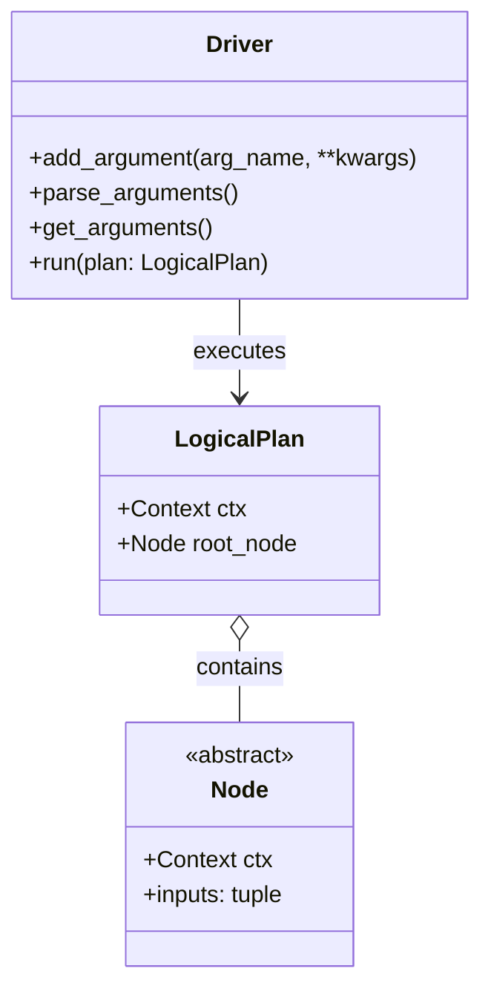
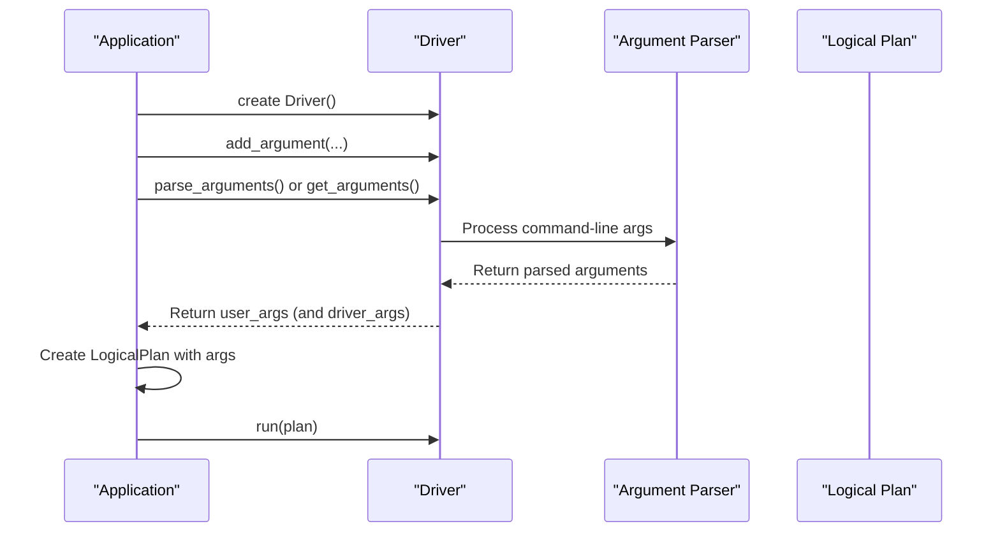
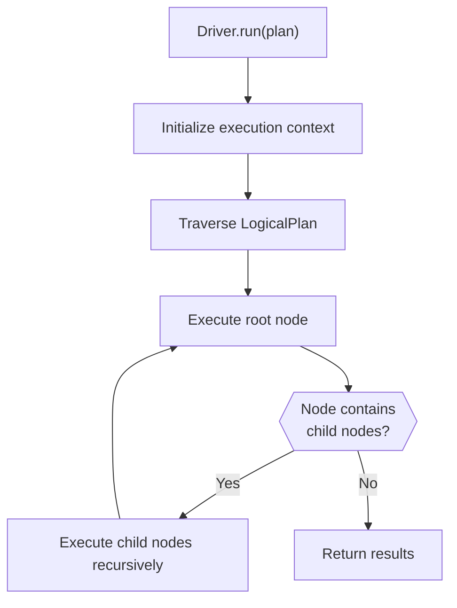
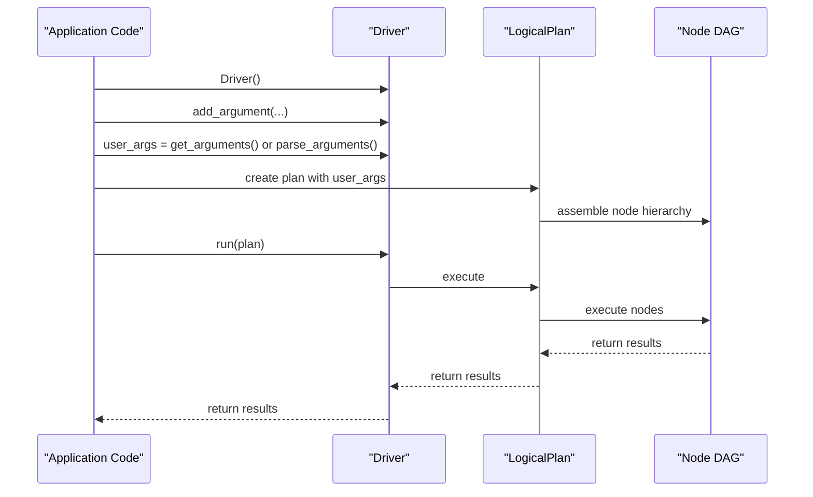
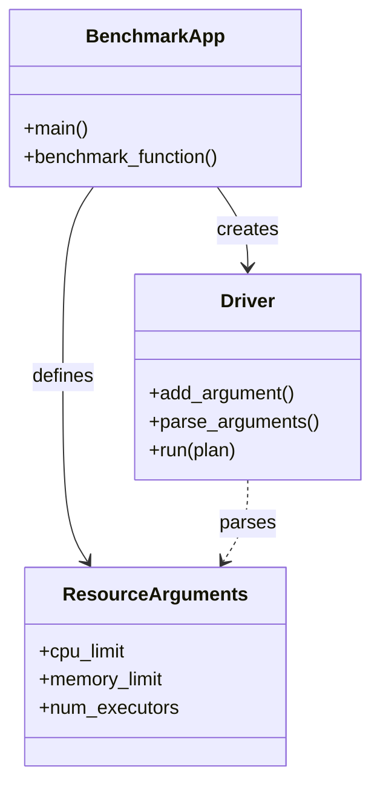
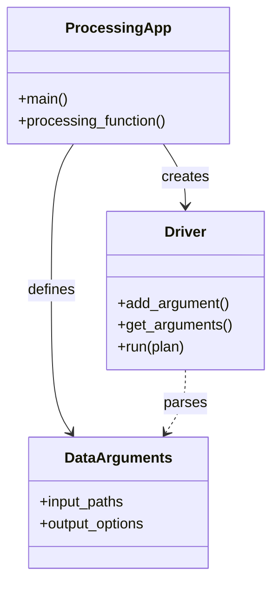

<!-- source: DeepWiki mcp.deepwiki.com · repo deepseek-ai/smallpond · page 3.3 Driver and Execution · fetched 2026-10-30 -->

# Driver and Execution

<details>
<summary>Relevant source files</summary>

The following files were used as context for generating this wiki page:

- [benchmarks/hash_partition_benchmark.py](benchmarks/hash_partition_benchmark.py)
- [examples/shuffle_data.py](examples/shuffle_data.py)
- [examples/shuffle_mock_urls.py](examples/shuffle_mock_urls.py)

</details>


This page documents the Driver component of the Smallpond framework and explains how it manages the execution of LogicalPlans. The Driver forms a critical bridge between the user interface (command-line arguments) and the actual execution of data processing operations defined in LogicalPlans.

For information about LogicalPlans and their structure, see [LogicalPlan Overview](#3.1). For details about the different types of nodes used in LogicalPlans, see [Node Types](#3.2).

## Driver Component Overview

The Driver component is responsible for:

1. Managing command-line arguments for Smallpond applications
2. Parsing user inputs and configuration settings
3. Executing LogicalPlans and managing their lifecycle
4. Providing a consistent interface for all Smallpond applications



Sources: [benchmarks/hash_partition_benchmark.py:69-87](), [examples/shuffle_data.py:62-70](), [examples/shuffle_mock_urls.py:57-65]()

## Argument Handling

The Driver provides an argparse-like interface to handle command-line arguments. This makes it easy to create standardized command-line applications with Smallpond.

### Adding Arguments

Arguments are added to the Driver instance using the `add_argument()` method, which mirrors Python's built-in argparse syntax:


Common argument patterns include:

| Argument Pattern | Example | Purpose |
|------------------|---------|---------|
| Positional arguments | `input_paths` | Required input values |
| Optional arguments | `-n, --npartitions` | Configuration settings with defaults |
| Flag arguments | `--partition_stats` | Boolean toggles for features |
| Type-specific arguments | `--cpu_limit` (int) | Values with type validation |

Sources: [benchmarks/hash_partition_benchmark.py:70-80](), [examples/shuffle_data.py:63-68](), [examples/shuffle_mock_urls.py:59-62]()

### Parsing Arguments

Once arguments are defined, they can be processed in two main ways:

1. `parse_arguments()` - Returns a tuple of user arguments and driver-specific arguments
2. `get_arguments()` - Returns just the user arguments, typically used with `**` unpacking



Sources: [benchmarks/hash_partition_benchmark.py:82-86](), [examples/shuffle_data.py:69](), [examples/shuffle_mock_urls.py:64]()

## Plan Execution

The core functionality of the Driver is to execute LogicalPlans. When the `run()` method is called with a LogicalPlan, the Driver manages the execution of the plan's node hierarchy.

### Execution Flow



The execution process follows these steps:

1. The application creates a LogicalPlan, assembling a DAG of Node objects
2. The application passes the plan to the Driver's `run()` method
3. The Driver traverses the plan, executing each node and managing dependencies
4. Results are collected and returned as appropriate

Sources: [benchmarks/hash_partition_benchmark.py:87](), [examples/shuffle_data.py:70](), [examples/shuffle_mock_urls.py:65]()

## Common Usage Patterns

The Driver component is typically used in a standard pattern across Smallpond applications:



This standardized pattern creates a consistent experience across different Smallpond applications, whether they are benchmarks or data processing tools.

Sources: [benchmarks/hash_partition_benchmark.py:67-91](), [examples/shuffle_data.py:61-74](), [examples/shuffle_mock_urls.py:57-69]()

## Driver Integration with Different Applications

The Driver component demonstrates flexibility in how it can be used with different types of Smallpond applications:

### Benchmark Applications

In benchmark applications, the Driver typically:
- Handles more complex argument sets related to resource allocation
- Often parses both user arguments and driver-specific arguments
- Manages execution of performance-focused LogicalPlans



Sources: [benchmarks/hash_partition_benchmark.py:15-91]()

### Data Processing Applications

For data transformation applications, the Driver:
- Usually has a simpler argument structure
- May use `get_arguments()` for direct unpacking into processing functions
- Focuses on data flow rather than performance metrics



Sources: [examples/shuffle_data.py:14-74](), [examples/shuffle_mock_urls.py:14-69]()

## Example Use Cases

### Basic Driver Usage

A typical pattern for using the Driver to execute a LogicalPlan:

1. Create a Driver instance
2. Define arguments
3. Parse arguments
4. Create a LogicalPlan using the arguments
5. Execute the plan using Driver.run()

### Resource Configuration

The Driver can be used to configure resource constraints for plan execution:

```
driver.add_argument("-C", "--cpu_limit", type=int, default=HashPartitionNode.default_cpu_limit)
driver.add_argument("-M", "--memory_limit", type=int, default=HashPartitionNode.default_memory_limit)
```

These resource constraints can then be passed to specific nodes in the LogicalPlan.

Sources: [benchmarks/hash_partition_benchmark.py:77-78]()

## Summary

The Driver component serves as the central execution manager for Smallpond applications. It provides:

1. A standardized interface for handling command-line arguments
2. Execution management for LogicalPlans
3. Resource configuration for performance optimization
4. A consistent application structure across different use cases

By bridging user input and plan execution, the Driver creates a uniform experience for Smallpond users while enabling flexible configuration of complex data processing operations.

---

