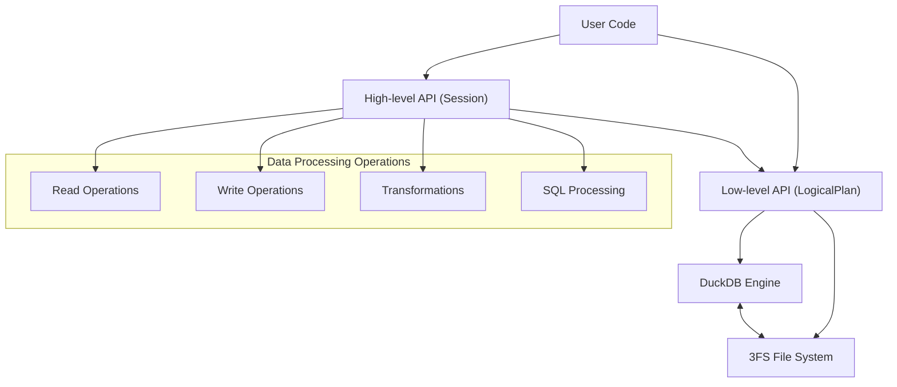
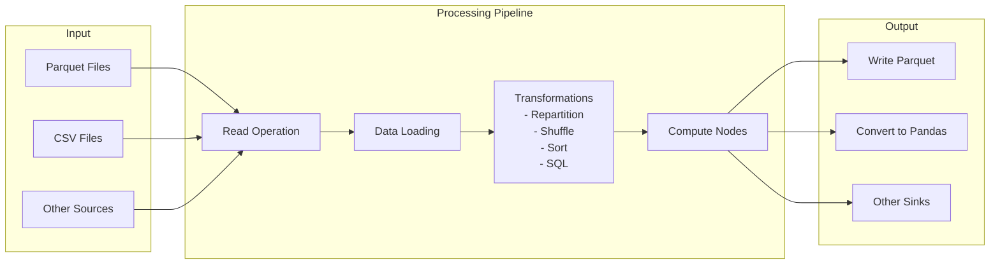
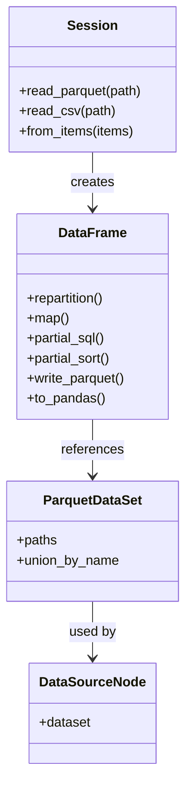
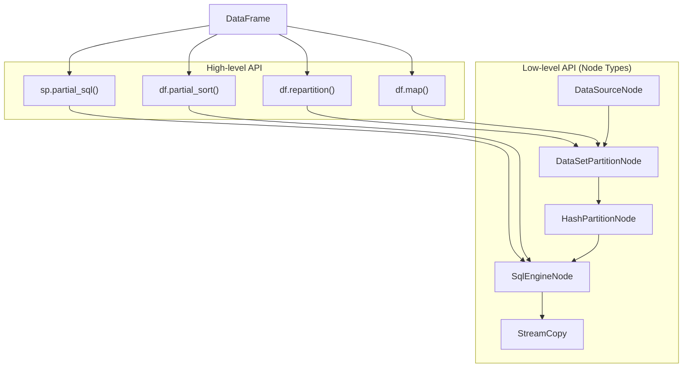
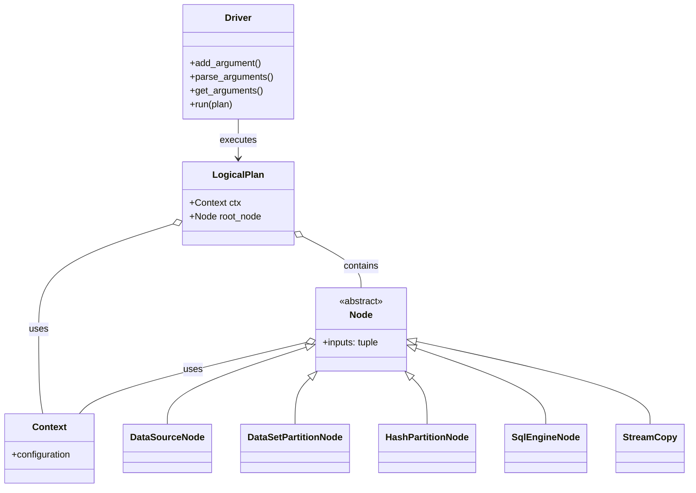
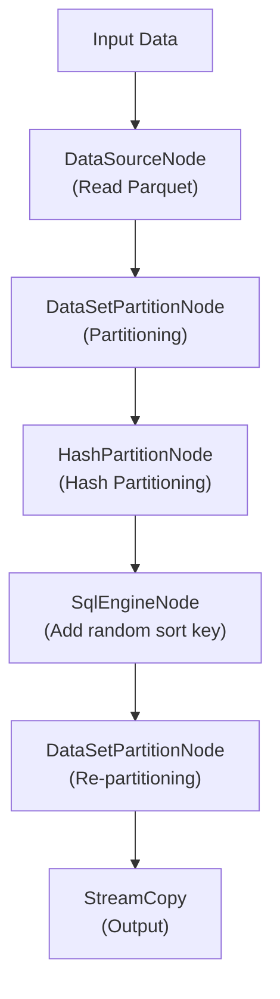
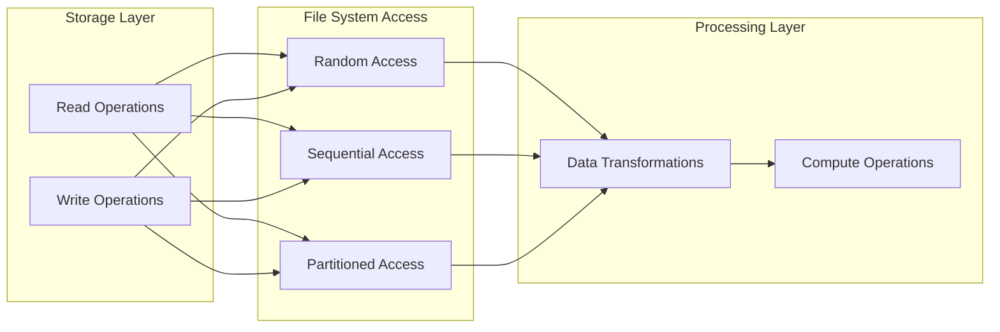

<!-- source: DeepWiki mcp.deepwiki.com · repo deepseek-ai/smallpond · page 4 Data Processing · fetched 2026-10-30 -->

# Data Processing

<details>
<summary>Relevant source files</summary>

The following files were used as context for generating this wiki page:

- [README.md](README.md)
- [examples/fstest.py](examples/fstest.py)
- [examples/shuffle_data.py](examples/shuffle_data.py)

</details>


This document provides an overview of data processing capabilities in the smallpond framework. It covers the fundamental architecture and mechanisms through which smallpond processes data at scale, including the various transformation operations available and how they're implemented within the system. For specific details about individual operations, see [Reading and Writing Data](#4.1), [Partitioning and Shuffling](#4.2), and [Sorting](#4.3).

## Data Processing Architecture

Smallpond provides a layered architecture for data processing, allowing operations at different levels of abstraction. At its core, smallpond leverages DuckDB for query processing and 3FS as its distributed file system for storage.



Sources: [README.md:31-48]()

Data processing in smallpond follows a structured flow from input to output, with transformations applied through a chain of operations:



Sources: [README.md:31-48](), [examples/shuffle_data.py:14-58]()

## Data Processing Operations

Smallpond supports various data processing operations, implemented through both high-level API calls and the underlying logical plan system.

### Data Reading and Loading

Smallpond can read from various sources, with built-in support for Parquet and CSV files. The reading process creates DataFrame objects that can then be processed further.



Sources: [README.md:31-48](), [examples/shuffle_data.py:22-24]()

### Data Transformation

Transformations in smallpond allow for manipulation and processing of data. Key transformation operations include:

1. **Repartitioning**: Redistributing data across partitions for parallel processing
2. **Mapping**: Applying functions to transform data
3. **SQL Processing**: Executing SQL queries on data
4. **Shuffling**: Randomizing data distribution
5. **Sorting**: Ordering data according to specified keys



Sources: [examples/shuffle_data.py:14-58]()

## API Approaches for Data Processing

Smallpond provides two primary approaches to data processing:

### High-level Session API

The Session API offers a more user-friendly, DataFrame-oriented approach, similar to pandas or Spark:

```python
# Initialize session
sp = smallpond.init()

# Load data
df = sp.read_parquet("prices.parquet")

# Process data
df = df.repartition(3, hash_by="ticker")
df = sp.partial_sql("SELECT ticker, min(price), max(price) FROM {0} GROUP BY ticker", df)

# Save results
df.write_parquet("output/")
```

This approach abstracts away the complexities of logical plan construction.

Sources: [README.md:31-48]()

### Low-level Logical Plan API

The Logical Plan API provides more fine-grained control over execution, allowing for complex processing pipelines:



The Logical Plan API involves creating a directed acyclic graph (DAG) of operation nodes and executing them through a Driver:

Sources: [examples/shuffle_data.py:14-58]()

## Example: Data Shuffling Implementation

One illustrative example of data processing in smallpond is data shuffling, which demonstrates both the high-level and low-level approaches:



This logical plan demonstrates a complete data shuffling workflow:
1. Read data from Parquet files
2. Partition the data
3. Hash partition the data with optional random shuffling
4. Apply SQL to add a random sort key
5. Re-partition the data for output
6. Copy the final data to the destination

Sources: [examples/shuffle_data.py:14-58]()

## File System Integration

Data processing in smallpond is closely integrated with the file system (typically 3FS). The framework provides mechanisms for efficient file operations:



The example from `fstest.py` demonstrates testing file system operations, which are fundamental to data processing performance:

1. Writing data in blocks to the file system
2. Reading data back with verification
3. Optional random access testing
4. Parallel processing across multiple partitions

Sources: [examples/fstest.py:131-166]()

## Performance Considerations

Smallpond is designed for high-performance data processing at scale. Key performance features include:

1. **Partitioning**: Distributes processing across multiple workers
2. **DuckDB Integration**: Leverages DuckDB's efficient query execution engine
3. **3FS File System**: Uses a distributed file system optimized for data processing
4. **Resource Control**: Allows specification of CPU and memory limits for operations

The framework has been evaluated using the GraySort benchmark, demonstrating its capability to sort over 110 TiB of data with high throughput.

Sources: [README.md:56-60]()

## Summary

Data processing in smallpond provides a flexible, scalable approach to handling large-scale data operations. Through its layered architecture, it offers both high-level abstractions for ease of use and low-level controls for advanced scenarios. The integration with DuckDB and 3FS enables efficient execution of data transformations, while the logical plan system allows for complex processing pipelines.

For detailed information about specific data processing operations, refer to the dedicated pages on [Reading and Writing Data](#4.1), [Partitioning and Shuffling](#4.2), and [Sorting](#4.3).

---

