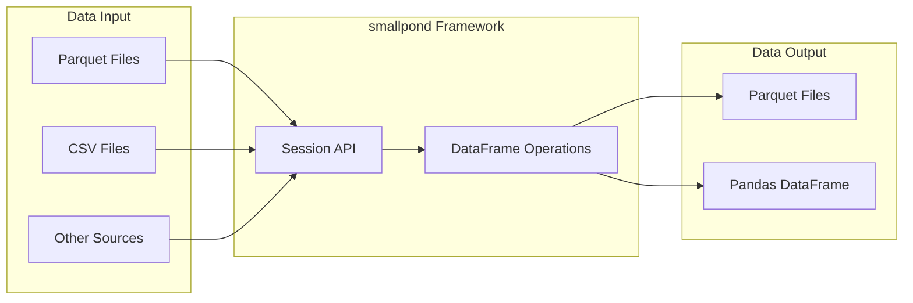
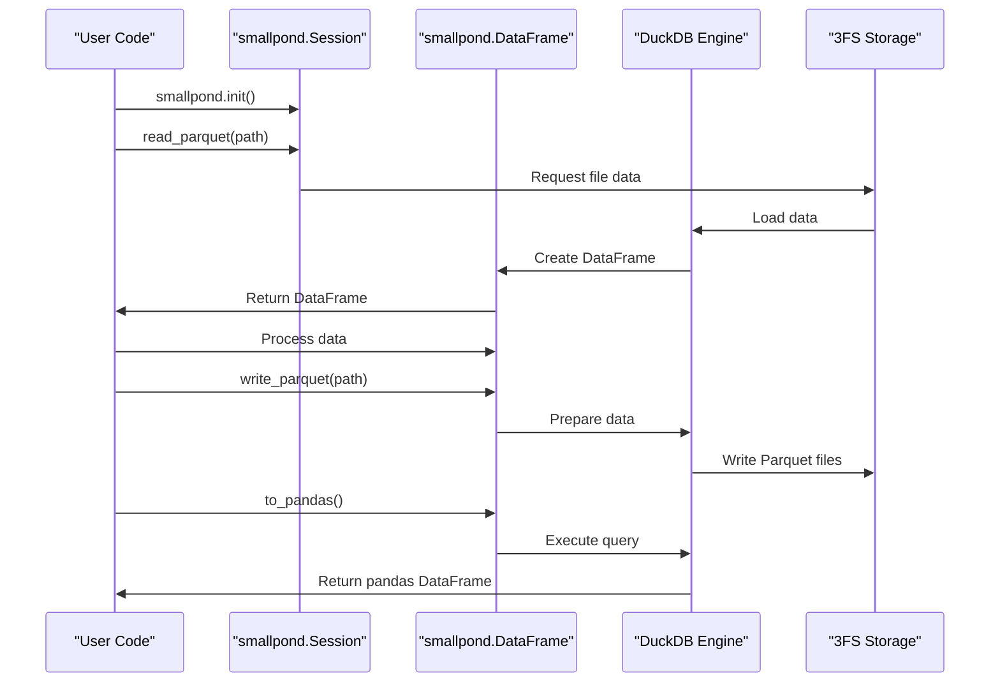
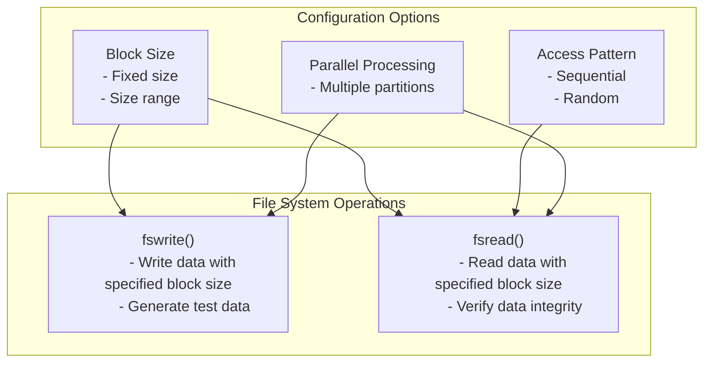

<!-- source: DeepWiki mcp.deepwiki.com · repo deepseek-ai/smallpond · page 4.1 Reading and Writing Data · fetched 2026-10-30 -->

# Reading and Writing Data

<details>
<summary>Relevant source files</summary>

The following files were used as context for generating this wiki page:

- [README.md](README.md)
- [examples/fstest.py](examples/fstest.py)

</details>


This page documents the data input and output capabilities of the smallpond framework. It covers how to read data from various sources and formats into smallpond DataFrames, as well as how to write processed data back to storage. For information about transforming data after it's loaded, see [DataFrame Operations](#2.2) and [Partitioning and Shuffling](#4.2).

## Overview of Data I/O in smallpond

smallpond provides a high-level API for reading and writing data through the Session object. These operations are built on the underlying capabilities of DuckDB and the 3FS distributed file system, allowing for efficient handling of large datasets.



Sources: [README.md:32-45]()

## Reading Data

Reading data into smallpond begins with creating a session using `smallpond.init()`, which returns a Session object that provides access to the data reading methods.

### Supported Read Methods

smallpond provides the following primary methods for reading data:

| Method | Description | Format |
|--------|-------------|--------|
| `read_parquet()` | Reads data from Parquet files | Parquet |
| `read_csv()` | Reads data from CSV files | CSV |
| `from_items()` | Creates a DataFrame from Python objects | Python collection |

### Reading Parquet Files

Parquet is a columnar storage format that offers efficient compression and encoding schemes. It's the recommended format for use with smallpond due to its performance characteristics.

```python
import smallpond

# Initialize session
sp = smallpond.init()

# Read from a single Parquet file
df = sp.read_parquet("path/to/file.parquet")

# Read from a directory of Parquet files
df = sp.read_parquet("path/to/directory/")
```

When reading from a directory, smallpond will read all Parquet files in that directory as a single logical dataset.

Sources: [README.md:32-38]()

### Reading CSV Files

For tabular data in text format, smallpond provides the `read_csv()` method:

```python
# Read from a CSV file
df = sp.read_csv("path/to/file.csv")
```

### Creating DataFrames from Python Objects

For creating DataFrames from in-memory data, smallpond provides the `from_items()` method, which accepts a list of dictionaries:

```python
# Create a DataFrame from Python objects
items = [
    {"id": 1, "name": "Item 1"},
    {"id": 2, "name": "Item 2"},
    {"id": 3, "name": "Item 3"}
]
df = sp.from_items(items)
```

This is particularly useful for creating small test datasets or combining with other data sources.

Sources: [examples/fstest.py:156-157](), [examples/fstest.py:162-164]()

## Writing Data

After processing data, smallpond provides methods to write the results back to storage or convert them to other formats.

### Writing to Parquet Files

The most efficient way to save data in smallpond is to write to Parquet format:

```python
# Write to a directory of Parquet files
df.write_parquet("output/")
```

This will create a directory containing one or more Parquet files, depending on the DataFrame's partitioning.

Sources: [README.md:44-45]()

### Converting to Pandas

For further analysis in Python, you can convert a smallpond DataFrame to a pandas DataFrame:

```python
# Convert to pandas DataFrame
pandas_df = df.to_pandas()
```

This is useful when you need to use pandas functionality or visualize results, but note that this loads all data into memory, so it should be used carefully with large datasets.

Sources: [README.md:46-47]()

## Data Flow Architecture

The following diagram illustrates how data flows through the smallpond system when reading and writing data:



Sources: [README.md:32-47]()

## Working with Partitioned Data

smallpond has built-in support for partitioned datasets, allowing efficient operations on large datasets.

### Reading Partitioned Data

When reading from a directory containing multiple files, smallpond will read them as a partitioned dataset:

```python
# Read from a directory containing multiple Parquet files
df = sp.read_parquet("path/to/partitioned/data/")
```

### Writing Partitioned Data

When writing a DataFrame that has been partitioned (using `repartition()` or other operations), each partition will be written as a separate file:

```python
# Partition data and write
df = df.repartition(3, hash_by="column_name")
df.write_parquet("output/")  # Creates 3 files in output/
```

This produces a directory with multiple Parquet files, one per partition.

Sources: [README.md:41-45]()

## File System Operations

For more advanced file system operations, smallpond provides utilities to test and verify data integrity when reading and writing files.



The `fstest.py` example demonstrates more advanced file system operations, including:

1. Writing data with controlled block sizes
2. Reading data with verification
3. Random vs. sequential access patterns
4. Parallel reading and writing using multiple partitions

This is particularly useful for testing storage performance and verifying data integrity in distributed environments.

Sources: [examples/fstest.py:21-67](), [examples/fstest.py:131-166]()

## Performance Considerations

When reading and writing data with smallpond, consider the following factors for optimal performance:

1. **Format Selection**: Parquet generally provides better performance than text formats like CSV due to its columnar nature and compression.

2. **Partitioning**: Using appropriate partitioning can significantly improve read and write performance, especially for large datasets.

3. **Block Size**: For low-level operations, selecting an appropriate block size can impact I/O performance.

4. **Memory Usage**: When using `to_pandas()`, be aware that all data will be loaded into memory, which may be problematic for large datasets.

Sources: [examples/fstest.py:131-166](), [README.md:41-47]()

## Example: Complete Data Processing Pipeline

Here's an example of a complete data processing pipeline that includes reading, processing, and writing data:

```python
import smallpond

# Initialize session
sp = smallpond.init()

# Read data
df = sp.read_parquet("input.parquet")

# Process data
df = df.repartition(3, hash_by="ticker")
df = sp.partial_sql("SELECT ticker, min(price), max(price) FROM {0} GROUP BY ticker", df)

# Write results
df.write_parquet("output/")

# View results
print(df.to_pandas())
```

This example demonstrates the typical workflow: initialize a session, read data, process it using DataFrame operations and SQL, write the results, and optionally convert to pandas for analysis.

Sources: [README.md:32-47]()

---

