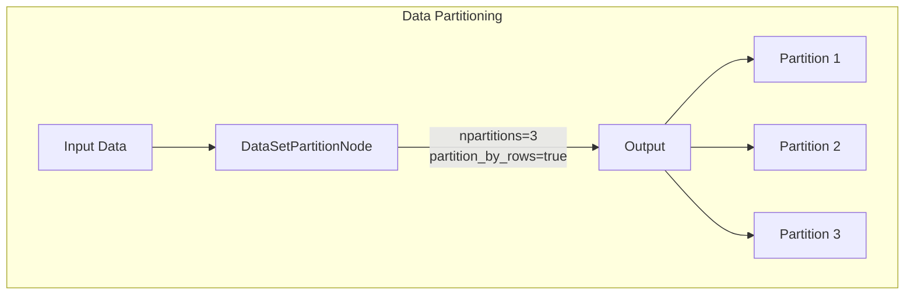
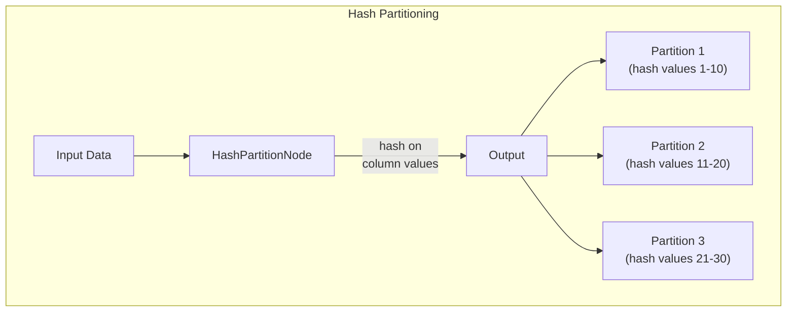
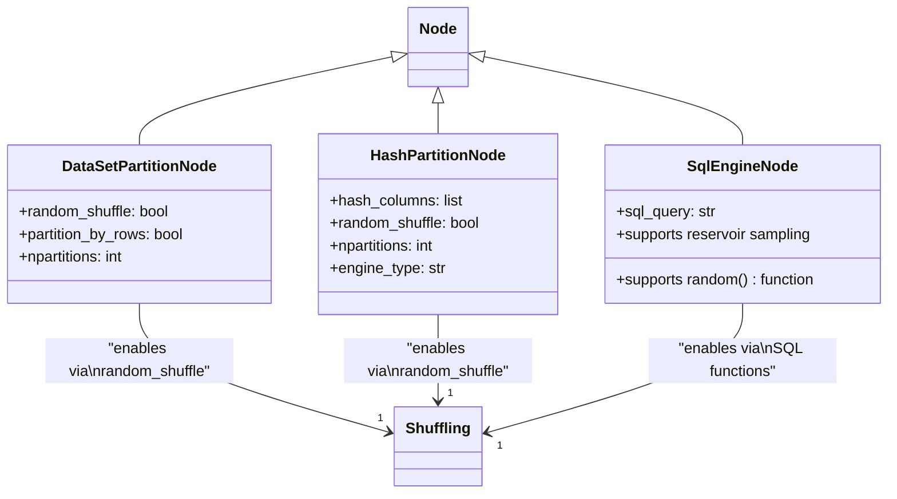
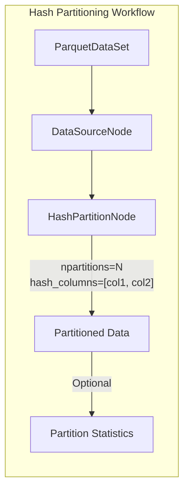
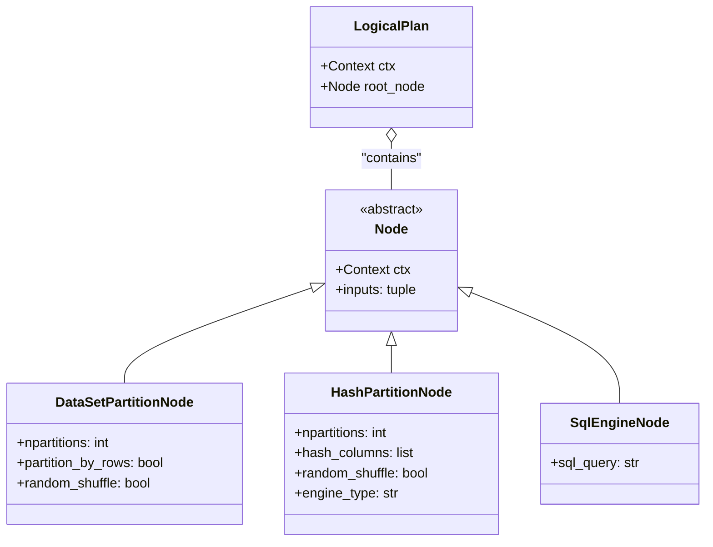

<!-- source: DeepWiki mcp.deepwiki.com · repo deepseek-ai/smallpond · page 4.2 Partitioning and Shuffling · fetched 2026-10-30 -->

# Partitioning and Shuffling

<details>
<summary>Relevant source files</summary>

The following files were used as context for generating this wiki page:

- [benchmarks/hash_partition_benchmark.py](benchmarks/hash_partition_benchmark.py)
- [examples/shuffle_data.py](examples/shuffle_data.py)
- [examples/shuffle_mock_urls.py](examples/shuffle_mock_urls.py)

</details>


This document provides a detailed explanation of the partitioning and shuffling capabilities in Smallpond. These operations are essential for distributed data processing, enabling efficient data distribution across multiple compute nodes and randomization of data for various processing needs. For information about sorting operations, see [Sorting](#4.3).

## Purpose and Scope

Partitioning and shuffling in Smallpond serve several critical purposes:

1. Distributing data evenly across compute resources
2. Implementing divide-and-conquer strategies for large-scale data processing
3. Supporting distributed join and aggregation operations
4. Randomizing data for statistical sampling and benchmarking
5. Enabling efficient parallel processing

The Smallpond framework provides specialized node types in its logical plan system to handle these operations, primarily through `DataSetPartitionNode`, `HashPartitionNode`, and related SQL operations.

## Partitioning Strategies

Smallpond offers two primary partitioning strategies that serve different use cases.

### Data Partitioning

Data partitioning divides data into roughly equal-sized chunks, either by rows or file boundaries. This approach is useful when you need to split data evenly without concern for specific data values.



Sources: [examples/shuffle_data.py:24-31](), [examples/shuffle_mock_urls.py:17-18]()

Key parameters for `DataSetPartitionNode`:
- `npartitions`: Number of partitions to create
- `partition_by_rows`: When true, attempts to create partitions with equal row counts
- `random_shuffle`: When true, randomly shuffles data during partitioning

### Hash Partitioning

Hash partitioning distributes data based on hash values of specified columns. This ensures that records with the same values for the hash columns are grouped into the same partition, which is essential for operations like distributed joins and aggregations.



Sources: [benchmarks/hash_partition_benchmark.py:31-43](), [examples/shuffle_data.py:35-42]()

Key parameters for `HashPartitionNode`:
- `npartitions`: Number of partitions to create
- `hash_columns`: Columns to use for hash calculation (if None, random shuffling is performed)
- `random_shuffle`: When true, randomly distributes data regardless of hash values
- `engine_type`: Processing engine to use ("duckdb" or "arrow")
- `use_parquet_writer`: Whether to use native Parquet writer
- `hive_partitioning`: Whether to use Hive-style partitioning in output
- `cpu_limit` and `memory_limit`: Resource limits for the operation

## Shuffling Techniques

Shuffling refers to randomizing the order of data records. Smallpond provides several techniques for data shuffling.

### System Architecture for Shuffling



Sources: [examples/shuffle_data.py:4-11](), [examples/shuffle_mock_urls.py:4-11]()

### Randomization during Partitioning

Both `DataSetPartitionNode` and `HashPartitionNode` support randomization through the `random_shuffle` parameter:

- In `DataSetPartitionNode`, setting `random_shuffle=True` randomizes rows while partitioning
- In `HashPartitionNode`, setting `random_shuffle=True` overrides the hash column assignment and randomly distributes rows

Sources: [examples/shuffle_data.py:30-31](), [examples/shuffle_data.py:40-41]()

### SQL-based Shuffling

Smallpond leverages SQL capabilities for more complex shuffling operations:

1. **Random Sort Key Method**: Adds a random value to each row and sorts by this value
   ```sql
   select *, cast(random() * 2147483647 as integer) as sort_key from {0} order by sort_key
   ```

2. **Partition Key Method**: Adds a random value as a partition key
   ```sql
   select *, random() as partition_key from {0} order by partition_key
   ```

3. **Reservoir Sampling**: Uses DuckDB's reservoir sampling capability
   ```sql
   select * from {0} using sample 100% (reservoir, {rand_seed})
   ```

Sources: [examples/shuffle_data.py:43-48](), [examples/shuffle_mock_urls.py:32-51]()

## Workflow Examples

### Basic Hash Partitioning

The following diagram illustrates a basic hash partitioning workflow:



Sources: [benchmarks/hash_partition_benchmark.py:15-65]()

### Complex Data Shuffling

For more complex shuffling needs, Smallpond combines multiple techniques:

```mermaid
flowchart TB
    subgraph "Complex Shuffling Workflow"
        dataset["ParquetDataSet"] --> DataSourceNode
        DataSourceNode --> DataSetPartitionNode
        DataSetPartitionNode --> |"Initial partitioning"| initial["Initial Partitions"]
        initial --> |"If not skipped"| HashPartitionNode
        initial --> |"If skip_hash_partition=True"| skip["Skip Hash Partitioning"]
        HashPartitionNode --> |"random_shuffle=True"| shuffled["Hash-Shuffled Data"]
        skip --> sqlNodeRand["SqlEngineNode (Random Sort)"]
        shuffled --> sqlNodeRand
        sqlNodeRand --> |"Add random sort key"| sorted["Sorted by Random Key"]
        sorted --> repart["DataSetPartitionNode"]
        repart --> |"Final partitioning"| StreamCopy
        StreamCopy --> output["Final Shuffled Output"]
    end
```



Sources: [examples/shuffle_data.py:14-58]()

## Performance Considerations

Partitioning and shuffling operations in Smallpond can be resource-intensive. The framework provides several configuration options to optimize performance:

| Parameter | Description | Example Values |
|-----------|-------------|---------------|
| `cpu_limit` | Number of CPU cores to use | 1, 16, or `HashPartitionNode.default_cpu_limit` |
| `memory_limit` | Memory allocation in bytes | `10 * GB`, `40 * GB`, or `HashPartitionNode.default_memory_limit` |
| `engine_type` | Processing engine | "duckdb" or "arrow" |
| `npartitions` | Number of partitions | Often set based on available CPU cores |
| `use_parquet_writer` | Use optimized Parquet writer | `True` or `False` |

For hash partitioning benchmarks, the system can provide statistical information about the distribution of data across partitions, which is useful for evaluating partitioning quality:

```sql
select partition_keys, count(*) as row_cnt, count(distinct({hash_columns})) as uniq_key_cnt 
from {0} group by partition_keys
```

Sources: [benchmarks/hash_partition_benchmark.py:45-55](), [benchmarks/hash_partition_benchmark.py:76-80]()

## Integration with Logical Plan System

Partitioning and shuffling operations are integrated into Smallpond's Logical Plan system, allowing them to be combined with other data processing operations in complex workflows.



Sources: [benchmarks/hash_partition_benchmark.py:5-12](), [examples/shuffle_data.py:4-11](), [examples/shuffle_mock_urls.py:4-11]()

## Usage Examples

### Hash Partitioning Benchmark

The hash partitioning benchmark demonstrates how to partition data based on specific columns and optionally analyze the resulting distribution:

```python
# Create hash partitioning plan
partitioned_datasets = HashPartitionNode(
    ctx,
    (data_files,),
    npartitions=npartitions,
    hash_columns=hash_columns,
    data_partition_column="partition_keys",
    engine_type=engine_type,
    use_parquet_writer=use_parquet_writer,
    hive_partitioning=hive_partitioning,
    output_name="partitioned_datasets",
    cpu_limit=cpu_limit,
    memory_limit=memory_limit,
)
```

Sources: [benchmarks/hash_partition_benchmark.py:31-43]()

### Data Shuffling

For applications requiring thoroughly randomized data:

```python
# Combine partitioning and SQL-based shuffling
shuffled_urls = SqlEngineNode(
    ctx,
    (urls_partitions,),
    r"select *, cast(random() * 2147483647 as integer) as sort_key from {0} order by sort_key",
    cpu_limit=16,
)
```

Sources: [examples/shuffle_data.py:43-48]()

## Summary

Smallpond provides flexible and powerful partitioning and shuffling capabilities through its logical plan system. The `DataSetPartitionNode` and `HashPartitionNode` types support different partitioning strategies, while SQL operations and random shuffling parameters enable various data randomization techniques. These capabilities enable efficient distributed data processing and support a wide range of data manipulation needs.

By combining these operations in logical plans, users can create complex data processing workflows that efficiently distribute and randomize data across compute resources.

---

