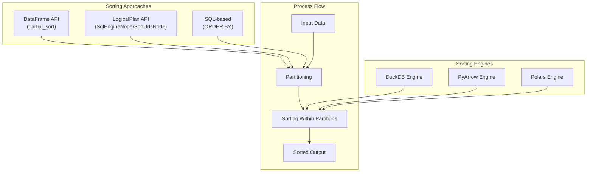
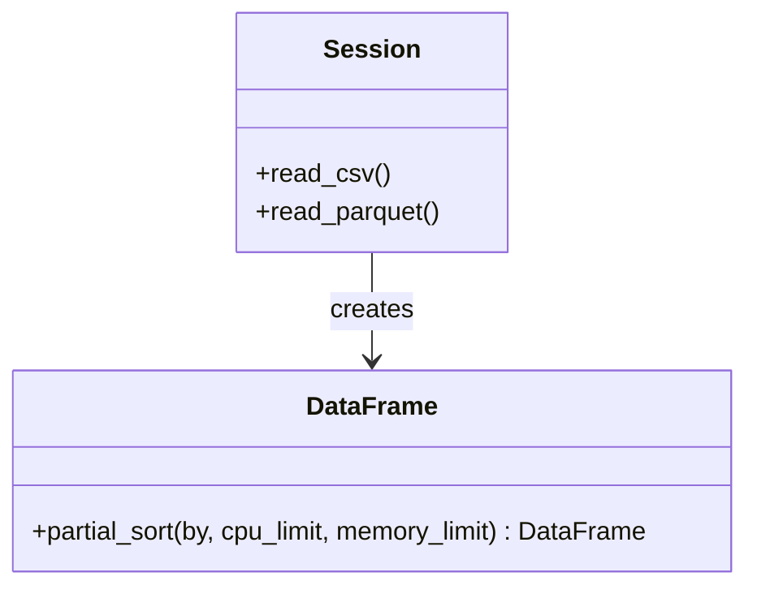
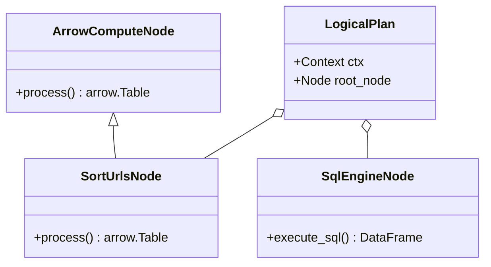
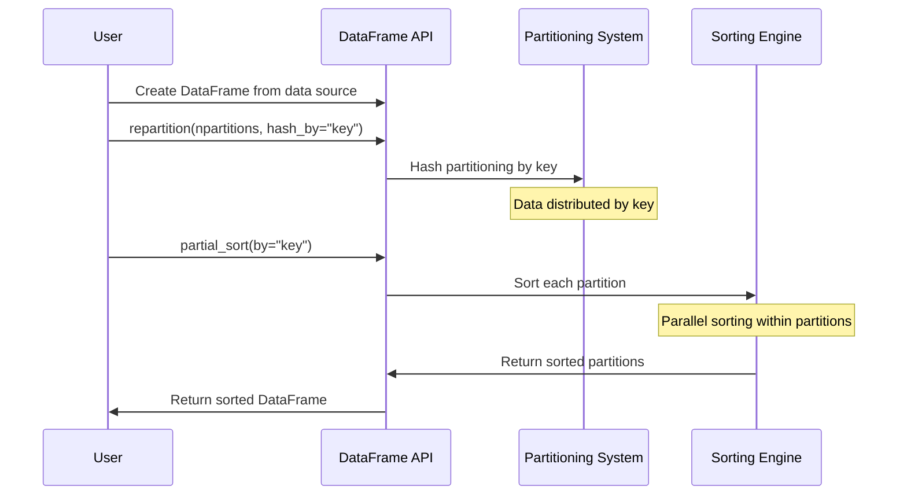
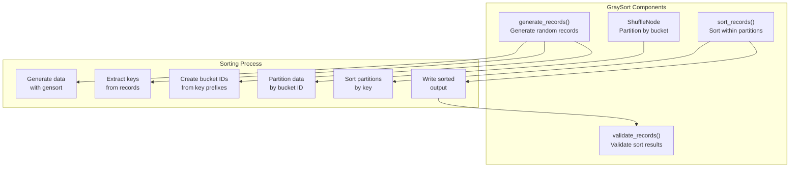
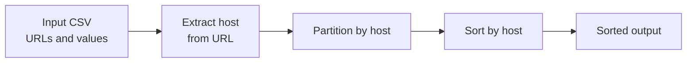

<!-- source: DeepWiki mcp.deepwiki.com · repo deepseek-ai/smallpond · page 4.3 Sorting · fetched 2026-10-30 -->

# Sorting

<details>
<summary>Relevant source files</summary>

The following files were used as context for generating this wiki page:

- [benchmarks/gray_sort_benchmark.py](benchmarks/gray_sort_benchmark.py)
- [benchmarks/urls_sort_benchmark.py](benchmarks/urls_sort_benchmark.py)
- [examples/sort_mock_urls.py](examples/sort_mock_urls.py)
- [examples/sort_mock_urls_v2.py](examples/sort_mock_urls_v2.py)

</details>


This page documents the sorting capabilities of the smallpond framework. Sorting is a fundamental data processing operation that allows users to order datasets based on one or more columns. Smallpond provides multiple approaches and engines for efficient sorting of large datasets, with particular emphasis on distributed sorting through partitioning.

For information about partitioning operations that are often used together with sorting, see [Partitioning and Shuffling](#4.2).

## Overview of Sorting in Smallpond

Smallpond offers flexible sorting capabilities that can be accessed through different API layers, with support for multiple sorting engines and resource configuration options. The framework is designed to handle large-scale sorting operations by leveraging partitioning strategies to distribute the workload.



Sources: [benchmarks/gray_sort_benchmark.py](), [benchmarks/urls_sort_benchmark.py](), [examples/sort_mock_urls.py](), [examples/sort_mock_urls_v2.py]()

## Sorting APIs

Smallpond provides two primary approaches for sorting data: a high-level DataFrame API and a lower-level LogicalPlan API.

### DataFrame API

The DataFrame API offers a simple and intuitive way to sort data using the `partial_sort` method:



The `partial_sort` method sorts data within each partition based on the specified column(s). This approach is most suitable for cases where data is already correctly partitioned by the sort key(s).

Key parameters:
- `by`: Column name(s) to sort by
- `cpu_limit`: Maximum CPU cores to use
- `memory_limit`: Maximum memory to use

Usage example:
```python
# Sort URLs by host within each partition
sorted_urls = urls.partial_sort(by=["host"])
```

Sources: [examples/sort_mock_urls_v2.py:18-18](), [benchmarks/urls_sort_benchmark.py:84-84]()

### LogicalPlan API

The LogicalPlan API provides more explicit control over the sorting process through specialized nodes:



There are two main approaches for sorting with the LogicalPlan API:

1. **SQL-based sorting**: Using `SqlEngineNode` with an ORDER BY clause
   ```python
   sorted_urls = SqlEngineNode(
       ctx,
       (urls_partitions,),
       r"select * from {0} order by host",
       output_name="sorted_urls",
   )
   ```

2. **Arrow-based sorting**: Using a custom node like `SortUrlsNode` that extends `ArrowComputeNode`
   ```python
   class SortUrlsNode(ArrowComputeNode):
       def process(self, runtime_ctx: RuntimeContext, input_tables: List[arrow.Table]) -> arrow.Table:
           return input_tables[0].sort_by("host")
   ```

Sources: [examples/sort_mock_urls.py:22-25](), [examples/sort_mock_urls.py:62-67](), [examples/sort_mock_urls.py:69-74]()

## Sorting Engines

Smallpond supports multiple sorting engines, each with different characteristics and performance profiles:

| Engine  | API                   | Strengths                                       | Usage Context                     |
|---------|------------------------|------------------------------------------------|-----------------------------------|
| DuckDB  | SQL (ORDER BY)         | SQL expressiveness, performance, memory efficiency | Default engine for most operations |
| Arrow   | PyArrow Table sort_by() | Integration with Arrow ecosystem               | Arrow-native workflows             |
| Polars  | Polars DataFrame sort() | Performance for specific workloads             | Alternative engine for benchmarks  |

These engines can be selected through configuration parameters:

```python
# In gray_sort_benchmark
sort_records(runtime_ctx, input_datasets, output_path, sort_engine="polars")
```

Sources: [benchmarks/gray_sort_benchmark.py:95-151](), [benchmarks/urls_sort_benchmark.py:57-65]()

## Distributed Sorting Pattern

Smallpond implements a distributed sorting pattern that combines partitioning and sorting to efficiently process large datasets:



This pattern follows these steps:

1. **Data Loading**: Load data from source (CSV, Parquet, etc.)
2. **Partitioning**: Partition data using hash-based partitioning on the sort key
   - Ensures that all records with the same key go to the same partition
3. **Sorting**: Sort each partition independently 
   - Enables parallel processing across partitions
4. **Result Handling**: Write sorted data or process further

Sources: [examples/sort_mock_urls_v2.py:8-19](), [benchmarks/urls_sort_benchmark.py:71-85]()

## GraySort Implementation

Smallpond includes a GraySort benchmark implementation that demonstrates large-scale sorting capabilities. GraySort is a standard benchmark for evaluating sorting performance on large datasets.



The GraySort implementation showcases a comprehensive sorting workflow:

1. **Data Generation**: Creates random records with `generate_records()`
2. **Partitioning**: Uses `ShuffleNode` to partition records by bucket ID
3. **Sorting**: Sorts records within each partition using the chosen engine (DuckDB, Arrow, or Polars)
4. **Validation**: Optionally validates sorted results with `valsort`

The `sort_records()` function handles the actual sorting operation and supports multiple engines:

```python
def sort_records(runtime_ctx, input_datasets, output_path, sort_engine="polars", write_io_nbytes=500*MB):
    # Sort using the specified engine (polars, arrow, or duckdb)
    # Write sorted output to a file
```

Sources: [benchmarks/gray_sort_benchmark.py:95-151](), [benchmarks/gray_sort_benchmark.py:235-311]()

## Performance Considerations

When using sorting operations in smallpond, several parameters can be tuned to optimize performance:

| Parameter | Description | Impact |
|-----------|-------------|--------|
| `num_sort_partitions` | Number of partitions for sorting | More partitions increase parallelism but add overhead |
| `sort_cpu_limit` | Maximum CPU cores for sorting tasks | Controls CPU resource allocation |
| `sort_memory_limit` | Maximum memory for sorting tasks | Prevents out-of-memory errors |
| `sort_engine` | Sorting engine to use | Different engines have different performance characteristics |
| `parquet_row_group_size` | Size of Parquet row groups | Affects I/O performance |
| `parquet_compression` | Compression algorithm for output | Trades CPU usage for storage space |

Example of configuring these parameters:

```python
sorted_urls = urls_partitions.partial_sort(
    by="urlstr", 
    cpu_limit=sort_cpu_limit, 
    memory_limit=sort_memory_limit
)
```

Sources: [benchmarks/urls_sort_benchmark.py:57-65](), [benchmarks/gray_sort_benchmark.py:290-297]()

## Examples

### URL Sorting Example

The URL sorting example demonstrates sorting a dataset of URLs by their host names:



This example is implemented in two ways:

1. **Using LogicalPlan API** (`sort_mock_urls.py`):
   ```python
   urls_partitions = HashPartitionNode(ctx, (imported_urls,), npartitions=npartitions, hash_columns=["host"])
   sorted_urls = SqlEngineNode(ctx, (urls_partitions,), r"select * from {0} order by host")
   ```

2. **Using DataFrame API** (`sort_mock_urls_v2.py`):
   ```python
   urls = urls.repartition(npartitions, hash_by="host")
   sorted_urls = urls.partial_sort(by=["host"])
   ```

Sources: [examples/sort_mock_urls.py:28-86](), [examples/sort_mock_urls_v2.py:8-19]()

### URL Sort Benchmark

The URL sort benchmark provides a more comprehensive example for performance testing:

```python
# Using LogicalPlan API
urls_partitions = HashPartitionNode(ctx, (imported_urls,), npartitions=num_hash_partitions, hash_columns=["urlstr"])
sorted_urls = SqlEngineNode(ctx, (urls_partitions,), r"select * from {0} order by urlstr")

# Using DataFrame API
urls_partitions = data_partitions.repartition(num_hash_partitions, hash_by="urlstr", engine_type=engine_type)
sorted_urls = urls_partitions.partial_sort(by="urlstr", cpu_limit=sort_cpu_limit, memory_limit=sort_memory_limit)
```

This benchmark shows how to scale sorting operations by configuring the number of partitions based on system resources:

```python
user_args.num_data_partitions = user_args.num_data_partitions or num_nodes * cpus_per_node * partition_rounds
user_args.num_hash_partitions = user_args.num_hash_partitions or num_nodes * cpus_per_node
```

Sources: [benchmarks/urls_sort_benchmark.py:17-68](), [benchmarks/urls_sort_benchmark.py:71-85](), [benchmarks/urls_sort_benchmark.py:98-102]()

## Conclusion

Smallpond provides robust sorting capabilities through multiple APIs and engines, with support for distributed sorting through partitioning. The framework is designed to handle large-scale sorting operations efficiently by leveraging parallelism and resource management. Whether using the high-level DataFrame API or the more explicit LogicalPlan API, users can implement sophisticated sorting workflows adapted to their specific needs.

---

