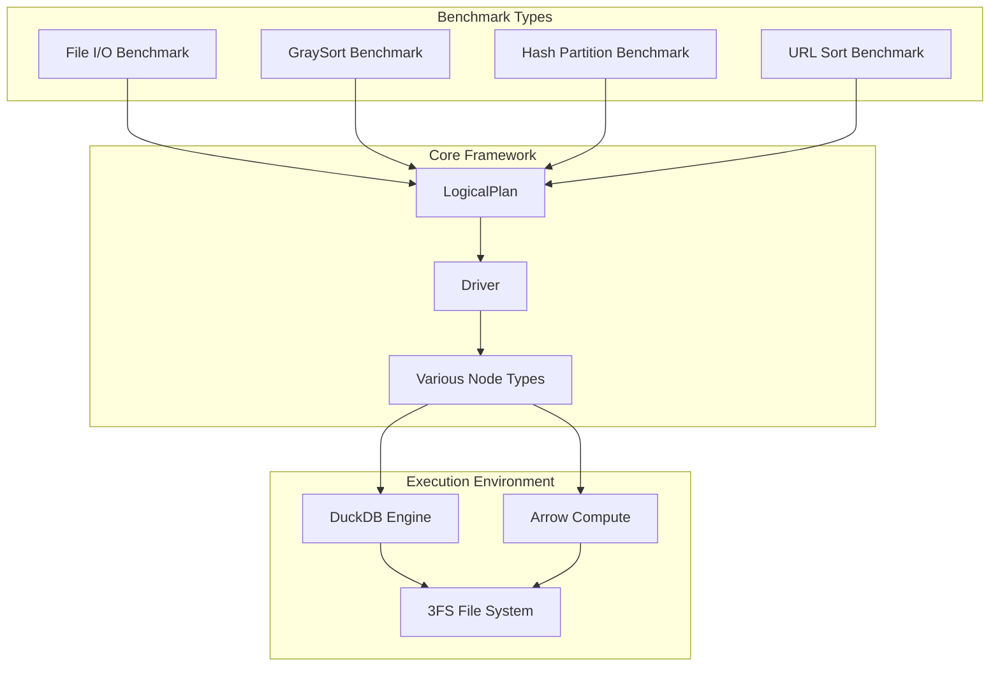
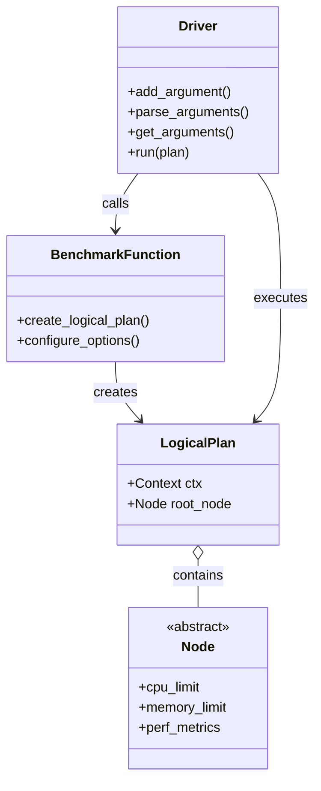
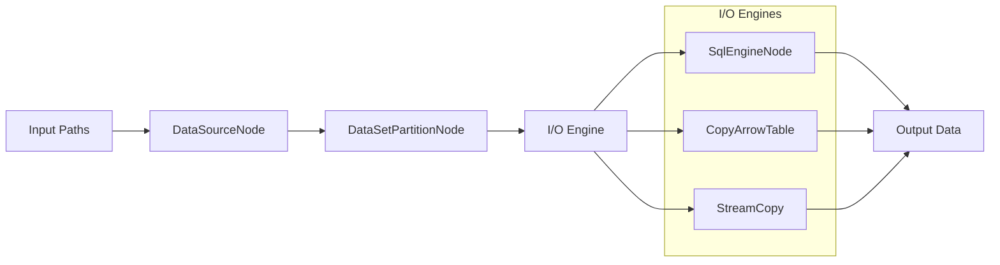
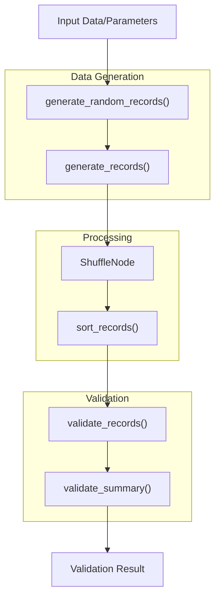
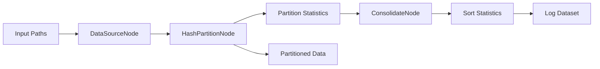
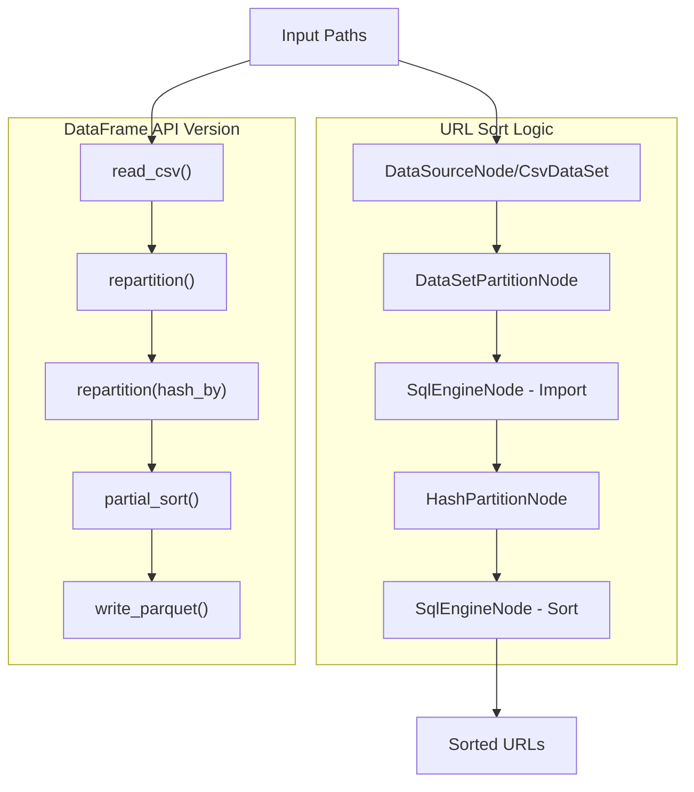
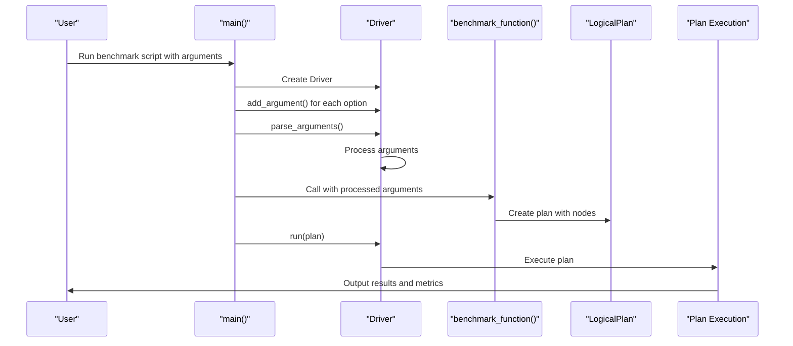

<!-- source: DeepWiki mcp.deepwiki.com · repo deepseek-ai/smallpond · page 5 Benchmarking · fetched 2026-10-30 -->

# Benchmarking

<details>
<summary>Relevant source files</summary>

The following files were used as context for generating this wiki page:

- [benchmarks/file_io_benchmark.py](benchmarks/file_io_benchmark.py)
- [benchmarks/gray_sort_benchmark.py](benchmarks/gray_sort_benchmark.py)
- [benchmarks/hash_partition_benchmark.py](benchmarks/hash_partition_benchmark.py)
- [benchmarks/urls_sort_benchmark.py](benchmarks/urls_sort_benchmark.py)

</details>


The smallpond benchmarking system provides a collection of performance measurement tools for evaluating different aspects of the framework's data processing capabilities. This page documents the available benchmarks, their architecture, configuration options, and usage patterns.

For information about specific benchmark implementations, see the child pages: [GraySort Benchmark](#5.1), [File I/O Benchmark](#5.2), [Hash Partition Benchmark](#5.3), and [URL Sort Benchmark](#5.4).

## Overview

The benchmarking system in smallpond consists of specialized applications built on top of the core framework components. Each benchmark focuses on measuring performance for specific data processing operations such as sorting, partitioning, or file I/O operations. The benchmarks leverage the LogicalPlan system to define data processing workflows and the Driver to execute them.



Sources: [benchmarks/file_io_benchmark.py:1-82](), [benchmarks/gray_sort_benchmark.py:1-364](), [benchmarks/hash_partition_benchmark.py:1-91](), [benchmarks/urls_sort_benchmark.py:1-114]()

## Benchmark Architecture

All benchmarks in smallpond follow a common pattern of implementation:

1. A main benchmark function that creates a LogicalPlan
2. Command-line argument parsing via the Driver
3. Configuration options specific to the benchmark type
4. Performance measurement through the framework's metrics collection



Sources: [benchmarks/file_io_benchmark.py:14-60](), [benchmarks/file_io_benchmark.py:63-78](), [benchmarks/gray_sort_benchmark.py:235-312](), [benchmarks/gray_sort_benchmark.py:315-360](), [benchmarks/hash_partition_benchmark.py:15-65](), [benchmarks/hash_partition_benchmark.py:68-87](), [benchmarks/urls_sort_benchmark.py:17-68](), [benchmarks/urls_sort_benchmark.py:88-110]()

## Available Benchmarks

### File I/O Benchmark

The File I/O benchmark measures the performance of reading and copying Parquet data files using different I/O engines. It supports three I/O engines: DuckDB, Arrow, and streaming.



Sources: [benchmarks/file_io_benchmark.py:14-60]()

### GraySort Benchmark

The GraySort benchmark implements a standardized sorting benchmark for measuring the performance of sorting large amounts of data. It includes data generation, partitioning, sorting, and result validation.



Sources: [benchmarks/gray_sort_benchmark.py:37-47](), [benchmarks/gray_sort_benchmark.py:48-93](), [benchmarks/gray_sort_benchmark.py:95-151](), [benchmarks/gray_sort_benchmark.py:154-182](), [benchmarks/gray_sort_benchmark.py:235-312]()

### Hash Partition Benchmark

The Hash Partition benchmark evaluates the performance of partitioning data based on hash columns. It includes options for different engine types and can generate statistics about partition distribution.



Sources: [benchmarks/hash_partition_benchmark.py:15-65]()

### URL Sort Benchmark

The URL Sort benchmark tests the performance of sorting URL data. It includes both a lower-level implementation using the Logical Plan API and a higher-level implementation using the DataFrame API.



Sources: [benchmarks/urls_sort_benchmark.py:17-68](), [benchmarks/urls_sort_benchmark.py:71-85]()

## Common Configuration Options

All benchmarks share some common configuration options through the Driver's argument parsing mechanism, while also providing benchmark-specific options.

| Option | Description | Used In |
|--------|-------------|---------|
| `--input_paths` | Input data file paths | All benchmarks |
| `--npartitions` / `--num_*_partitions` | Number of partitions | All benchmarks |
| `--engine_type` / `--*_engine` | Processing engine (duckdb, arrow) | All benchmarks |
| `--cpu_limit` / `--*_cpu_limit` | CPU cores limit for operations | All benchmarks |
| `--memory_limit` / `--*_memory_limit` | Memory limit for operations | All benchmarks |
| `--cpus_per_node` | CPUs available per node | All benchmarks |
| `--memory_per_node` | Memory available per node | Some benchmarks |
| `--parquet_compression` | Compression for Parquet output | Some benchmarks |
| `--parquet_compression_level` | Compression level for Parquet | Some benchmarks |

Sources: [benchmarks/file_io_benchmark.py:64-71](), [benchmarks/gray_sort_benchmark.py:317-342](), [benchmarks/hash_partition_benchmark.py:69-80](), [benchmarks/urls_sort_benchmark.py:89-95]()

## Execution Flow

The benchmarks follow a consistent execution flow pattern, leveraging the Driver component to parse arguments and execute the logical plan.



Sources: [benchmarks/file_io_benchmark.py:63-78](), [benchmarks/gray_sort_benchmark.py:315-360](), [benchmarks/hash_partition_benchmark.py:68-87](), [benchmarks/urls_sort_benchmark.py:88-110]()

## Running Benchmarks

To run a benchmark, use the respective Python script with appropriate arguments. The Driver will handle argument parsing and plan execution.

Example for running the File I/O benchmark:

```
python -m benchmarks.file_io_benchmark -i /path/to/data/*.parquet -n 16 -e duckdb
```

Example for running the GraySort benchmark:

```
python -m benchmarks.gray_sort_benchmark -T 100GB -n 16 -t 32 -s polars
```

You can adjust configuration parameters to evaluate performance under different conditions and compare the results across different settings.

Sources: [benchmarks/file_io_benchmark.py:63-82](), [benchmarks/gray_sort_benchmark.py:315-364](), [benchmarks/hash_partition_benchmark.py:68-91](), [benchmarks/urls_sort_benchmark.py:88-114]()

## Performance Measurement

The benchmark system collects performance metrics during execution through the Node's performance metrics collection mechanism. Key metrics include:

- Execution time for different operations
- Memory usage
- Data throughput
- Number of records processed

These metrics are reported at the end of benchmark execution, allowing for analysis of system performance under different configurations.

Sources: [benchmarks/gray_sort_benchmark.py:95-151](), [benchmarks/gray_sort_benchmark.py:154-182]()

## Benchmark Customization

For specific use cases, the benchmarks can be customized by:

1. Modifying the benchmark functions to add new processing steps
2. Adding new command-line arguments via the Driver
3. Creating new benchmark implementations following the same pattern

This flexibility allows for testing specific aspects of the system's performance or creating custom benchmarks for specialized workloads.

Sources: [benchmarks/file_io_benchmark.py:14-60](), [benchmarks/gray_sort_benchmark.py:235-312](), [benchmarks/hash_partition_benchmark.py:15-65](), [benchmarks/urls_sort_benchmark.py:17-68]()

---

