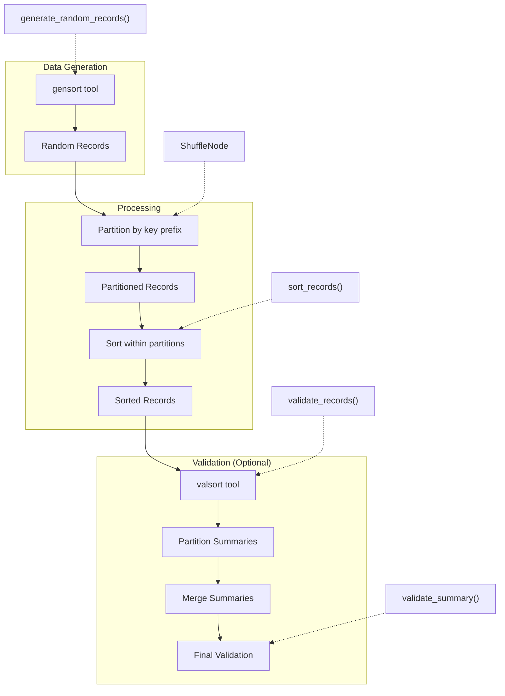
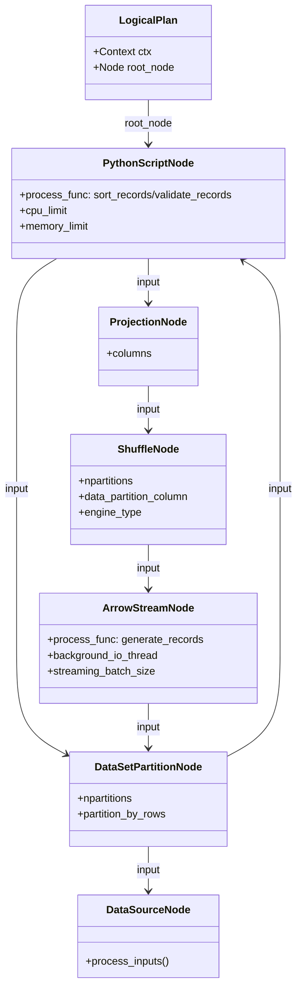

<!-- source: DeepWiki mcp.deepwiki.com · repo deepseek-ai/smallpond · page 5.1 GraySort Benchmark · fetched 2026-10-30 -->

# GraySort Benchmark

<details>
<summary>Relevant source files</summary>

The following files were used as context for generating this wiki page:

- [benchmarks/gray_sort_benchmark.py](benchmarks/gray_sort_benchmark.py)

</details>


## Purpose and Scope

The GraySort Benchmark is an implementation of the industry-standard Sort Benchmark in the smallpond framework. It provides a way to measure the efficiency and performance of sorting large volumes of data with configurable record sizes, partitioning strategies, and sorting engines. This page explains how the benchmark works, its components, and how to use it effectively.

For information about other benchmarks in smallpond, see [Benchmarking](#5).

Sources: [benchmarks/gray_sort_benchmark.py:235-311]()

## Overview

GraySort evaluates a system's ability to sort large datasets quickly and efficiently. The smallpond implementation follows these key steps:

1. Generate random records with configurable size and key length
2. Partition the records based on key prefixes
3. Sort each partition independently
4. Validate that the results are properly sorted (optional)

The benchmark uses external tools (`gensort` and `valsort`) for data generation and validation, combined with smallpond's distributed processing capabilities.

Sources: [benchmarks/gray_sort_benchmark.py:37-45](), [benchmarks/gray_sort_benchmark.py:235-311]()

## Architecture and Data Flow

### GraySort Benchmark Workflow



Sources: [benchmarks/gray_sort_benchmark.py:235-311]()

### Logical Plan Structure



Sources: [benchmarks/gray_sort_benchmark.py:185-312]()

## Implementation Components

### SortBenchTool

The `SortBenchTool` class manages the integration with external sorting tools:

- `gensort`: Generates random records with specified patterns
- `valsort`: Validates that records are properly sorted

These tools must be installed and available in the system PATH before running the benchmark.

Sources: [benchmarks/gray_sort_benchmark.py:37-45]()

### Record Generation

The record generation process:

1. Creates batches of records using the `gensort` tool
2. Constructs Arrow tables with the following structure:
   - `buckets`: 16-bit bucket identifiers for partitioning
   - `keys`: Binary field containing the sort key
   - `records`: Binary field containing the full record

Records are generated with customizable sizes and fed through the system as batches to manage memory usage.

Sources: [benchmarks/gray_sort_benchmark.py:48-93](), [benchmarks/gray_sort_benchmark.py:185-232]()

### Sorting Process

The benchmark supports three different sorting engines:

| Engine | Description | Best Use Case |
|--------|-------------|--------------|
| polars | Uses Polars library for sorting | Default, good balance of performance and features |
| arrow | Uses PyArrow's native sorting | Memory efficient, but single-threaded |
| duckdb | Uses SQL queries via DuckDB | Complex sorting needs, leverages SQL capabilities |

Each engine loads the partitioned data, sorts it by keys, and writes the sorted records to the output.

Sources: [benchmarks/gray_sort_benchmark.py:95-151](), [benchmarks/gray_sort_benchmark.py:290-297]()

### Validation

The validation process ensures that the sorted output is correct:

1. `validate_records`: Runs `valsort` on each partition to verify it's sorted and generates summary files
2. `validate_summary`: Merges all summaries and performs a final validation to ensure the entire dataset is correctly sorted

This validation step is optional but recommended to ensure the benchmark results are valid.

Sources: [benchmarks/gray_sort_benchmark.py:154-182](), [benchmarks/gray_sort_benchmark.py:300-310]()

## Benchmark Configuration

### Configuration Parameters


Sources: [benchmarks/gray_sort_benchmark.py:235-361]()

### Key Parameters

| Parameter | Description | Default |
|-----------|-------------|---------|
| `record_nbytes` | Size of each record in bytes | 100 |
| `key_nbytes` | Size of the key portion of each record | 10 |
| `total_data_nbytes` | Total data size to generate | System memory size |
| `num_data_partitions` | Number of partitions for data generation | Half of available CPUs |
| `num_sort_partitions` | Number of partitions for sorting | Based on CPU/memory |
| `shuffle_engine` | Engine for partitioning ("duckdb" or "arrow") | "duckdb" |
| `sort_engine` | Engine for sorting ("duckdb", "arrow", or "polars") | "duckdb" |
| `validate_results` | Whether to validate the sorted results | False |

Sources: [benchmarks/gray_sort_benchmark.py:317-360]()

## Running the Benchmark

### Basic Usage

To run the GraySort benchmark with default settings:

```bash
python -m benchmarks.gray_sort_benchmark
```

### Example: Running with Custom Settings

```bash
python -m benchmarks.gray_sort_benchmark \
    -R 100 \             # Record size (100 bytes)
    -K 10 \              # Key size (10 bytes)
    -T 107374182400 \    # Total data size (100GB)
    -n 16 \              # Number of data partitions
    -t 32 \              # Number of sort partitions
    -e duckdb \          # Shuffle engine
    -s polars \          # Sort engine
    -V \                 # Validate results
    -C 32 \              # Shuffle CPU limit
    -TC 8                # Sort CPU limit
```

### Performance Tuning

For optimal performance:

1. **Data partitioning**: Set `num_data_partitions` to match available hardware (default is half of available CPU cores)
2. **Sort partitions**: Increase `num_sort_partitions` for larger datasets to ensure each partition fits in memory
3. **Engine selection**:
   - For most cases, use `duckdb` for shuffling and `polars` for sorting
   - For very large keys, `arrow` may be more memory efficient
4. **Resource limits**: Adjust CPU and memory limits based on hardware capabilities
   - Higher `shuffle_cpu_limit` improves partitioning performance
   - Higher `sort_cpu_limit` improves sorting performance (except for `arrow` engine which is single-threaded)

Sources: [benchmarks/gray_sort_benchmark.py:344-357]()

## Internal Implementation Details

### Logical Plan Construction

The benchmark constructs a logical plan with the following sequence:

1. If input paths are provided, create a `DataSourceNode` to read existing data
2. Otherwise, create a plan to generate random records using `generate_random_records`
3. Create a `ShuffleNode` to partition records by key prefix
4. Create a `PythonScriptNode` with `sort_records` function to sort each partition
5. If validation is enabled, add additional nodes for validation

The function `gray_sort_benchmark` assembles this logical plan, which is then executed by the `Driver`.

Sources: [benchmarks/gray_sort_benchmark.py:235-311](), [benchmarks/gray_sort_benchmark.py:358-360]()

### Auto-Tuning

The benchmark includes logic to automatically determine optimal settings based on hardware:

- Number of data partitions defaults to half of available CPU cores
- Number of sort partitions is calculated based on:
  - Available CPU cores divided by sort CPU limit
  - Total data size divided by available memory
- Memory limits are calculated based on available system memory per CPU

This auto-tuning makes the benchmark usable without extensive configuration while still delivering good performance.

Sources: [benchmarks/gray_sort_benchmark.py:344-357]()

---

