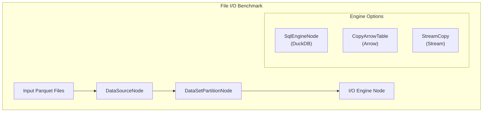
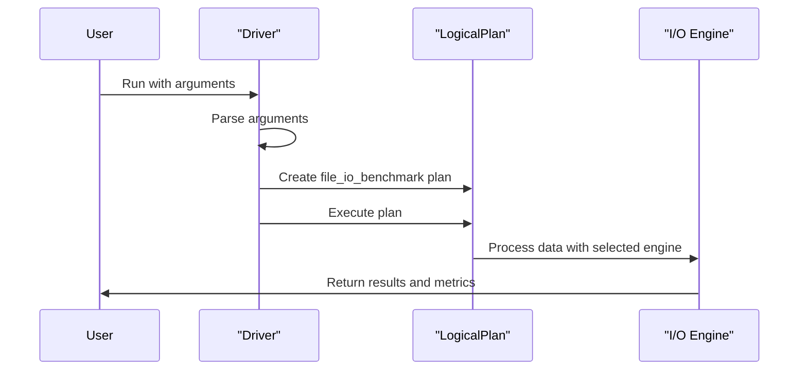
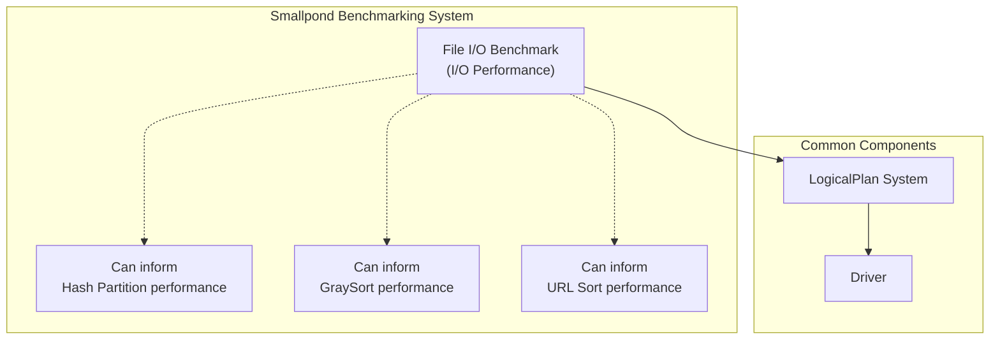

<!-- source: DeepWiki mcp.deepwiki.com · repo deepseek-ai/smallpond · page 5.2 File I/O Benchmark · fetched 2026-10-30 -->

# File I/O Benchmark

<details>
<summary>Relevant source files</summary>

The following files were used as context for generating this wiki page:

- [benchmarks/file_io_benchmark.py](benchmarks/file_io_benchmark.py)

</details>


## Purpose and Scope

The File I/O Benchmark in Smallpond provides a standardized way to measure and evaluate the performance of various I/O engines when reading and processing Parquet files. This benchmark is specifically designed to isolate and test the raw I/O capabilities of the system, rather than testing computational operations.

For benchmarks focused on sorting operations, see [GraySort Benchmark](#5.1), [Hash Partition Benchmark](#5.3), or [URL Sort Benchmark](#5.4).

Sources: [benchmarks/file_io_benchmark.py:14-60]()

## Benchmark Overview

The File I/O Benchmark creates a simple data processing pipeline that reads Parquet files, partitions the data, and processes it through one of three available I/O engines. The benchmark focuses on measuring throughput rather than transformation correctness.



Sources: [benchmarks/file_io_benchmark.py:14-60]()

## Benchmark Architecture

The benchmark is implemented as a logical plan with a simple pipeline of nodes. It demonstrates the flexibility of Smallpond's logical plan system to measure different aspects of system performance.

```mermaid
classDiagram
    class LogicalPlan {
        +Context ctx
        +Node root_node
    }
    
    class DataSourceNode {
        +ParquetDataSet dataset
    }
    
    class DataSetPartitionNode {
        +npartitions
    }
    
    class SqlEngineNode {
        +sql_query: "select * from {0}"
        +engine: "duckdb"
    }
    
    class CopyArrowTable {
        +engine: "arrow"
    }
    
    class StreamCopy {
        +engine: "stream"
        +streaming_batch_size
    }
    
    LogicalPlan --> DataSourceNode: contains
    DataSourceNode --> DataSetPartitionNode: feeds
    DataSetPartitionNode --> SqlEngineNode: feeds (if duckdb)
    DataSetPartitionNode --> CopyArrowTable: feeds (if arrow)
    DataSetPartitionNode --> StreamCopy: feeds (if stream)
```

Sources: [benchmarks/file_io_benchmark.py:14-60]()

## Benchmark Engines

The benchmark supports three different I/O engines, each with its own characteristics and performance profile:

| Engine | Implementation | Description | Best For |
|--------|---------------|-------------|----------|
| DuckDB | SqlEngineNode | Uses DuckDB's SQL engine to read and process data | SQL-based processing, analytical workloads |
| Arrow | CopyArrowTable | Uses Apache Arrow for in-memory processing | Memory-efficient processing, columnar operations |
| Stream | StreamCopy | Streams data in batches | Processing large datasets with limited memory |

Each engine is configured with the same resource limitations for fair comparison:
- CPU limit: 1 core
- Memory limit: 10 GB

Sources: [benchmarks/file_io_benchmark.py:28-57]()

## Usage

### Command-Line Arguments

The benchmark can be run from the command line with various parameters to customize the test:

| Argument | Description | Default |
|----------|-------------|---------|
| `-i, --input_paths` | Paths to input Parquet files | Required |
| `-n, --npartitions` | Number of partitions | Auto-determined (total CPUs) |
| `-e, --io_engine` | Engine to use (duckdb, arrow, stream) | duckdb |
| `-b, --batch_size` | Batch size for streaming | 1024 * 1024 |
| `-s, --row_group_size` | Parquet row group size | 1024 * 1024 |
| `-o, --output_name` | Name for output data | data |
| `-NC, --cpus_per_node` | CPUs per node | 128 |

Sources: [benchmarks/file_io_benchmark.py:64-75]()

### Running the Benchmark

The benchmark is executed through the Smallpond Driver, which handles argument parsing and plan execution:



Sources: [benchmarks/file_io_benchmark.py:63-82]()

## Implementation Details

### Logical Plan Construction

The benchmark creates a logical plan with three main components:

1. **Data Source**: A `DataSourceNode` that reads from a `ParquetDataSet` containing the input files.
2. **Partitioning**: A `DataSetPartitionNode` that splits the data into the specified number of partitions.
3. **Processing Engine**: One of three engine nodes that processes the data:
   - `SqlEngineNode` for DuckDB
   - `CopyArrowTable` for Arrow
   - `StreamCopy` for streaming

The logical plan isolates I/O performance by performing minimal processing on the data - essentially just reading it through the selected engine.

Sources: [benchmarks/file_io_benchmark.py:23-59]()

### Resource Configuration

The benchmark configures each engine with identical resource constraints to ensure fair comparison:

- **CPU Limit**: 1 core per engine instance
- **Memory Limit**: 10 GB per engine instance 
- **Row Group Size**: Configurable, defaults to 1,024,000 rows
- **Batch Size**: For streaming engine only, configurable with default of 1,024,000 rows

This configuration helps isolate I/O performance from computational performance.

Sources: [benchmarks/file_io_benchmark.py:35-57]()

### Auto-Partitioning

The benchmark automatically determines the number of partitions if not specified by the user:

```
total_num_cpus = driver_args.num_executors * user_args.cpus_per_node
user_args.npartitions = user_args.npartitions or total_num_cpus
```

This ensures efficient utilization of available resources by matching the number of partitions to the available CPU cores.

Sources: [benchmarks/file_io_benchmark.py:74-75]()

## Relationship to Other Components

The File I/O Benchmark integrates with Smallpond's core execution framework and serves as a foundation for more complex benchmarks like GraySort:



Sources: [benchmarks/file_io_benchmark.py:14-60]()

---

