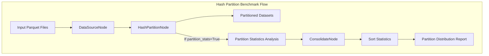
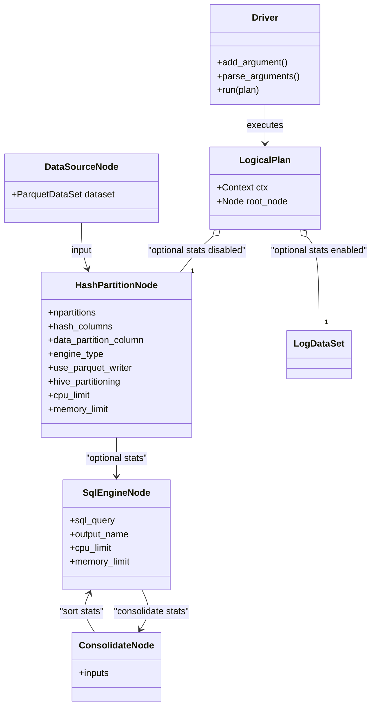
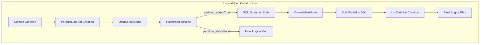

<!-- source: DeepWiki mcp.deepwiki.com · repo deepseek-ai/smallpond · page 5.3 Hash Partition Benchmark · fetched 2026-10-30 -->

# Hash Partition Benchmark

<details>
<summary>Relevant source files</summary>

The following files were used as context for generating this wiki page:

- [benchmarks/hash_partition_benchmark.py](benchmarks/hash_partition_benchmark.py)

</details>


## Purpose and Scope

The Hash Partition Benchmark is a specialized tool designed to evaluate the performance and distribution characteristics of hash-based data partitioning in the smallpond framework. This benchmark allows users to test how effectively data is distributed across partitions using specified hash columns, analyze partition balance, and measure processing performance under various configurations.

For information about other benchmarks in smallpond, see [Benchmarking](#5) for the overview, [GraySort Benchmark](#5.1) for sorting performance, [File I/O Benchmark](#5.2) for storage performance, or [URL Sort Benchmark](#5.4) for URL-specific sorting.

## Overview

Hash partitioning is a fundamental operation in distributed data processing systems that divides data into separate partitions based on hash values of specified columns. The Hash Partition Benchmark in smallpond creates a logical plan that reads input data, applies hash partitioning, and optionally measures distribution statistics of the resulting partitions.



Sources: [benchmarks/hash_partition_benchmark.py:15-65]()

## Benchmark Implementation

### Architecture Components

The Hash Partition Benchmark is built using smallpond's logical plan system, which constructs a directed acyclic graph (DAG) of processing nodes. The core components include:



Sources: [benchmarks/hash_partition_benchmark.py:15-65](), [benchmarks/hash_partition_benchmark.py:68-87]()

### Main Function Structure

The benchmark is built around two primary functions:

1. **hash_partition_benchmark()** - Creates a logical plan for benchmarking hash partitioning:
   - Takes input paths, partition count, columns to hash, and other configuration parameters
   - Constructs a logical plan with a HashPartitionNode at its core
   - Optionally adds analysis nodes to collect and report statistics about partition distribution

2. **main()** - Entry point that processes command-line arguments and executes the benchmark:
   - Configures and parses command-line arguments
   - Calculates default parameters based on system resources
   - Creates and runs the benchmark plan

Sources: [benchmarks/hash_partition_benchmark.py:15-65](), [benchmarks/hash_partition_benchmark.py:68-87]()

## Key Parameters

The Hash Partition Benchmark accepts a variety of parameters that control its behavior:

| Parameter | Type | Description |
|-----------|------|-------------|
| input_paths | list[str] | Paths to input Parquet files to be partitioned |
| npartitions | int | Number of partitions to create (defaults to total available CPUs) |
| hash_columns | list[str] | Column names to use for hash partitioning |
| engine_type | str | Processing engine to use: "duckdb" or "arrow" |
| use_parquet_writer | bool | Whether to use Parquet writer directly instead of DuckDB |
| hive_partitioning | bool | Whether to use Hive-style partitioning for output |
| cpu_limit | int | CPU core limit per partition operation |
| memory_limit | int | Memory limit per partition operation (in bytes) |
| partition_stats | bool | Whether to collect and report statistics about partition distribution |

Sources: [benchmarks/hash_partition_benchmark.py:15-26](), [benchmarks/hash_partition_benchmark.py:70-80]()

## Logical Plan Construction

The benchmark constructs a logical plan that processes data in the following sequence:



Sources: [benchmarks/hash_partition_benchmark.py:27-65]()

### Partition Statistics

When enabled, the benchmark collects detailed statistics about the resulting partitions, including:

1. Count of rows per partition
2. Count of unique keys per partition
3. Distribution of data across partitions (sorted by row count)

This helps in evaluating how evenly the hash partitioning distributes data, which is crucial for balanced workload distribution in parallel processing environments.

Sources: [benchmarks/hash_partition_benchmark.py:45-61]()

## Running the Benchmark

The benchmark can be run from the command line with various arguments:

```
python -m benchmarks.hash_partition_benchmark \
    --input_paths /path/to/data/*.parquet \
    --hash_columns column1 column2 \
    --npartitions 16 \
    --partition_stats
```

### Command-line Arguments

| Argument | Description |
|----------|-------------|
| `-i`, `--input_paths` | Input Parquet files (required) |
| `-n`, `--npartitions` | Number of partitions to create |
| `-c`, `--hash_columns` | Columns to use for hash partitioning (required) |
| `-e`, `--engine_type` | Engine type: "duckdb" (default) or "arrow" |
| `-S`, `--partition_stats` | Enable partition statistics collection and reporting |
| `-W`, `--use_parquet_writer` | Use direct Parquet writer instead of DuckDB |
| `-H`, `--hive_partitioning` | Use Hive-style partitioning for output |
| `-C`, `--cpu_limit` | CPU limit per partition operation |
| `-M`, `--memory_limit` | Memory limit per partition operation |
| `-NC`, `--cpus_per_node` | CPUs available per node (default: 192) |
| `-NM`, `--memory_per_node` | Memory available per node (default: 2000 GB) |

Sources: [benchmarks/hash_partition_benchmark.py:70-80]()

## Integration with smallpond Framework

The Hash Partition Benchmark integrates with the main smallpond framework components:

```mermaid
graph TD
    subgraph "smallpond Integration"
        HPB["Hash Partition Benchmark"]
        Driver["smallpond Driver"]
        LogicalPlan["LogicalPlan System"]
        HashPartition["HashPartitionNode"]
        SQL["SQL Processing"]
        
        HPB --> Driver : "uses for execution"
        HPB --> LogicalPlan : "creates"
        LogicalPlan --> HashPartition : "contains"
        HashPartition --> SQL : "uses for processing"
        
        HashPartition --> DuckDB["DuckDB Engine"] : "can use"
        HashPartition --> Arrow["Arrow Engine"] : "can use"
    end
```

Sources: [benchmarks/hash_partition_benchmark.py:5-11](), [benchmarks/hash_partition_benchmark.py:31-43]()

## Use Cases and Applications

The Hash Partition Benchmark is useful for:

1. Evaluating the performance of different hash partitioning strategies
2. Testing data skew and distribution across partitions
3. Optimizing resource allocation for partitioning operations
4. Comparing different execution engines (DuckDB vs. Arrow)
5. Benchmarking hardware performance for distributed processing workloads

This benchmark is particularly valuable when preparing for large-scale data processing tasks that rely on effective data distribution for parallel processing.

Sources: [benchmarks/hash_partition_benchmark.py:15-65]()

## Summary

The Hash Partition Benchmark provides a comprehensive tool for evaluating and optimizing hash partitioning performance in the smallpond framework. By offering configurable parameters and detailed statistics, it helps users understand and improve their data partitioning strategies for distributed processing tasks.

---

