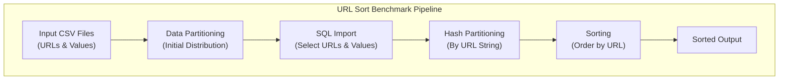
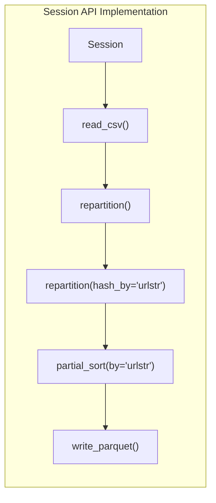
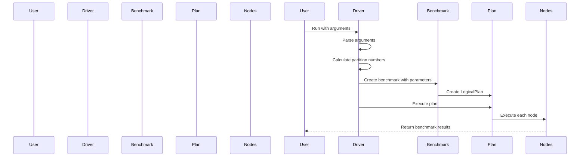
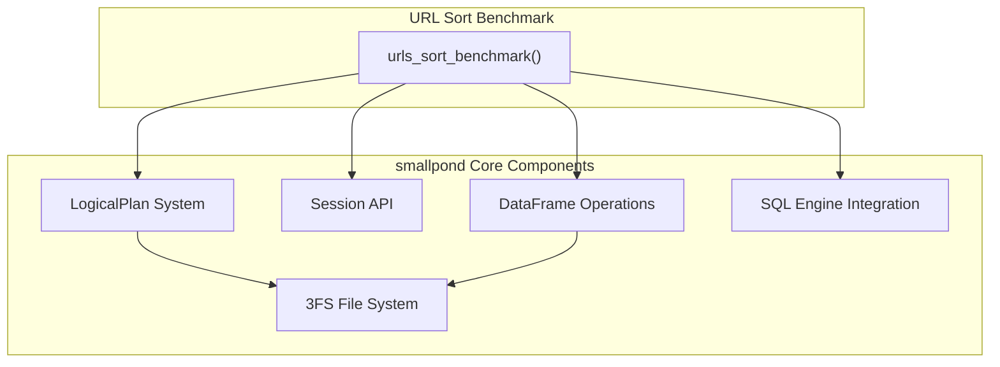

<!-- source: DeepWiki mcp.deepwiki.com · repo deepseek-ai/smallpond · page 5.4 URL Sort Benchmark · fetched 2026-10-30 -->

# URL Sort Benchmark

<details>
<summary>Relevant source files</summary>

The following files were used as context for generating this wiki page:

- [benchmarks/urls_sort_benchmark.py](benchmarks/urls_sort_benchmark.py)
- [examples/sort_mock_urls.py](examples/sort_mock_urls.py)
- [examples/sort_mock_urls_v2.py](examples/sort_mock_urls_v2.py)

</details>


## Purpose and Scope

The URL Sort Benchmark is a specialized benchmark in the smallpond framework designed to evaluate the performance of sorting large datasets containing URLs and associated values. This benchmark focuses on testing the efficiency of data partitioning, hash-based redistribution, and sorting operations within the smallpond ecosystem. For general benchmarking information, see [Benchmarking](#5) and for other specific benchmarks, see [GraySort Benchmark](#5.1), [File I/O Benchmark](#5.2), or [Hash Partition Benchmark](#5.3).

Sources: [benchmarks/urls_sort_benchmark.py:17-68]()

## Overview

The URL Sort Benchmark processes tab-delimited datasets containing URL strings and associated values. It demonstrates smallpond's capability to handle web-scale data operations by implementing a multi-stage processing pipeline that includes data loading, partitioning, hash-based redistribution, and sorting.



The benchmark is implemented using two different API approaches in smallpond:
1. **Logical Plan API**: A lower-level, node-based approach that explicitly constructs a data processing pipeline
2. **Session API**: A higher-level, fluent interface that provides a more concise implementation

Sources: [benchmarks/urls_sort_benchmark.py:17-110]()

## Implementation Details

### Logical Plan Implementation

The URL Sort Benchmark's primary implementation uses smallpond's Logical Plan system to create a processing pipeline.

```mermaid
classDiagram
    class "urls_sort_benchmark" {
        +input_paths: List[str]
        +num_data_partitions: int
        +num_hash_partitions: int
        +engine_type: str
        +sort_cpu_limit: int
        +sort_memory_limit: int
        +return LogicalPlan
    }
    
    class "Context" {
        +plan_context
    }
    
    class "DataSourceNode" {
        +CsvDataSet dataset
    }
    
    class "DataSetPartitionNode" {
        +npartitions: int
    }
    
    class "SqlEngineNode" {
        +sql_query: str
        +resource_limits
    }
    
    class "HashPartitionNode" {
        +npartitions: int
        +hash_columns: List[str]
        +engine_type: str
    }
    
    class "LogicalPlan" {
        +root_node: Node
    }
    
    "urls_sort_benchmark" --> "Context" : creates
    "urls_sort_benchmark" --> "DataSourceNode" : creates
    "urls_sort_benchmark" --> "DataSetPartitionNode" : creates
    "urls_sort_benchmark" --> "SqlEngineNode" : creates
    "urls_sort_benchmark" --> "HashPartitionNode" : creates
    "urls_sort_benchmark" --> "LogicalPlan" : returns
```

The pipeline consists of the following nodes:

1. **DataSourceNode**: Loads the CSV data with URL and value columns
2. **DataSetPartitionNode**: Partitions the initial data across processing units
3. **SqlEngineNode**: Selects and imports the URL data
4. **HashPartitionNode**: Redistributes data by hashing the URL strings
5. **SqlEngineNode**: Sorts data by URL within each partition

Each node in the pipeline is configured with specific resource constraints such as CPU and memory limits to optimize performance during benchmarking.

Sources: [benchmarks/urls_sort_benchmark.py:17-68]()

### Session API Implementation

The benchmark also includes an alternative implementation using the higher-level Session API, which provides a more concise, fluent interface for the same operations.



This implementation achieves the same result with fewer lines of code:

1. Read CSV data with a schema for URL and value columns
2. Perform initial data repartitioning
3. Repartition again using hash-based distribution on URL strings
4. Execute partial sorting by URL
5. Write results to parquet format

Sources: [benchmarks/urls_sort_benchmark.py:71-85]()

## Configuration Parameters

The URL Sort Benchmark accepts several parameters to tune its behavior and performance:

| Parameter | Type | Description | Default |
|-----------|------|-------------|---------|
| `input_paths` | List[str] | Paths to input CSV files containing URL data | Required |
| `num_data_partitions` | int | Number of initial data partitions | `num_executors * cpus_per_node * partition_rounds` |
| `num_hash_partitions` | int | Number of hash partitions for redistribution | `num_executors * cpus_per_node` |
| `engine_type` | str | Engine to use for processing (e.g., "duckdb") | "duckdb" |
| `sort_cpu_limit` | int | CPU limit for sorting operations | 8 |
| `sort_memory_limit` | int | Memory limit for sorting operations | None |

These parameters provide flexibility to adjust the benchmark for different hardware configurations and workload sizes.

Sources: [benchmarks/urls_sort_benchmark.py:88-102]()

## Usage and Execution

The benchmark is executed through the command-line interface provided by the Driver component. It automatically calculates appropriate partition numbers based on the available resources if not explicitly specified.



Example command-line execution:

```
python -m benchmarks.urls_sort_benchmark -i path/to/url/data/*.csv -m 240 -n 480 -e duckdb -TC 16
```

This would run the benchmark with 240 hash partitions, 480 initial data partitions, using DuckDB as the engine, and limiting sort operations to 16 CPUs.

Sources: [benchmarks/urls_sort_benchmark.py:88-114]()

## Example Applications

The URL Sort Benchmark is closely related to two example applications in the smallpond framework, which demonstrate how to sort URL data in real-world scenarios:

1. **sort_mock_urls.py**: Demonstrates URL sorting using the Logical Plan API
   - Extracts host, URL, and payload from the data
   - Supports both DuckDB-based and custom Arrow-based sorting
   - Provides more customization options

2. **sort_mock_urls_v2.py**: Shows the same functionality using the Session API
   - More concise implementation with less boilerplate
   - Demonstrates the fluent interface style

These examples can serve as templates for custom URL sorting applications based on the benchmark.

Sources: [examples/sort_mock_urls.py:28-96](), [examples/sort_mock_urls_v2.py:8-30]()

## Integration with smallpond Framework

The URL Sort Benchmark leverages several core components of the smallpond framework:



The benchmark specifically demonstrates:

1. **Logical Plan System**: Building a directed acyclic graph of operations for data processing
2. **SQL Integration**: Using SQL queries for data transformation and sorting operations
3. **Distributed Processing**: Leveraging partitioning and distributed execution for performance
4. **Resource Management**: Controlling CPU and memory allocation for optimal performance

Sources: [benchmarks/urls_sort_benchmark.py:17-110]()

## Performance Considerations

When using the URL Sort Benchmark, several factors can affect performance:

1. **Partition Count**: The number of partitions impacts parallelism and resource utilization
   - Too few partitions may underutilize resources
   - Too many partitions may increase overhead

2. **Hash Distribution**: Effective URL hash distribution is crucial for balanced sorting workloads
   - The benchmark uses URL strings as hash keys to distribute workload

3. **Resource Limits**: CPU and memory limits can be tuned to match hardware capabilities
   - Different phases have different optimal settings

4. **Engine Selection**: The choice of engine (e.g., DuckDB) affects processing characteristics

These considerations should be evaluated when interpreting benchmark results or customizing the benchmark for specific environments.

Sources: [benchmarks/urls_sort_benchmark.py:17-110]()

---

