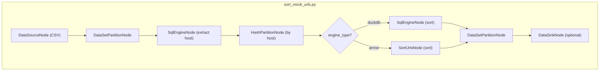
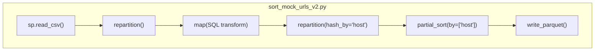
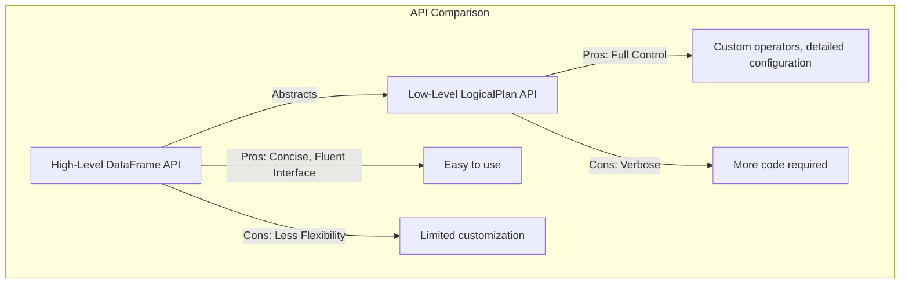
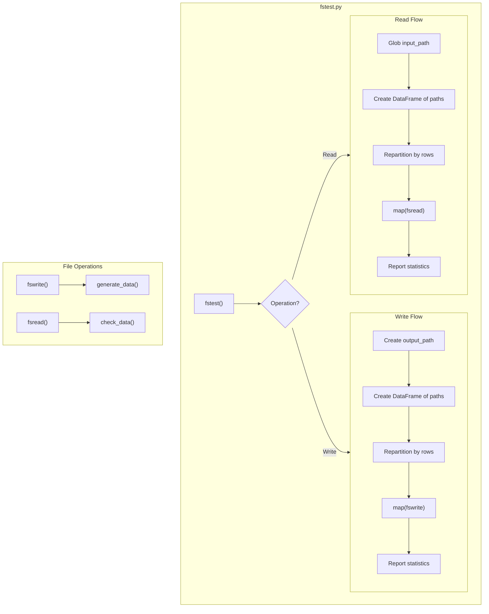
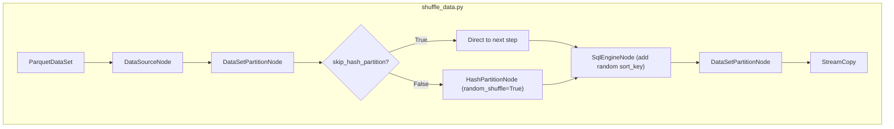
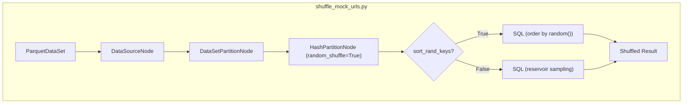

<!-- source: DeepWiki mcp.deepwiki.com · repo deepseek-ai/smallpond · page 6 Examples · fetched 2026-10-30 -->

# Examples

Relevant source files

The following files were used as context for generating this wiki page:

- [examples/fstest.py](examples/fstest.py)
- [examples/shuffle_data.py](examples/shuffle_data.py)
- [examples/shuffle_mock_urls.py](examples/shuffle_mock_urls.py)
- [examples/sort_mock_urls.py](examples/sort_mock_urls.py)
- [examples/sort_mock_urls_v2.py](examples/sort_mock_urls_v2.py)

This page showcases practical example applications that demonstrate how to use the smallpond framework for various data processing tasks. These examples illustrate both the high-level DataFrame API and lower-level LogicalPlan approaches to solving common data processing challenges.

## URL Sorting Examples

The smallpond framework provides two approaches to sorting URL data: using the low-level LogicalPlan API and the higher-level DataFrame API. Both examples demonstrate how to:
1. Read URL data from CSV files
2. Extract host information
3. Partition the data by host
4. Sort the data
5. Write results to disk

### LogicalPlan Approach

The LogicalPlan approach demonstrates how to build a data processing pipeline using smallpond's node-based logical plan system.

The URL sorting LogicalPlan creates a pipeline of operations:

1. **Data Source**: Reads TSV files containing URLs using `CsvDataSet`
2. **Partitioning**: Divides data into specified number of partitions
3. **Data Transformation**: Uses SQL to extract host from URLs and decode payload
4. **Hash Partitioning**: Distributes data by host to prepare for efficient sorting
5. **Sorting**: Sorts each partition by host (using DuckDB SQL or Arrow)
6. **Result Collection**: Combines results into a single partition
7. **Data Sink**: Optionally writes results to disk

The `sort_mock_urls` function in [examples/sort_mock_urls.py:28-86]() constructs this plan, which can be executed using the `Driver` class.

Sources: [examples/sort_mock_urls.py]()

### High-Level DataFrame API Approach

The DataFrame API provides a more concise, fluent interface for the same URL sorting task:

This approach accomplishes the same task in fewer lines of code using method chaining:

1. Read and partition the CSV data
2. Map SQL transformation to extract host information
3. Repartition by host using hash partitioning
4. Sort each partition by host
5. Write results to Parquet files

The implementation is just 5-6 lines of code in [examples/sort_mock_urls_v2.py:8-19]() compared to the more verbose LogicalPlan approach.

Sources: [examples/sort_mock_urls_v2.py]()

### Comparison of Approaches

The two approaches illustrate smallpond's layered architecture, with the DataFrame API providing syntactic sugar over the more flexible but verbose LogicalPlan system.

## File System Testing

The file system testing example validates the correctness and performance of storage operations in smallpond by running multiple tasks to write and read data.

Key features of this example:

1. **Data Generation**: Creates deterministic test data based on offset and length
2. **Write Testing**: Writes data to specified files with configurable block sizes
3. **Read Testing**: Reads back data and verifies correctness against expected values
4. **Performance Measurement**: Tracks elapsed time and throughput for both operations
5. **Parallel Execution**: Uses smallpond's DataFrame `map()` to parallelize file operations
6. **Random/Sequential Access**: Supports both sequential and random read patterns

The example provides detailed CLI options for specifying:
- Input/output paths
- Number of partitions (parallel jobs)
- File sizes
- Block sizes or block size ranges
- Read pattern (sequential or random)

Usage examples are provided in the comments at [examples/fstest.py:169-178]().

Sources: [examples/fstest.py]()

## Data Shuffling

The data shuffling examples demonstrate techniques for randomizing and redistributing data across partitions in a distributed setting.

### General Data Shuffling

The general data shuffling example in [examples/shuffle_data.py]() demonstrates:

1. **Initial Partitioning**: Divides input data into partitions, optionally with random shuffling
2. **Hash-based Redistribution**: Further shuffles data using hash partitioning (optional)
3. **Random Key Generation**: Adds a random sort key to each row and sorts by this key
4. **Re-partitioning**: Distributes the shuffled data into the desired number of output partitions
5. **Stream Copying**: Efficiently streams the shuffled data to the output

Sources: [examples/shuffle_data.py]()

### Mock URL Shuffling

The mock URL shuffling example in [examples/shuffle_mock_urls.py]() offers:

1. **Two Shuffling Methods**:
   - Sorting by random keys: Uses SQL's `random()` function and sorts data by the random values
   - Reservoir sampling: Uses DuckDB's reservoir sampling to randomly select rows

2. **Configurable Parameters**:
   - Number of partitions
   - Shuffling method
   - Engine type (DuckDB or Arrow)

Sources: [examples/shuffle_mock_urls.py]()

## Example Usage Summary

This table summarizes the examples and their key command-line options:

| Example | File | Purpose | Key Options |
|---------|------|---------|------------|
| URL Sorting (LogicalPlan) | [examples/sort_mock_urls.py]() | Sort URLs by host using node-based plan | `-i` (input paths), `-n` (partitions), `-e` (engine type) |
| URL Sorting (DataFrame) | [examples/sort_mock_urls_v2.py]() | Sort URLs by host using DataFrame API | `-i` (input paths), `-o` (output path), `-n` (partitions) |
| File System Testing | [examples/fstest.py]() | Test file I/O performance and validity | `-i` (input path), `-o` (output path), `-j` (partitions), `-s` (size), `-bs` (block size), `-randread` (random read) |
| Data Shuffling | [examples/shuffle_data.py]() | Randomly shuffle data between partitions | `-i` (input paths), `-nd/-nh/-no` (partition counts), `-e` (engine type), `-x` (skip hash partition) |
| Mock URL Shuffling | [examples/shuffle_mock_urls.py]() | Shuffle URL data with different methods | `-i` (input paths), `-n` (partitions), `-s` (sort random keys), `-e` (engine type) |

These examples demonstrate the flexibility of smallpond for various data processing tasks and highlight both the high-level DataFrame API and the lower-level LogicalPlan system. They provide templates that can be adapted for custom data processing workflows.

Sources: [examples/sort_mock_urls.py](), [examples/sort_mock_urls_v2.py](), [examples/fstest.py](), [examples/shuffle_data.py](), [examples/shuffle_mock_urls.py]()

---

