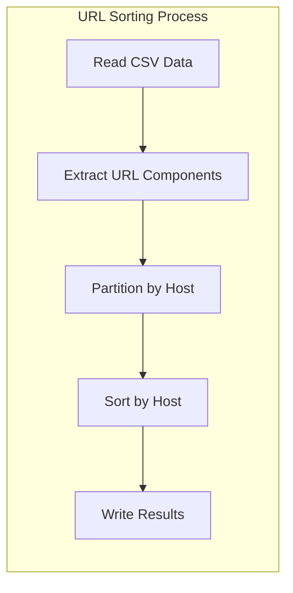
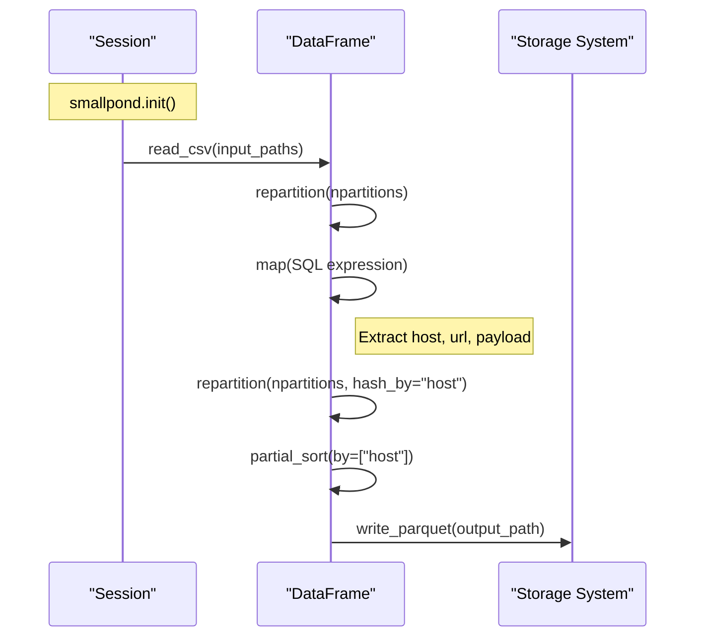
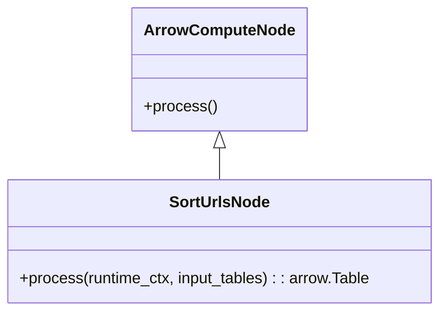
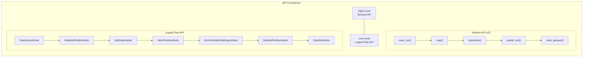

<!-- source: DeepWiki mcp.deepwiki.com · repo deepseek-ai/smallpond · page 6.1 URL Sorting · fetched 2026-10-30 -->

# URL Sorting

<details>
<summary>Relevant source files</summary>

The following files were used as context for generating this wiki page:

- [examples/sort_mock_urls.py](examples/sort_mock_urls.py)
- [examples/sort_mock_urls_v2.py](examples/sort_mock_urls_v2.py)

</details>


## Purpose

This page demonstrates how URL sorting is implemented in smallpond using both the high-level Session API and the lower-level Logical Plan API. URL sorting is a common data processing task that involves parsing URLs into their components (such as host, path, etc.) and sorting them by specific criteria. For more general information about sorting capabilities in smallpond, see [Sorting](#4.3). For URL Sort benchmark performance testing, see [URL Sort Benchmark](#5.4).

## Overview of URL Sorting in smallpond

The smallpond framework provides two approaches to implement URL sorting:

1. **Session API approach**: A concise, high-level implementation using DataFrame operations
2. **Logical Plan approach**: A more explicit, lower-level implementation using the LogicalPlan system

Both approaches demonstrate key smallpond capabilities including:
- Reading and parsing tab-separated values (TSV) files
- Extracting URL components
- Partitioning data based on URL hosts
- Sorting operations using various engine types
- Writing results to storage



Sources: [examples/sort_mock_urls.py:28-86](), [examples/sort_mock_urls_v2.py:8-19]()

## Implementation Approaches

### Session API Approach

The Session API provides a concise, fluent interface for URL sorting. This implementation uses method chaining to create a clean data processing pipeline.



Sources: [examples/sort_mock_urls_v2.py:8-19]()

The Session API implementation follows these steps:
1. Initialize a smallpond session
2. Read CSV files containing URL data 
3. Repartition data across the specified number of partitions
4. Use `map()` with SQL expressions to extract host, URL, and payload components
5. Repartition data based on the host field
6. Sort the data by host using `partial_sort()`
7. Write the results to Parquet format

Example code location: [examples/sort_mock_urls_v2.py:8-19]()

### Logical Plan Approach

The Logical Plan API provides a more explicit approach by constructing a directed acyclic graph (DAG) of data processing nodes.

```mermaid
graph TD
    subgraph "Logical Plan Node Structure"
        A["DataSourceNode<br/>(CsvDataSet)"] --> B["DataSetPartitionNode"]
        B --> C["SqlEngineNode<br/>(extract URL parts)"]
        C --> D["HashPartitionNode<br/>(by host)"]
        
        D -->|engine_type="duckdb"| E1["SqlEngineNode<br/>(ORDER BY host)"]
        D -->|engine_type≠"duckdb"| E2["SortUrlsNode<br/>(sort_by('host'))"]
        
        E1 --> F["DataSetPartitionNode<br/>(npartitions=1)"]
        E2 --> F
        
        F -->|external_output_path| G["DataSinkNode"]
    end
```

Sources: [examples/sort_mock_urls.py:28-86]()

The Logical Plan implementation follows these steps:
1. Create a `Context` instance
2. Define a `CsvDataSet` for the input data
3. Create a DAG of processing nodes:
   - `DataSourceNode`: Reads the data from the dataset
   - `DataSetPartitionNode`: Partitions the data
   - `SqlEngineNode`: Extracts host, URL, and payload using SQL
   - `HashPartitionNode`: Repartitions data by host
   - Either `SqlEngineNode` (DuckDB) or `SortUrlsNode` (Arrow): Sorts the data
   - `DataSetPartitionNode`: Consolidates to a single partition
   - Optional `DataSinkNode`: Writes results to storage
4. Create a `LogicalPlan` with the final node as root
5. Execute the plan using a `Driver`

Example code location: [examples/sort_mock_urls.py:28-86]()

## Key Components

### SortUrlsNode

For non-DuckDB engines, the Logical Plan implementation includes a custom `SortUrlsNode` class that extends `ArrowComputeNode` to handle URL sorting:



Sources: [examples/sort_mock_urls.py:22-25]()

The `SortUrlsNode` processes incoming Arrow tables by sorting them based on the "host" column, demonstrating how to implement custom data processing logic in the smallpond framework.

### URL Processing Logic

Both implementations use similar logic to process URLs, extracting the following components:

| Component | Extraction Method                      | Description                 |
|-----------|--------------------------------------|-----------------------------|
| host      | `split_part(urlstr, '/', 1)`         | Domain part of the URL       |
| url       | `split_part(urlstr, ' ', 1)`         | Full URL                     |
| payload   | `from_base64(valstr)`                | Decoded payload value        |

Sources: [examples/sort_mock_urls.py:45-47](), [examples/sort_mock_urls_v2.py:10-15]()

## Implementation Comparison

The two implementations demonstrate different programming styles and levels of abstraction in smallpond:



Sources: [examples/sort_mock_urls.py:28-86](), [examples/sort_mock_urls_v2.py:8-19]()

### Key Differences

| Aspect | Session API | Logical Plan API |
|--------|------------|-----------------|
| Code Length | Concise (~12 lines) | Verbose (~60 lines) |
| Flexibility | High-level abstractions | Fine-grained control |
| Readability | Method chaining | Explicit node construction |
| Engine Choice | Uses default engine | Supports explicit engine_type selection |
| Error Handling | Simplified | More detailed control |

Sources: [examples/sort_mock_urls.py:28-86](), [examples/sort_mock_urls_v2.py:8-19]()

## Command-Line Usage

Both implementations provide command-line interfaces:

### Session API Version

```
python examples/sort_mock_urls_v2.py [-i INPUT_PATHS [INPUT_PATHS ...]] [-o OUTPUT_PATH] [-n NPARTITIONS]
```

Sources: [examples/sort_mock_urls_v2.py:22-30]()

### Logical Plan Version

```
python examples/sort_mock_urls.py [-i INPUT_PATHS [INPUT_PATHS ...]] [-n NPARTITIONS] [-e ENGINE_TYPE]
```

Sources: [examples/sort_mock_urls.py:89-96]()

## Conclusion

The URL sorting examples demonstrate two distinct approaches to implementing data processing workflows in smallpond. The Session API provides a concise, high-level interface suitable for most use cases, while the Logical Plan API offers greater flexibility and control for complex scenarios. Both approaches leverage smallpond's core capabilities for distributed data processing, including partitioning, SQL integration, and sorting operations.

---

