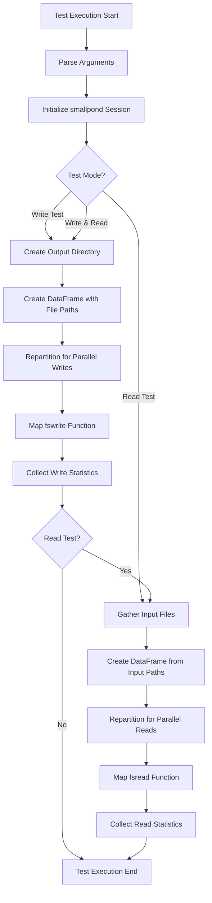
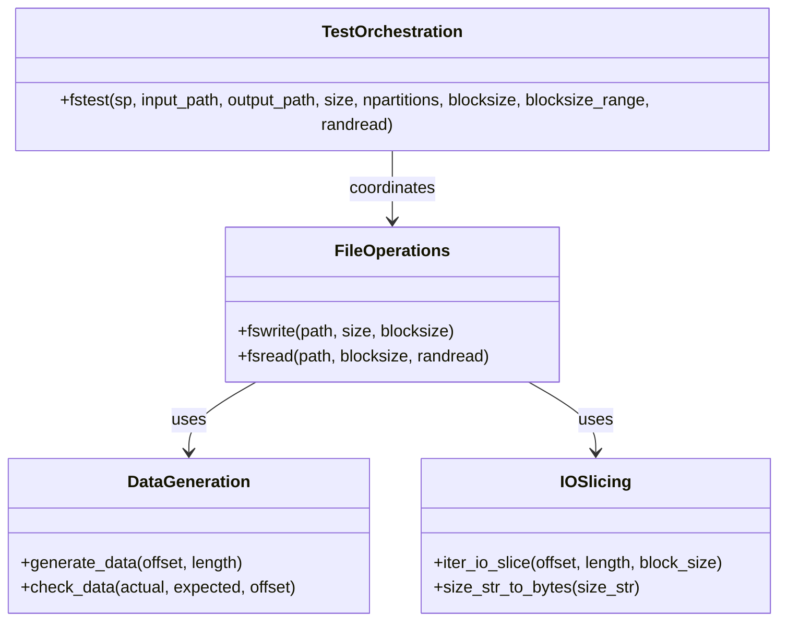
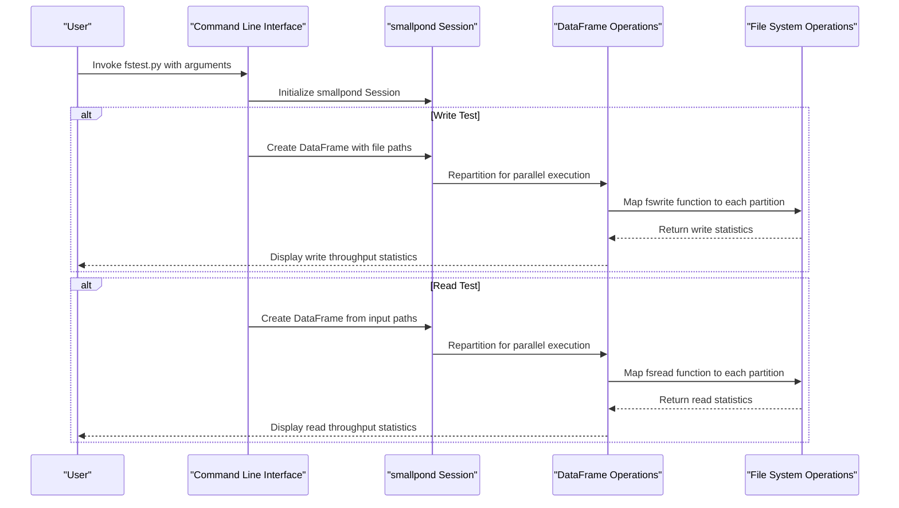

<!-- source: DeepWiki mcp.deepwiki.com · repo deepseek-ai/smallpond · page 6.2 File System Testing · fetched 2026-10-30 -->

# File System Testing

<details>
<summary>Relevant source files</summary>

The following files were used as context for generating this wiki page:

- [examples/fstest.py](examples/fstest.py)

</details>


## Purpose and Scope

This document describes the File System Testing utility included in the smallpond framework. This utility is designed to validate the correctness and performance of file system read and write operations by generating test data, writing it to files, reading it back, and verifying its integrity. The utility leverages smallpond's parallel processing capabilities to execute multiple file operations concurrently.

For information about data shuffling examples, see [Data Shuffling](#6.3). For benchmark-related file I/O testing, see [File I/O Benchmark](#5.2).

## Overview

The File System Testing utility provides a robust mechanism to validate that a file system correctly preserves data during write and read operations. It operates by generating deterministic data patterns, writing them to files, and then reading them back to verify integrity. The utility can measure throughput performance and supports various I/O patterns like sequential and random access with configurable block sizes.



**Diagram: File System Testing Workflow**

Sources: [examples/fstest.py:131-167]()

## Core Components

The File System Testing utility consists of several key components that work together to provide comprehensive file system validation:

### 1. Data Generation and Verification

The utility uses a deterministic data pattern generator that creates a predictable sequence of bytes, making it possible to verify the integrity of data after it has been written to and read from the file system.



**Diagram: File System Testing Components**

Sources: [examples/fstest.py:21-67](), [examples/fstest.py:70-128]()

### 2. Write Operation (`fswrite`)

The write operation generates test data and writes it to a specified file in blocks of configurable size, measuring throughput in the process.

Key features:
- Supports fixed or variable block sizes
- Measures and reports write throughput
- Creates deterministic data patterns for later verification

Sources: [examples/fstest.py:21-39]()

### 3. Read Operation (`fsread`)

The read operation reads data from a file, verifies its integrity by comparing it with expected data, and measures read throughput.

Key features:
- Supports both sequential and random read patterns
- Verifies data integrity against expected patterns
- Measures and reports read throughput
- Raises detailed error information upon data mismatch

Sources: [examples/fstest.py:42-67]()

### 4. I/O Pattern Management

The utility provides flexible I/O patterns through the `iter_io_slice` function, which can generate:
- Fixed-size I/O operations
- Variable-size I/O operations within a specified range
- Sequential access patterns
- Random access patterns (for read operations)

Sources: [examples/fstest.py:96-111]()

## Integration with smallpond

The File System Testing utility is built on top of the smallpond framework, leveraging its parallel processing capabilities to execute multiple file operations concurrently.



**Diagram: smallpond Integration Flow**

Sources: [examples/fstest.py:131-167](), [examples/fstest.py:169-211]()

### Key Integration Points:

1. **Session API**: The utility uses `smallpond.init()` to create a session that serves as the entry point to smallpond's functionality.

2. **DataFrame Operations**:
   - `from_items()`: Creates a DataFrame from a list of dictionaries representing file paths
   - `repartition()`: Distributes the workload across multiple partitions for parallel execution
   - `map()`: Applies the `fswrite` or `fsread` function to each file path in parallel
   - `to_pandas()`: Collects the results for reporting

3. **Parallelization**: The `-j/--npartitions` parameter controls the degree of parallelism, with each partition handling a separate file operation.

## Usage

The File System Testing utility can be run from the command line with various options to control its behavior.

### Command-Line Arguments

| Argument | Description | Default |
|----------|-------------|---------|
| `-o, --output_path` | Directory to write test files to | None |
| `-i, --input_path` | Path pattern to read test files from | None |
| `-j, --npartitions` | Number of parallel operations | 10 |
| `-s, --size` | Size of each test file (e.g., "1G") | None (required for write) |
| `-bs, --blocksize` | I/O block size (e.g., "4k") | "4k" |
| `-bsrange, --blocksize_range` | Range of I/O block sizes (e.g., "4k-128k") | None |
| `-randread, --randread` | Enable random read testing | False |

Sources: [examples/fstest.py:179-207]()

### Example Usage

Here are some common usage patterns:

1. **Write-only test** (create test files):
   ```
   python examples/fstest.py -o 'fstest' -j 8 -s 1G
   ```

2. **Read-only test** (verify existing files):
   ```
   python examples/fstest.py -i 'fstest/*'
   ```

3. **Write-then-read test** (create and verify files):
   ```
   python examples/fstest.py -o 'fstest' -j 8 -s 1G -i 'fstest/*'
   ```

4. **Random read test** with variable block sizes:
   ```
   python examples/fstest.py -i 'fstest/*' -bsrange '4k-128k' -randread
   ```

Sources: [examples/fstest.py:169-178]()

## Performance Measurement

The File System Testing utility automatically calculates and reports throughput metrics for both read and write operations:

- **Write throughput**: Measures how fast data can be written to the file system
- **Read throughput**: Measures how fast data can be read from the file system

These metrics are reported in MB/s for each file and are collected into a pandas DataFrame for easy analysis.

## Data Integrity Verification

The utility employs a deterministic data generation pattern that allows it to verify the integrity of data after it has been written to and read from the file system:

1. **Data Generation**: The `generate_data` function creates a predictable sequence of bytes based on the offset and length.
2. **Data Verification**: The `check_data` function compares the read data with the expected data and reports detailed error information in case of a mismatch.

This approach ensures that any corruption or data loss during file system operations is detected and reported.

Sources: [examples/fstest.py:70-93]()

## Summary

The File System Testing utility provides a comprehensive approach to validating file system functionality within the smallpond framework. By combining deterministic data generation, parallel execution, and thorough verification, it offers a reliable method to ensure that file systems correctly preserve data during write and read operations. It also provides valuable performance metrics to help evaluate file system throughput under various workload conditions.

---

