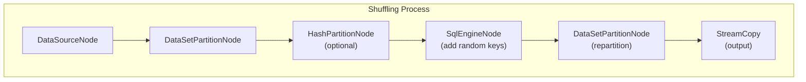
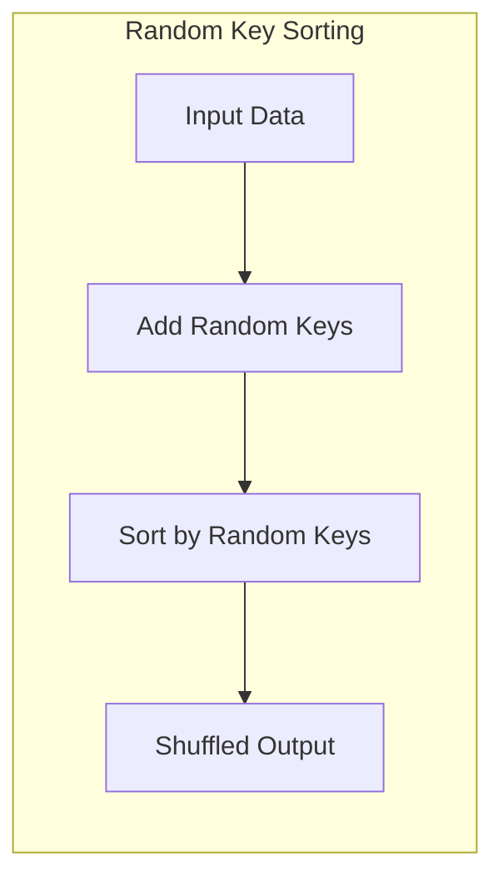
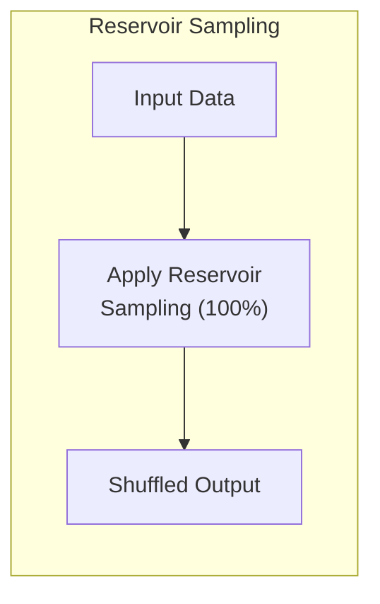
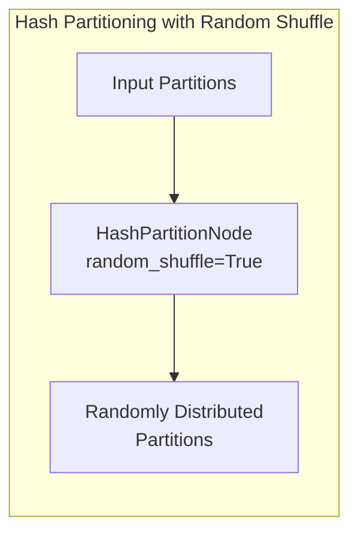
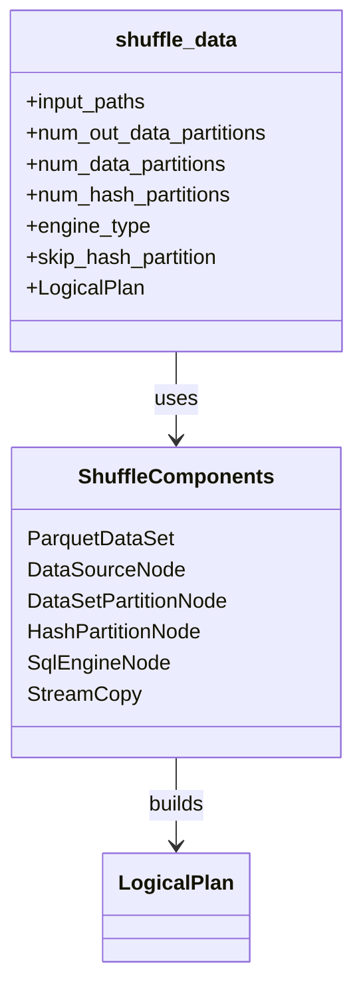
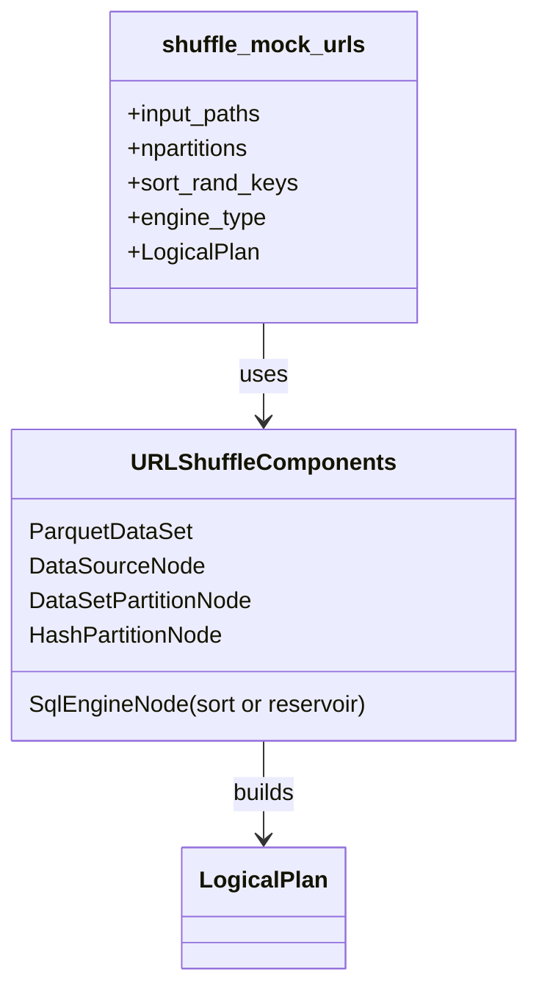
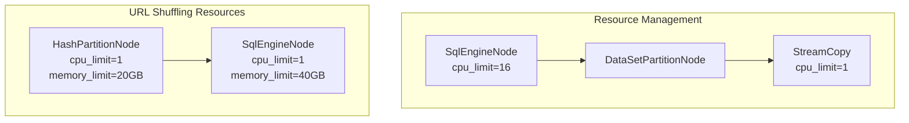

<!-- source: DeepWiki mcp.deepwiki.com · repo deepseek-ai/smallpond · page 6.3 Data Shuffling · fetched 2026-10-30 -->

# Data Shuffling

<details>
<summary>Relevant source files</summary>

The following files were used as context for generating this wiki page:

- [examples/shuffle_data.py](examples/shuffle_data.py)
- [examples/shuffle_mock_urls.py](examples/shuffle_mock_urls.py)

</details>


## Purpose and Scope

This document explains data shuffling capabilities within the smallpond framework. Data shuffling is the process of randomly rearranging data across partitions to ensure even distribution and to eliminate biases or patterns in the original data layout. This page covers both general data shuffling techniques and specialized URL shuffling implementations available in the smallpond examples.

For information about data partitioning in general, see [Partitioning and Shuffling](#4.2).

## Shuffling Process Overview

Data shuffling in smallpond involves a series of logical operations organized into a directed acyclic graph through the LogicalPlan system. The typical shuffling process follows these steps:



Sources: [examples/shuffle_data.py:13-58]()

In this process:
1. Data is loaded from a source (typically Parquet files)
2. Initial partitioning divides data into manageable chunks
3. Hash partitioning (optional) redistributes data based on random hash values
4. Random keys are added to each row and data is sorted by these keys
5. Data is repartitioned to achieve the desired output distribution
6. Results are copied to the output

## Shuffling Methods

smallpond implements several methods for introducing randomness into data distribution:

### Random Key Sorting

This approach adds a random value to each row and sorts by this random key:



Sources: [examples/shuffle_data.py:43-48](), [examples/shuffle_mock_urls.py:33-41]()

In the implementation, SQL is used to generate random values:

```
select *, cast(random() * 2147483647 as integer) as sort_key from {0} order by sort_key
```

Or with a simpler form for URL shuffling:

```
select *, random() as partition_key from {0} order by partition_key
```

### Reservoir Sampling

For URL shuffling, reservoir sampling offers an alternative method that uses DuckDB's built-in sampling capabilities:



Sources: [examples/shuffle_mock_urls.py:42-51]()

The implementation uses DuckDB's sampling syntax:

```
select * from {0} using sample 100% (reservoir, {rand_seed})
```

### Hash Partitioning with Random Shuffle

Hash partitioning can be used with the `random_shuffle` option to redistribute data randomly across partitions:



Sources: [examples/shuffle_data.py:34-42](), [examples/shuffle_mock_urls.py:19-30]()

## Implementation Examples

smallpond provides two main implementations for data shuffling:

### General Data Shuffling

The general data shuffling implementation is found in `shuffle_data.py` and supports:
- Customizable number of input partitions
- Optional hash partitioning step
- Configurable number of output partitions
- Choice of engine (DuckDB or Arrow)



Sources: [examples/shuffle_data.py:14-58]()

### URL Shuffling

The URL shuffling implementation in `shuffle_mock_urls.py` is specialized for URL data and offers:
- Two shuffling methods (random key sorting or reservoir sampling)
- Simplified partitioning scheme
- Memory and CPU limits for large-scale processing



Sources: [examples/shuffle_mock_urls.py:14-54]()

## Command-Line Arguments and Configuration

Both shuffling implementations provide command-line interfaces through the Driver system:

### General Data Shuffling Arguments

| Argument | Description | Default |
|----------|-------------|---------|
| `-i, --input_paths` | Input data paths (Parquet files) | Required |
| `-nd, --num_data_partitions` | Number of initial data partitions | 1024 |
| `-nh, --num_hash_partitions` | Number of hash partitions | 3840 |
| `-no, --num_out_data_partitions` | Number of output data partitions | 1920 |
| `-e, --engine_type` | Engine type (duckdb or arrow) | duckdb |
| `-x, --skip_hash_partition` | Skip hash partitioning step | False |

Sources: [examples/shuffle_data.py:61-70]()

### URL Shuffling Arguments

| Argument | Description | Default |
|----------|-------------|---------|
| `-i, --input_paths` | Input data paths (Parquet files) | Required |
| `-n, --npartitions` | Number of partitions | 500 |
| `-s, --sort_rand_keys` | Use sorting by random keys (vs. reservoir sampling) | False |
| `-e, --engine_type` | Engine type (duckdb or arrow) | duckdb |

Sources: [examples/shuffle_mock_urls.py:57-65]()

## Resource Management

Both shuffling implementations include resource management features to control CPU and memory usage:



Sources: [examples/shuffle_data.py:43-55](), [examples/shuffle_mock_urls.py:19-51]()

## Use Cases

Data shuffling in smallpond is particularly useful for:

1. **Benchmarking**: Creating randomized datasets for performance testing
2. **Eliminating Data Skew**: Ensuring even data distribution across partitions
3. **Machine Learning Preprocessing**: Randomizing training data to prevent learning biases
4. **Parallel Processing**: Preparing data for efficient parallel computation

The ability to process large datasets with controlled resource usage makes these implementations suitable for production environments dealing with big data.

---

