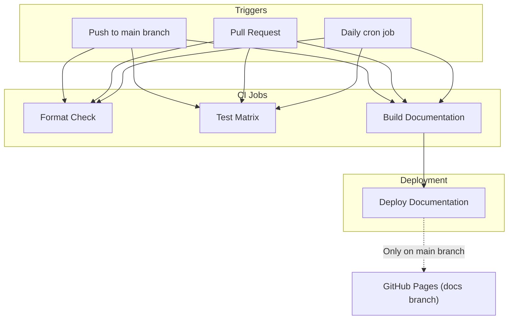
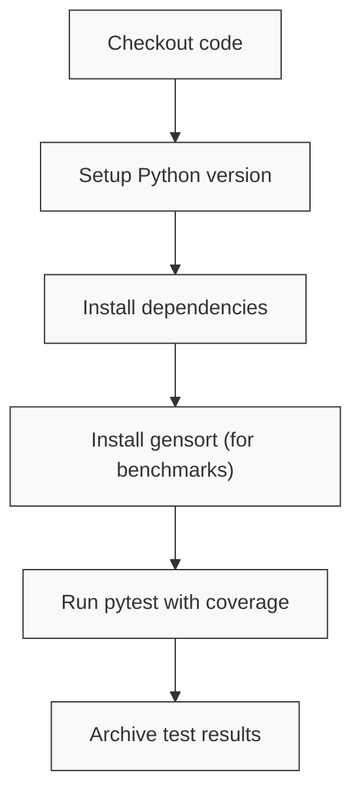
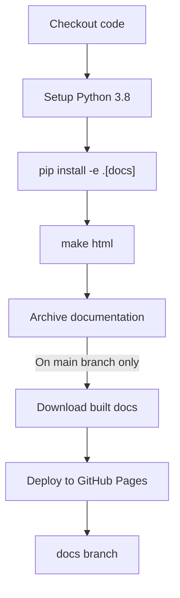
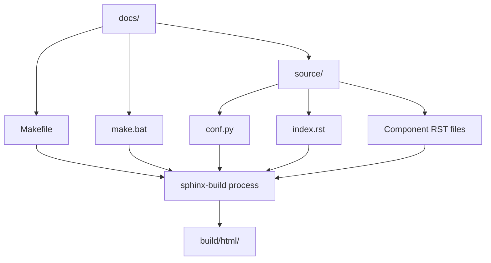

<!-- source: DeepWiki mcp.deepwiki.com · repo deepseek-ai/smallpond · page 7 Development · fetched 2026-10-30 -->

# Development

<details>
<summary>Relevant source files</summary>

The following files were used as context for generating this wiki page:

- [.github/workflows/ci.yml](.github/workflows/ci.yml)
- [docs/Makefile](docs/Makefile)
- [docs/make.bat](docs/make.bat)

</details>


This document provides essential information for developers who want to contribute to the smallpond project. It covers the development environment setup, CI/CD pipeline, contributing guidelines, and documentation processes. For details on using smallpond in your applications, see [Overview](#1) and [Core API](#2).

## Development Environment Setup

To set up your local development environment for smallpond:

1. Fork and clone the repository from GitHub
2. Install the package with development dependencies:
   ```bash
   pip install -e .[dev]
   ```
3. For documentation development, install the documentation dependencies:
   ```bash
   pip install -e .[docs]
   ```
4. For formatting code, install the required tools:
   ```bash
   pip install black
   ```

## CI/CD Pipeline

Smallpond uses GitHub Actions for continuous integration and deployment to ensure code quality and streamline the development process.

### CI Pipeline Architecture



Sources: [.github/workflows/ci.yml:3-9]()

### CI Jobs Overview

The CI system consists of several key jobs that run in parallel:

| Job Name | Purpose | Triggered By |
|----------|---------|--------------|
| Format Check | Ensures code follows the black formatting standard | All triggers |
| Test Matrix | Runs tests on multiple Python versions | All triggers |
| Build Documentation | Builds Sphinx documentation | All triggers |
| Deploy Documentation | Publishes docs to GitHub Pages | Push to main only |

Sources: [.github/workflows/ci.yml:11-126]()

### Format Check Process

The format check job ensures consistent code style using the black formatter:


Sources: [.github/workflows/ci.yml:11-33]()

### Test Execution Framework

Tests run on a matrix of Python versions (3.9, 3.10, 3.11, 3.12) to ensure broad compatibility:



The test process uses these key pytest options:
- `-n 4`: Parallel execution with 4 workers
- `-v`: Verbose output
- `-x`: Stop on first failure
- `--timeout=600`: 10-minute timeout per test
- `--cov`: Coverage reporting for core packages

Sources: [.github/workflows/ci.yml:34-78]()

### Documentation Build and Deployment

Documentation is automatically built and deployed to GitHub Pages when changes are pushed to the main branch:



Sources: [.github/workflows/ci.yml:79-126](), [docs/Makefile:1-20](), [docs/make.bat:1-36]()

## Contributing Guidelines

This section outlines the process for contributing code to the smallpond project.

### Contribution Workflow


### Code Quality Standards

Before submitting a pull request, ensure your code meets the project's quality standards:

1. **Formatting**: Format your code using black with the project's line length setting:
   ```bash
   black --line-length=150 .
   ```

2. **Tests**: Write tests for new features and ensure all tests pass:
   ```bash
   pytest -v tests/
   ```

3. **Coverage**: Maintain or improve code coverage:
   ```bash
   pytest --cov=smallpond --cov-report term tests/
   ```

### Pull Request Process

1. Create a descriptive branch name based on the feature or fix
2. Make your changes with clear, descriptive commit messages
3. Run tests locally to ensure they pass
4. Push your changes to your fork
5. Create a pull request with a clear title and description
6. Respond to review feedback and update as needed

## Documentation

The smallpond documentation is built using Sphinx and deployed to GitHub Pages.

### Documentation Architecture



Sources: [docs/Makefile:1-20](), [docs/make.bat:1-36]()

### Building Documentation Locally

To build and view the documentation locally:

1. Install documentation dependencies:
   ```bash
   pip install -e .[docs]
   ```

2. Navigate to the docs directory and build:
   ```bash
   cd docs
   make html
   ```

3. Open `docs/build/html/index.html` in your web browser

### Documentation Maintenance

When adding new features to smallpond:

1. Update relevant RST files in the `docs/source/` directory
2. For new modules or classes, add appropriate documentation strings
3. Build the documentation locally to verify your changes
4. Include documentation updates in your pull request

## Development Tools

The smallpond project relies on several key development tools:

| Tool | Purpose | Configuration |
|------|---------|---------------|
| pytest | Testing framework | In CI and for local testing |
| black | Code formatter | Line length of 150 characters |
| GitHub Actions | CI/CD platform | Configured in `.github/workflows/` |
| Sphinx | Documentation generator | Configured in `docs/source/conf.py` |
| Coverage.py | Code coverage | Used with pytest in CI |

This standardized toolset ensures consistency across all contributions to the project.

---

