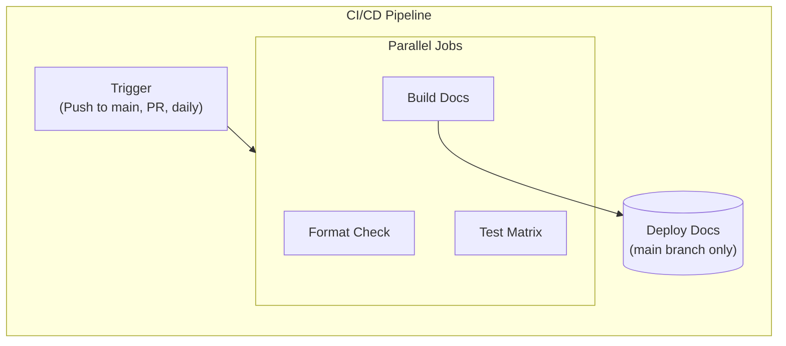
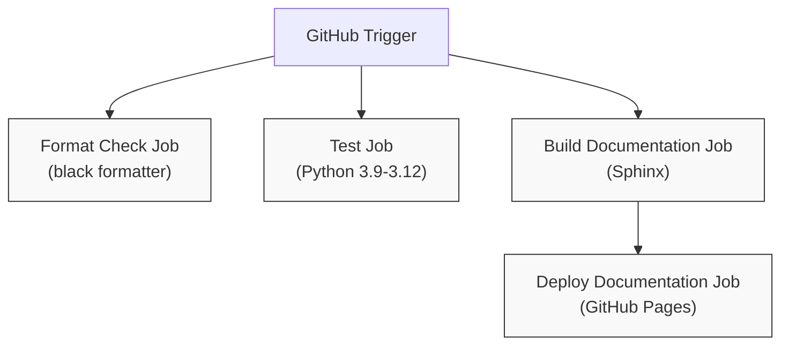
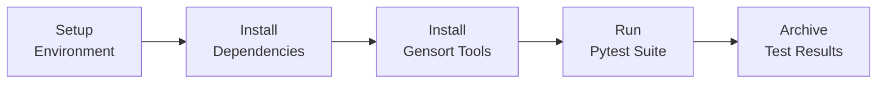
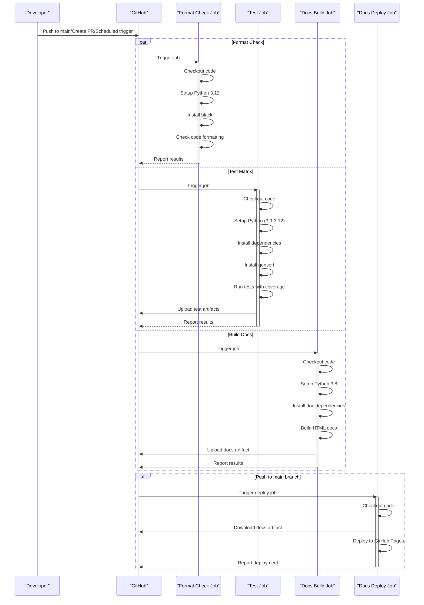

<!-- source: DeepWiki mcp.deepwiki.com · repo deepseek-ai/smallpond · page 7.1 CI/CD Pipeline · fetched 2026-10-30 -->

# CI/CD Pipeline

<details>
<summary>Relevant source files</summary>

The following files were used as context for generating this wiki page:

- [.github/workflows/ci.yml](.github/workflows/ci.yml)

</details>


This document details the Continuous Integration and Continuous Deployment (CI/CD) pipeline for the smallpond framework. It covers the automated testing, code formatting checks, and documentation building workflows that ensure code quality and reliability. For information about contributing to the project, see [Contributing](#7.2).

## Overview

The smallpond project uses GitHub Actions to implement its CI/CD pipeline, automating critical development workflows including code quality checks, testing across multiple Python versions, and documentation generation and deployment.



Sources: [.github/workflows/ci.yml:3-8](), [.github/workflows/ci.yml:10-11]()

## Pipeline Triggers

The CI pipeline is automatically triggered by the following events:

| Trigger Type | Description | Implementation |
|--------------|-------------|----------------|
| Push to main | Runs when code is pushed to the main branch | `push: branches: [ main ]` |
| Pull Request | Runs on any pull request to verify changes | `pull_request` |
| Scheduled | Runs daily at midnight UTC to ensure ongoing stability | `cron: '0 0 * * *'` |

Sources: [.github/workflows/ci.yml:3-8]()

## Pipeline Components

The CI/CD pipeline consists of four main jobs that run in parallel, with the documentation deployment depending on the successful completion of the documentation build job.



Sources: [.github/workflows/ci.yml:10-127]()

### Format Check

The Format Check job ensures consistent code style across the codebase by verifying that all Python files conform to the [black](https://black.readthedocs.io/) code formatter's style guidelines.

| Component | Description |
|-----------|-------------|
| Runner | Self-hosted |
| Python Version | 3.12 |
| Tools | black |
| Check Command | `black --check --line-length=150 .` |

Sources: [.github/workflows/ci.yml:11-33]()

### Testing

The Test job runs the comprehensive test suite to verify the correctness of the codebase. It uses a matrix strategy to test across multiple Python versions.

| Component | Description |
|-----------|-------------|
| Runner | Self-hosted |
| Python Versions | 3.9, 3.10, 3.11, 3.12 |
| Dependencies | Project with development extras (`pip install -e .[dev]`) |
| External Tools | gensort and valsort (for sorting benchmarks) |
| Test Command | pytest with parallel execution, coverage reports, and timeouts |
| Artifacts | Test results and coverage reports |



Sources: [.github/workflows/ci.yml:34-78]()

The test suite runs with the following configurations:

- Parallel execution with 4 workers (`-n 4`)
- Verbose output (`-v`)
- Stop on first failure (`-x`)
- Report test durations (`--durations=50`)
- Test timeout of 600 seconds (`--timeout=600`)
- Coverage reports for the main packages:
  - smallpond
  - examples
  - benchmarks
  - tests

Sources: [.github/workflows/ci.yml:62-69]()

### Documentation Build

The Build Documentation job generates the HTML documentation for the project using Sphinx.

| Component | Description |
|-----------|-------------|
| Runner | Self-hosted |
| Python Version | 3.8 |
| Dependencies | Project with documentation extras (`pip install -e .[docs]`) |
| Build Command | `make html` in the docs directory |
| Artifacts | Generated HTML documentation |

Sources: [.github/workflows/ci.yml:79-102]()

### Documentation Deployment

The Deploy Documentation job publishes the built documentation to GitHub Pages. This job only runs when changes are pushed to the main branch.

| Component | Description |
|-----------|-------------|
| Runner | Self-hosted |
| Trigger Condition | Push to main branch only |
| Dependencies | Build Documentation job |
| Deployment Tool | actions-gh-pages |
| Target | docs branch (GitHub Pages) |

Sources: [.github/workflows/ci.yml:104-127]()

## CI/CD Workflow Diagram

The following diagram illustrates the complete CI/CD workflow with detailed steps for each job:



Sources: [.github/workflows/ci.yml:3-127]()

## Environment Configuration

The CI/CD pipeline primarily uses self-hosted runners, with matrix testing configured across multiple Python versions to ensure compatibility.

| Environment Variable | Purpose |
|----------------------|---------|
| `GITHUB_TOKEN` | Authentication for GitHub Pages deployment |

Self-hosted runners are specified in the workflow configuration to ensure custom environments for specific testing requirements:

```yaml
runs-on: self-hosted
```

Sources: [.github/workflows/ci.yml:13](), [.github/workflows/ci.yml:36](), [.github/workflows/ci.yml:39](), [.github/workflows/ci.yml:106](), [.github/workflows/ci.yml:121]()

## Working with the CI/CD Pipeline

Developers should be aware of the following guidelines when working with the smallpond CI/CD pipeline:

1. **Code formatting**: Ensure your code is formatted with black before submitting a pull request:
   ```bash
   black --line-length=150 .
   ```

2. **Test coverage**: Run the test suite locally before pushing changes:
   ```bash
   pip install -e .[dev]
   pytest -v
   ```

3. **Documentation**: If updating documentation, build it locally to verify changes:
   ```bash
   pip install -e .[docs]
   cd docs
   make html
   ```

4. **CI failures**: If CI checks fail, review the logs in the GitHub Actions interface to identify and fix the issues.

Sources: [.github/workflows/ci.yml:11-33](), [.github/workflows/ci.yml:34-78](), [.github/workflows/ci.yml:79-102]()

## Common Issues and Troubleshooting

| Issue | Resolution |
|-------|------------|
| Format check failures | Run `black --line-length=150 .` locally and commit the changes |
| Test failures | Check the test logs for specific failures and fix the related code |
| Documentation build failures | Ensure proper syntax in docstrings and documentation files |
| Missing gensort | The CI automatically installs gensort for testing; for local testing, download it from [ordinal.com](https://www.ordinal.com/try.cgi/) |

Sources: [.github/workflows/ci.yml:29](), [.github/workflows/ci.yml:54-61](), [.github/workflows/ci.yml:62-69]()

---

