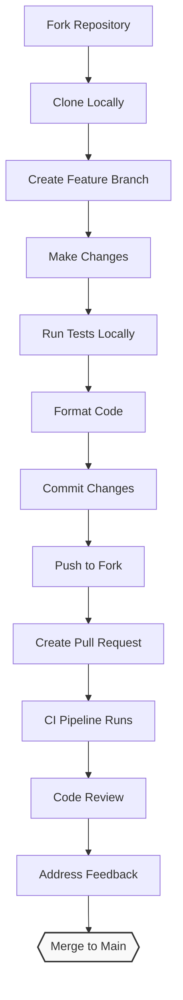
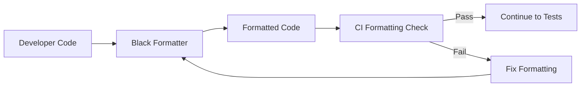
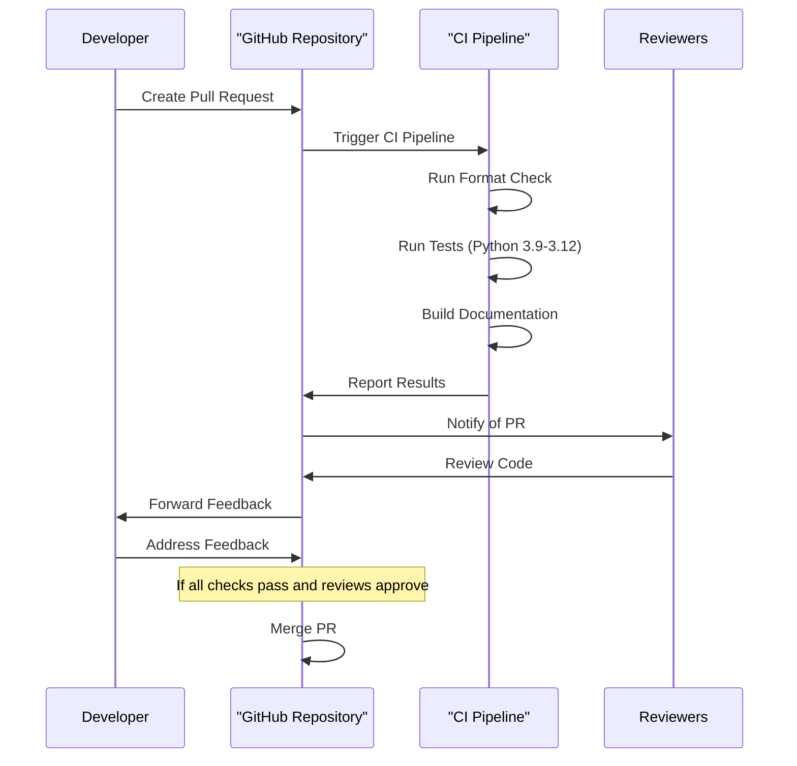
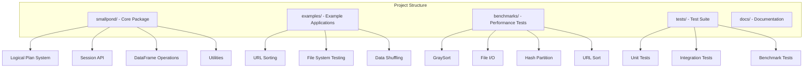

<!-- source: DeepWiki mcp.deepwiki.com · repo deepseek-ai/smallpond · page 7.2 Contributing · fetched 2026-10-30 -->

# Contributing

<details>
<summary>Relevant source files</summary>

The following files were used as context for generating this wiki page:

- [.github/workflows/ci.yml](.github/workflows/ci.yml)
- [.gitignore](.gitignore)
- [MANIFEST.in](MANIFEST.in)

</details>


This document outlines how to contribute to the smallpond project. It covers the development workflow, coding standards, testing requirements, and the process for submitting changes. For information about the CI/CD pipeline specifically, see [CI/CD Pipeline](#7.1), and for documentation guidelines, see [Documentation](#7.3).

## Setting Up Development Environment

Before contributing to smallpond, you'll need to set up your development environment properly.

### Prerequisites

- Python 3.9 or newer (the project supports Python 3.9, 3.10, 3.11, and 3.12)
- Git
- pip (latest version recommended)

### Installation Steps

1. Fork the repository on GitHub
2. Clone your fork locally
3. Install smallpond in development mode with all dependencies:

```bash
# Install the package in development mode with dev dependencies
pip install -e .[dev]
```

This installs the package with all development dependencies, making it ready for contributions.

Sources: [.github/workflows/ci.yml:49-52]()

## Contribution Workflow

The diagram below illustrates the typical contribution workflow for the smallpond project:



### Branch Naming Conventions

When creating a new branch for your contribution, follow these naming conventions:

- `feature/short-description` - For new features
- `bugfix/issue-number-description` - For bug fixes
- `docs/what-changed` - For documentation updates
- `test/what-changed` - For test additions or improvements

Sources: [.github/workflows/ci.yml:3-8]()

## Code Style and Standards

The smallpond project maintains consistent code style through automated formatting tools and established conventions.

### Code Formatting

The project uses Black for code formatting with a line length of 150 characters. Before submitting your contribution, ensure your code is properly formatted:

```bash
# Check formatting without making changes
black --check --line-length=150 .

# Format code
black --line-length=150 .
```

The CI pipeline will automatically check code formatting, and PRs with improperly formatted code will fail the checks.



Sources: [.github/workflows/ci.yml:22-29]()

## Testing

Comprehensive testing is a core requirement for all contributions to smallpond.

### Running Tests

The project uses pytest for testing. To run the test suite locally:

```bash
# Run tests with parallel execution and coverage
pytest -n 4 -v -x --durations=50 --cov=smallpond --cov=examples --cov=benchmarks --cov=tests tests/test_*.py
```

For GraySort benchmark tests, you'll need to install the gensort and valsort utilities:

```bash
wget https://www.ordinal.com/try.cgi/gensort-linux-1.5.tar.gz
tar -xzf gensort-linux-1.5.tar.gz
chmod +x 64/gensort 64/valsort
export PATH=$PATH:$(pwd)/64
```

### Writing Tests

When adding new features, make sure to include appropriate tests that cover the functionality. Tests should be placed in the `tests/` directory with filenames that match the pattern `test_*.py`.

Sources: [.github/workflows/ci.yml:54-69]()

## Pull Request Process



### Creating a Pull Request

1. Ensure all tests pass locally
2. Push your changes to your forked repository
3. Create a pull request to the main branch of the smallpond repository
4. Fill in the PR template with:
   - Description of changes
   - Related issue(s)
   - Type of change (bugfix, feature, etc.)
   - Testing performed

### CI Pipeline

When you submit a pull request, the CI pipeline automatically runs the following checks:

1. Code formatting validation with Black
2. Tests on multiple Python versions (3.9, 3.10, 3.11, 3.12)
3. Documentation builds

All checks must pass before a PR can be merged.

Sources: [.github/workflows/ci.yml:10-78]()

## Documentation

Good documentation is essential for the project. When adding new features or modifying existing ones, ensure documentation is updated accordingly.

### Building Documentation Locally

To build the documentation locally:

```bash
# Install documentation dependencies
pip install -e .[docs]

# Build HTML documentation
cd docs
make html
```

The built documentation will be available in the `docs/build/html` directory.

Sources: [.github/workflows/ci.yml:79-102]()

## Code Organization

Understanding the codebase structure helps when making contributions. The main components of smallpond are organized as follows:



When contributing, ensure your changes follow this organizational structure and adhere to the existing architecture patterns.

Sources: [.gitignore:1-18]()

## General Guidelines

1. **Keep changes focused**: PRs should address a single concern rather than including multiple unrelated changes
2. **Write meaningful commit messages**: Follow conventional commit message format when possible
3. **Add tests**: New features or bug fixes should include appropriate tests
4. **Update documentation**: Ensure documentation reflects your changes
5. **Respect the existing code style**: Follow the patterns and conventions already established in the codebase

## Getting Help

If you need assistance while contributing, consider:

1. Opening a discussion on GitHub
2. Reaching out to the project maintainers
3. Looking at existing issues and pull requests for reference

By following these guidelines, you'll help ensure a smooth contribution process for both you and the project maintainers.

---

