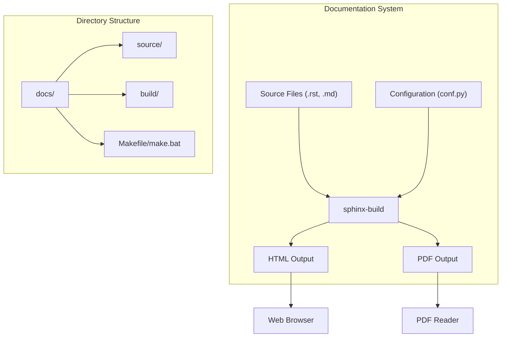
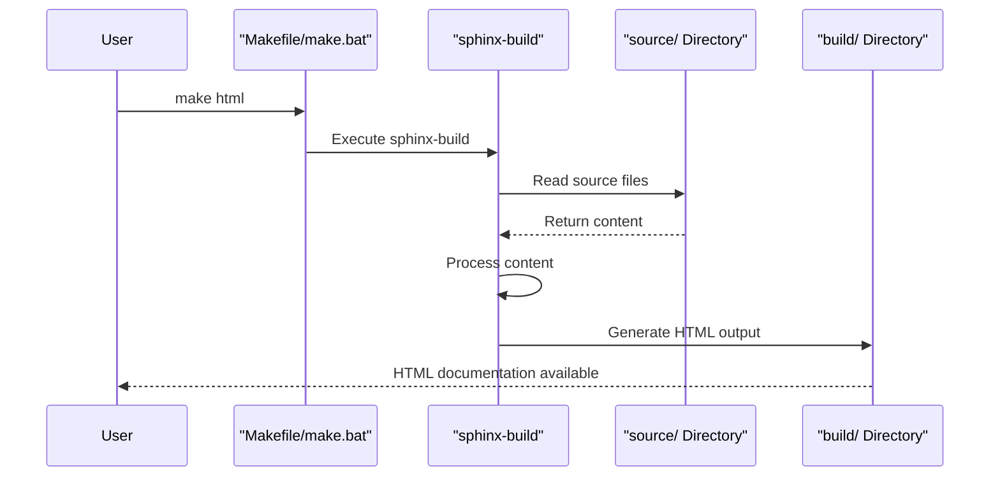
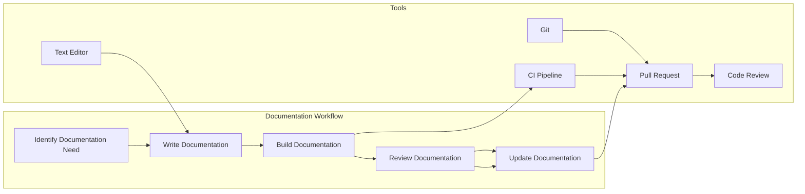
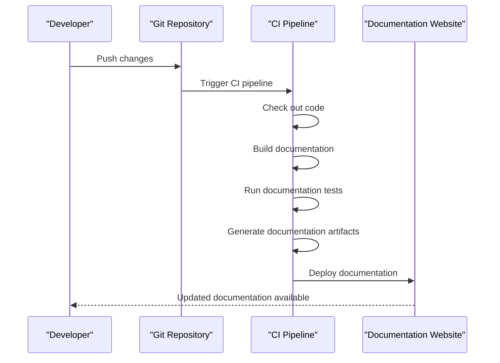
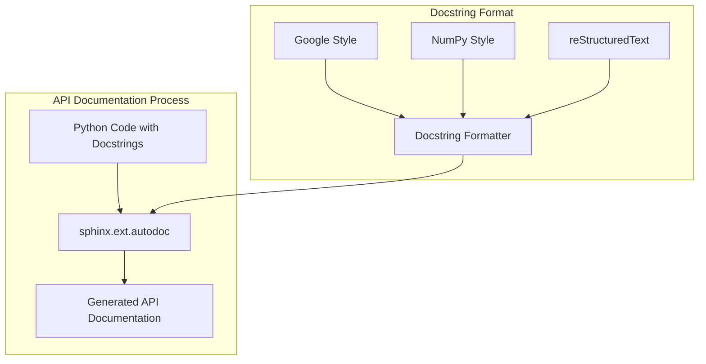

<!-- source: DeepWiki mcp.deepwiki.com · repo deepseek-ai/smallpond · page 7.3 Documentation · fetched 2026-10-30 -->

# Documentation

<details>
<summary>Relevant source files</summary>

The following files were used as context for generating this wiki page:

- [docs/Makefile](docs/Makefile)
- [docs/make.bat](docs/make.bat)

</details>


This page explains how to build, maintain, and contribute to the smallpond documentation system. The documentation for smallpond is built using Sphinx, a popular Python documentation generator. For information about contributing to the code itself, see [Contributing](#7.2).

## Documentation System Overview

Smallpond uses Sphinx to generate its documentation from source files. Sphinx converts structured text files into various output formats, including HTML, PDF, and others, making it suitable for comprehensive project documentation.



Sources: [docs/Makefile:1-21](), [docs/make.bat:1-36]()

## Building the Documentation

The documentation can be built using the provided Makefile (for Unix-based systems) or make.bat (for Windows). The build process compiles the source documentation files into the desired output format.

### Prerequisites

Before building the documentation, ensure you have the following installed:
- Python (3.6 or later)
- Sphinx (`pip install sphinx`)
- Any required Sphinx extensions (specified in the configuration file)

### Build Commands

```bash
# Navigate to the docs directory
cd docs

# Build HTML documentation
make html

# Build PDF documentation (requires LaTeX)
make latexpdf

# Clean the build directory
make clean
```

For Windows users, replace `make` with `make.bat`.



Sources: [docs/Makefile:1-21](), [docs/make.bat:1-36]()

## Documentation Structure

The documentation is organized in a hierarchical structure, with source files located in the `source/` directory. The structure typically follows the project's architecture, with separate sections for various components and features.

| Directory/File        | Purpose                                               |
|-----------------------|-------------------------------------------------------|
| `source/`             | Root directory for documentation source files          |
| `source/conf.py`      | Sphinx configuration file                             |
| `source/index.rst`    | Main index file for the documentation                 |
| `source/_static/`     | Static files (images, CSS, etc.)                      |
| `source/_templates/`  | Custom Sphinx templates                               |
| `build/`              | Output directory for built documentation              |

## Contributing to Documentation

When contributing to the smallpond documentation, follow these guidelines to maintain consistency and quality:

### Documentation Format

Smallpond documentation uses either reStructuredText (.rst) or Markdown (.md) format for source files. Both formats support rich text formatting, code blocks, tables, and cross-references.

### Documentation Style Guidelines

1. **Clear and Concise**: Write clear, concise explanations without unnecessary jargon
2. **Code Examples**: Include working code examples to demonstrate functionality
3. **Cross-References**: Use Sphinx cross-references to link related documentation
4. **Diagrams**: Use diagrams to illustrate complex concepts or workflows
5. **Consistency**: Maintain consistent terminology and formatting throughout

### Documentation Workflow



## Documentation Automation

The documentation build process can be automated using Continuous Integration (CI) pipelines. This ensures that documentation is always up-to-date with the latest code changes.



## Sphinx Configuration

The Sphinx configuration file (`conf.py`) contains settings for the documentation build process, including:

- Project information (name, version, authors)
- Extensions to enable
- Theme configuration
- Output options
- Custom settings

## Troubleshooting Documentation Issues

| Issue                              | Possible Solution                                    |
|------------------------------------|------------------------------------------------------|
| Build errors                       | Check syntax in source files, ensure dependencies are installed |
| Missing content                    | Verify file paths and cross-references               |
| Formatting issues                  | Review syntax for the specific format (RST or MD)    |
| Sphinx extension errors            | Check extension compatibility and configuration      |
| Image or diagram issues            | Verify file paths and syntax for including media     |

Sources: [docs/Makefile:1-21](), [docs/make.bat:1-36]()

## API Documentation

For API documentation, it's recommended to use docstrings in the code that can be automatically extracted by Sphinx using extensions like `sphinx.ext.autodoc`. This ensures that the API documentation stays in sync with the code.



Sources: [docs/Makefile:1-21](), [docs/make.bat:1-36]()

## Conclusion

Maintaining comprehensive and accurate documentation is essential for the smallpond project. By following these guidelines and utilizing the Sphinx documentation system, contributors can ensure that the documentation remains valuable and up-to-date for users and developers of the framework.