# Page: Overview

# Overview

<details>
<summary>Relevant source files</summary>

The following files were used as context for generating this wiki page:

- [README.md](README.md)
- [smallpond/common.py](smallpond/common.py)

</details>


This page provides an introduction to Smallpond, a lightweight, high-performance data processing framework built on DuckDB and 3FS. Smallpond enables efficient processing of large-scale datasets without requiring long-running services, making it suitable for both batch processing and analytical workloads.

For detailed architecture information, see [Architecture](#1.1). For installation and basic usage, see [Getting Started](#1.2).

## What is Smallpond?

Smallpond is a Python-based data processing framework designed to handle large-scale data operations efficiently. By leveraging DuckDB for query processing and 3FS for distributed storage, Smallpond provides a scalable solution for data operations ranging from gigabytes to petabytes in size.

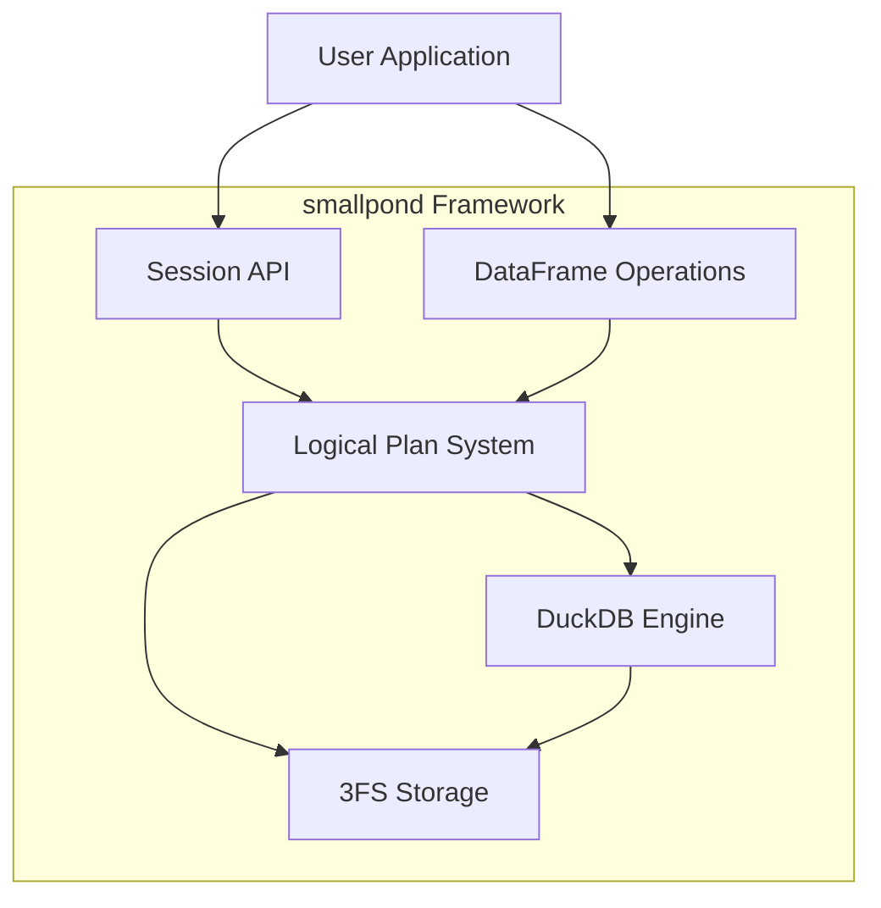

Title: Core Components of Smallpond

Sources: [README.md:8-15](), [smallpond/common.py:10-29]()

## Key Features

Smallpond offers several distinctive features that make it powerful for data processing tasks:

- **High Performance**: Built on DuckDB's columnar query engine for fast analytical processing.
- **Scalability**: Capable of handling datasets from megabytes to petabytes.
- **Simple Deployment**: No need for long-running services or complex cluster setup.
- **Flexible Processing**: Supports operations like partitioning, shuffling, and sorting large datasets.
- **SQL Integration**: Seamless integration with SQL through DuckDB.
- **Distributed Processing**: Works with 3FS distributed file system for large-scale processing.

The framework has been proven to handle massive workloads, such as sorting 110.5TiB of data in approximately 30 minutes using the GraySort benchmark.

Sources: [README.md:10-15](), [README.md:57-60]()

## System Architecture

Smallpond's architecture consists of several layers working together to provide a complete data processing solution.

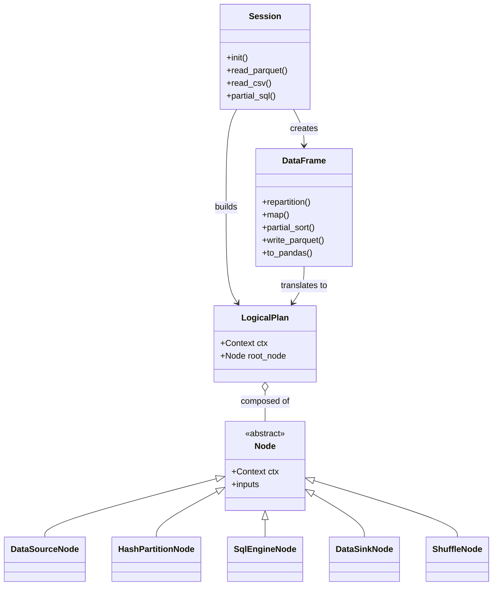

Title: Smallpond Component Architecture

Sources: [README.md:32-47](), [smallpond/common.py:9-29]()

### Key Components

1. **Session API**: The primary interface for users, providing methods to initialize a session, read data, and perform SQL operations.

2. **DataFrame**: Represents a distributed dataset with operations like repartition, map, and sort.

3. **Logical Plan System**: The execution framework that transforms high-level operations into a directed acyclic graph (DAG) of processing nodes.

4. **DuckDB Engine**: The underlying query execution engine that provides SQL processing capabilities.

5. **3FS Storage**: The distributed file system that enables large-scale data processing.

Sources: [README.md:32-47]()

## Data Processing Flow

A typical data processing workflow in Smallpond follows these steps:

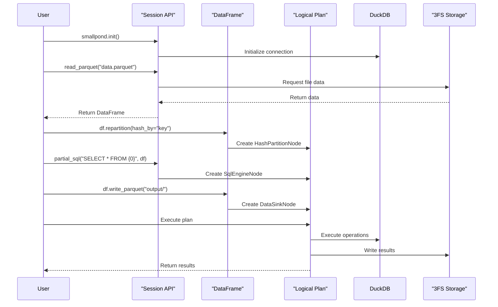

Title: Smallpond Data Processing Flow

Sources: [README.md:32-47]()

## Usage Example

Here's a basic example of using Smallpond to process data:

1. Initialize a session
2. Read data from a Parquet file
3. Repartition the data based on a column
4. Execute SQL on the data
5. Write results or convert to pandas

The framework provides constants for common size units (`KB`, `MB`, `GB`, `TB`) and default configuration values that can be used when processing data.

Sources: [README.md:26-48](), [smallpond/common.py:10-29]()

## Performance Characteristics

Smallpond is designed for high-performance data processing, with several optimizations:

- **Partitioning and Shuffling**: Efficient redistribution of data for parallel processing
- **Row Group Optimization**: Configurable row group sizes for Parquet files
- **Memory Management**: Controls to manage memory usage during processing
- **Batch Processing**: Default batch sizes optimized for performance

The framework has been evaluated using the GraySort benchmark on a cluster of 50 compute nodes and 25 storage nodes, achieving an impressive throughput of 3.66TiB/min when sorting 110.5TiB of data.

Sources: [README.md:57-60](), [smallpond/common.py:10-29]()

## Related Documentation

Smallpond's documentation is organized into several sections:

- [Architecture](#1.1): Detailed architectural overview
- [Getting Started](#1.2): Installation and basic usage
- [Key Concepts](#1.3): Fundamental concepts like sessions and DataFrames
- [Core API](#2): Main API components and interfaces
- [Logical Plan System](#3): Execution framework for data operations
- [Data Processing](#4): Reading, writing, and transforming data
- [Benchmarking](#5): Performance measurement tools
- [Examples](#6): Sample applications demonstrating usage

## Summary

Smallpond is a lightweight yet powerful data processing framework that combines the analytical capabilities of DuckDB with the distributed storage of 3FS. It provides a flexible and efficient solution for processing large datasets without the complexity of traditional big data systems. The framework's architecture enables seamless scaling from small datasets to petabyte-scale processing with minimal configuration.

Sources: [README.md:8-15](), [README.md:57-60]()

---

# Page: Architecture

# Architecture

<details>
<summary>Relevant source files</summary>

The following files were used as context for generating this wiki page:

- [README.md](README.md)
- [smallpond/common.py](smallpond/common.py)

</details>


This document provides a detailed overview of the smallpond framework architecture, explaining its components, interactions, and design principles. For information about installation and basic usage, see [Getting Started](#1.2). For an explanation of fundamental concepts, see [Key Concepts](#1.3).

## System Overview

Smallpond is a lightweight data processing framework built on [DuckDB](https://duckdb.org/) and [3FS](https://github.com/deepseek-ai/3FS), designed for high-performance data processing at scale without requiring long-running services. The architecture follows a layered approach, separating high-level APIs from execution planning and underlying storage and compute engines.

### High-Level Architecture

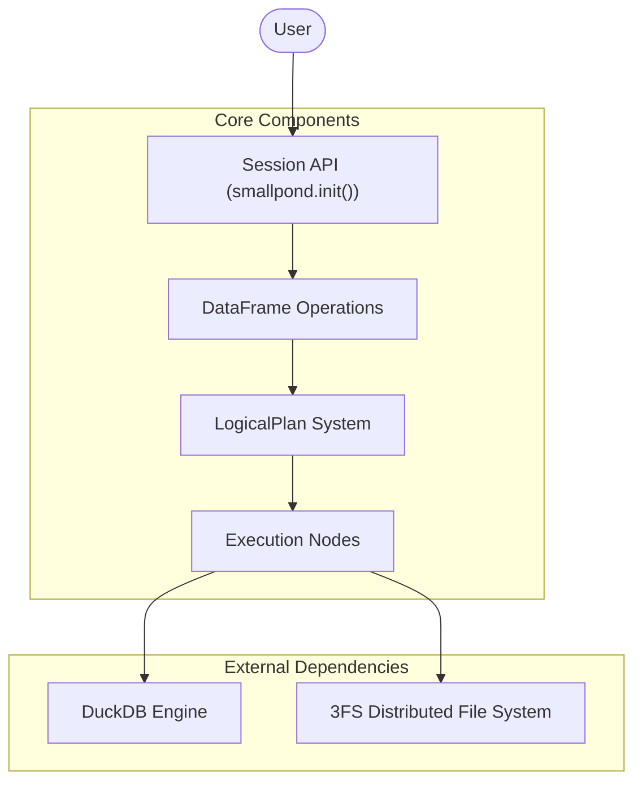

Sources: [README.md:8-15]()

## Core Components

### Session API

The Session API provides the primary entry point for users to interact with smallpond. It offers methods for initializing a session, reading data, creating DataFrames, executing SQL queries, and writing results.

```python
# Example usage
import smallpond
sp = smallpond.init()
df = sp.read_parquet("data.parquet")
df = df.repartition(3, hash_by="column_name")
df = sp.partial_sql("SELECT * FROM {0} WHERE value > 100", df)
df.write_parquet("output/")
```

Sources: [README.md:34-47]()

### DataFrame Operations

The DataFrame abstraction represents a dataset that can be processed and transformed through a variety of operations. The DataFrame is not loaded entirely into memory; instead, it represents a reference to data that may be distributed across multiple files and partitions.

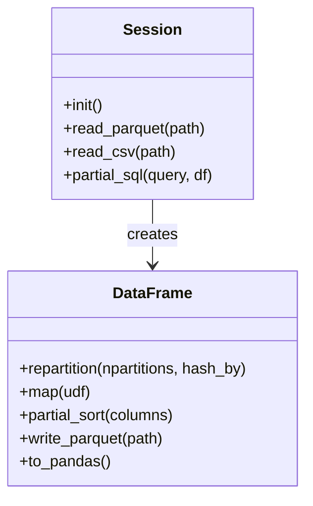

Sources: Based on examples in [README.md:34-48]()

### Logical Plan System

The LogicalPlan system is the core execution framework for complex data operations in smallpond. It represents the execution plan as a directed acyclic graph (DAG) of nodes, where each node represents a specific operation.

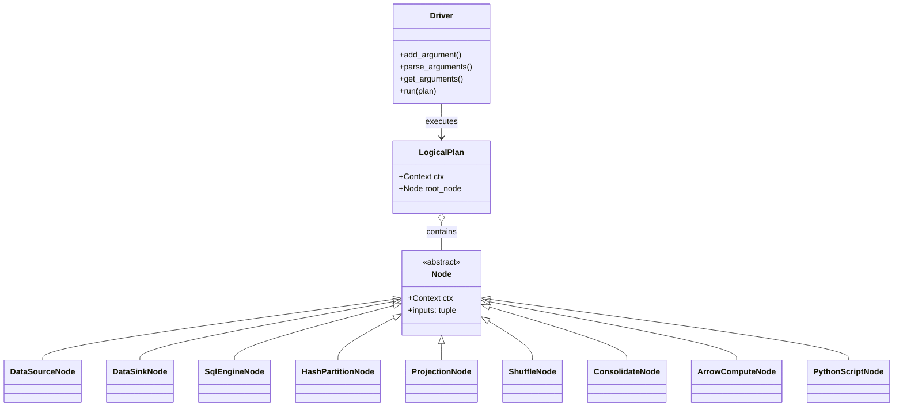

Sources: From the provided high-level diagrams

### Node Types

The Logical Plan system includes various node types, each handling specific operations in the data processing pipeline:

| Node Type | Purpose |
|-----------|---------|
| DataSourceNode | Reads data from storage (files, etc.) |
| DataSinkNode | Writes data to storage |
| SqlEngineNode | Executes SQL queries via DuckDB |
| HashPartitionNode | Partitions data based on hash values |
| ProjectionNode | Selects specific columns |
| ShuffleNode | Redistributes data across partitions |
| ConsolidateNode | Combines partitioned data |
| ArrowComputeNode | Performs operations using Apache Arrow |
| PythonScriptNode | Executes Python code on data |
| DataSetPartitionNode | Partitions datasets |
| StreamCopy | Copies data between streams |

Sources: From the provided high-level diagrams

## Data Flow

### Typical Processing Workflow

A typical data processing workflow in smallpond follows these steps:

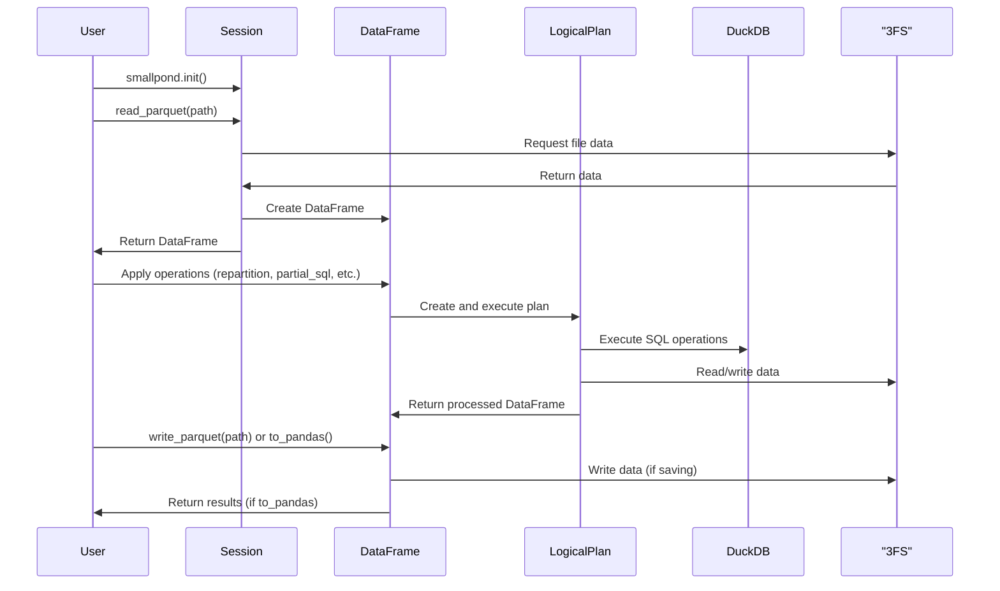

Sources: Based on examples in [README.md:32-48]()

### Flow Through Components

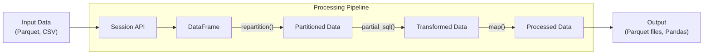

Sources: Based on workflow in [README.md:32-48]()

## Integration with External Systems

### DuckDB Integration

Smallpond leverages DuckDB as its SQL execution engine, providing:
- In-process SQL processing capabilities
- Efficient columnar data operations
- SQL query execution via the `partial_sql` method

### 3FS Integration

3FS serves as the distributed file system for smallpond, offering:
- Scalable storage for large datasets
- Distributed file operations
- Support for handling petabyte-scale data

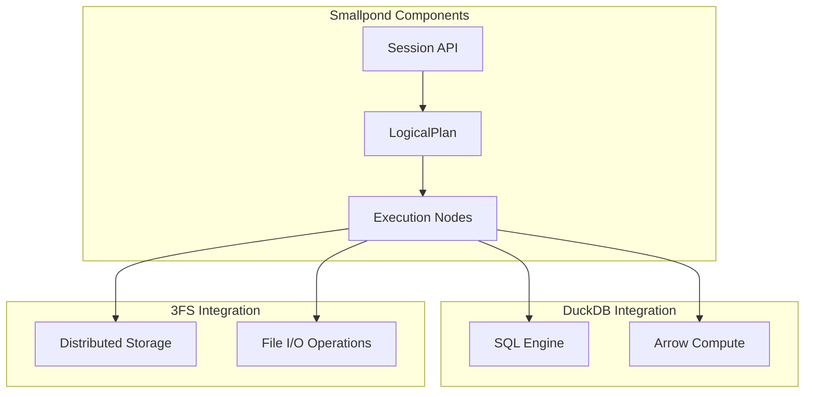

Sources: [README.md:8]() and provided diagrams

## System Constants and Configuration

Smallpond defines several important constants for system configuration:

| Constant | Value | Purpose |
|----------|-------|---------|
| KB, MB, GB, TB | Size units | Memory and storage size units |
| MAX_ROW_GROUP_SIZE | 10 * 1024 * 1024 | Maximum row group size for Parquet files |
| MAX_ROW_GROUP_BYTES | 2 * GB | Maximum row group size in bytes |
| MAX_PARQUET_FILE_BYTES | 8 * GB | Maximum size for a single Parquet file |
| DEFAULT_ROW_GROUP_SIZE | 122880 | Default row group size |
| DEFAULT_BATCH_SIZE | 122880 | Default batch size for processing |

Sources: [smallpond/common.py:10-29]()

## Design Principles

Smallpond's architecture is guided by several key design principles:

### 1. Layered Architecture

Clear separation between high-level APIs (Session), execution planning (LogicalPlan), and underlying engines (DuckDB, 3FS).

### 2. Composability

The node-based logical plan system allows complex data processing pipelines to be built from simple, composable operations.

### 3. Multiple API Styles

- A high-level, fluent API through the Session object (e.g., `df.repartition().partial_sort()`)
- A lower-level, more explicit API through the LogicalPlan system

### 4. Performance Focus

The architecture emphasizes performance for large-scale data processing, demonstrated by benchmarks like GraySort:

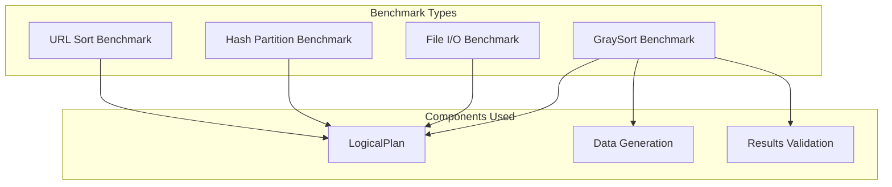

Sources: [README.md:56-60]() and provided diagrams

### 5. Extensibility

Various node types and engine options (DuckDB, Arrow, custom) allow for extending the system's capabilities.

## Performance Characteristics

Smallpond is designed for high-performance data processing, demonstrated by its GraySort benchmark results:

- Sorted 110.5TiB of data in 30 minutes and 14 seconds
- Achieved an average throughput of 3.66TiB/min
- Utilized a cluster of 50 compute nodes and 25 storage nodes

Sources: [README.md:56-60]()

## Conclusion

Smallpond provides a lightweight yet powerful data processing framework by combining:

1. A user-friendly Session API
2. A flexible LogicalPlan execution system
3. Efficient integration with DuckDB for SQL processing
4. Scalable storage through 3FS

This architecture enables processing of petabyte-scale datasets with high performance while maintaining a simple interface for users.

For more information on using the framework, see the [Core API](#2) section of the documentation.

---

# Page: Getting Started

# Getting Started

<details>
<summary>Relevant source files</summary>

The following files were used as context for generating this wiki page:

- [LICENSE](LICENSE)
- [README.md](README.md)

</details>


This guide provides step-by-step instructions for installing and running your first Smallpond data processing workflow. It covers installation, basic usage patterns, and demonstrates how to load, transform, and save data. For more detailed information about core concepts and the API, see [Key Concepts](#1.3) and [Core API](#2).

## Installation

Smallpond supports Python 3.8 to 3.12. Installation is straightforward using pip:

```bash
pip install smallpond
```

To install with development tools for contributing to the project:

```bash
pip install .[dev]
```

For documentation development:

```bash
pip install .[docs]
```

Sources: [README.md:16-22](), [README.md:69-81]()

## Basic Usage Flow

A typical Smallpond workflow follows these steps:


Let's walk through this workflow with a simple example using each step.

Sources: [README.md:24-48]()

### Step 1: Initialize a Session

The first step in any Smallpond workflow is to create a session:

```python
import smallpond

# Initialize session
sp = smallpond.init()
```

This initializes a session that serves as your entry point to the Smallpond framework. The session object manages connections to the underlying DuckDB engine and provides access to data loading and processing capabilities.

Sources: [README.md:31-35]()

### Step 2: Load Data

After initializing a session, you can load data from various sources. Here's an example loading a Parquet file:

```python
# Load data from Parquet file
df = sp.read_parquet("prices.parquet")
```

You can download sample data for this example:

```bash
wget https://duckdb.org/data/prices.parquet
```

Sources: [README.md:26-38]()

### Step 3: Transform Data

Smallpond provides various operations for data transformation. Here's an example that:
1. Repartitions the data based on a specific column
2. Runs a SQL query to calculate statistics

```python
# Repartition by ticker symbol with 3 partitions
df = df.repartition(3, hash_by="ticker")

# Run a SQL query to calculate min and max prices by ticker
df = sp.partial_sql("SELECT ticker, min(price), max(price) FROM {0} GROUP BY ticker", df)
```

Sources: [README.md:40-42]()

### Step 4: Save and View Results

Once you've transformed your data, you can save the results to disk and/or convert them to a pandas DataFrame for further analysis:

```python
# Save to Parquet files
df.write_parquet("output/")

# Convert to pandas DataFrame and display
print(df.to_pandas())
```

Sources: [README.md:44-47]()

## System Components Interaction

The following diagram shows how your code interacts with the Smallpond framework's components during a typical workflow:

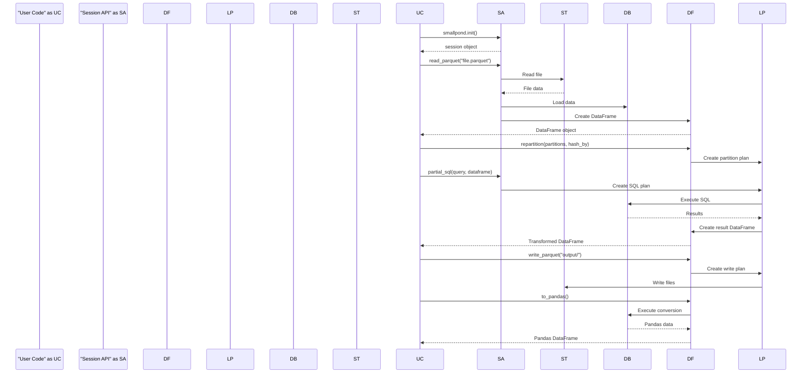

Sources: [README.md:24-48]()

## Code Entity Relationships

This diagram shows the relationship between key code entities in the Smallpond API that you'll interact with:

```mermaid
classDiagram
    class "smallpond" {
        +init() Session
    }
    
    class "Session" {
        +read_parquet(path) DataFrame
        +read_csv(path) DataFrame
        +partial_sql(query, df) DataFrame
    }
    
    class "DataFrame" {
        +repartition(n_parts, hash_by) DataFrame
        +map(map_fn) DataFrame
        +partial_sort(by, asc) DataFrame
        +write_parquet(path) None
        +to_pandas() pandas.DataFrame
    }
    
    smallpond ..> Session : creates
    Session ..> DataFrame : produces
    DataFrame ..> DataFrame : transforms
```

Sources: [README.md:31-47]()

## Complete Example

Here's a complete example that demonstrates a basic Smallpond workflow from start to finish:

```python
import smallpond

# Initialize session
sp = smallpond.init()

# Load data
df = sp.read_parquet("prices.parquet")

# Process data
df = df.repartition(3, hash_by="ticker")
df = sp.partial_sql("SELECT ticker, min(price), max(price) FROM {0} GROUP BY ticker", df)

# Save results
df.write_parquet("output/")

# Show results
print(df.to_pandas())
```

This example:
1. Initializes a Smallpond session
2. Loads stock price data from a Parquet file
3. Repartitions the data into 3 partitions based on the ticker symbol
4. Runs a SQL query to calculate the minimum and maximum price for each ticker
5. Saves the results to Parquet files in an "output" directory
6. Converts the results to a pandas DataFrame and displays them

Sources: [README.md:31-47]()

## Next Steps

Now that you have a basic understanding of how to use Smallpond, you can explore more advanced features:

- Learn about [Key Concepts](#1.3) to understand sessions, DataFrames, and partitioning in more detail
- Explore the [Session API](#2.1) for more detailed information on session initialization and operations
- Discover [DataFrame Operations](#2.2) for a comprehensive list of data transformation methods
- See how to use [SQL Integration](#2.3) for complex data processing tasks
- Read about [Reading and Writing Data](#4.1) for working with different file formats

For examples of real-world applications built with Smallpond, check out the [Examples](#6) section.

---

# Page: Key Concepts

# Key Concepts

<details>
<summary>Relevant source files</summary>

The following files were used as context for generating this wiki page:

- [README.md](README.md)
- [smallpond/common.py](smallpond/common.py)

</details>


This page explains the fundamental concepts in smallpond, such as sessions, DataFrames, partitioning, and SQL integration. Understanding these concepts is essential for effectively using the smallpond framework. For details on specific APIs, see [Core API](#2), and for information about the execution framework, see [Logical Plan System](#3).

## Core Components Overview

Smallpond is built around several key components that work together to provide a lightweight yet powerful data processing framework.

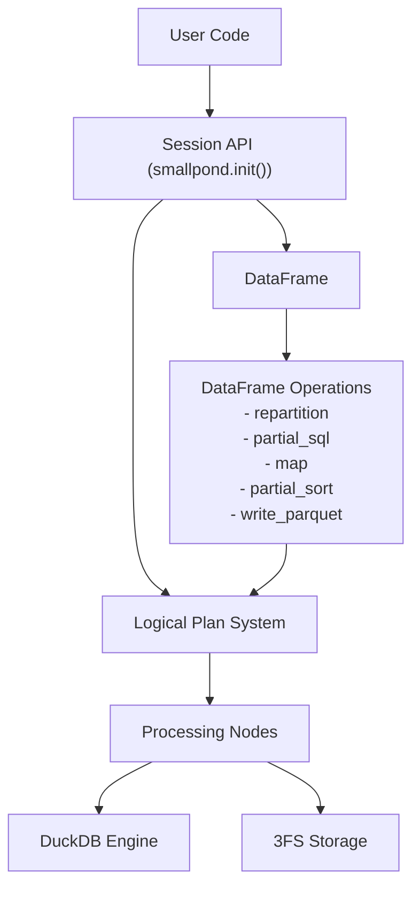

Sources: [README.md:32-47]()

## Session

A session is the entry point to smallpond and serves as the context for all data operations. Sessions manage connections to the underlying DuckDB engine and provide methods for creating DataFrames.

### Creating a Session

Sessions are created using the `smallpond.init()` function, which returns a session object:

```python
import smallpond

# Initialize a new session
sp = smallpond.init()
```

The session provides methods for reading data (like `read_parquet`, `read_csv`) and creating DataFrames, as well as executing SQL queries directly.

Sources: [README.md:34-35]()

## DataFrame

A DataFrame in smallpond is a tabular data structure similar to pandas DataFrames but optimized for distributed processing. It represents a collection of rows and columns that can be processed using various operations.

### DataFrame Operations

DataFrames support various operations:

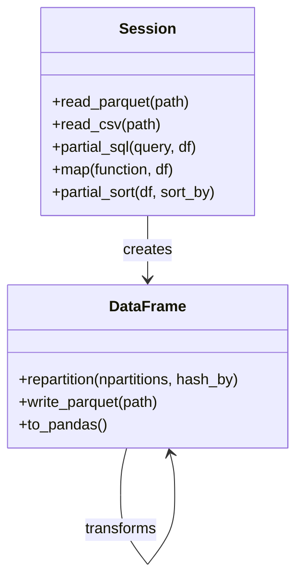

Example of using DataFrame operations:

```python
# Read data into a DataFrame
df = sp.read_parquet("prices.parquet")

# Repartition the data
df = df.repartition(3, hash_by="ticker")

# Run SQL operation
df = sp.partial_sql("SELECT ticker, min(price), max(price) FROM {0} GROUP BY ticker", df)

# Write results
df.write_parquet("output/")

# Convert to pandas DataFrame for further analysis
pandas_df = df.to_pandas()
```

Sources: [README.md:37-47]()

## Partitioning

Partitioning is a key concept in smallpond that enables distributed processing of large datasets by splitting them into manageable chunks.

### Types of Partitioning

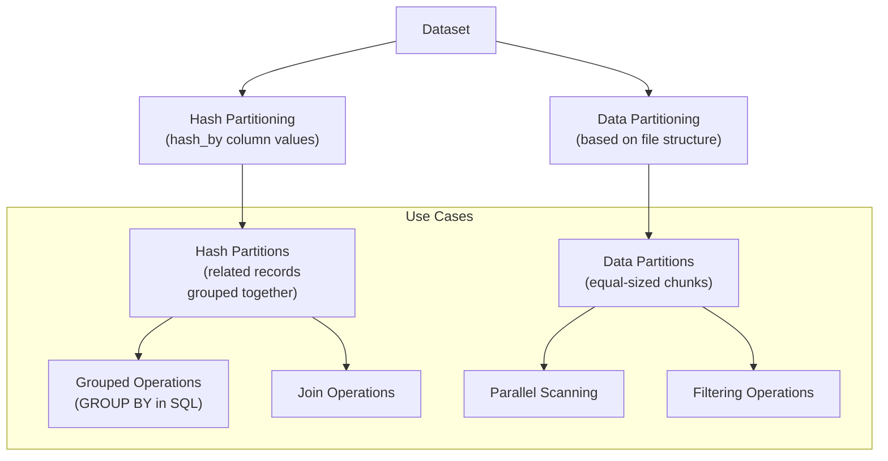

The framework implements partitioning through functions like `split_into_rows`, `split_into_cols`, and `get_nth_partition` in the common module.

Sources: [smallpond/common.py:72-101]()

### Partition Constants

Smallpond defines several constants related to partitioning and file handling:

- `DATA_PARTITION_COLUMN_NAME`: Special column name used for partitioning (`__data_partition__`)
- `DEFAULT_ROW_GROUP_SIZE`: Default size for Parquet row groups (122880 rows)
- `MAX_ROW_GROUP_SIZE`: Maximum row group size (10MB)
- `MAX_PARQUET_FILE_BYTES`: Maximum size for Parquet files (8GB)

Sources: [smallpond/common.py:10-29]()

## SQL Integration

Smallpond tightly integrates with SQL through DuckDB, allowing SQL queries to be executed on DataFrames.

### Partial SQL Execution

The `partial_sql` method enables executing SQL queries on DataFrames:

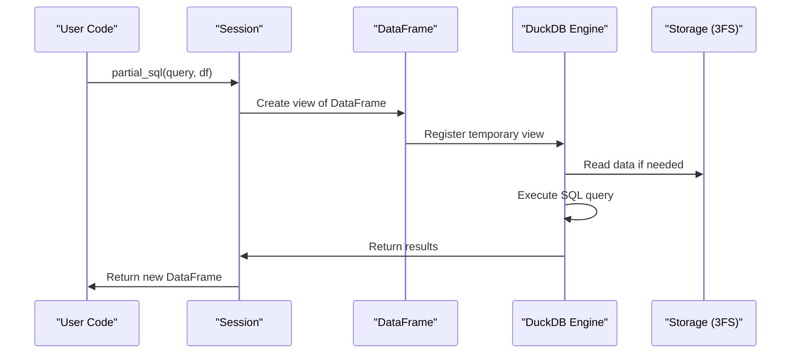

Example:
```python
# Execute SQL on a DataFrame
result_df = sp.partial_sql("SELECT ticker, AVG(price) as avg_price FROM {0} GROUP BY ticker", df)
```

The SQL integration allows for complex data transformations and aggregations using familiar SQL syntax, leveraging DuckDB's high-performance SQL engine.

Sources: [README.md:42]()

## Logical Plan

The Logical Plan is the execution framework that underpins all operations in smallpond. It represents a directed acyclic graph of processing nodes that describe how data should be transformed.

### Node Types and Processing Flow

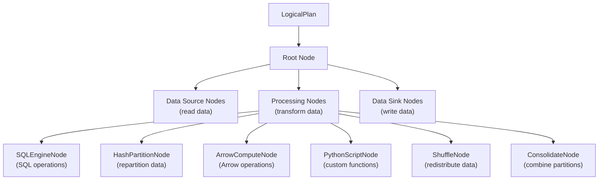

When executing DataFrame operations like `repartition()` or `partial_sql()`, smallpond creates a logical plan behind the scenes and executes it using the appropriate nodes.

Sources: [README.md:35-47]()

## Memory and Resource Management

Smallpond defines constants for memory management and resource allocation that affect performance:

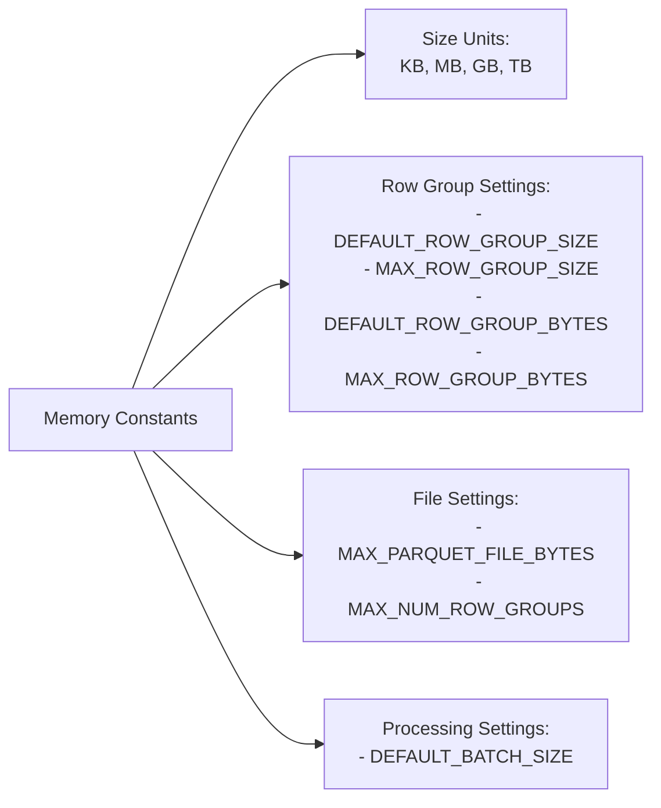

These constants help control how smallpond processes data and allocates resources, which is important for handling large datasets efficiently.

Sources: [smallpond/common.py:10-29]()

## Data Flow in Smallpond

The typical data flow in smallpond follows this pattern:

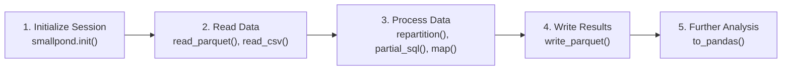

This flow represents the standard pattern for data processing in smallpond, from initialization to final output or analysis.

Sources: [README.md:32-47]()

## Error Handling

Smallpond defines several error classes for handling different failure scenarios:

- `SmallpondError`: Base class for all errors in smallpond
- `InjectedFault`: Used for testing fault scenarios
- `OutOfMemory`: Indicates memory allocation failures
- `NonzeroExitCode`: Indicates a process exited with an error code

These error classes help with proper error handling and debugging in smallpond applications.

Sources: [smallpond/common.py:48-61]()

## Relationship with Underlying Technologies

Smallpond is built on top of DuckDB for query processing and 3FS for distributed storage. Understanding this relationship is important for effective use of the framework.

```mermaid
graph TD
    User["User Application"] --> SP["smallpond Framework"]
    SP --> DuckDB["DuckDB Engine
      - SQL query execution
      - In-memory processing
      - Data transformation"]
    SP --> FS["3FS Distributed File System
      - Distributed storage
      - Parallel I/O
      - Data partitioning"]
    
    subgraph "smallpond Components"
        Session["Session API"]
        DataFrame["DataFrame Operations"]
        LogicalPlan["Logical Plan System"]
    end
    
    SP --> Session
    SP --> DataFrame
    SP --> LogicalPlan
```

The integration with DuckDB provides high-performance SQL processing, while 3FS enables scalable distributed storage, allowing smallpond to process large datasets efficiently.

Sources: [README.md:8-14]()

---

# Page: Core API

# Core API

<details>
<summary>Relevant source files</summary>

The following files were used as context for generating this wiki page:

- [README.md](README.md)
- [examples/sort_mock_urls_v2.py](examples/sort_mock_urls_v2.py)

</details>


The Core API of smallpond provides the primary interfaces that applications use to interact with the framework. It serves as the foundation for data processing operations, enabling users to efficiently work with large-scale datasets without dealing with the complexities of the underlying systems. For detailed information about the implementation of the logical plan system that powers these operations, see [Logical Plan System](#3).

## Overview of the Core API

The smallpond Core API is designed as a layered architecture that provides both high-level, user-friendly interfaces and lower-level components for advanced use cases. It abstracts the complexity of distributed data processing while leveraging the performance capabilities of DuckDB and 3FS.

```mermaid
classDiagram
    class "User Application" {
        Uses smallpond API
    }
    
    class "Core API" {
        Entry point for framework
    }
    
    class "Session" {
        +init()
        +read_parquet()
        +read_csv()
        +partial_sql()
    }
    
    class "DataFrame" {
        +repartition()
        +map()
        +partial_sort()
        +write_parquet()
        +to_pandas()
    }
    
    class "SQL Interface" {
        +partial_sql()
        SQL execution
    }
    
    class "LogicalPlan System" {
        Execution engine
    }
    
    class "Storage Backends" {
        DuckDB
        3FS
    }
    
    "User Application" --> "Core API"
    "Core API" --> "Session"
    "Session" --> "DataFrame"
    "Session" --> "SQL Interface"
    "DataFrame" --> "LogicalPlan System"
    "SQL Interface" --> "LogicalPlan System"
    "LogicalPlan System" --> "Storage Backends"
```

Sources: [README.md:8-48](), [examples/sort_mock_urls_v2.py:4-20]()

## Key Components

### Session

The Session is the primary entry point to the smallpond framework. It provides methods for initializing the framework, reading data from various sources, and executing SQL operations.

```mermaid
sequenceDiagram
    participant User as "User Code"
    participant Session as "smallpond.Session"
    participant DF as "DataFrame"
    participant LP as "LogicalPlan"
    participant DuckDB as "DuckDB Engine"
    
    User->>Session: smallpond.init()
    Session->>DuckDB: Initialize connection
    DuckDB-->>Session: Connection established
    Session-->>User: Return Session object
    
    User->>Session: read_parquet("path")
    Session->>LP: Create DataSourceNode
    LP->>DuckDB: Access data
    DuckDB-->>LP: Data loaded
    LP-->>DF: Create DataFrame
    DF-->>User: Return DataFrame
    
    User->>Session: partial_sql("SELECT...", df)
    Session->>LP: Create SqlEngineNode
    LP->>DuckDB: Execute SQL
    DuckDB-->>LP: Results
    LP-->>DF: Create DataFrame
    DF-->>User: Return DataFrame
```

Key Session API methods:
- `smallpond.init()`: Initializes a new smallpond session
- `read_parquet()`: Reads Parquet files into a DataFrame
- `read_csv()`: Reads CSV files into a DataFrame
- `partial_sql()`: Executes SQL queries on DataFrames

Sources: [README.md:32-42](), [examples/sort_mock_urls_v2.py:8-9](), [examples/sort_mock_urls_v2.py:29-30]()

### DataFrame

The DataFrame is the core data abstraction in smallpond, representing a distributed collection of data that can be transformed through various operations.

| Operation | Description | Example Usage |
|-----------|-------------|--------------|
| `repartition()` | Redistributes data into specified number of partitions | `df.repartition(3, hash_by="ticker")` |
| `map()` | Applies transformations using SQL expressions | `df.map("column1 + column2 as sum")` |
| `partial_sort()` | Sorts data within partitions | `df.partial_sort(by=["column1", "column2"])` |
| `write_parquet()` | Writes DataFrame to Parquet files | `df.write_parquet("output/")` |
| `to_pandas()` | Converts DataFrame to pandas DataFrame | `df.to_pandas()` |

Sources: [README.md:41-47](), [examples/sort_mock_urls_v2.py:9-19]()

## Data Processing Flow

The following diagram illustrates the typical flow of data through the smallpond Core API:

```mermaid
flowchart TD
    subgraph "Data Sources"
        Parquet["Parquet Files"]
        CSV["CSV Files"]
    end
    
    subgraph "Core API"
        Init["smallpond.init()"]
        Session["Session"]
        ReadOps["read_parquet()/read_csv()"]
        DataFrame["DataFrame"]
        
        subgraph "Transformations"
            Repartition["repartition()"]
            Map["map()"]
            PartialSort["partial_sort()"]
            PartialSQL["partial_sql()"]
        end
        
        WriteOps["write_parquet()/to_pandas()"]
    end
    
    subgraph "Output"
        OutputParquet["Parquet Files"]
        PandasDF["Pandas DataFrame"]
    end
    
    Init --> Session
    Session --> ReadOps
    Parquet & CSV --> ReadOps
    ReadOps --> DataFrame
    
    DataFrame --> Repartition & Map & PartialSort
    Session --> PartialSQL
    DataFrame --> PartialSQL
    Repartition & Map & PartialSort & PartialSQL --> DataFrame
    
    DataFrame --> WriteOps
    WriteOps --> OutputParquet & PandasDF
```

Sources: [README.md:32-47](), [examples/sort_mock_urls_v2.py:8-19]()

## SQL Integration

A key strength of smallpond is its integration with SQL through the DuckDB engine. This allows users to leverage SQL's power for data transformations while maintaining the distributed processing capabilities of the framework.

SQL operations can be performed in two primary ways:
1. Using `partial_sql()` from the Session object to execute SQL on DataFrames
2. Using `map()` on DataFrames to apply SQL expressions for transformations

```mermaid
graph TD
    subgraph "SQL Integration"
        Session["Session.partial_sql()"]
        Map["DataFrame.map()"]
        
        Session -->|"Executes full SQL query<br>with DataFrame as table"| SQLQuery["SQL Query"]
        Map -->|"Applies SQL expressions<br>to transform columns"| SQLExpr["SQL Expressions"]
        
        SQLQuery --> Results["New DataFrame"]
        SQLExpr --> Transformed["Transformed DataFrame"]
    end
```

Examples of SQL usage:

1. Using `partial_sql()`:
   ```
   df = sp.partial_sql("SELECT ticker, min(price), max(price) FROM {0} GROUP BY ticker", df)
   ```

2. Using `map()`:
   ```
   urls = dataset.map("""
       split_part(urlstr, '/', 1) as host,
       split_part(urlstr, ' ', 1) as url,
       from_base64(valstr) AS payload
   """)
   ```

Sources: [README.md:42](), [examples/sort_mock_urls_v2.py:10-16]()

## Relationship with Logical Plan System

The Core API provides a high-level interface that abstracts the underlying Logical Plan system. Every operation performed through the Core API is translated into a logical plan that is then executed by the framework.

```mermaid
classDiagram
    class "Core API" {
        High-level interface
    }
    
    class "Session" {
        +init()
        +read_parquet()
        +partial_sql()
    }
    
    class "DataFrame" {
        +repartition()
        +map()
        +partial_sort()
    }
    
    class "LogicalPlan" {
        +Node root_node
        Execution plan
    }
    
    class "Node" {
        <<abstract>>
    }
    
    class "DataSourceNode" {
        Reading data
    }
    
    class "HashPartitionNode" {
        Partitioning data
    }
    
    class "SqlEngineNode" {
        SQL execution
    }
    
    class "DataSinkNode" {
        Writing data
    }
    
    "Core API" --> "Session"
    "Core API" --> "DataFrame"
    "Session" --|> "LogicalPlan" : creates
    "DataFrame" --|> "LogicalPlan" : translated to
    "LogicalPlan" o-- "Node"
    "Node" <|-- "DataSourceNode"
    "Node" <|-- "HashPartitionNode"
    "Node" <|-- "SqlEngineNode"
    "Node" <|-- "DataSinkNode"
```

For more details on the Logical Plan system, see [Logical Plan System](#3).

Sources: [README.md:32-47]()

## Common Usage Patterns

The Core API is designed to support common data processing patterns in a clean, intuitive way. Here are the most common usage patterns:

1. **Basic workflow**: Initialize, read, transform, write
   ```python
   sp = smallpond.init()
   df = sp.read_parquet("input.parquet")
   # Perform transformations
   df.write_parquet("output/")
   ```

2. **Partitioning and transformation**:
   ```python
   df = df.repartition(10, hash_by="key_column")
   df = df.map("column1, column2 * 2 as doubled")
   ```

3. **SQL-based analytics**:
   ```python
   result = sp.partial_sql("SELECT col1, SUM(col2) FROM {0} GROUP BY col1", df)
   ```

4. **Distributed sorting**:
   ```python
   df = df.repartition(10, hash_by="sort_key")
   sorted_df = df.partial_sort(by=["sort_key"])
   ```

Sources: [README.md:32-47](), [examples/sort_mock_urls_v2.py:8-19]()

## Summary

The Core API of smallpond provides a user-friendly interface for distributed data processing, built on top of the more advanced Logical Plan system. Through the Session and DataFrame interfaces, users can perform complex data operations with simple, intuitive syntax while leveraging the performance benefits of DuckDB and 3FS.

Key components include:
- Session: Primary entry point and factory for DataFrames
- DataFrame: Core data abstraction with transformation operations
- SQL Integration: Powerful SQL capabilities through DuckDB

For more specific information about each component, refer to:
- [Session API](#2.1)
- [DataFrame Operations](#2.2)
- [SQL Integration](#2.3)

Sources: [README.md:8-15]()

---

# Page: Session API

# Session API

<details>
<summary>Relevant source files</summary>

The following files were used as context for generating this wiki page:

- [README.md](README.md)
- [examples/sort_mock_urls_v2.py](examples/sort_mock_urls_v2.py)

</details>


## Purpose and Scope

The Session API provides the primary entry point and high-level interface for interacting with the smallpond framework. It serves as the bridge between user applications and the underlying data processing capabilities of DuckDB and the 3FS distributed file system. For information about operations available on DataFrame objects returned by the Session API, see [DataFrame Operations](#2.2).

Sources: [README.md:32-47]()

## Initialization

The Session API is initialized through the `smallpond.init()` function, which returns a Session object that provides access to all framework capabilities:

```mermaid
flowchart TD
    smallpond_init["smallpond.init()"] --> Session["smallpond.dataframe.Session"]
    Session --> read_methods["Data Reading Methods\n- read_parquet()\n- read_csv()"]
    Session --> processing_methods["Data Processing Methods\n- partial_sql()"]
    read_methods --> DataFrame["smallpond.dataframe.DataFrame"]
    processing_methods --> DataFrame
```

**Title: Session API Initialization and Core Methods**

Sources: [README.md:34-35](), [examples/sort_mock_urls_v2.py:29]()

## Core Components

The Session API is built around two primary classes that facilitate data processing:

```mermaid
classDiagram
    class "smallpond" {
        +init() Session
    }
    
    class "smallpond.dataframe.Session" {
        +read_parquet(path: str|List[str]) DataFrame
        +read_csv(path: str|List[str], schema: dict, delim: str) DataFrame
        +partial_sql(query: str, *dataframes: DataFrame) DataFrame
    }
    
    class "smallpond.dataframe.DataFrame" {
        +repartition(n: int, hash_by: str) DataFrame
        +map(sql_expr: str) DataFrame
        +partial_sort(by: List[str]) DataFrame
        +write_parquet(path: str) None
        +to_pandas() pandas.DataFrame
    }
    
    note for "smallpond" "Entry point module"
    note for "smallpond.dataframe.Session" "Main interface"
    note for "smallpond.dataframe.DataFrame" "Data container"
    
    smallpond --> "smallpond.dataframe.Session" : creates
    "smallpond.dataframe.Session" --> "smallpond.dataframe.DataFrame" : returns
    "smallpond.dataframe.DataFrame" --> "smallpond.dataframe.DataFrame" : transforms
```

**Title: Session and DataFrame Class Structure**

Sources: [README.md:32-47](), [examples/sort_mock_urls_v2.py:5-19]()

## Data Loading Methods

The Session object provides methods for loading data from various file formats:

| Method | Description | Parameters | Returns |
|--------|-------------|------------|---------|
| `read_parquet` | Reads Parquet files | `path`: str or list of str | DataFrame |
| `read_csv` | Reads CSV files | `path`: str or list of str, `schema`: dict, `delim`: str | DataFrame |

Example usage:
```python
# Read a Parquet file
df = sp.read_parquet("prices.parquet")

# Read CSV with schema definition
df = sp.read_csv(
    ["data/*.tsv"], 
    schema={"urlstr": "varchar", "valstr": "varchar"}, 
    delim="\t"
)
```

Sources: [README.md:38](), [examples/sort_mock_urls_v2.py:9]()

## Data Processing Methods

The Session API includes the following method for data manipulation:

| Method | Description | Parameters | Returns |
|--------|-------------|------------|---------|
| `partial_sql` | Executes SQL queries against DataFrames | `query`: str, `*dataframes`: DataFrame | DataFrame |

The `partial_sql` method allows SQL operations to be performed on DataFrames, with placeholders ({0}, {1}, etc.) in the query string referring to the provided DataFrame objects.

Example:
```python
# Execute SQL on a DataFrame
result_df = sp.partial_sql(
    "SELECT ticker, min(price), max(price) FROM {0} GROUP BY ticker", 
    df
)
```

Sources: [README.md:42]()

## System Integration

The Session API integrates with other components of the smallpond framework:

```mermaid
sequenceDiagram
    participant "User Code" as User
    participant "smallpond.dataframe.Session" as Session
    participant "smallpond.dataframe.DataFrame" as DF
    participant "smallpond.logical_plan.LogicalPlan" as LP
    participant "DuckDB Engine" as DuckDB
    participant "3FS File System" as FS
    
    User->>Session: smallpond.init()
    Session->>DuckDB: Initialize connection
    Session->>FS: Configure storage
    User->>Session: read_parquet(path)
    Session->>FS: Read file data
    Session->>DuckDB: Process data
    Session-->>User: Return DataFrame
    User->>DF: repartition(n, hash_by)
    DF->>LP: Create LogicalPlan
    LP->>DuckDB: Execute operations
    DF-->>User: Return transformed DataFrame
    User->>Session: partial_sql(query, df)
    Session->>DuckDB: Execute SQL query
    Session-->>User: Return result DataFrame
    User->>DF: write_parquet(path)
    DF->>FS: Write data to storage
```

**Title: Session API Interaction with Framework Components**

Sources: [README.md:32-47](), [examples/sort_mock_urls_v2.py:8-19]()

## Typical Data Flow

This diagram illustrates the standard data processing flow when using the Session API:

```mermaid
flowchart LR
    subgraph "Initialization"
        Init["smallpond.init()"] --> SessionObj["Session Object"]
    end
    
    subgraph "Data Loading"
        SessionObj --> ReadParquet["session.read_parquet()"]
        SessionObj --> ReadCSV["session.read_csv()"]
        ReadParquet & ReadCSV --> DataFrame["DataFrame Object"]
    end
    
    subgraph "Data Processing"
        DataFrame --> Repartition["df.repartition()"]
        DataFrame --> Map["df.map()"]
        SessionObj --> PartialSQL["session.partial_sql()"]
        DataFrame --> PartialSort["df.partial_sort()"]
        
        Repartition & Map & PartialSQL & PartialSort --> ProcessedDF["Processed DataFrame"]
    end
    
    subgraph "Output Options"
        ProcessedDF --> WriteParquet["df.write_parquet()"]
        ProcessedDF --> ToPandas["df.to_pandas()"]
    end
```

**Title: Session API Data Processing Pipeline**

Sources: [README.md:32-47](), [examples/sort_mock_urls_v2.py:8-19]()

## Example Usage Patterns

### Basic Data Processing

```python
import smallpond

# Initialize session
sp = smallpond.init()

# Load data
df = sp.read_parquet("prices.parquet")

# Process data
df = df.repartition(3, hash_by="ticker")
df = sp.partial_sql("SELECT ticker, min(price), max(price) FROM {0} GROUP BY ticker", df)

# Save results
df.write_parquet("output/")
# Show results
print(df.to_pandas())
```

Sources: [README.md:32-47]()

### URL Data Processing

```python
def sort_mock_urls_v2(sp: Session, input_paths: List[str], output_path: str, npartitions: int):
    # Read CSV data with tab delimiter and schema definition
    dataset = sp.read_csv(
        input_paths, 
        schema={"urlstr": "varchar", "valstr": "varchar"}, 
        delim=r"\t"
    ).repartition(npartitions)
    
    # Transform using SQL expressions
    urls = dataset.map(
        """
    split_part(urlstr, '/', 1) as host,
    split_part(urlstr, ' ', 1) as url,
    from_base64(valstr) AS payload
  """
    )
    
    # Repartition by host column
    urls = urls.repartition(npartitions, hash_by="host")
    
    # Sort URLs by host
    sorted_urls = urls.partial_sort(by=["host"])
    
    # Write results to Parquet format
    sorted_urls.write_parquet(output_path)
```

Sources: [examples/sort_mock_urls_v2.py:8-19]()

---

# Page: DataFrame Operations

# DataFrame Operations

<details>
<summary>Relevant source files</summary>

The following files were used as context for generating this wiki page:

- [README.md](README.md)
- [examples/fstest.py](examples/fstest.py)
- [examples/sort_mock_urls_v2.py](examples/sort_mock_urls_v2.py)

</details>


## Purpose and Scope

This document details the DataFrame operations available in smallpond, a lightweight data processing framework. DataFrames in smallpond represent distributed tabular data that can be processed across multiple partitions. These operations provide a high-level API for data manipulation, transformation, and I/O operations while leveraging DuckDB for SQL processing and 3FS for distributed storage.

For information about SQL integration, see [SQL Integration](#2.3). For details on the underlying execution system, see [Logical Plan System](#3).

## DataFrames in smallpond Architecture

```mermaid
graph TD
    subgraph "User API Level"
        UserCode["User Application"]
        Session["Session API"]
    end
    
    subgraph "Core Components"
        DF["DataFrame Operations"]
        LP["Logical Plan System"]
    end
    
    subgraph "Execution Layer"
        DuckDB["DuckDB Engine"]
        ThreeFS["3FS Storage"]
    end
    
    UserCode --> Session
    Session --> DF
    DF --> LP
    LP --> DuckDB
    LP --> ThreeFS
```

Sources: [README.md:32-47]()

## DataFrame Life Cycle

```mermaid
flowchart LR
    subgraph "Creation"
        read_parquet["read_parquet()"]
        read_csv["read_csv()"]
        from_items["from_items()"]
    end
    
    subgraph "Transformation"
        repartition["repartition()"]
        map["map()"]
        partial_sql["partial_sql()"]
        partial_sort["partial_sort()"]
    end
    
    subgraph "Output"
        write_parquet["write_parquet()"]
        to_pandas["to_pandas()"]
    end
    
    Creation --> Transformation
    Transformation --> Output
```

Sources: [README.md:38-46](), [examples/sort_mock_urls_v2.py:9-19]()

## Creating DataFrames

DataFrames in smallpond are typically created through the Session API, which provides methods for reading data from various sources.

### Reading From Files

```
# Read from Parquet files
df = sp.read_parquet("path/to/data.parquet")

# Read from CSV files with schema definition
df = sp.read_csv(paths, schema={"column1": "varchar", "column2": "integer"}, delim="\t")
```

The `read_csv()` method supports specifying a schema and delimiter, allowing for detailed control over how the data is interpreted.

### Creating From Python Objects

```
# Create a DataFrame from a list of dictionaries
df = sp.from_items([{"id": 1, "name": "Alice"}, {"id": 2, "name": "Bob"}])
```

Sources: [examples/sort_mock_urls_v2.py:9](), [examples/fstest.py:156-157](), [examples/fstest.py:162-163]()

## Core DataFrame Operations

### Repartitioning

The `repartition()` method redistributes data across a specified number of partitions:

```
# Repartition by hashing on a column
df = df.repartition(npartitions, hash_by="column_name")

# Repartition evenly by row count
df = df.repartition(npartitions, by_rows=True)
```

Repartitioning is fundamental for:
- Balancing workload across workers
- Co-locating related data for operations like joins or aggregations
- Controlling memory usage per partition

Sources: [README.md:41](), [examples/sort_mock_urls_v2.py:9](), [examples/sort_mock_urls_v2.py:17](), [examples/fstest.py:157](), [examples/fstest.py:164]()

### Data Transformation

#### Map Operations

The `map()` method applies transformations to each partition:

```
# Using a lambda function
df = df.map(lambda x: transform_data(x))

# Using SQL-like expressions
df = df.map("""
    column1 as renamed_column,
    function(column2) as transformed_column
""")
```

In the first form, a Python function is applied to each row. In the second form, SQL-like expressions define the transformation.

Sources: [examples/fstest.py:158](), [examples/sort_mock_urls_v2.py:10-16]()

#### SQL Operations

While not strictly a DataFrame method, `partial_sql()` from the Session API is commonly used with DataFrames:

```
# Apply SQL query with DataFrame as a placeholder
df = sp.partial_sql("SELECT column1, SUM(column2) FROM {0} GROUP BY column1", df)
```

The placeholder `{0}` is replaced with a reference to the DataFrame.

Sources: [README.md:42]()

#### Sorting

The `partial_sort()` method sorts data within each partition:

```
# Sort data within partitions by specified columns
df = df.partial_sort(by=["column1", "column2"])
```

This performs a local sort within each partition, not a global sort across all partitions.

Sources: [examples/sort_mock_urls_v2.py:18]()

### Data Output

#### Writing to Storage

```
# Write DataFrame to Parquet files
df.write_parquet("output_directory/")
```

Each partition is written as a separate Parquet file in the specified directory.

Sources: [README.md:45](), [examples/sort_mock_urls_v2.py:19]()

#### Converting to pandas

```
# Convert to pandas DataFrame for local analysis
pandas_df = df.to_pandas()
```

This operation collects all data to the driver node and should only be used for small to medium-sized result sets.

Sources: [README.md:47]()

## DataFrame Operation Flow

```mermaid
sequenceDiagram
    participant User as "User Code"
    participant Session as "Session"
    participant DataFrame as "DataFrame"
    participant LogicalPlan as "Logical Plan"
    participant Engine as "DuckDB/Storage"

    User->>Session: smallpond.init()
    User->>Session: read_parquet("path")
    Session->>LogicalPlan: Create DataSourceNode
    LogicalPlan->>Engine: Execute read operation
    Engine->>Session: Return data references
    Session->>User: Return DataFrame

    User->>DataFrame: repartition(n, hash_by="col")
    DataFrame->>LogicalPlan: Add HashPartitionNode
    
    User->>DataFrame: map("transform")
    DataFrame->>LogicalPlan: Add ArrowComputeNode/SqlEngineNode
    
    User->>DataFrame: write_parquet("output")
    DataFrame->>LogicalPlan: Add DataSinkNode
    LogicalPlan->>Engine: Execute entire plan
    Engine->>User: Operation complete
```

Sources: [README.md:34-47](), [examples/sort_mock_urls_v2.py:9-19]()

## Common Use Cases

### ETL Pipeline

```python
# Extract
df = sp.read_parquet("input_data/")

# Transform
df = df.repartition(10, hash_by="category")
df = df.map("transform_column(col1) as new_col, col2 * 2 as doubled")
df = sp.partial_sql("SELECT category, AVG(new_col) FROM {0} GROUP BY category", df)

# Load
df.write_parquet("output_data/")
```

### URL Processing Example

The following example demonstrates processing and sorting URLs:

```python
# Read tab-delimited data with schema
dataset = sp.read_csv(input_paths, schema={"urlstr": "varchar", "valstr": "varchar"}, delim=r"\t")

# Repartition for initial processing
dataset = dataset.repartition(npartitions)

# Transform data using map with SQL expressions
urls = dataset.map("""
    split_part(urlstr, '/', 1) as host,
    split_part(urlstr, ' ', 1) as url,
    from_base64(valstr) AS payload
""")

# Repartition by host for sorting
urls = urls.repartition(npartitions, hash_by="host")

# Sort within each partition
sorted_urls = urls.partial_sort(by=["host"])

# Write results to Parquet
sorted_urls.write_parquet(output_path)
```

Sources: [examples/sort_mock_urls_v2.py:9-19]()

## Performance Considerations

When working with DataFrame operations, consider:

1. **Partition Count**: Choose based on cluster size and data volume
   - Too few: limits parallelism
   - Too many: increases overhead

2. **Partition Key Selection**: 
   - For hash-based partitioning, choose columns with good distribution characteristics
   - Avoid columns with skewed values that would create imbalanced partitions

3. **Data Locality**: 
   - Operations are faster when data is processed locally
   - Minimize unnecessary data movement between nodes

4. **Memory Management**:
   - Consider available RAM when determining partition sizes
   - Monitor memory usage for operations that materialize data

5. **Conversion to pandas**:
   - Use `to_pandas()` only for reasonably sized results
   - For large datasets, write to storage and process in chunks

Sources: [README.md:41-46]()

## Integration with Logical Plan System

Under the hood, DataFrame operations create and modify a logical plan, which defines the execution flow. For more complex scenarios requiring fine-grained control, users can work directly with the Logical Plan API as described in [Logical Plan System](#3).

The translation from DataFrame operations to logical plan nodes is as follows:

| DataFrame Operation | Logical Plan Node |
|---------------------|-------------------|
| read_parquet/csv    | DataSourceNode    |
| repartition         | HashPartitionNode |
| map                 | ArrowComputeNode or SqlEngineNode |
| partial_sql         | SqlEngineNode     |
| partial_sort        | ArrowComputeNode  |
| write_parquet       | DataSinkNode      |

Sources: [README.md:34-47]()

---

# Page: SQL Integration

# SQL Integration

<details>
<summary>Relevant source files</summary>

The following files were used as context for generating this wiki page:

- [README.md](README.md)
- [examples/sort_mock_urls.py](examples/sort_mock_urls.py)
- [examples/sort_mock_urls_v2.py](examples/sort_mock_urls_v2.py)

</details>


This document explains how smallpond integrates with SQL capabilities via DuckDB and provides guidance on executing SQL queries on data. The integration enables users to leverage powerful SQL operations while maintaining smallpond's distributed processing capabilities. For information about general DataFrame operations, see [DataFrame Operations](#2.2).

## Overview

Smallpond provides seamless SQL integration through DuckDB, offering both high-level DataFrame API methods and lower-level logical plan components for SQL execution. This integration allows users to combine the expressiveness of SQL with smallpond's performance and scalability features.

```mermaid
graph TD
    subgraph "SQL Integration Approaches"
        HL["High-Level API"] --> DF["DataFrame.partial_sql()"]
        HL --> IM["Implicit SQL Operations"]
        IM --> PS["partial_sort()"]
        IM --> MAP["map()"]
        
        LL["Low-Level API"] --> SEN["SqlEngineNode"]
        LL --> HPN["HashPartitionNode"]
    end
    
    subgraph "Execution Flow"
        DF & SEN --> DDB["DuckDB Engine"]
        DDB --> EXE["Query Execution"]
        EXE --> RES["Results"]
    end
```

Sources: [README.md:41-42](), [examples/sort_mock_urls.py:42-67](), [examples/sort_mock_urls_v2.py:17-18]()

## High-Level SQL API

### The partial_sql Method

The primary way to execute SQL queries in smallpond is through the `partial_sql` method available in the Session API. This method allows you to execute SQL queries on DataFrame objects.

```mermaid
classDiagram
    class Session {
        +partial_sql(query_template, *dataframes)
    }
    
    class DataFrame {
        +partial_sql(query_template)
        +map(sql_expression)
        +partial_sort(by)
    }
    
    Session --> DataFrame : creates
    DataFrame --> DataFrame : transforms
```

The `partial_sql` method accepts:
- A SQL query template with placeholders (`{0}`, `{1}`, etc.)
- One or more DataFrame objects that will be substituted into the placeholders

### Example Usage

```python
# Initialize session
sp = smallpond.init()

# Load data
df = sp.read_parquet("prices.parquet")

# Process data with SQL
result = sp.partial_sql("SELECT ticker, min(price), max(price) FROM {0} GROUP BY ticker", df)
```

Sources: [README.md:34-42]()

### SQL Syntax and Features

Smallpond's SQL integration supports the full DuckDB SQL dialect, which is PostgreSQL-compatible with extensions. This includes:

- Standard SQL operations (SELECT, WHERE, GROUP BY, etc.)
- Window functions
- Common Table Expressions (CTEs)
- DuckDB's specialized functions (e.g., `split_part`, `from_base64`)
- Regular expressions and pattern matching

### Implicit SQL Operations

Several DataFrame methods implicitly use SQL for their implementation:

| Method | Description | Underlying SQL Operation |
|--------|-------------|--------------------------|
| `map()` | Transforms data using SQL expressions | SELECT with expressions |
| `partial_sort()` | Sorts data within partitions | ORDER BY |
| `repartition()` | Redistributes data | Hash functions and partitioning |

Example of `map()` with SQL expressions:

```python
urls = dataset.map("""
    split_part(urlstr, '/', 1) as host,
    split_part(urlstr, ' ', 1) as url,
    from_base64(valstr) AS payload
""")
```

Sources: [examples/sort_mock_urls_v2.py:10-16]()

## Low-Level SQL Integration

For more control over SQL execution, smallpond provides low-level components in its Logical Plan system.

### SqlEngineNode

The `SqlEngineNode` is a core component for SQL execution in logical plans. It takes input nodes and executes a SQL query against their data.

```mermaid
graph TD
    DSN["DataSourceNode"] --> DSP["DataSetPartitionNode"]
    DSP --> SEN["SqlEngineNode"]
    SEN -- "SQL Query" --> DDB["DuckDB Engine"]
    SEN --> HPN["HashPartitionNode"]
    HPN --> SEN2["SqlEngineNode<br>for sorting"]
    
    subgraph "Example Logical Plan"
        DSN
        DSP
        SEN
        HPN
        SEN2
    end
```

Example of `SqlEngineNode` usage:

```python
imported_urls = SqlEngineNode(
    ctx,
    (data_partitions,),
    r"""
select split_part(urlstr, '/', 1) as host, split_part(urlstr, ' ', 1) as url, from_base64(valstr) AS payload from {0}
""",
    output_name="imported_urls",
    output_path=external_output_path,
)
```

Sources: [examples/sort_mock_urls.py:42-50]()

### SQL Engine Options

Smallpond supports multiple execution engines for certain operations. The engine_type parameter (with default value "duckdb") controls which engine is used:

```python
urls_partitions = HashPartitionNode(
    ctx,
    (imported_urls,),
    npartitions=npartitions,
    hash_columns=["host"],
    engine_type=engine_type,  # Controls which engine is used
    output_name="urls_partitions",
    output_path=external_output_path,
)
```

This allows for flexibility in choosing between DuckDB SQL execution and alternative engines (e.g., Arrow Compute) based on the specific requirements of the operation.

Sources: [examples/sort_mock_urls.py:51-59](), [examples/sort_mock_urls.py:61-74]()

## SQL Execution Flow

The following sequence diagram illustrates how SQL queries are processed within smallpond:

```mermaid
sequenceDiagram
    participant User
    participant DF as DataFrame
    participant SP as Session/LogicalPlan
    participant DDB as DuckDB Engine
    participant Storage as 3FS Storage
    
    User->>DF: call partial_sql()
    DF->>SP: create logical plan with SqlEngineNode
    SP->>DDB: prepare SQL query
    DDB->>Storage: read input data
    Storage->>DDB: return data
    DDB->>DDB: execute SQL query
    DDB->>SP: return query results
    SP->>DF: create result DataFrame
    DF->>User: return result
```

When executing SQL queries, smallpond:

1. Translates high-level API calls into logical plan operations
2. Creates appropriate nodes (e.g., `SqlEngineNode`)
3. Passes SQL queries to DuckDB for execution
4. Manages data movement between storage and the engine
5. Returns results as DataFrame objects

Sources: [README.md:41-42](), [examples/sort_mock_urls.py:42-67]()

## Best Practices

### Working with Partitioned Data

When working with partitioned data, consider these SQL integration patterns:

1. **Partition-aware operations**: Use `partial_sql` to perform operations within each partition independently
2. **Global operations**: Consolidate partitions before operations that need to see all data
3. **Hybrid approach**: Use partitioning for initial filtering and aggregation, then consolidate for final processing

### Example: URL Sorting

The following example shows a complete workflow using SQL integration at different stages:

```python
# High-level API approach
dataset = sp.read_csv(input_paths, schema={"urlstr": "varchar", "valstr": "varchar"}, delim=r"\t").repartition(npartitions)

# Use map() with SQL expressions
urls = dataset.map("""
    split_part(urlstr, '/', 1) as host,
    split_part(urlstr, ' ', 1) as url,
    from_base64(valstr) AS payload
""")

# Repartition based on SQL column
urls = urls.repartition(npartitions, hash_by="host")

# Sort within partitions (uses SQL ORDER BY internally)
sorted_urls = urls.partial_sort(by=["host"])
```

Sources: [examples/sort_mock_urls_v2.py:8-19]()

## Performance Considerations

- SQL operations within smallpond leverage DuckDB's optimized query engine
- Partitioning is key to balancing SQL execution across multiple processes
- Consider using SQL for computationally intensive operations while using Python for workflow orchestration
- When possible, push filtering operations down to the SQL layer to reduce data movement

Sources: [README.md:12-14](), [examples/sort_mock_urls.py:61-74]()

---

# Page: Logical Plan System

# Logical Plan System

<details>
<summary>Relevant source files</summary>

The following files were used as context for generating this wiki page:

- [benchmarks/hash_partition_benchmark.py](benchmarks/hash_partition_benchmark.py)
- [examples/shuffle_data.py](examples/shuffle_data.py)
- [examples/sort_mock_urls.py](examples/sort_mock_urls.py)

</details>


The Logical Plan System forms the core execution framework of the smallpond data processing platform. It provides a mechanism for constructing and executing directed acyclic graphs (DAGs) of data processing operations. This document explains the architecture, components, and usage of the Logical Plan System in smallpond.

For information about the high-level Session API that builds on top of this system, see [Core API](#2) and [Session API](#2.1).

## System Purpose and Architecture

The Logical Plan System enables the definition of complex data processing workflows through a composable node-based architecture. It serves as the foundation for all data operations in smallpond, providing a flexible and extensible framework for tasks such as data loading, transformation, partitioning, and output.

```mermaid
classDiagram
    class LogicalPlan {
        +Context ctx
        +Node root_node
    }
    
    class Context {
        +register_node()
        +get_node()
    }
    
    class Node {
        <<abstract>>
        +Context ctx
        +inputs: tuple
        +output_name: str
        +output_path: str
        +execute()
    }
    
    class Driver {
        +add_argument()
        +parse_arguments()
        +get_arguments()
        +run(plan)
    }
    
    LogicalPlan o-- "1" Context
    LogicalPlan o-- "1" Node : "root_node"
    Node o-- "1" Context
    Node o-- "*" Node : "inputs"
    Driver --> LogicalPlan : executes
```

The system consists of four primary components:

1. **LogicalPlan**: The top-level container that holds a directed acyclic graph of processing nodes with a single root node representing the final output.

2. **Context**: Maintains the registry of all nodes in a plan, enabling node lookup and management.

3. **Node**: The abstract base class for all operation types, with subclasses for specific operations like data loading, SQL execution, partitioning, etc.

4. **Driver**: Handles command-line argument parsing and plan execution, providing the entry point for running logical plans.

Sources: [benchmarks/hash_partition_benchmark.py:10-11](), [benchmarks/hash_partition_benchmark.py:61-63](), [examples/shuffle_data.py:8-10]()

## Node Types and Hierarchy

The Logical Plan System includes a variety of specialized node types, each providing specific data processing functionality. These nodes can be composed to create complex data processing pipelines.

```mermaid
classDiagram
    class Node {
        <<abstract>>
        +Context ctx
        +inputs: tuple
        +output_name: str
        +execute()
    }
    
    Node <|-- DataSourceNode
    Node <|-- DataSinkNode
    Node <|-- ProcessingNode
    
    class DataSourceNode {
        +dataset
    }
    
    class DataSinkNode {
        +output_path
    }
    
    ProcessingNode <|-- DataSetPartitionNode
    ProcessingNode <|-- HashPartitionNode
    ProcessingNode <|-- SqlEngineNode
    ProcessingNode <|-- ArrowComputeNode
    ProcessingNode <|-- StreamCopy
    ProcessingNode <|-- ProjectionNode
    ProcessingNode <|-- ShuffleNode
    ProcessingNode <|-- ConsolidateNode
    ProcessingNode <|-- PythonScriptNode
    
    class DataSetPartitionNode {
        +npartitions
        +partition_by_rows
        +random_shuffle
    }
    
    class HashPartitionNode {
        +npartitions
        +hash_columns
        +engine_type
    }
    
    class SqlEngineNode {
        +sql_template
        +cpu_limit
        +memory_limit
    }
    
    class ArrowComputeNode {
        +process()
    }
    
    class ConsolidateNode {
        +consolidate inputs
    }
}
```

### Key Node Types:

1. **DataSourceNode**: Loads data from sources like Parquet or CSV files into the processing pipeline
2. **DataSetPartitionNode**: Divides datasets into multiple partitions for parallel processing
3. **HashPartitionNode**: Partitions data based on hash values of specified columns
4. **SqlEngineNode**: Executes SQL queries on input data using DuckDB
5. **ArrowComputeNode**: Performs custom operations on Apache Arrow tables
6. **ConsolidateNode**: Combines multiple data partitions into a single dataset
7. **DataSinkNode**: Writes processed data to storage
8. **StreamCopy**: Copies data streams between nodes
9. **PythonScriptNode**: Executes custom Python code on data
10. **ProjectionNode**: Selects specific columns from datasets
11. **ShuffleNode**: Randomizes data ordering

Sources: [examples/sort_mock_urls.py:10-19](), [examples/shuffle_data.py:4-10](), [benchmarks/hash_partition_benchmark.py:5-12]()

## Building and Executing Logical Plans

Creating and executing a logical plan involves three main steps:

1. Creating a Context
2. Building a node graph with a root node
3. Constructing a LogicalPlan and executing it via a Driver

```mermaid
sequenceDiagram
    participant Application
    participant Context
    participant Nodes as "Node Instances"
    participant LogicalPlan
    participant Driver
    
    Application->>Context: Create context
    Note over Application,Context: ctx = Context()
    
    Application->>Nodes: Create source node
    Note over Application,Nodes: data_source = DataSourceNode(ctx, dataset)
    
    Application->>Nodes: Create processing nodes
    Note over Application,Nodes: processed = ProcessingNode(ctx, (data_source,))
    
    Application->>LogicalPlan: Create plan with root node
    Note over Application,LogicalPlan: plan = LogicalPlan(ctx, root_node)
    
    Application->>Driver: Create and configure driver
    Note over Application,Driver: driver = Driver()
    Application->>Driver: Add arguments
    Note over Application,Driver: driver.add_argument()
    
    Application->>Driver: Run plan
    Note over Application,Driver: driver.run(plan)
    
    Driver->>LogicalPlan: Execute plan
    LogicalPlan->>Nodes: Execute node graph
```

### Example Plan Construction

Here's how a typical logical plan is built:

```python
# Create context
ctx = Context()

# Create dataset and source node
dataset = ParquetDataSet(input_paths)
data_files = DataSourceNode(ctx, dataset)

# Add processing nodes
partitioned = HashPartitionNode(
    ctx, 
    (data_files,), 
    npartitions=10, 
    hash_columns=["column_name"]
)

processed = SqlEngineNode(
    ctx,
    (partitioned,),
    "SELECT * FROM {0} WHERE value > 100"
)

# Create logical plan with the final node as root
plan = LogicalPlan(ctx, processed)

# Execute with driver
driver = Driver()
driver.run(plan)
```

Sources: [benchmarks/hash_partition_benchmark.py:27-64](), [examples/shuffle_data.py:22-58](), [examples/sort_mock_urls.py:28-86]()

## Driver and Execution

The Driver component manages the execution of logical plans and provides utilities for handling command-line arguments. It serves as the entry point for running logical plans from command-line applications.

```mermaid
flowchart TB
    subgraph "Driver"
        AddArgs["add_argument()"]
        ParseArgs["parse_arguments()"]
        GetArgs["get_arguments()"]
        RunPlan["run(plan)"]
    end
    
    subgraph "Application"
        CreatePlan["Create LogicalPlan"]
        Config["Configure arguments"]
        Execute["Execute plan"]
    end
    
    Config --> AddArgs
    AddArgs --> ParseArgs
    ParseArgs --> GetArgs
    GetArgs --> CreatePlan
    CreatePlan --> RunPlan
    Execute --> RunPlan

    subgraph "Execution"
        RunPlan --> TraverseNodes["Traverse node graph"]
        TraverseNodes --> ExecuteNodes["Execute each node"]
        ExecuteNodes --> CollectResult["Collect results"]
    end
```

### Driver Features:

1. **Argument Management**:
   - Define command-line arguments with `add_argument()`
   - Parse arguments with `parse_arguments()`
   - Retrieve parsed arguments with `get_arguments()`

2. **Plan Execution**:
   - Execute the plan with `run(plan)`
   - Handle execution context and resource management
   - Process the node graph in the correct dependency order

3. **Resource Control**:
   - Specify CPU and memory limits for operations
   - Configure execution environment parameters

Sources: [benchmarks/hash_partition_benchmark.py:69-87](), [examples/shuffle_data.py:61-70](), [examples/sort_mock_urls.py:89-96]()

## Common Usage Patterns

The Logical Plan System supports several common data processing patterns that appear frequently in smallpond applications.

### Data Partitioning and Distribution

```mermaid
flowchart LR
    Source["DataSourceNode"] --> Partition["DataSetPartitionNode"]
    Partition --> HashPartition["HashPartitionNode"]
    HashPartition --> Process["SqlEngineNode/ArrowComputeNode"]
```

This pattern divides data into partitions for parallel processing, improving performance for large datasets.

### ETL Pipeline

```mermaid
flowchart LR
    Extract["DataSourceNode"] --> Transform["SqlEngineNode"]
    Transform --> Partition["HashPartitionNode"]
    Partition --> Load["DataSinkNode"]
```

This pattern represents a standard Extract-Transform-Load pipeline for data processing.

### Sort and Aggregate

```mermaid
flowchart LR
    Source["DataSourceNode"] --> Partition["HashPartitionNode"]
    Partition --> Sort["SqlEngineNode(ORDER BY)"]
    Sort --> Consolidate["ConsolidateNode"]
    Consolidate --> Aggregate["SqlEngineNode(GROUP BY)"]
```

This pattern enables efficient sorting and aggregation of large datasets.

Sources: [examples/sort_mock_urls.py:28-86](), [benchmarks/hash_partition_benchmark.py:15-65](), [examples/shuffle_data.py:14-58]()

## Resource Management

Nodes in the Logical Plan System can be configured with resource constraints to control their execution:

| Parameter | Description | Example |
|-----------|-------------|---------|
| `cpu_limit` | Maximum CPU cores to use | `cpu_limit=16` |
| `memory_limit` | Maximum memory allocation | `memory_limit=10 * GB` |
| `output_name` | Name for tracking output | `output_name="sorted_data"` |
| `output_path` | Path for persisting output | `output_path="/tmp/results"` |

These parameters can be specified when creating nodes, allowing fine-grained control over resource utilization throughout the plan.

Sources: [benchmarks/hash_partition_benchmark.py:42-43](), [examples/sort_mock_urls.py:66](), [benchmarks/hash_partition_benchmark.py:54]()

## Integration with Execution Engines

The Logical Plan System can use different execution engines for data processing:

```mermaid
flowchart TD
    subgraph "LogicalPlan"
        Node1["DataSourceNode"]
        Node2["HashPartitionNode"]
        Node3["SqlEngineNode"]
    end
    
    Node1 --> Node2
    Node2 --> Node3
    
    subgraph "Execution Engines"
        DuckDB["DuckDB Engine"]
        Arrow["Arrow Compute"]
    end
    
    Node2 --> DuckDB
    Node2 --> Arrow
    Node3 --> DuckDB
```

The system primarily supports two execution engines:

1. **DuckDB**: Used for SQL-based operations and general data processing
2. **Arrow**: Used for specialized compute operations or when custom processing logic is needed

The engine can be specified through the `engine_type` parameter in nodes like `HashPartitionNode`, allowing selection between "duckdb" and "arrow" based on processing requirements.

Sources: [examples/sort_mock_urls.py:61-74](), [benchmarks/hash_partition_benchmark.py:19](), [examples/shuffle_data.py:67]()

## Extending the System

The Logical Plan System can be extended by creating custom node types that inherit from existing node classes:

1. **Custom Processing Nodes**: Extend `ArrowComputeNode` or other node types
2. **Custom Data Sources/Sinks**: Extend `DataSourceNode` or `DataSinkNode`
3. **Specialized Operations**: Create dedicated node classes for domain-specific operations

Example of a custom node extension:

```python
class SortUrlsNode(ArrowComputeNode):
    def process(self, runtime_ctx: RuntimeContext, input_tables: List[arrow.Table]) -> arrow.Table:
        logging.info(f"sorting urls by 'host', table shape: {input_tables[0].shape}")
        return input_tables[0].sort_by("host")
```

Sources: [examples/sort_mock_urls.py:22-25]()

## Summary

The Logical Plan System provides a flexible, extensible framework for defining and executing complex data processing workflows in smallpond. By composing different node types into directed acyclic graphs, users can create sophisticated data processing pipelines that efficiently handle large-scale data operations.

The system's integration with the Driver component enables easy execution from command-line applications, while its support for different execution engines allows selection of the most appropriate processing technology for each operation.

---

# Page: LogicalPlan Overview

# LogicalPlan Overview

<details>
<summary>Relevant source files</summary>

The following files were used as context for generating this wiki page:

- [benchmarks/hash_partition_benchmark.py](benchmarks/hash_partition_benchmark.py)
- [examples/shuffle_data.py](examples/shuffle_data.py)

</details>


The LogicalPlan is the core execution framework in the smallpond system, representing a directed acyclic graph (DAG) of data processing operations. It encapsulates the entire workflow from data source to data sink, providing a flexible way to express complex data transformations through a series of connected nodes.

For information about specific node types used within a LogicalPlan, see [Node Types](#3.2).
For details on how LogicalPlans are executed, see [Driver and Execution](#3.3).

## Structure of LogicalPlan

### LogicalPlan Class Diagram

```mermaid
classDiagram
    class LogicalPlan {
        +Context ctx
        +Node root_node
        +__init__(ctx, root_node)
    }
    
    class Context {
        +resources
        +configuration
    }
    
    class Node {
        <<abstract>>
        +Context ctx
        +tuple inputs
        +execute()
    }
    
    LogicalPlan o-- Context
    LogicalPlan o-- Node
    Node o-- Context
    Node o-- Node : inputs
```

The LogicalPlan consists of two main components:

1. A **Context** object that provides shared resources and configuration
2. A **root_node** that serves as the entry point to the DAG of operations

The LogicalPlan class has a simple structure - it primarily holds these two references and serves as the execution entry point. When executed, the plan traverses the node graph and produces the final result.

Sources: [benchmarks/hash_partition_benchmark.py:10-11](), [benchmarks/hash_partition_benchmark.py:61-63](), [examples/shuffle_data.py:9-10](), [examples/shuffle_data.py:57-58]()

## Node Types in the LogicalPlan

### Node Inheritance Hierarchy

```mermaid
classDiagram
    class Node {
        <<abstract>>
        +Context ctx
        +tuple inputs
        +execute()
    }
    
    Node <|-- DataSourceNode
    Node <|-- DataSetPartitionNode
    Node <|-- HashPartitionNode
    Node <|-- SqlEngineNode
    Node <|-- ConsolidateNode
    Node <|-- StreamCopy
    Node <|-- DataSinkNode
    Node <|-- ProjectionNode
    Node <|-- ShuffleNode
    Node <|-- PythonScriptNode
    Node <|-- ArrowComputeNode
```

The smallpond framework defines various node types that can be used in a LogicalPlan. Each node represents a specific operation in the data processing pipeline:

| Node Type | Purpose |
|-----------|---------|
| DataSourceNode | Loads data from a dataset (e.g., ParquetDataSet) |
| DataSetPartitionNode | Partitions data by rows or other criteria |
| HashPartitionNode | Distributes data based on hash values of columns |
| SqlEngineNode | Executes SQL queries on input data |
| ConsolidateNode | Combines data from multiple partitions |
| StreamCopy | Copies data between streams |
| DataSinkNode | Writes data to a destination |
| ProjectionNode | Selects specific columns from data |
| ShuffleNode | Redistributes data across partitions |
| PythonScriptNode | Executes custom Python code |
| ArrowComputeNode | Performs Arrow-based operations |

The nodes are connected in a directed acyclic graph (DAG) where each node can have multiple input nodes, specified in the `inputs` tuple parameter during node creation.

Sources: [benchmarks/hash_partition_benchmark.py:5-12](), [examples/shuffle_data.py:4-11]()

## Creating a LogicalPlan

To create a LogicalPlan, you typically follow this pattern:

1. Create a Context object:
```python
ctx = Context()
```

2. Create a data source node:
```python
dataset = ParquetDataSet(input_paths)
data_files = DataSourceNode(ctx, dataset)
```

3. Add processing nodes, connecting them in a DAG:
```python
processed_data = SomeOperationNode(ctx, (data_files,), parameters...)
```

4. Create the LogicalPlan with the final node as root:
```python
plan = LogicalPlan(ctx, processed_data)
```

Each node takes a tuple of input nodes as its second parameter, establishing the connections in the DAG. The final node in the processing pipeline becomes the root node of the LogicalPlan.

Sources: [benchmarks/hash_partition_benchmark.py:27-63](), [examples/shuffle_data.py:22-58]()

## Execution Flow

### LogicalPlan Execution Sequence

```mermaid
sequenceDiagram
    participant User as "User Code"
    participant Driver as "Driver"
    participant LogicalPlan as "LogicalPlan"
    participant Nodes as "Nodes"
    
    User->>Driver: run(plan)
    Driver->>LogicalPlan: execute()
    LogicalPlan->>LogicalPlan: traverse DAG
    loop For each node in topological order
        LogicalPlan->>Nodes: execute()
        Note over Nodes: Process data
        Nodes-->>LogicalPlan: return processed data
    end
    LogicalPlan-->>Driver: return final result
    Driver-->>User: return result
```

When a LogicalPlan is executed, the system traverses the node DAG in topological order (dependencies first), executing each node's operation. The execution typically follows these steps:

1. The Driver's `run()` method is called with the LogicalPlan
2. The LogicalPlan determines the execution order of nodes
3. Each node is executed in order, with dependencies executing first
4. Results flow from upstream nodes to downstream nodes
5. The final result is produced by the root node

Sources: [benchmarks/hash_partition_benchmark.py:86-87](), [examples/shuffle_data.py:69-70]()

## Example: Hash Partition Benchmark

### Hash Partition Benchmark Logical Plan

```mermaid
flowchart TB
    DS["DataSourceNode\n(ParquetDataSet)"] --> HP["HashPartitionNode\n(Partition by hash columns)"]
    
    subgraph "OptionalPartitionStats"
        HP --> SQL1["SqlEngineNode\n(Calculate partition stats)"]
        SQL1 --> CN["ConsolidateNode\n(Combine statistics)"]
        CN --> SQL2["SqlEngineNode\n(Sort statistics)"]
        SQL2 --> LD["LogDataSet\n(Output statistics)"]
    end
```

The hash partition benchmark creates a LogicalPlan that:
1. Loads Parquet data using a DataSourceNode
2. Partitions the data using a HashPartitionNode based on specified hash columns
3. Optionally calculates statistics about the partitions using SqlEngineNode and ConsolidateNode

This benchmark is particularly useful for testing the performance of hash-based data partitioning operations, which are common in distributed data processing.

Source: [benchmarks/hash_partition_benchmark.py:15-65]()

## Example: Shuffle Data

### Shuffle Data Logical Plan

```mermaid
flowchart TB
    DS["DataSourceNode\n(ParquetDataSet)"] --> DSP["DataSetPartitionNode\n(Partition by rows)"]
    
    DSP --> HP["HashPartitionNode\n(Random shuffle)"]
    HP --> SQL["SqlEngineNode\n(Add random sort key)"]
    SQL --> RDSP["DataSetPartitionNode\n(Re-partition output)"]
    RDSP --> SC["StreamCopy\n(Final output)"]
```

The shuffle data example creates a LogicalPlan that:
1. Loads Parquet data using a DataSourceNode
2. Partitions the data by rows using a DataSetPartitionNode
3. Shuffles the data using a HashPartitionNode with random_shuffle=True
4. Adds a random sort key and sorts using a SqlEngineNode
5. Re-partitions the output using another DataSetPartitionNode
6. Copies the data using StreamCopy

This example demonstrates how to randomize a dataset, which is useful for creating test datasets or ensuring random distribution of data.

Source: [examples/shuffle_data.py:14-58]()

## Integration with Driver

### Driver and LogicalPlan Integration

```mermaid
flowchart LR
    subgraph "UserCode"
        UC["User Application"] --> CF["Create LogicalPlan"]
        CF --> DR["driver.run(plan)"]
    end
    
    subgraph "Driver"
        DR --> PA["Parse Arguments"]
        PA --> EP["Execute Plan"]
    end
    
    subgraph "LogicalPlanExecution"
        EP --> NT["Node Traversal"]
        NT --> NE["Node Execution"]
    end
```

The LogicalPlan is typically executed using the Driver component, which handles command-line arguments and manages the execution process. The typical workflow is:

1. Create a Driver instance (`driver = Driver()`)
2. Add arguments to the driver (`driver.add_argument()`)
3. Parse arguments (`driver.parse_arguments()` or `driver.get_arguments()`)
4. Create a LogicalPlan using those arguments
5. Execute the plan with `driver.run(plan)`

This pattern is consistent across various examples and benchmarks in the smallpond codebase.

Sources: [benchmarks/hash_partition_benchmark.py:68-87](), [examples/shuffle_data.py:61-70]()

## Resource Management in LogicalPlan

An important aspect of the LogicalPlan system is its ability to manage computational resources. Many node types accept parameters like `cpu_limit` and `memory_limit` to control resource usage during execution:

```python
partitioned_datasets = HashPartitionNode(
    ctx,
    (data_files,),
    npartitions=npartitions,
    hash_columns=hash_columns,
    cpu_limit=cpu_limit,
    memory_limit=memory_limit,
)
```

This allows for fine-grained control over resource allocation, which is particularly important for large-scale data processing tasks.

Source: [benchmarks/hash_partition_benchmark.py:31-43]()

## Conclusion

The LogicalPlan system is the core execution framework in smallpond, providing a flexible and powerful way to express complex data operations as a directed acyclic graph of nodes. By composing different types of nodes, users can create sophisticated data processing pipelines while the framework handles the execution details.

The LogicalPlan works closely with:
- The Context object for resource management
- Various Node types for specific operations
- The Driver component for execution management
- Dataset abstractions for data access

For more information on the specific node types available in LogicalPlans, see [Node Types](#3.2).
For details on how the Driver component executes LogicalPlans, see [Driver and Execution](#3.3).

---

# Page: Node Types

# Node Types

<details>
<summary>Relevant source files</summary>

The following files were used as context for generating this wiki page:

- [benchmarks/hash_partition_benchmark.py](benchmarks/hash_partition_benchmark.py)
- [examples/shuffle_data.py](examples/shuffle_data.py)
- [examples/shuffle_mock_urls.py](examples/shuffle_mock_urls.py)
- [examples/sort_mock_urls.py](examples/sort_mock_urls.py)

</details>


## Purpose and Scope

This document details the various node types available in the smallpond Logical Plan system. These nodes are the building blocks for constructing data processing pipelines in smallpond. Each node represents a specific operation or transformation on data, and they can be composed together to form complex workflows.

For an overview of the Logical Plan system itself, see [LogicalPlan Overview](#3.1). For information about how LogicalPlans are executed, see [Driver and Execution](#3.3).

## Node Hierarchy

The Node class is the abstract base class for all node types in smallpond's Logical Plan system. Each specific node type implements particular data processing functionality.

```mermaid
classDiagram
    class Node {
        <<abstract>>
        +Context ctx
        +inputs: tuple
        +output_name: str
        +output_path: str
        +cpu_limit: int
        +memory_limit: int
    }
    
    Node <|-- DataSourceNode
    Node <|-- DataSetPartitionNode
    Node <|-- HashPartitionNode
    Node <|-- SqlEngineNode
    Node <|-- ArrowComputeNode
    Node <|-- StreamCopy
    Node <|-- DataSinkNode
    Node <|-- PythonScriptNode
    Node <|-- ProjectionNode
    Node <|-- ShuffleNode
    Node <|-- ConsolidateNode
    
    class DataSourceNode {
        +dataset
    }
    
    class DataSetPartitionNode {
        +npartitions
        +partition_by_rows
        +random_shuffle
    }
    
    class HashPartitionNode {
        +npartitions
        +hash_columns
        +random_shuffle
        +engine_type
    }
    
    class SqlEngineNode {
        +query_template
    }
    
    class ArrowComputeNode {
        +process()
    }
    
    class DataSinkNode {
        +output_path
    }
```

Sources: [examples/sort_mock_urls.py:10-19](), [examples/shuffle_data.py:3-11](), [examples/shuffle_mock_urls.py:3-11](), [benchmarks/hash_partition_benchmark.py:5-12]()

## Core Node Characteristics

All node types in smallpond share certain common properties:

- **Context**: Each node has a context that provides shared environment information
- **Inputs**: Most nodes accept one or more input nodes, forming a directed acyclic graph
- **Resource Limits**: Nodes can specify CPU and memory limits
- **Output Configuration**: Nodes can have specified output names and paths

### Common Node Parameters

| Parameter | Description | Default |
|-----------|-------------|---------|
| `ctx` | Context object for the node | Required |
| `inputs` | Tuple of input nodes | Varies by node type |
| `output_name` | Name for the node's output | Generated if not specified |
| `output_path` | Path for node's output files | None |
| `cpu_limit` | CPU limit for node execution | Node-specific default |
| `memory_limit` | Memory limit for node execution | Node-specific default |

Sources: [benchmarks/hash_partition_benchmark.py:30-43](), [examples/shuffle_mock_urls.py:18-30]()

## Data Source Nodes

### DataSourceNode

The `DataSourceNode` is the entry point for data in a logical plan. It connects to various data sources like Parquet files or CSV files.

```mermaid
graph TD
    subgraph "DataSourceNode"
        DS["DataSourceNode"]
        DSP["Dataset Provider<br>(ParquetDataSet, CsvDataSet)"]
    end
    
    subgraph "File System"
        F1["Parquet Files"]
        F2["CSV Files"]
    end
    
    F1 & F2 --> DSP --> DS
```

**Key Parameters:**
- `ctx`: Context object
- `dataset`: Dataset object (e.g., ParquetDataSet, CsvDataSet)

**Usage Example:**
```python
dataset = ParquetDataSet(input_paths)
data_files = DataSourceNode(ctx, dataset)
```

Sources: [benchmarks/hash_partition_benchmark.py:28-29](), [examples/shuffle_data.py:23-24](), [examples/sort_mock_urls.py:39-40]()

## Data Processing Nodes

### DataSetPartitionNode

The `DataSetPartitionNode` divides a dataset into multiple partitions, either by rows or using other strategies.

**Key Parameters:**
- `inputs`: Tuple containing a single input node
- `npartitions`: Number of partitions to create
- `partition_by_rows`: If True, partitions data evenly by row count
- `random_shuffle`: If True, randomly shuffles data during partitioning

**Usage Example:**
```python
data_partitions = DataSetPartitionNode(ctx, (data_files,), npartitions=npartitions)
```

Sources: [examples/shuffle_data.py:25-31](), [examples/sort_mock_urls.py:76]()

### HashPartitionNode

The `HashPartitionNode` partitions data based on hash values of specified columns, enabling data to be distributed for parallel processing.

```mermaid
graph TD
    subgraph "HashPartitionNode Process"
        IN["Input Data"]
        HP["HashPartitionNode"]
        HC["Hash Function<br>(Applied to hash_columns)"]
        P1["Partition 1"]
        P2["Partition 2"]
        PN["Partition N"]
    end
    
    IN --> HP
    HP --> HC
    HC --> P1 & P2 & PN
```

**Key Parameters:**
- `inputs`: Tuple containing a single input node
- `npartitions`: Number of partitions to create
- `hash_columns`: List of column names to use for hashing
- `random_shuffle`: If True, randomly shuffles data instead of using hash columns
- `engine_type`: Engine to use for partitioning ("duckdb" or "arrow")
- `use_parquet_writer`: Whether to use Parquet writer
- `hive_partitioning`: Whether to use Hive partitioning

**Usage Example:**
```python
urls_partitions = HashPartitionNode(
    ctx,
    (imported_urls,),
    npartitions=npartitions,
    hash_columns=["host"],
    engine_type=engine_type,
    output_name="urls_partitions",
)
```

Sources: [benchmarks/hash_partition_benchmark.py:31-43](), [examples/shuffle_mock_urls.py:20-30](), [examples/sort_mock_urls.py:51-59]()

### SqlEngineNode

The `SqlEngineNode` executes SQL queries on input data using a SQL engine (typically DuckDB).

**Key Parameters:**
- `inputs`: Tuple containing one or more input nodes
- `query_template`: SQL query template with `{N}` placeholders that reference input nodes
- `output_name`: Name for the query output
- `output_path`: Optional path for output files

**Usage Example:**
```python
sorted_urls = SqlEngineNode(
    ctx,
    (urls_partitions,),
    r"select * from {0} order by host",
    output_name="sorted_urls",
)
```

Sources: [benchmarks/hash_partition_benchmark.py:46-55](), [examples/shuffle_data.py:43-48](), [examples/sort_mock_urls.py:42-50](), [examples/sort_mock_urls.py:62-67]()

### ArrowComputeNode

The `ArrowComputeNode` provides an interface for custom processing using PyArrow. It can be subclassed to implement specific data transformations.

**Key Features:**
- Allows custom processing logic via the `process` method
- Works with PyArrow Tables as input and output
- Useful for operations not easily expressible in SQL

**Example Implementation:**
```python
class SortUrlsNode(ArrowComputeNode):
    def process(self, runtime_ctx: RuntimeContext, input_tables: List[arrow.Table]) -> arrow.Table:
        logging.info(f"sorting urls by 'host', table shape: {input_tables[0].shape}")
        return input_tables[0].sort_by("host")
```

Sources: [examples/sort_mock_urls.py:22-25](), [examples/sort_mock_urls.py:69-74]()

## Data Movement Nodes

### StreamCopy

The `StreamCopy` node copies data from its input to its output, potentially with format conversion.

**Key Parameters:**
- `inputs`: Tuple containing a single input node
- `output_name`: Name for the output
- `cpu_limit`: CPU limit for the copy operation

**Usage Example:**
```python
shuffled_urls = StreamCopy(ctx, (repartitioned,), output_name="data_copy", cpu_limit=1)
```

Sources: [examples/shuffle_data.py:55]()

### ConsolidateNode

The `ConsolidateNode` combines multiple partitions into a single consolidated dataset.

**Key Parameters:**
- `inputs`: Input node to consolidate
- `shuffle_input_partitions`: List specifying how to shuffle input partitions (optional)

**Usage Example:**
```python
sorted_stats = SqlEngineNode(
    ctx,
    (ConsolidateNode(ctx, partition_stats, []),),
    r"select * from {0} order by row_cnt desc",
)
```

Sources: [benchmarks/hash_partition_benchmark.py:58]()

## Data Sink Nodes

### DataSinkNode

The `DataSinkNode` writes data to a specified output location. It serves as a terminal node in the logical plan.

**Key Parameters:**
- `inputs`: Tuple containing a single input node
- `output_path`: Path where data will be written

**Usage Example:**
```python
final_result = DataSinkNode(
    ctx,
    (final_result,),
    output_path=os.path.join(external_output_path, "data_sink"),
)
```

Sources: [examples/sort_mock_urls.py:79-83]()

## Other Node Types

The smallpond framework also includes the following node types that are not demonstrated in the provided file examples:

- **ProjectionNode**: Selects specific columns from input data
- **ShuffleNode**: Redistributes data across partitions
- **PythonScriptNode**: Executes custom Python code on data

## Node Composition Patterns

Nodes in smallpond are composed together to form directed acyclic graphs (DAGs) that represent data processing workflows. Here are common patterns:

```mermaid
graph TD
    DS["DataSourceNode"] --> DSP["DataSetPartitionNode"]
    DSP --> HP["HashPartitionNode"]
    HP --> SQ["SqlEngineNode"]
    SQ --> SK["DataSinkNode"]
    
    subgraph "Alternate Path"
        DSP --> AC["ArrowComputeNode"]
        AC --> SK
    end
```

### Common Node Composition Patterns

1. **Extract-Transform-Load (ETL)**:
   - DataSourceNode → Processing Nodes → DataSinkNode

2. **Partitioning and Shuffling**:
   - DataSourceNode → DataSetPartitionNode → HashPartitionNode → Processing Nodes

3. **Partition-Process-Consolidate**:
   - DataSourceNode → Partitioning Nodes → Processing Nodes → ConsolidateNode → DataSinkNode

Sources: [examples/sort_mock_urls.py:39-85](), [benchmarks/hash_partition_benchmark.py:27-65]()

## Example Node Workflow: URL Sorting

The following diagram illustrates a complete workflow for sorting URLs using various node types:

```mermaid
graph TD
    subgraph "Data Source"
        DS["DataSourceNode<br>(CsvDataSet)"]
    end
    
    subgraph "Data Preparation"
        DP["DataSetPartitionNode<br>(npartitions)"]
        IU["SqlEngineNode<br>(Parse URLs)"]
    end
    
    subgraph "Partitioning"
        HP["HashPartitionNode<br>(hash by host)"]
    end
    
    subgraph "Processing"
        SQ["SqlEngineNode<br>(sort by host)"] 
        AC["ArrowComputeNode<br>(sort by host)"]
    end
    
    subgraph "Output"
        FP["DataSetPartitionNode<br>(consolidate)"]
        SK["DataSinkNode<br>(write results)"]
    end
    
    DS --> DP
    DP --> IU
    IU --> HP
    HP --> SQ
    HP --> AC
    SQ --> FP
    AC --> FP
    FP --> SK
```

Sources: [examples/sort_mock_urls.py:28-86]()

## Performance Considerations

Nodes in smallpond can specify resource constraints that are important for performance optimization:

- **CPU Limits**: Control parallelism per node
- **Memory Limits**: Prevent out-of-memory errors
- **Partitioning Strategy**: Affects data distribution and processing efficiency

For example, the `HashPartitionNode` in the hash_partition_benchmark accepts both CPU and memory limits:

```python
partitioned_datasets = HashPartitionNode(
    ctx,
    (data_files,),
    npartitions=npartitions,
    hash_columns=hash_columns,
    cpu_limit=cpu_limit,
    memory_limit=memory_limit,
)
```

Sources: [benchmarks/hash_partition_benchmark.py:31-43](), [examples/shuffle_mock_urls.py:27-30]()

---

# Page: Driver and Execution

# Driver and Execution

<details>
<summary>Relevant source files</summary>

The following files were used as context for generating this wiki page:

- [benchmarks/hash_partition_benchmark.py](benchmarks/hash_partition_benchmark.py)
- [examples/shuffle_data.py](examples/shuffle_data.py)
- [examples/shuffle_mock_urls.py](examples/shuffle_mock_urls.py)

</details>


This page documents the Driver component of the Smallpond framework and explains how it manages the execution of LogicalPlans. The Driver forms a critical bridge between the user interface (command-line arguments) and the actual execution of data processing operations defined in LogicalPlans.

For information about LogicalPlans and their structure, see [LogicalPlan Overview](#3.1). For details about the different types of nodes used in LogicalPlans, see [Node Types](#3.2).

## Driver Component Overview

The Driver component is responsible for:

1. Managing command-line arguments for Smallpond applications
2. Parsing user inputs and configuration settings
3. Executing LogicalPlans and managing their lifecycle
4. Providing a consistent interface for all Smallpond applications

```mermaid
classDiagram
    class Driver {
        +add_argument(arg_name, **kwargs)
        +parse_arguments()
        +get_arguments()
        +run(plan: LogicalPlan)
    }

    class LogicalPlan {
        +Context ctx
        +Node root_node
    }

    class Node {
        <<abstract>>
        +Context ctx
        +inputs: tuple
    }

    Driver --> LogicalPlan: executes
    LogicalPlan o-- Node: contains
```

Sources: [benchmarks/hash_partition_benchmark.py:69-87](), [examples/shuffle_data.py:62-70](), [examples/shuffle_mock_urls.py:57-65]()

## Argument Handling

The Driver provides an argparse-like interface to handle command-line arguments. This makes it easy to create standardized command-line applications with Smallpond.

### Adding Arguments

Arguments are added to the Driver instance using the `add_argument()` method, which mirrors Python's built-in argparse syntax:

```mermaid
flowchart LR
    A["Application Code"] -->|"add_argument()"| B["Driver"]
    B -->|"Stores argument definitions"| C["Internal ArgumentParser"]
```

Common argument patterns include:

| Argument Pattern | Example | Purpose |
|------------------|---------|---------|
| Positional arguments | `input_paths` | Required input values |
| Optional arguments | `-n, --npartitions` | Configuration settings with defaults |
| Flag arguments | `--partition_stats` | Boolean toggles for features |
| Type-specific arguments | `--cpu_limit` (int) | Values with type validation |

Sources: [benchmarks/hash_partition_benchmark.py:70-80](), [examples/shuffle_data.py:63-68](), [examples/shuffle_mock_urls.py:59-62]()

### Parsing Arguments

Once arguments are defined, they can be processed in two main ways:

1. `parse_arguments()` - Returns a tuple of user arguments and driver-specific arguments
2. `get_arguments()` - Returns just the user arguments, typically used with `**` unpacking

```mermaid
sequenceDiagram
    participant App as "Application"
    participant Driver as "Driver"
    participant ArgParser as "Argument Parser"
    participant LogicalPlan as "Logical Plan"
    
    App->>Driver: create Driver()
    App->>Driver: add_argument(...)
    App->>Driver: parse_arguments() or get_arguments()
    Driver->>ArgParser: Process command-line args
    ArgParser-->>Driver: Return parsed arguments
    Driver-->>App: Return user_args (and driver_args)
    App->>App: Create LogicalPlan with args
    App->>Driver: run(plan)
```

Sources: [benchmarks/hash_partition_benchmark.py:82-86](), [examples/shuffle_data.py:69](), [examples/shuffle_mock_urls.py:64]()

## Plan Execution

The core functionality of the Driver is to execute LogicalPlans. When the `run()` method is called with a LogicalPlan, the Driver manages the execution of the plan's node hierarchy.

### Execution Flow

```mermaid
flowchart TD
    A["Driver.run(plan)"] --> B["Initialize execution context"]
    B --> C["Traverse LogicalPlan"]
    C --> D["Execute root node"]
    D --> E{{"Node contains\nchild nodes?"}}
    E -->|"Yes"| F["Execute child nodes recursively"]
    F --> D
    E -->|"No"| G["Return results"]
```

The execution process follows these steps:

1. The application creates a LogicalPlan, assembling a DAG of Node objects
2. The application passes the plan to the Driver's `run()` method
3. The Driver traverses the plan, executing each node and managing dependencies
4. Results are collected and returned as appropriate

Sources: [benchmarks/hash_partition_benchmark.py:87](), [examples/shuffle_data.py:70](), [examples/shuffle_mock_urls.py:65]()

## Common Usage Patterns

The Driver component is typically used in a standard pattern across Smallpond applications:

```mermaid
sequenceDiagram
    participant App as "Application Code"
    participant Driver as "Driver"
    participant LogicalPlan as "LogicalPlan"
    participant Node as "Node DAG"
    
    App->>Driver: Driver()
    App->>Driver: add_argument(...)
    App->>Driver: user_args = get_arguments() or parse_arguments()
    App->>LogicalPlan: create plan with user_args
    LogicalPlan->>Node: assemble node hierarchy
    App->>Driver: run(plan)
    Driver->>LogicalPlan: execute
    LogicalPlan->>Node: execute nodes
    Node-->>LogicalPlan: return results
    LogicalPlan-->>Driver: return results
    Driver-->>App: return results
```

This standardized pattern creates a consistent experience across different Smallpond applications, whether they are benchmarks or data processing tools.

Sources: [benchmarks/hash_partition_benchmark.py:67-91](), [examples/shuffle_data.py:61-74](), [examples/shuffle_mock_urls.py:57-69]()

## Driver Integration with Different Applications

The Driver component demonstrates flexibility in how it can be used with different types of Smallpond applications:

### Benchmark Applications

In benchmark applications, the Driver typically:
- Handles more complex argument sets related to resource allocation
- Often parses both user arguments and driver-specific arguments
- Manages execution of performance-focused LogicalPlans

```mermaid
classDiagram
    class Driver {
        +add_argument()
        +parse_arguments()
        +run(plan)
    }
    
    class BenchmarkApp {
        +main()
        +benchmark_function()
    }
    
    class ResourceArguments {
        +cpu_limit
        +memory_limit
        +num_executors
    }
    
    BenchmarkApp --> Driver: creates
    BenchmarkApp --> ResourceArguments: defines
    Driver ..> ResourceArguments: parses
```

Sources: [benchmarks/hash_partition_benchmark.py:15-91]()

### Data Processing Applications

For data transformation applications, the Driver:
- Usually has a simpler argument structure
- May use `get_arguments()` for direct unpacking into processing functions
- Focuses on data flow rather than performance metrics

```mermaid
classDiagram
    class Driver {
        +add_argument()
        +get_arguments()
        +run(plan)
    }
    
    class ProcessingApp {
        +main()
        +processing_function()
    }
    
    class DataArguments {
        +input_paths
        +output_options
    }
    
    ProcessingApp --> Driver: creates
    ProcessingApp --> DataArguments: defines
    Driver ..> DataArguments: parses
```

Sources: [examples/shuffle_data.py:14-74](), [examples/shuffle_mock_urls.py:14-69]()

## Example Use Cases

### Basic Driver Usage

A typical pattern for using the Driver to execute a LogicalPlan:

1. Create a Driver instance
2. Define arguments
3. Parse arguments
4. Create a LogicalPlan using the arguments
5. Execute the plan using Driver.run()

### Resource Configuration

The Driver can be used to configure resource constraints for plan execution:

```
driver.add_argument("-C", "--cpu_limit", type=int, default=HashPartitionNode.default_cpu_limit)
driver.add_argument("-M", "--memory_limit", type=int, default=HashPartitionNode.default_memory_limit)
```

These resource constraints can then be passed to specific nodes in the LogicalPlan.

Sources: [benchmarks/hash_partition_benchmark.py:77-78]()

## Summary

The Driver component serves as the central execution manager for Smallpond applications. It provides:

1. A standardized interface for handling command-line arguments
2. Execution management for LogicalPlans
3. Resource configuration for performance optimization
4. A consistent application structure across different use cases

By bridging user input and plan execution, the Driver creates a uniform experience for Smallpond users while enabling flexible configuration of complex data processing operations.

---

# Page: Data Processing

# Data Processing

<details>
<summary>Relevant source files</summary>

The following files were used as context for generating this wiki page:

- [README.md](README.md)
- [examples/fstest.py](examples/fstest.py)
- [examples/shuffle_data.py](examples/shuffle_data.py)

</details>


This document provides an overview of data processing capabilities in the smallpond framework. It covers the fundamental architecture and mechanisms through which smallpond processes data at scale, including the various transformation operations available and how they're implemented within the system. For specific details about individual operations, see [Reading and Writing Data](#4.1), [Partitioning and Shuffling](#4.2), and [Sorting](#4.3).

## Data Processing Architecture

Smallpond provides a layered architecture for data processing, allowing operations at different levels of abstraction. At its core, smallpond leverages DuckDB for query processing and 3FS as its distributed file system for storage.

```mermaid
flowchart TD
    User["User Code"]
    HighLevel["High-level API (Session)"]
    LowLevel["Low-level API (LogicalPlan)"]
    DuckDB["DuckDB Engine"]
    FS["3FS File System"]
    
    User --> HighLevel
    User --> LowLevel
    HighLevel --> LowLevel
    LowLevel --> DuckDB
    LowLevel --> FS
    DuckDB <--> FS
    
    subgraph "Data Processing Operations"
        Read["Read Operations"]
        Write["Write Operations"]
        Transform["Transformations"]
        SQL["SQL Processing"]
    end
    
    HighLevel --> Read
    HighLevel --> Write
    HighLevel --> Transform
    HighLevel --> SQL
```

Sources: [README.md:31-48]()

Data processing in smallpond follows a structured flow from input to output, with transformations applied through a chain of operations:

```mermaid
flowchart LR
    subgraph "Input"
        Parquet["Parquet Files"]
        CSV["CSV Files"]
        Other["Other Sources"]
    end
    
    subgraph "Processing Pipeline"
        ReadOp["Read Operation"]
        LoadData["Data Loading"]
        Transform["Transformations
        - Repartition
        - Shuffle
        - Sort
        - SQL"]
        ComputeNode["Compute Nodes"]
    end
    
    subgraph "Output"
        WriteParquet["Write Parquet"]
        ToPandas["Convert to Pandas"]
        OtherSinks["Other Sinks"]
    end
    
    Parquet & CSV & Other --> ReadOp
    ReadOp --> LoadData
    LoadData --> Transform
    Transform --> ComputeNode
    ComputeNode --> WriteParquet & ToPandas & OtherSinks
```

Sources: [README.md:31-48](), [examples/shuffle_data.py:14-58]()

## Data Processing Operations

Smallpond supports various data processing operations, implemented through both high-level API calls and the underlying logical plan system.

### Data Reading and Loading

Smallpond can read from various sources, with built-in support for Parquet and CSV files. The reading process creates DataFrame objects that can then be processed further.

```mermaid
classDiagram
    class Session {
        +read_parquet(path)
        +read_csv(path)
        +from_items(items)
    }
    
    class DataFrame {
        +repartition()
        +map()
        +partial_sql()
        +partial_sort()
        +write_parquet()
        +to_pandas()
    }
    
    class ParquetDataSet {
        +paths
        +union_by_name
    }
    
    class DataSourceNode {
        +dataset
    }
    
    Session --> DataFrame : creates
    DataFrame --> ParquetDataSet : references
    ParquetDataSet --> DataSourceNode : used by
```

Sources: [README.md:31-48](), [examples/shuffle_data.py:22-24]()

### Data Transformation

Transformations in smallpond allow for manipulation and processing of data. Key transformation operations include:

1. **Repartitioning**: Redistributing data across partitions for parallel processing
2. **Mapping**: Applying functions to transform data
3. **SQL Processing**: Executing SQL queries on data
4. **Shuffling**: Randomizing data distribution
5. **Sorting**: Ordering data according to specified keys

```mermaid
flowchart TD
    DataFrame["DataFrame"]
    
    subgraph "High-level API"
        Repartition["df.repartition()"]
        Map["df.map()"]
        SQL["sp.partial_sql()"]
        Sort["df.partial_sort()"]
    end
    
    subgraph "Low-level API (Node Types)"
        DSN["DataSourceNode"]
        DSPN["DataSetPartitionNode"]
        HPN["HashPartitionNode"]
        SEN["SqlEngineNode"]
        SCopy["StreamCopy"]
    end
    
    DataFrame --> Repartition & Map & SQL & Sort
    
    Repartition --> DSPN
    SQL --> SEN
    Map --> DSPN
    Sort --> SEN
    
    DSN --> DSPN
    DSPN --> HPN
    HPN --> SEN
    SEN --> SCopy
```

Sources: [examples/shuffle_data.py:14-58]()

## API Approaches for Data Processing

Smallpond provides two primary approaches to data processing:

### High-level Session API

The Session API offers a more user-friendly, DataFrame-oriented approach, similar to pandas or Spark:

```python
# Initialize session
sp = smallpond.init()

# Load data
df = sp.read_parquet("prices.parquet")

# Process data
df = df.repartition(3, hash_by="ticker")
df = sp.partial_sql("SELECT ticker, min(price), max(price) FROM {0} GROUP BY ticker", df)

# Save results
df.write_parquet("output/")
```

This approach abstracts away the complexities of logical plan construction.

Sources: [README.md:31-48]()

### Low-level Logical Plan API

The Logical Plan API provides more fine-grained control over execution, allowing for complex processing pipelines:

```mermaid
classDiagram
    class LogicalPlan {
        +Context ctx
        +Node root_node
    }
    
    class Context {
        +configuration
    }
    
    class Node {
        <<abstract>>
        +inputs: tuple
    }
    
    LogicalPlan o-- Node : contains
    LogicalPlan o-- Context : uses
    Node o-- Context : uses
    
    Node <|-- DataSourceNode
    Node <|-- DataSetPartitionNode
    Node <|-- HashPartitionNode
    Node <|-- SqlEngineNode
    Node <|-- StreamCopy
    
    class Driver {
        +add_argument()
        +parse_arguments()
        +get_arguments()
        +run(plan)
    }
    
    Driver --> LogicalPlan : executes
```

The Logical Plan API involves creating a directed acyclic graph (DAG) of operation nodes and executing them through a Driver:

Sources: [examples/shuffle_data.py:14-58]()

## Example: Data Shuffling Implementation

One illustrative example of data processing in smallpond is data shuffling, which demonstrates both the high-level and low-level approaches:

```mermaid
flowchart TD
    Input["Input Data"]
    DSN["DataSourceNode
    (Read Parquet)"]
    DSPN1["DataSetPartitionNode
    (Partitioning)"]
    HPN["HashPartitionNode
    (Hash Partitioning)"]
    SEN["SqlEngineNode
    (Add random sort key)"]
    DSPN2["DataSetPartitionNode
    (Re-partitioning)"]
    SC["StreamCopy
    (Output)"]
    
    Input --> DSN
    DSN --> DSPN1
    DSPN1 --> HPN
    HPN --> SEN
    SEN --> DSPN2
    DSPN2 --> SC
```

This logical plan demonstrates a complete data shuffling workflow:
1. Read data from Parquet files
2. Partition the data
3. Hash partition the data with optional random shuffling
4. Apply SQL to add a random sort key
5. Re-partition the data for output
6. Copy the final data to the destination

Sources: [examples/shuffle_data.py:14-58]()

## File System Integration

Data processing in smallpond is closely integrated with the file system (typically 3FS). The framework provides mechanisms for efficient file operations:

```mermaid
flowchart LR
    subgraph "Storage Layer"
        Read["Read Operations"]
        Write["Write Operations"]
    end
    
    subgraph "Processing Layer"
        Transform["Data Transformations"]
        Compute["Compute Operations"]
    end
    
    subgraph "File System Access"
        Random["Random Access"]
        Sequential["Sequential Access"]
        Partitioned["Partitioned Access"]
    end
    
    Read --> Random & Sequential & Partitioned
    Write --> Random & Sequential & Partitioned
    Random & Sequential & Partitioned --> Transform
    Transform --> Compute
```

The example from `fstest.py` demonstrates testing file system operations, which are fundamental to data processing performance:

1. Writing data in blocks to the file system
2. Reading data back with verification
3. Optional random access testing
4. Parallel processing across multiple partitions

Sources: [examples/fstest.py:131-166]()

## Performance Considerations

Smallpond is designed for high-performance data processing at scale. Key performance features include:

1. **Partitioning**: Distributes processing across multiple workers
2. **DuckDB Integration**: Leverages DuckDB's efficient query execution engine
3. **3FS File System**: Uses a distributed file system optimized for data processing
4. **Resource Control**: Allows specification of CPU and memory limits for operations

The framework has been evaluated using the GraySort benchmark, demonstrating its capability to sort over 110 TiB of data with high throughput.

Sources: [README.md:56-60]()

## Summary

Data processing in smallpond provides a flexible, scalable approach to handling large-scale data operations. Through its layered architecture, it offers both high-level abstractions for ease of use and low-level controls for advanced scenarios. The integration with DuckDB and 3FS enables efficient execution of data transformations, while the logical plan system allows for complex processing pipelines.

For detailed information about specific data processing operations, refer to the dedicated pages on [Reading and Writing Data](#4.1), [Partitioning and Shuffling](#4.2), and [Sorting](#4.3).

---

# Page: Reading and Writing Data

# Reading and Writing Data

<details>
<summary>Relevant source files</summary>

The following files were used as context for generating this wiki page:

- [README.md](README.md)
- [examples/fstest.py](examples/fstest.py)

</details>


This page documents the data input and output capabilities of the smallpond framework. It covers how to read data from various sources and formats into smallpond DataFrames, as well as how to write processed data back to storage. For information about transforming data after it's loaded, see [DataFrame Operations](#2.2) and [Partitioning and Shuffling](#4.2).

## Overview of Data I/O in smallpond

smallpond provides a high-level API for reading and writing data through the Session object. These operations are built on the underlying capabilities of DuckDB and the 3FS distributed file system, allowing for efficient handling of large datasets.

```mermaid
flowchart LR
    subgraph "Data Input"
        Parquet["Parquet Files"]
        CSV["CSV Files"]
        Other["Other Sources"]
    end
    
    subgraph "smallpond Framework"
        Session["Session API"]
        DF["DataFrame Operations"]
    end
    
    subgraph "Data Output"
        OutputParquet["Parquet Files"]
        Pandas["Pandas DataFrame"]
    end
    
    Parquet & CSV & Other --> Session
    Session --> DF
    DF --> OutputParquet
    DF --> Pandas
```

Sources: [README.md:32-45]()

## Reading Data

Reading data into smallpond begins with creating a session using `smallpond.init()`, which returns a Session object that provides access to the data reading methods.

### Supported Read Methods

smallpond provides the following primary methods for reading data:

| Method | Description | Format |
|--------|-------------|--------|
| `read_parquet()` | Reads data from Parquet files | Parquet |
| `read_csv()` | Reads data from CSV files | CSV |
| `from_items()` | Creates a DataFrame from Python objects | Python collection |

### Reading Parquet Files

Parquet is a columnar storage format that offers efficient compression and encoding schemes. It's the recommended format for use with smallpond due to its performance characteristics.

```python
import smallpond

# Initialize session
sp = smallpond.init()

# Read from a single Parquet file
df = sp.read_parquet("path/to/file.parquet")

# Read from a directory of Parquet files
df = sp.read_parquet("path/to/directory/")
```

When reading from a directory, smallpond will read all Parquet files in that directory as a single logical dataset.

Sources: [README.md:32-38]()

### Reading CSV Files

For tabular data in text format, smallpond provides the `read_csv()` method:

```python
# Read from a CSV file
df = sp.read_csv("path/to/file.csv")
```

### Creating DataFrames from Python Objects

For creating DataFrames from in-memory data, smallpond provides the `from_items()` method, which accepts a list of dictionaries:

```python
# Create a DataFrame from Python objects
items = [
    {"id": 1, "name": "Item 1"},
    {"id": 2, "name": "Item 2"},
    {"id": 3, "name": "Item 3"}
]
df = sp.from_items(items)
```

This is particularly useful for creating small test datasets or combining with other data sources.

Sources: [examples/fstest.py:156-157](), [examples/fstest.py:162-164]()

## Writing Data

After processing data, smallpond provides methods to write the results back to storage or convert them to other formats.

### Writing to Parquet Files

The most efficient way to save data in smallpond is to write to Parquet format:

```python
# Write to a directory of Parquet files
df.write_parquet("output/")
```

This will create a directory containing one or more Parquet files, depending on the DataFrame's partitioning.

Sources: [README.md:44-45]()

### Converting to Pandas

For further analysis in Python, you can convert a smallpond DataFrame to a pandas DataFrame:

```python
# Convert to pandas DataFrame
pandas_df = df.to_pandas()
```

This is useful when you need to use pandas functionality or visualize results, but note that this loads all data into memory, so it should be used carefully with large datasets.

Sources: [README.md:46-47]()

## Data Flow Architecture

The following diagram illustrates how data flows through the smallpond system when reading and writing data:

```mermaid
sequenceDiagram
    participant User as "User Code"
    participant Session as "smallpond.Session"
    participant DataFrame as "smallpond.DataFrame"
    participant DuckDB as "DuckDB Engine"
    participant Storage as "3FS Storage"
    
    User->>Session: smallpond.init()
    
    User->>Session: read_parquet(path)
    Session->>Storage: Request file data
    Storage->>DuckDB: Load data
    DuckDB->>DataFrame: Create DataFrame
    DataFrame->>User: Return DataFrame
    
    User->>DataFrame: Process data
    
    User->>DataFrame: write_parquet(path)
    DataFrame->>DuckDB: Prepare data
    DuckDB->>Storage: Write Parquet files
    
    User->>DataFrame: to_pandas()
    DataFrame->>DuckDB: Execute query
    DuckDB->>User: Return pandas DataFrame
```

Sources: [README.md:32-47]()

## Working with Partitioned Data

smallpond has built-in support for partitioned datasets, allowing efficient operations on large datasets.

### Reading Partitioned Data

When reading from a directory containing multiple files, smallpond will read them as a partitioned dataset:

```python
# Read from a directory containing multiple Parquet files
df = sp.read_parquet("path/to/partitioned/data/")
```

### Writing Partitioned Data

When writing a DataFrame that has been partitioned (using `repartition()` or other operations), each partition will be written as a separate file:

```python
# Partition data and write
df = df.repartition(3, hash_by="column_name")
df.write_parquet("output/")  # Creates 3 files in output/
```

This produces a directory with multiple Parquet files, one per partition.

Sources: [README.md:41-45]()

## File System Operations

For more advanced file system operations, smallpond provides utilities to test and verify data integrity when reading and writing files.

```mermaid
flowchart TB
    subgraph "File System Operations"
        Write["fswrite()
        - Write data with specified block size
        - Generate test data"]
        Read["fsread()
        - Read data with specified block size
        - Verify data integrity"]
    end
    
    subgraph "Configuration Options"
        BlockSize["Block Size
        - Fixed size
        - Size range"]
        Access["Access Pattern
        - Sequential
        - Random"]
        Partitioning["Parallel Processing
        - Multiple partitions"]
    end
    
    BlockSize --> Write & Read
    Access --> Read
    Partitioning --> Write & Read
```

The `fstest.py` example demonstrates more advanced file system operations, including:

1. Writing data with controlled block sizes
2. Reading data with verification
3. Random vs. sequential access patterns
4. Parallel reading and writing using multiple partitions

This is particularly useful for testing storage performance and verifying data integrity in distributed environments.

Sources: [examples/fstest.py:21-67](), [examples/fstest.py:131-166]()

## Performance Considerations

When reading and writing data with smallpond, consider the following factors for optimal performance:

1. **Format Selection**: Parquet generally provides better performance than text formats like CSV due to its columnar nature and compression.

2. **Partitioning**: Using appropriate partitioning can significantly improve read and write performance, especially for large datasets.

3. **Block Size**: For low-level operations, selecting an appropriate block size can impact I/O performance.

4. **Memory Usage**: When using `to_pandas()`, be aware that all data will be loaded into memory, which may be problematic for large datasets.

Sources: [examples/fstest.py:131-166](), [README.md:41-47]()

## Example: Complete Data Processing Pipeline

Here's an example of a complete data processing pipeline that includes reading, processing, and writing data:

```python
import smallpond

# Initialize session
sp = smallpond.init()

# Read data
df = sp.read_parquet("input.parquet")

# Process data
df = df.repartition(3, hash_by="ticker")
df = sp.partial_sql("SELECT ticker, min(price), max(price) FROM {0} GROUP BY ticker", df)

# Write results
df.write_parquet("output/")

# View results
print(df.to_pandas())
```

This example demonstrates the typical workflow: initialize a session, read data, process it using DataFrame operations and SQL, write the results, and optionally convert to pandas for analysis.

Sources: [README.md:32-47]()

---

# Page: Partitioning and Shuffling

# Partitioning and Shuffling

<details>
<summary>Relevant source files</summary>

The following files were used as context for generating this wiki page:

- [benchmarks/hash_partition_benchmark.py](benchmarks/hash_partition_benchmark.py)
- [examples/shuffle_data.py](examples/shuffle_data.py)
- [examples/shuffle_mock_urls.py](examples/shuffle_mock_urls.py)

</details>


This document provides a detailed explanation of the partitioning and shuffling capabilities in Smallpond. These operations are essential for distributed data processing, enabling efficient data distribution across multiple compute nodes and randomization of data for various processing needs. For information about sorting operations, see [Sorting](#4.3).

## Purpose and Scope

Partitioning and shuffling in Smallpond serve several critical purposes:

1. Distributing data evenly across compute resources
2. Implementing divide-and-conquer strategies for large-scale data processing
3. Supporting distributed join and aggregation operations
4. Randomizing data for statistical sampling and benchmarking
5. Enabling efficient parallel processing

The Smallpond framework provides specialized node types in its logical plan system to handle these operations, primarily through `DataSetPartitionNode`, `HashPartitionNode`, and related SQL operations.

## Partitioning Strategies

Smallpond offers two primary partitioning strategies that serve different use cases.

### Data Partitioning

Data partitioning divides data into roughly equal-sized chunks, either by rows or file boundaries. This approach is useful when you need to split data evenly without concern for specific data values.

```mermaid
flowchart TD
    subgraph "Data Partitioning"
        Input["Input Data"] --> DataSetPartitionNode
        DataSetPartitionNode --> |"npartitions=3\npartition_by_rows=true"| Output
        Output --> Part1["Partition 1"]
        Output --> Part2["Partition 2"]
        Output --> Part3["Partition 3"]
    end
```

Sources: [examples/shuffle_data.py:24-31](), [examples/shuffle_mock_urls.py:17-18]()

Key parameters for `DataSetPartitionNode`:
- `npartitions`: Number of partitions to create
- `partition_by_rows`: When true, attempts to create partitions with equal row counts
- `random_shuffle`: When true, randomly shuffles data during partitioning

### Hash Partitioning

Hash partitioning distributes data based on hash values of specified columns. This ensures that records with the same values for the hash columns are grouped into the same partition, which is essential for operations like distributed joins and aggregations.

```mermaid
flowchart TD
    subgraph "Hash Partitioning"
        Input["Input Data"] --> HashPartitionNode
        HashPartitionNode --> |"hash on\ncolumn values"| Output
        Output --> P1["Partition 1\n(hash values 1-10)"]
        Output --> P2["Partition 2\n(hash values 11-20)"]
        Output --> P3["Partition 3\n(hash values 21-30)"]
    end
```

Sources: [benchmarks/hash_partition_benchmark.py:31-43](), [examples/shuffle_data.py:35-42]()

Key parameters for `HashPartitionNode`:
- `npartitions`: Number of partitions to create
- `hash_columns`: Columns to use for hash calculation (if None, random shuffling is performed)
- `random_shuffle`: When true, randomly distributes data regardless of hash values
- `engine_type`: Processing engine to use ("duckdb" or "arrow")
- `use_parquet_writer`: Whether to use native Parquet writer
- `hive_partitioning`: Whether to use Hive-style partitioning in output
- `cpu_limit` and `memory_limit`: Resource limits for the operation

## Shuffling Techniques

Shuffling refers to randomizing the order of data records. Smallpond provides several techniques for data shuffling.

### System Architecture for Shuffling

```mermaid
classDiagram
    class DataSetPartitionNode {
        +random_shuffle: bool
        +partition_by_rows: bool
        +npartitions: int
    }
    
    class HashPartitionNode {
        +hash_columns: list
        +random_shuffle: bool
        +npartitions: int
        +engine_type: str
    }
    
    class SqlEngineNode {
        +sql_query: str
        +supports random() function
        +supports reservoir sampling
    }
    
    Node <|-- DataSetPartitionNode
    Node <|-- HashPartitionNode
    Node <|-- SqlEngineNode
    
    DataSetPartitionNode --> "1" Shuffling : "enables via\nrandom_shuffle"
    HashPartitionNode --> "1" Shuffling : "enables via\nrandom_shuffle"
    SqlEngineNode --> "1" Shuffling : "enables via\nSQL functions"
```

Sources: [examples/shuffle_data.py:4-11](), [examples/shuffle_mock_urls.py:4-11]()

### Randomization during Partitioning

Both `DataSetPartitionNode` and `HashPartitionNode` support randomization through the `random_shuffle` parameter:

- In `DataSetPartitionNode`, setting `random_shuffle=True` randomizes rows while partitioning
- In `HashPartitionNode`, setting `random_shuffle=True` overrides the hash column assignment and randomly distributes rows

Sources: [examples/shuffle_data.py:30-31](), [examples/shuffle_data.py:40-41]()

### SQL-based Shuffling

Smallpond leverages SQL capabilities for more complex shuffling operations:

1. **Random Sort Key Method**: Adds a random value to each row and sorts by this value
   ```sql
   select *, cast(random() * 2147483647 as integer) as sort_key from {0} order by sort_key
   ```

2. **Partition Key Method**: Adds a random value as a partition key
   ```sql
   select *, random() as partition_key from {0} order by partition_key
   ```

3. **Reservoir Sampling**: Uses DuckDB's reservoir sampling capability
   ```sql
   select * from {0} using sample 100% (reservoir, {rand_seed})
   ```

Sources: [examples/shuffle_data.py:43-48](), [examples/shuffle_mock_urls.py:32-51]()

## Workflow Examples

### Basic Hash Partitioning

The following diagram illustrates a basic hash partitioning workflow:

```mermaid
flowchart LR
    subgraph "Hash Partitioning Workflow"
        dataset["ParquetDataSet"] --> DataSourceNode
        DataSourceNode --> HashPartitionNode
        HashPartitionNode --> |"npartitions=N\nhash_columns=[col1, col2]"| partitioned["Partitioned Data"]
        partitioned --> |"Optional"| stats["Partition Statistics"]
    end
```

Sources: [benchmarks/hash_partition_benchmark.py:15-65]()

### Complex Data Shuffling

For more complex shuffling needs, Smallpond combines multiple techniques:

```mermaid
flowchart TB
    subgraph "Complex Shuffling Workflow"
        dataset["ParquetDataSet"] --> DataSourceNode
        DataSourceNode --> DataSetPartitionNode
        DataSetPartitionNode --> |"Initial partitioning"| initial["Initial Partitions"]
        initial --> |"If not skipped"| HashPartitionNode
        initial --> |"If skip_hash_partition=True"| skip["Skip Hash Partitioning"]
        HashPartitionNode --> |"random_shuffle=True"| shuffled["Hash-Shuffled Data"]
        skip --> sqlNodeRand["SqlEngineNode (Random Sort)"]
        shuffled --> sqlNodeRand
        sqlNodeRand --> |"Add random sort key"| sorted["Sorted by Random Key"]
        sorted --> repart["DataSetPartitionNode"]
        repart --> |"Final partitioning"| StreamCopy
        StreamCopy --> output["Final Shuffled Output"]
    end
```

Sources: [examples/shuffle_data.py:14-58]()

## Performance Considerations

Partitioning and shuffling operations in Smallpond can be resource-intensive. The framework provides several configuration options to optimize performance:

| Parameter | Description | Example Values |
|-----------|-------------|---------------|
| `cpu_limit` | Number of CPU cores to use | 1, 16, or `HashPartitionNode.default_cpu_limit` |
| `memory_limit` | Memory allocation in bytes | `10 * GB`, `40 * GB`, or `HashPartitionNode.default_memory_limit` |
| `engine_type` | Processing engine | "duckdb" or "arrow" |
| `npartitions` | Number of partitions | Often set based on available CPU cores |
| `use_parquet_writer` | Use optimized Parquet writer | `True` or `False` |

For hash partitioning benchmarks, the system can provide statistical information about the distribution of data across partitions, which is useful for evaluating partitioning quality:

```sql
select partition_keys, count(*) as row_cnt, count(distinct({hash_columns})) as uniq_key_cnt 
from {0} group by partition_keys
```

Sources: [benchmarks/hash_partition_benchmark.py:45-55](), [benchmarks/hash_partition_benchmark.py:76-80]()

## Integration with Logical Plan System

Partitioning and shuffling operations are integrated into Smallpond's Logical Plan system, allowing them to be combined with other data processing operations in complex workflows.

```mermaid
classDiagram
    class LogicalPlan {
        +Context ctx
        +Node root_node
    }
    
    class Node {
        <<abstract>>
        +Context ctx
        +inputs: tuple
    }
    
    class DataSetPartitionNode {
        +npartitions: int
        +partition_by_rows: bool
        +random_shuffle: bool
    }
    
    class HashPartitionNode {
        +npartitions: int
        +hash_columns: list
        +random_shuffle: bool
        +engine_type: str
    }
    
    class SqlEngineNode {
        +sql_query: str
    }
    
    Node <|-- DataSetPartitionNode
    Node <|-- HashPartitionNode
    Node <|-- SqlEngineNode
    
    LogicalPlan o-- Node : "contains"
```

Sources: [benchmarks/hash_partition_benchmark.py:5-12](), [examples/shuffle_data.py:4-11](), [examples/shuffle_mock_urls.py:4-11]()

## Usage Examples

### Hash Partitioning Benchmark

The hash partitioning benchmark demonstrates how to partition data based on specific columns and optionally analyze the resulting distribution:

```python
# Create hash partitioning plan
partitioned_datasets = HashPartitionNode(
    ctx,
    (data_files,),
    npartitions=npartitions,
    hash_columns=hash_columns,
    data_partition_column="partition_keys",
    engine_type=engine_type,
    use_parquet_writer=use_parquet_writer,
    hive_partitioning=hive_partitioning,
    output_name="partitioned_datasets",
    cpu_limit=cpu_limit,
    memory_limit=memory_limit,
)
```

Sources: [benchmarks/hash_partition_benchmark.py:31-43]()

### Data Shuffling

For applications requiring thoroughly randomized data:

```python
# Combine partitioning and SQL-based shuffling
shuffled_urls = SqlEngineNode(
    ctx,
    (urls_partitions,),
    r"select *, cast(random() * 2147483647 as integer) as sort_key from {0} order by sort_key",
    cpu_limit=16,
)
```

Sources: [examples/shuffle_data.py:43-48]()

## Summary

Smallpond provides flexible and powerful partitioning and shuffling capabilities through its logical plan system. The `DataSetPartitionNode` and `HashPartitionNode` types support different partitioning strategies, while SQL operations and random shuffling parameters enable various data randomization techniques. These capabilities enable efficient distributed data processing and support a wide range of data manipulation needs.

By combining these operations in logical plans, users can create complex data processing workflows that efficiently distribute and randomize data across compute resources.

---

# Page: Sorting

# Sorting

<details>
<summary>Relevant source files</summary>

The following files were used as context for generating this wiki page:

- [benchmarks/gray_sort_benchmark.py](benchmarks/gray_sort_benchmark.py)
- [benchmarks/urls_sort_benchmark.py](benchmarks/urls_sort_benchmark.py)
- [examples/sort_mock_urls.py](examples/sort_mock_urls.py)
- [examples/sort_mock_urls_v2.py](examples/sort_mock_urls_v2.py)

</details>


This page documents the sorting capabilities of the smallpond framework. Sorting is a fundamental data processing operation that allows users to order datasets based on one or more columns. Smallpond provides multiple approaches and engines for efficient sorting of large datasets, with particular emphasis on distributed sorting through partitioning.

For information about partitioning operations that are often used together with sorting, see [Partitioning and Shuffling](#4.2).

## Overview of Sorting in Smallpond

Smallpond offers flexible sorting capabilities that can be accessed through different API layers, with support for multiple sorting engines and resource configuration options. The framework is designed to handle large-scale sorting operations by leveraging partitioning strategies to distribute the workload.

```mermaid
flowchart TD
    subgraph "Sorting Approaches"
        HighLevel["DataFrame API\n(partial_sort)"]
        LowLevel["LogicalPlan API\n(SqlEngineNode/SortUrlsNode)"]
        SQL["SQL-based\n(ORDER BY)"]
    end
    
    subgraph "Sorting Engines"
        DuckDB["DuckDB Engine"]
        Arrow["PyArrow Engine"]
        Polars["Polars Engine"]
    end
    
    subgraph "Process Flow"
        Input["Input Data"]
        Partition["Partitioning"]
        Sort["Sorting Within Partitions"]
        Output["Sorted Output"]
    end
    
    HighLevel & LowLevel & SQL --> Partition
    Partition --> Sort
    Sort --> Output
    DuckDB & Arrow & Polars --> Sort
    Input --> Partition
```

Sources: [benchmarks/gray_sort_benchmark.py](), [benchmarks/urls_sort_benchmark.py](), [examples/sort_mock_urls.py](), [examples/sort_mock_urls_v2.py]()

## Sorting APIs

Smallpond provides two primary approaches for sorting data: a high-level DataFrame API and a lower-level LogicalPlan API.

### DataFrame API

The DataFrame API offers a simple and intuitive way to sort data using the `partial_sort` method:

```mermaid
classDiagram
    class DataFrame {
        +partial_sort(by, cpu_limit, memory_limit) DataFrame
    }
    
    class Session {
        +read_csv()
        +read_parquet()
    }
    
    Session --> DataFrame : creates
```

The `partial_sort` method sorts data within each partition based on the specified column(s). This approach is most suitable for cases where data is already correctly partitioned by the sort key(s).

Key parameters:
- `by`: Column name(s) to sort by
- `cpu_limit`: Maximum CPU cores to use
- `memory_limit`: Maximum memory to use

Usage example:
```python
# Sort URLs by host within each partition
sorted_urls = urls.partial_sort(by=["host"])
```

Sources: [examples/sort_mock_urls_v2.py:18-18](), [benchmarks/urls_sort_benchmark.py:84-84]()

### LogicalPlan API

The LogicalPlan API provides more explicit control over the sorting process through specialized nodes:

```mermaid
classDiagram
    class SqlEngineNode {
        +execute_sql() DataFrame
    }
    
    class ArrowComputeNode {
        +process() arrow.Table
    }
    
    class SortUrlsNode {
        +process() arrow.Table
    }
    
    ArrowComputeNode <|-- SortUrlsNode
    
    class LogicalPlan {
        +Context ctx
        +Node root_node
    }
    
    LogicalPlan o-- SqlEngineNode
    LogicalPlan o-- SortUrlsNode
```

There are two main approaches for sorting with the LogicalPlan API:

1. **SQL-based sorting**: Using `SqlEngineNode` with an ORDER BY clause
   ```python
   sorted_urls = SqlEngineNode(
       ctx,
       (urls_partitions,),
       r"select * from {0} order by host",
       output_name="sorted_urls",
   )
   ```

2. **Arrow-based sorting**: Using a custom node like `SortUrlsNode` that extends `ArrowComputeNode`
   ```python
   class SortUrlsNode(ArrowComputeNode):
       def process(self, runtime_ctx: RuntimeContext, input_tables: List[arrow.Table]) -> arrow.Table:
           return input_tables[0].sort_by("host")
   ```

Sources: [examples/sort_mock_urls.py:22-25](), [examples/sort_mock_urls.py:62-67](), [examples/sort_mock_urls.py:69-74]()

## Sorting Engines

Smallpond supports multiple sorting engines, each with different characteristics and performance profiles:

| Engine  | API                   | Strengths                                       | Usage Context                     |
|---------|------------------------|------------------------------------------------|-----------------------------------|
| DuckDB  | SQL (ORDER BY)         | SQL expressiveness, performance, memory efficiency | Default engine for most operations |
| Arrow   | PyArrow Table sort_by() | Integration with Arrow ecosystem               | Arrow-native workflows             |
| Polars  | Polars DataFrame sort() | Performance for specific workloads             | Alternative engine for benchmarks  |

These engines can be selected through configuration parameters:

```python
# In gray_sort_benchmark
sort_records(runtime_ctx, input_datasets, output_path, sort_engine="polars")
```

Sources: [benchmarks/gray_sort_benchmark.py:95-151](), [benchmarks/urls_sort_benchmark.py:57-65]()

## Distributed Sorting Pattern

Smallpond implements a distributed sorting pattern that combines partitioning and sorting to efficiently process large datasets:

```mermaid
sequenceDiagram
    participant User
    participant DataFrame as DataFrame API
    participant Partitioning as Partitioning System
    participant SortEngine as Sorting Engine
    
    User->>DataFrame: Create DataFrame from data source
    User->>DataFrame: repartition(npartitions, hash_by="key")
    DataFrame->>Partitioning: Hash partitioning by key
    Note over Partitioning: Data distributed by key
    User->>DataFrame: partial_sort(by="key")
    DataFrame->>SortEngine: Sort each partition
    Note over SortEngine: Parallel sorting within partitions
    SortEngine->>DataFrame: Return sorted partitions
    DataFrame->>User: Return sorted DataFrame
```

This pattern follows these steps:

1. **Data Loading**: Load data from source (CSV, Parquet, etc.)
2. **Partitioning**: Partition data using hash-based partitioning on the sort key
   - Ensures that all records with the same key go to the same partition
3. **Sorting**: Sort each partition independently 
   - Enables parallel processing across partitions
4. **Result Handling**: Write sorted data or process further

Sources: [examples/sort_mock_urls_v2.py:8-19](), [benchmarks/urls_sort_benchmark.py:71-85]()

## GraySort Implementation

Smallpond includes a GraySort benchmark implementation that demonstrates large-scale sorting capabilities. GraySort is a standard benchmark for evaluating sorting performance on large datasets.

```mermaid
flowchart TD
    subgraph "GraySort Components"
        Generate["generate_records()\nGenerate random records"]
        Shuffle["ShuffleNode\nPartition by bucket"]
        Sort["sort_records()\nSort within partitions"]
        Validate["validate_records()\nValidate sort results"]
    end
    
    subgraph "Sorting Process"
        GenData["Generate data\nwith gensort"]
        ExtractKeys["Extract keys\nfrom records"]
        CreateBuckets["Create bucket IDs\nfrom key prefixes"]
        PartitionByBucket["Partition data\nby bucket ID"]
        SortByKey["Sort partitions\nby key"]
        WriteOutput["Write sorted\noutput"]
    end
    
    Generate --> GenData
    Generate --> ExtractKeys
    Generate --> CreateBuckets
    Shuffle --> PartitionByBucket
    Sort --> SortByKey
    Sort --> WriteOutput
    WriteOutput --> Validate
```

The GraySort implementation showcases a comprehensive sorting workflow:

1. **Data Generation**: Creates random records with `generate_records()`
2. **Partitioning**: Uses `ShuffleNode` to partition records by bucket ID
3. **Sorting**: Sorts records within each partition using the chosen engine (DuckDB, Arrow, or Polars)
4. **Validation**: Optionally validates sorted results with `valsort`

The `sort_records()` function handles the actual sorting operation and supports multiple engines:

```python
def sort_records(runtime_ctx, input_datasets, output_path, sort_engine="polars", write_io_nbytes=500*MB):
    # Sort using the specified engine (polars, arrow, or duckdb)
    # Write sorted output to a file
```

Sources: [benchmarks/gray_sort_benchmark.py:95-151](), [benchmarks/gray_sort_benchmark.py:235-311]()

## Performance Considerations

When using sorting operations in smallpond, several parameters can be tuned to optimize performance:

| Parameter | Description | Impact |
|-----------|-------------|--------|
| `num_sort_partitions` | Number of partitions for sorting | More partitions increase parallelism but add overhead |
| `sort_cpu_limit` | Maximum CPU cores for sorting tasks | Controls CPU resource allocation |
| `sort_memory_limit` | Maximum memory for sorting tasks | Prevents out-of-memory errors |
| `sort_engine` | Sorting engine to use | Different engines have different performance characteristics |
| `parquet_row_group_size` | Size of Parquet row groups | Affects I/O performance |
| `parquet_compression` | Compression algorithm for output | Trades CPU usage for storage space |

Example of configuring these parameters:

```python
sorted_urls = urls_partitions.partial_sort(
    by="urlstr", 
    cpu_limit=sort_cpu_limit, 
    memory_limit=sort_memory_limit
)
```

Sources: [benchmarks/urls_sort_benchmark.py:57-65](), [benchmarks/gray_sort_benchmark.py:290-297]()

## Examples

### URL Sorting Example

The URL sorting example demonstrates sorting a dataset of URLs by their host names:

```mermaid
flowchart LR
    Input["Input CSV\nURLs and values"]
    -->Parse["Extract host\nfrom URL"]
    -->Partition["Partition by host"]
    -->Sort["Sort by host"]
    -->Output["Sorted output"]
```

This example is implemented in two ways:

1. **Using LogicalPlan API** (`sort_mock_urls.py`):
   ```python
   urls_partitions = HashPartitionNode(ctx, (imported_urls,), npartitions=npartitions, hash_columns=["host"])
   sorted_urls = SqlEngineNode(ctx, (urls_partitions,), r"select * from {0} order by host")
   ```

2. **Using DataFrame API** (`sort_mock_urls_v2.py`):
   ```python
   urls = urls.repartition(npartitions, hash_by="host")
   sorted_urls = urls.partial_sort(by=["host"])
   ```

Sources: [examples/sort_mock_urls.py:28-86](), [examples/sort_mock_urls_v2.py:8-19]()

### URL Sort Benchmark

The URL sort benchmark provides a more comprehensive example for performance testing:

```python
# Using LogicalPlan API
urls_partitions = HashPartitionNode(ctx, (imported_urls,), npartitions=num_hash_partitions, hash_columns=["urlstr"])
sorted_urls = SqlEngineNode(ctx, (urls_partitions,), r"select * from {0} order by urlstr")

# Using DataFrame API
urls_partitions = data_partitions.repartition(num_hash_partitions, hash_by="urlstr", engine_type=engine_type)
sorted_urls = urls_partitions.partial_sort(by="urlstr", cpu_limit=sort_cpu_limit, memory_limit=sort_memory_limit)
```

This benchmark shows how to scale sorting operations by configuring the number of partitions based on system resources:

```python
user_args.num_data_partitions = user_args.num_data_partitions or num_nodes * cpus_per_node * partition_rounds
user_args.num_hash_partitions = user_args.num_hash_partitions or num_nodes * cpus_per_node
```

Sources: [benchmarks/urls_sort_benchmark.py:17-68](), [benchmarks/urls_sort_benchmark.py:71-85](), [benchmarks/urls_sort_benchmark.py:98-102]()

## Conclusion

Smallpond provides robust sorting capabilities through multiple APIs and engines, with support for distributed sorting through partitioning. The framework is designed to handle large-scale sorting operations efficiently by leveraging parallelism and resource management. Whether using the high-level DataFrame API or the more explicit LogicalPlan API, users can implement sophisticated sorting workflows adapted to their specific needs.

---

# Page: Benchmarking

# Benchmarking

<details>
<summary>Relevant source files</summary>

The following files were used as context for generating this wiki page:

- [benchmarks/file_io_benchmark.py](benchmarks/file_io_benchmark.py)
- [benchmarks/gray_sort_benchmark.py](benchmarks/gray_sort_benchmark.py)
- [benchmarks/hash_partition_benchmark.py](benchmarks/hash_partition_benchmark.py)
- [benchmarks/urls_sort_benchmark.py](benchmarks/urls_sort_benchmark.py)

</details>


The smallpond benchmarking system provides a collection of performance measurement tools for evaluating different aspects of the framework's data processing capabilities. This page documents the available benchmarks, their architecture, configuration options, and usage patterns.

For information about specific benchmark implementations, see the child pages: [GraySort Benchmark](#5.1), [File I/O Benchmark](#5.2), [Hash Partition Benchmark](#5.3), and [URL Sort Benchmark](#5.4).

## Overview

The benchmarking system in smallpond consists of specialized applications built on top of the core framework components. Each benchmark focuses on measuring performance for specific data processing operations such as sorting, partitioning, or file I/O operations. The benchmarks leverage the LogicalPlan system to define data processing workflows and the Driver to execute them.

```mermaid
flowchart TD
    subgraph "Benchmark Types"
        FileIO["File I/O Benchmark"]
        GraySort["GraySort Benchmark"]
        HashPartition["Hash Partition Benchmark"]
        URLSort["URL Sort Benchmark"]
    end
    
    subgraph "Core Framework"
        Driver["Driver"]
        LogicalPlan["LogicalPlan"]
        Nodes["Various Node Types"]
    end
    
    subgraph "Execution Environment"
        DuckDB["DuckDB Engine"]
        Arrow["Arrow Compute"]
        FileSystem["3FS File System"]
    end
    
    FileIO & GraySort & HashPartition & URLSort --> LogicalPlan
    LogicalPlan --> Driver
    Driver --> Nodes
    Nodes --> DuckDB & Arrow
    DuckDB & Arrow --> FileSystem
```

Sources: [benchmarks/file_io_benchmark.py:1-82](), [benchmarks/gray_sort_benchmark.py:1-364](), [benchmarks/hash_partition_benchmark.py:1-91](), [benchmarks/urls_sort_benchmark.py:1-114]()

## Benchmark Architecture

All benchmarks in smallpond follow a common pattern of implementation:

1. A main benchmark function that creates a LogicalPlan
2. Command-line argument parsing via the Driver
3. Configuration options specific to the benchmark type
4. Performance measurement through the framework's metrics collection

```mermaid
classDiagram
    class Driver {
        +add_argument()
        +parse_arguments()
        +get_arguments()
        +run(plan)
    }
    
    class LogicalPlan {
        +Context ctx
        +Node root_node
    }
    
    class BenchmarkFunction {
        +create_logical_plan()
        +configure_options()
    }
    
    class Node {
        <<abstract>>
        +cpu_limit
        +memory_limit
        +perf_metrics
    }
    
    BenchmarkFunction --> LogicalPlan : creates
    LogicalPlan o-- Node : contains
    Driver --> BenchmarkFunction : calls
    Driver --> LogicalPlan : executes
```

Sources: [benchmarks/file_io_benchmark.py:14-60](), [benchmarks/file_io_benchmark.py:63-78](), [benchmarks/gray_sort_benchmark.py:235-312](), [benchmarks/gray_sort_benchmark.py:315-360](), [benchmarks/hash_partition_benchmark.py:15-65](), [benchmarks/hash_partition_benchmark.py:68-87](), [benchmarks/urls_sort_benchmark.py:17-68](), [benchmarks/urls_sort_benchmark.py:88-110]()

## Available Benchmarks

### File I/O Benchmark

The File I/O benchmark measures the performance of reading and copying Parquet data files using different I/O engines. It supports three I/O engines: DuckDB, Arrow, and streaming.

```mermaid
flowchart LR
    Input["Input Paths"] --> DataSource["DataSourceNode"]
    DataSource --> Partition["DataSetPartitionNode"]
    Partition --> Engine["I/O Engine"]
    
    subgraph "I/O Engines"
        DuckDB["SqlEngineNode"]
        Arrow["CopyArrowTable"]
        Stream["StreamCopy"]
    end
    
    Engine --> DuckDB & Arrow & Stream
    DuckDB & Arrow & Stream --> Output["Output Data"]
```

Sources: [benchmarks/file_io_benchmark.py:14-60]()

### GraySort Benchmark

The GraySort benchmark implements a standardized sorting benchmark for measuring the performance of sorting large amounts of data. It includes data generation, partitioning, sorting, and result validation.

```mermaid
flowchart TD
    subgraph "Data Generation"
        GenRecs["generate_random_records()"]
        GenFunc["generate_records()"]
    end
    
    subgraph "Processing"
        Shuffle["ShuffleNode"]
        Sort["sort_records()"]
    end
    
    subgraph "Validation"
        ValRec["validate_records()"]
        ValSum["validate_summary()"]
    end
    
    Input["Input Data/Parameters"] --> GenRecs
    GenRecs --> GenFunc
    GenFunc --> Shuffle
    Shuffle --> Sort
    Sort --> ValRec
    ValRec --> ValSum
    ValSum --> Output["Validation Result"]
```

Sources: [benchmarks/gray_sort_benchmark.py:37-47](), [benchmarks/gray_sort_benchmark.py:48-93](), [benchmarks/gray_sort_benchmark.py:95-151](), [benchmarks/gray_sort_benchmark.py:154-182](), [benchmarks/gray_sort_benchmark.py:235-312]()

### Hash Partition Benchmark

The Hash Partition benchmark evaluates the performance of partitioning data based on hash columns. It includes options for different engine types and can generate statistics about partition distribution.

```mermaid
flowchart LR
    Input["Input Paths"] --> DataSource["DataSourceNode"]
    DataSource --> HashPart["HashPartitionNode"]
    
    HashPart --> Stats["Partition Statistics"]
    HashPart --> NormalOutput["Partitioned Data"]
    
    Stats --> ConsolidateNode["ConsolidateNode"]
    ConsolidateNode --> SortStats["Sort Statistics"]
    SortStats --> LogResults["Log Dataset"]
```

Sources: [benchmarks/hash_partition_benchmark.py:15-65]()

### URL Sort Benchmark

The URL Sort benchmark tests the performance of sorting URL data. It includes both a lower-level implementation using the Logical Plan API and a higher-level implementation using the DataFrame API.

```mermaid
flowchart TD
    subgraph "URL Sort Logic"
        DataSource["DataSourceNode/CsvDataSet"]
        DataPartition["DataSetPartitionNode"]
        ImportUrls["SqlEngineNode - Import"]
        HashPartition["HashPartitionNode"]
        SortUrls["SqlEngineNode - Sort"]
    end
    
    subgraph "DataFrame API Version"
        ReadCSV["read_csv()"]
        Repartition1["repartition()"]
        Repartition2["repartition(hash_by)"]
        PartialSort["partial_sort()"]
        WriteParquet["write_parquet()"]
    end
    
    Input["Input Paths"] --> DataSource
    DataSource --> DataPartition
    DataPartition --> ImportUrls
    ImportUrls --> HashPartition
    HashPartition --> SortUrls
    SortUrls --> Output["Sorted URLs"]
    
    Input --> ReadCSV
    ReadCSV --> Repartition1
    Repartition1 --> Repartition2
    Repartition2 --> PartialSort
    PartialSort --> WriteParquet
```

Sources: [benchmarks/urls_sort_benchmark.py:17-68](), [benchmarks/urls_sort_benchmark.py:71-85]()

## Common Configuration Options

All benchmarks share some common configuration options through the Driver's argument parsing mechanism, while also providing benchmark-specific options.

| Option | Description | Used In |
|--------|-------------|---------|
| `--input_paths` | Input data file paths | All benchmarks |
| `--npartitions` / `--num_*_partitions` | Number of partitions | All benchmarks |
| `--engine_type` / `--*_engine` | Processing engine (duckdb, arrow) | All benchmarks |
| `--cpu_limit` / `--*_cpu_limit` | CPU cores limit for operations | All benchmarks |
| `--memory_limit` / `--*_memory_limit` | Memory limit for operations | All benchmarks |
| `--cpus_per_node` | CPUs available per node | All benchmarks |
| `--memory_per_node` | Memory available per node | Some benchmarks |
| `--parquet_compression` | Compression for Parquet output | Some benchmarks |
| `--parquet_compression_level` | Compression level for Parquet | Some benchmarks |

Sources: [benchmarks/file_io_benchmark.py:64-71](), [benchmarks/gray_sort_benchmark.py:317-342](), [benchmarks/hash_partition_benchmark.py:69-80](), [benchmarks/urls_sort_benchmark.py:89-95]()

## Execution Flow

The benchmarks follow a consistent execution flow pattern, leveraging the Driver component to parse arguments and execute the logical plan.

```mermaid
sequenceDiagram
    participant User as "User"
    participant Main as "main()"
    participant Driver as "Driver"
    participant Benchmark as "benchmark_function()"
    participant LogicalPlan as "LogicalPlan"
    participant Execution as "Plan Execution"
    
    User->>Main: Run benchmark script with arguments
    Main->>Driver: Create Driver
    Main->>Driver: add_argument() for each option
    Main->>Driver: parse_arguments()
    Driver->>Driver: Process arguments
    Main->>Benchmark: Call with processed arguments
    Benchmark->>LogicalPlan: Create plan with nodes
    Main->>Driver: run(plan)
    Driver->>Execution: Execute plan
    Execution->>User: Output results and metrics
```

Sources: [benchmarks/file_io_benchmark.py:63-78](), [benchmarks/gray_sort_benchmark.py:315-360](), [benchmarks/hash_partition_benchmark.py:68-87](), [benchmarks/urls_sort_benchmark.py:88-110]()

## Running Benchmarks

To run a benchmark, use the respective Python script with appropriate arguments. The Driver will handle argument parsing and plan execution.

Example for running the File I/O benchmark:

```
python -m benchmarks.file_io_benchmark -i /path/to/data/*.parquet -n 16 -e duckdb
```

Example for running the GraySort benchmark:

```
python -m benchmarks.gray_sort_benchmark -T 100GB -n 16 -t 32 -s polars
```

You can adjust configuration parameters to evaluate performance under different conditions and compare the results across different settings.

Sources: [benchmarks/file_io_benchmark.py:63-82](), [benchmarks/gray_sort_benchmark.py:315-364](), [benchmarks/hash_partition_benchmark.py:68-91](), [benchmarks/urls_sort_benchmark.py:88-114]()

## Performance Measurement

The benchmark system collects performance metrics during execution through the Node's performance metrics collection mechanism. Key metrics include:

- Execution time for different operations
- Memory usage
- Data throughput
- Number of records processed

These metrics are reported at the end of benchmark execution, allowing for analysis of system performance under different configurations.

Sources: [benchmarks/gray_sort_benchmark.py:95-151](), [benchmarks/gray_sort_benchmark.py:154-182]()

## Benchmark Customization

For specific use cases, the benchmarks can be customized by:

1. Modifying the benchmark functions to add new processing steps
2. Adding new command-line arguments via the Driver
3. Creating new benchmark implementations following the same pattern

This flexibility allows for testing specific aspects of the system's performance or creating custom benchmarks for specialized workloads.

Sources: [benchmarks/file_io_benchmark.py:14-60](), [benchmarks/gray_sort_benchmark.py:235-312](), [benchmarks/hash_partition_benchmark.py:15-65](), [benchmarks/urls_sort_benchmark.py:17-68]()

---

# Page: GraySort Benchmark

# GraySort Benchmark

<details>
<summary>Relevant source files</summary>

The following files were used as context for generating this wiki page:

- [benchmarks/gray_sort_benchmark.py](benchmarks/gray_sort_benchmark.py)

</details>


## Purpose and Scope

The GraySort Benchmark is an implementation of the industry-standard Sort Benchmark in the smallpond framework. It provides a way to measure the efficiency and performance of sorting large volumes of data with configurable record sizes, partitioning strategies, and sorting engines. This page explains how the benchmark works, its components, and how to use it effectively.

For information about other benchmarks in smallpond, see [Benchmarking](#5).

Sources: [benchmarks/gray_sort_benchmark.py:235-311]()

## Overview

GraySort evaluates a system's ability to sort large datasets quickly and efficiently. The smallpond implementation follows these key steps:

1. Generate random records with configurable size and key length
2. Partition the records based on key prefixes
3. Sort each partition independently
4. Validate that the results are properly sorted (optional)

The benchmark uses external tools (`gensort` and `valsort`) for data generation and validation, combined with smallpond's distributed processing capabilities.

Sources: [benchmarks/gray_sort_benchmark.py:37-45](), [benchmarks/gray_sort_benchmark.py:235-311]()

## Architecture and Data Flow

### GraySort Benchmark Workflow

```mermaid
flowchart TD
    subgraph "Data Generation"
        GEN["gensort tool"] --> RREC["Random Records"]
    end

    subgraph "Processing"
        RREC --> PART["Partition by key prefix"]
        PART --> PREC["Partitioned Records"]
        PREC --> SORT["Sort within partitions"]
        SORT --> SREC["Sorted Records"]
    end

    subgraph "Validation (Optional)"
        SREC --> VAL["valsort tool"]
        VAL --> PSUM["Partition Summaries"]
        PSUM --> MSUM["Merge Summaries"]
        MSUM --> FINAL["Final Validation"]
    end

    GEN_NODE["generate_random_records()"] -.-> GEN
    SHUFFLE["ShuffleNode"] -.-> PART
    SORT_NODE["sort_records()"] -.-> SORT
    VAL_NODE["validate_records()"] -.-> VAL
    VAL_SUM["validate_summary()"] -.-> FINAL
```

Sources: [benchmarks/gray_sort_benchmark.py:235-311]()

### Logical Plan Structure

```mermaid
classDiagram
    class LogicalPlan {
        +Context ctx
        +Node root_node
    }
    
    class DataSourceNode {
        +process_inputs()
    }
    
    class DataSetPartitionNode {
        +npartitions
        +partition_by_rows
    }
    
    class ArrowStreamNode {
        +process_func: generate_records
        +background_io_thread
        +streaming_batch_size
    }
    
    class ShuffleNode {
        +npartitions
        +data_partition_column
        +engine_type
    }
    
    class ProjectionNode {
        +columns
    }
    
    class PythonScriptNode {
        +process_func: sort_records/validate_records
        +cpu_limit
        +memory_limit
    }
    
    LogicalPlan --> PythonScriptNode : root_node
    PythonScriptNode --> DataSetPartitionNode : input
    DataSetPartitionNode --> PythonScriptNode : input
    PythonScriptNode --> ProjectionNode : input
    ProjectionNode --> ShuffleNode : input
    ShuffleNode --> ArrowStreamNode : input
    ArrowStreamNode --> DataSetPartitionNode : input
    DataSetPartitionNode --> DataSourceNode : input
```

Sources: [benchmarks/gray_sort_benchmark.py:185-312]()

## Implementation Components

### SortBenchTool

The `SortBenchTool` class manages the integration with external sorting tools:

- `gensort`: Generates random records with specified patterns
- `valsort`: Validates that records are properly sorted

These tools must be installed and available in the system PATH before running the benchmark.

Sources: [benchmarks/gray_sort_benchmark.py:37-45]()

### Record Generation

The record generation process:

1. Creates batches of records using the `gensort` tool
2. Constructs Arrow tables with the following structure:
   - `buckets`: 16-bit bucket identifiers for partitioning
   - `keys`: Binary field containing the sort key
   - `records`: Binary field containing the full record

Records are generated with customizable sizes and fed through the system as batches to manage memory usage.

Sources: [benchmarks/gray_sort_benchmark.py:48-93](), [benchmarks/gray_sort_benchmark.py:185-232]()

### Sorting Process

The benchmark supports three different sorting engines:

| Engine | Description | Best Use Case |
|--------|-------------|--------------|
| polars | Uses Polars library for sorting | Default, good balance of performance and features |
| arrow | Uses PyArrow's native sorting | Memory efficient, but single-threaded |
| duckdb | Uses SQL queries via DuckDB | Complex sorting needs, leverages SQL capabilities |

Each engine loads the partitioned data, sorts it by keys, and writes the sorted records to the output.

Sources: [benchmarks/gray_sort_benchmark.py:95-151](), [benchmarks/gray_sort_benchmark.py:290-297]()

### Validation

The validation process ensures that the sorted output is correct:

1. `validate_records`: Runs `valsort` on each partition to verify it's sorted and generates summary files
2. `validate_summary`: Merges all summaries and performs a final validation to ensure the entire dataset is correctly sorted

This validation step is optional but recommended to ensure the benchmark results are valid.

Sources: [benchmarks/gray_sort_benchmark.py:154-182](), [benchmarks/gray_sort_benchmark.py:300-310]()

## Benchmark Configuration

### Configuration Parameters

```mermaid
graph TD
    subgraph "Data Configuration"
        RB["record_nbytes"] --> GRB["GraySort Benchmark"]
        KB["key_nbytes"] --> GRB
        TD["total_data_nbytes"] --> GRB
        GB["gensort_batch_nbytes"] --> GRB
    end
    
    subgraph "Partitioning"
        DP["num_data_partitions"] --> GRB
        SP["num_sort_partitions"] --> GRB
    end
    
    subgraph "Engine Selection"
        SE["shuffle_engine"] --> GRB
        SOE["sort_engine"] --> GRB
        HP["hive_partitioning"] --> GRB
    end
    
    subgraph "Resource Limits"
        SCL["shuffle_cpu_limit"] --> GRB
        SML["shuffle_memory_limit"] --> GRB
        TCL["sort_cpu_limit"] --> GRB
        TML["sort_memory_limit"] --> GRB
    end
    
    subgraph "Storage Options"
        PC["parquet_compression"] --> GRB
        PCL["parquet_compression_level"] --> GRB
    end
    
    VR["validate_results"] --> GRB
```

Sources: [benchmarks/gray_sort_benchmark.py:235-361]()

### Key Parameters

| Parameter | Description | Default |
|-----------|-------------|---------|
| `record_nbytes` | Size of each record in bytes | 100 |
| `key_nbytes` | Size of the key portion of each record | 10 |
| `total_data_nbytes` | Total data size to generate | System memory size |
| `num_data_partitions` | Number of partitions for data generation | Half of available CPUs |
| `num_sort_partitions` | Number of partitions for sorting | Based on CPU/memory |
| `shuffle_engine` | Engine for partitioning ("duckdb" or "arrow") | "duckdb" |
| `sort_engine` | Engine for sorting ("duckdb", "arrow", or "polars") | "duckdb" |
| `validate_results` | Whether to validate the sorted results | False |

Sources: [benchmarks/gray_sort_benchmark.py:317-360]()

## Running the Benchmark

### Basic Usage

To run the GraySort benchmark with default settings:

```bash
python -m benchmarks.gray_sort_benchmark
```

### Example: Running with Custom Settings

```bash
python -m benchmarks.gray_sort_benchmark \
    -R 100 \             # Record size (100 bytes)
    -K 10 \              # Key size (10 bytes)
    -T 107374182400 \    # Total data size (100GB)
    -n 16 \              # Number of data partitions
    -t 32 \              # Number of sort partitions
    -e duckdb \          # Shuffle engine
    -s polars \          # Sort engine
    -V \                 # Validate results
    -C 32 \              # Shuffle CPU limit
    -TC 8                # Sort CPU limit
```

### Performance Tuning

For optimal performance:

1. **Data partitioning**: Set `num_data_partitions` to match available hardware (default is half of available CPU cores)
2. **Sort partitions**: Increase `num_sort_partitions` for larger datasets to ensure each partition fits in memory
3. **Engine selection**:
   - For most cases, use `duckdb` for shuffling and `polars` for sorting
   - For very large keys, `arrow` may be more memory efficient
4. **Resource limits**: Adjust CPU and memory limits based on hardware capabilities
   - Higher `shuffle_cpu_limit` improves partitioning performance
   - Higher `sort_cpu_limit` improves sorting performance (except for `arrow` engine which is single-threaded)

Sources: [benchmarks/gray_sort_benchmark.py:344-357]()

## Internal Implementation Details

### Logical Plan Construction

The benchmark constructs a logical plan with the following sequence:

1. If input paths are provided, create a `DataSourceNode` to read existing data
2. Otherwise, create a plan to generate random records using `generate_random_records`
3. Create a `ShuffleNode` to partition records by key prefix
4. Create a `PythonScriptNode` with `sort_records` function to sort each partition
5. If validation is enabled, add additional nodes for validation

The function `gray_sort_benchmark` assembles this logical plan, which is then executed by the `Driver`.

Sources: [benchmarks/gray_sort_benchmark.py:235-311](), [benchmarks/gray_sort_benchmark.py:358-360]()

### Auto-Tuning

The benchmark includes logic to automatically determine optimal settings based on hardware:

- Number of data partitions defaults to half of available CPU cores
- Number of sort partitions is calculated based on:
  - Available CPU cores divided by sort CPU limit
  - Total data size divided by available memory
- Memory limits are calculated based on available system memory per CPU

This auto-tuning makes the benchmark usable without extensive configuration while still delivering good performance.

Sources: [benchmarks/gray_sort_benchmark.py:344-357]()

---

# Page: File I/O Benchmark

# File I/O Benchmark

<details>
<summary>Relevant source files</summary>

The following files were used as context for generating this wiki page:

- [benchmarks/file_io_benchmark.py](benchmarks/file_io_benchmark.py)

</details>


## Purpose and Scope

The File I/O Benchmark in Smallpond provides a standardized way to measure and evaluate the performance of various I/O engines when reading and processing Parquet files. This benchmark is specifically designed to isolate and test the raw I/O capabilities of the system, rather than testing computational operations.

For benchmarks focused on sorting operations, see [GraySort Benchmark](#5.1), [Hash Partition Benchmark](#5.3), or [URL Sort Benchmark](#5.4).

Sources: [benchmarks/file_io_benchmark.py:14-60]()

## Benchmark Overview

The File I/O Benchmark creates a simple data processing pipeline that reads Parquet files, partitions the data, and processes it through one of three available I/O engines. The benchmark focuses on measuring throughput rather than transformation correctness.

```mermaid
flowchart TD
    subgraph "File I/O Benchmark"
        InputFiles["Input Parquet Files"] --> DataSource["DataSourceNode"]
        DataSource --> Partitions["DataSetPartitionNode"]
        Partitions --> Engine["I/O Engine Node"]
        
        subgraph "Engine Options"
            DuckDB["SqlEngineNode\n(DuckDB)"]
            Arrow["CopyArrowTable\n(Arrow)"]
            Stream["StreamCopy\n(Stream)"]
        end
    end
```

Sources: [benchmarks/file_io_benchmark.py:14-60]()

## Benchmark Architecture

The benchmark is implemented as a logical plan with a simple pipeline of nodes. It demonstrates the flexibility of Smallpond's logical plan system to measure different aspects of system performance.

```mermaid
classDiagram
    class LogicalPlan {
        +Context ctx
        +Node root_node
    }
    
    class DataSourceNode {
        +ParquetDataSet dataset
    }
    
    class DataSetPartitionNode {
        +npartitions
    }
    
    class SqlEngineNode {
        +sql_query: "select * from {0}"
        +engine: "duckdb"
    }
    
    class CopyArrowTable {
        +engine: "arrow"
    }
    
    class StreamCopy {
        +engine: "stream"
        +streaming_batch_size
    }
    
    LogicalPlan --> DataSourceNode: contains
    DataSourceNode --> DataSetPartitionNode: feeds
    DataSetPartitionNode --> SqlEngineNode: feeds (if duckdb)
    DataSetPartitionNode --> CopyArrowTable: feeds (if arrow)
    DataSetPartitionNode --> StreamCopy: feeds (if stream)
```

Sources: [benchmarks/file_io_benchmark.py:14-60]()

## Benchmark Engines

The benchmark supports three different I/O engines, each with its own characteristics and performance profile:

| Engine | Implementation | Description | Best For |
|--------|---------------|-------------|----------|
| DuckDB | SqlEngineNode | Uses DuckDB's SQL engine to read and process data | SQL-based processing, analytical workloads |
| Arrow | CopyArrowTable | Uses Apache Arrow for in-memory processing | Memory-efficient processing, columnar operations |
| Stream | StreamCopy | Streams data in batches | Processing large datasets with limited memory |

Each engine is configured with the same resource limitations for fair comparison:
- CPU limit: 1 core
- Memory limit: 10 GB

Sources: [benchmarks/file_io_benchmark.py:28-57]()

## Usage

### Command-Line Arguments

The benchmark can be run from the command line with various parameters to customize the test:

| Argument | Description | Default |
|----------|-------------|---------|
| `-i, --input_paths` | Paths to input Parquet files | Required |
| `-n, --npartitions` | Number of partitions | Auto-determined (total CPUs) |
| `-e, --io_engine` | Engine to use (duckdb, arrow, stream) | duckdb |
| `-b, --batch_size` | Batch size for streaming | 1024 * 1024 |
| `-s, --row_group_size` | Parquet row group size | 1024 * 1024 |
| `-o, --output_name` | Name for output data | data |
| `-NC, --cpus_per_node` | CPUs per node | 128 |

Sources: [benchmarks/file_io_benchmark.py:64-75]()

### Running the Benchmark

The benchmark is executed through the Smallpond Driver, which handles argument parsing and plan execution:

```mermaid
sequenceDiagram
    participant User
    participant Driver as "Driver"
    participant Plan as "LogicalPlan"
    participant IO as "I/O Engine"
    
    User->>Driver: Run with arguments
    Driver->>Driver: Parse arguments
    Driver->>Plan: Create file_io_benchmark plan
    Driver->>Plan: Execute plan
    Plan->>IO: Process data with selected engine
    IO->>User: Return results and metrics
```

Sources: [benchmarks/file_io_benchmark.py:63-82]()

## Implementation Details

### Logical Plan Construction

The benchmark creates a logical plan with three main components:

1. **Data Source**: A `DataSourceNode` that reads from a `ParquetDataSet` containing the input files.
2. **Partitioning**: A `DataSetPartitionNode` that splits the data into the specified number of partitions.
3. **Processing Engine**: One of three engine nodes that processes the data:
   - `SqlEngineNode` for DuckDB
   - `CopyArrowTable` for Arrow
   - `StreamCopy` for streaming

The logical plan isolates I/O performance by performing minimal processing on the data - essentially just reading it through the selected engine.

Sources: [benchmarks/file_io_benchmark.py:23-59]()

### Resource Configuration

The benchmark configures each engine with identical resource constraints to ensure fair comparison:

- **CPU Limit**: 1 core per engine instance
- **Memory Limit**: 10 GB per engine instance 
- **Row Group Size**: Configurable, defaults to 1,024,000 rows
- **Batch Size**: For streaming engine only, configurable with default of 1,024,000 rows

This configuration helps isolate I/O performance from computational performance.

Sources: [benchmarks/file_io_benchmark.py:35-57]()

### Auto-Partitioning

The benchmark automatically determines the number of partitions if not specified by the user:

```
total_num_cpus = driver_args.num_executors * user_args.cpus_per_node
user_args.npartitions = user_args.npartitions or total_num_cpus
```

This ensures efficient utilization of available resources by matching the number of partitions to the available CPU cores.

Sources: [benchmarks/file_io_benchmark.py:74-75]()

## Relationship to Other Components

The File I/O Benchmark integrates with Smallpond's core execution framework and serves as a foundation for more complex benchmarks like GraySort:

```mermaid
graph TD
    subgraph "Smallpond Benchmarking System"
        direction LR
        FIOB["File I/O Benchmark\n(I/O Performance)"]
        HPB["Hash Partition Benchmark\n(Partitioning Performance)"]
        GSB["GraySort Benchmark\n(Sorting Performance)"]
        USB["URL Sort Benchmark\n(Specialized Sorting)"]
        
        FIOB -..-> GSB["Can inform\nGraySort performance"]
        FIOB -..-> HPB["Can inform\nHash Partition performance"]
        FIOB -..-> USB["Can inform\nURL Sort performance"]
    end
    
    subgraph "Common Components"
        LP["LogicalPlan System"]
        Driver["Driver"]
    end
    
    FIOB --> LP
    LP --> Driver
```

Sources: [benchmarks/file_io_benchmark.py:14-60]()

---

# Page: Hash Partition Benchmark

# Hash Partition Benchmark

<details>
<summary>Relevant source files</summary>

The following files were used as context for generating this wiki page:

- [benchmarks/hash_partition_benchmark.py](benchmarks/hash_partition_benchmark.py)

</details>


## Purpose and Scope

The Hash Partition Benchmark is a specialized tool designed to evaluate the performance and distribution characteristics of hash-based data partitioning in the smallpond framework. This benchmark allows users to test how effectively data is distributed across partitions using specified hash columns, analyze partition balance, and measure processing performance under various configurations.

For information about other benchmarks in smallpond, see [Benchmarking](#5) for the overview, [GraySort Benchmark](#5.1) for sorting performance, [File I/O Benchmark](#5.2) for storage performance, or [URL Sort Benchmark](#5.4) for URL-specific sorting.

## Overview

Hash partitioning is a fundamental operation in distributed data processing systems that divides data into separate partitions based on hash values of specified columns. The Hash Partition Benchmark in smallpond creates a logical plan that reads input data, applies hash partitioning, and optionally measures distribution statistics of the resulting partitions.

```mermaid
flowchart TD
    subgraph "Hash Partition Benchmark Flow"
        Input["Input Parquet Files"] --> DataSource["DataSourceNode"]
        DataSource --> HashPartition["HashPartitionNode"]
        HashPartition --> Output["Partitioned Datasets"]
        
        HashPartition -->|If partition_stats=True| StatAnalysis["Partition Statistics Analysis"]
        StatAnalysis --> ConsolidateStats["ConsolidateNode"]
        ConsolidateStats --> SortStats["Sort Statistics"]
        SortStats --> FinalStats["Partition Distribution Report"]
    end
```

Sources: [benchmarks/hash_partition_benchmark.py:15-65]()

## Benchmark Implementation

### Architecture Components

The Hash Partition Benchmark is built using smallpond's logical plan system, which constructs a directed acyclic graph (DAG) of processing nodes. The core components include:

```mermaid
classDiagram
    class LogicalPlan {
        +Context ctx
        +Node root_node
    }
    
    class DataSourceNode {
        +ParquetDataSet dataset
    }
    
    class HashPartitionNode {
        +npartitions
        +hash_columns
        +data_partition_column
        +engine_type
        +use_parquet_writer
        +hive_partitioning
        +cpu_limit
        +memory_limit
    }
    
    class SqlEngineNode {
        +sql_query
        +output_name
        +cpu_limit
        +memory_limit
    }
    
    class ConsolidateNode {
        +inputs
    }
    
    class Driver {
        +add_argument()
        +parse_arguments()
        +run(plan)
    }
    
    LogicalPlan o-- "1" HashPartitionNode : "optional stats disabled"
    LogicalPlan o-- "1" LogDataSet : "optional stats enabled"
    DataSourceNode --> HashPartitionNode : input
    HashPartitionNode --> SqlEngineNode : "optional stats"
    SqlEngineNode --> ConsolidateNode : "consolidate stats"
    ConsolidateNode --> SqlEngineNode : "sort stats"
    Driver --> LogicalPlan : executes
```

Sources: [benchmarks/hash_partition_benchmark.py:15-65](), [benchmarks/hash_partition_benchmark.py:68-87]()

### Main Function Structure

The benchmark is built around two primary functions:

1. **hash_partition_benchmark()** - Creates a logical plan for benchmarking hash partitioning:
   - Takes input paths, partition count, columns to hash, and other configuration parameters
   - Constructs a logical plan with a HashPartitionNode at its core
   - Optionally adds analysis nodes to collect and report statistics about partition distribution

2. **main()** - Entry point that processes command-line arguments and executes the benchmark:
   - Configures and parses command-line arguments
   - Calculates default parameters based on system resources
   - Creates and runs the benchmark plan

Sources: [benchmarks/hash_partition_benchmark.py:15-65](), [benchmarks/hash_partition_benchmark.py:68-87]()

## Key Parameters

The Hash Partition Benchmark accepts a variety of parameters that control its behavior:

| Parameter | Type | Description |
|-----------|------|-------------|
| input_paths | list[str] | Paths to input Parquet files to be partitioned |
| npartitions | int | Number of partitions to create (defaults to total available CPUs) |
| hash_columns | list[str] | Column names to use for hash partitioning |
| engine_type | str | Processing engine to use: "duckdb" or "arrow" |
| use_parquet_writer | bool | Whether to use Parquet writer directly instead of DuckDB |
| hive_partitioning | bool | Whether to use Hive-style partitioning for output |
| cpu_limit | int | CPU core limit per partition operation |
| memory_limit | int | Memory limit per partition operation (in bytes) |
| partition_stats | bool | Whether to collect and report statistics about partition distribution |

Sources: [benchmarks/hash_partition_benchmark.py:15-26](), [benchmarks/hash_partition_benchmark.py:70-80]()

## Logical Plan Construction

The benchmark constructs a logical plan that processes data in the following sequence:

```mermaid
graph TD
    subgraph "Logical Plan Construction"
        Context["Context Creation"]
        Dataset["ParquetDataSet Creation"]
        DataFiles["DataSourceNode"]
        Partition["HashPartitionNode"]
        StatsQuery["SQL Query for Stats"]
        Consolidate["ConsolidateNode"]
        SortStats["Sort Statistics SQL"]
        LogDataset["LogDataSet Creation"]
        
        Context --> Dataset
        Dataset --> DataFiles
        DataFiles --> Partition
        
        Partition -->|"partition_stats=True"| StatsQuery
        StatsQuery --> Consolidate
        Consolidate --> SortStats
        SortStats --> LogDataset
        
        Partition -->|"partition_stats=False"| FinalPlan["Final LogicalPlan"]
        LogDataset --> FinalPlan2["Final LogicalPlan"]
    end
```

Sources: [benchmarks/hash_partition_benchmark.py:27-65]()

### Partition Statistics

When enabled, the benchmark collects detailed statistics about the resulting partitions, including:

1. Count of rows per partition
2. Count of unique keys per partition
3. Distribution of data across partitions (sorted by row count)

This helps in evaluating how evenly the hash partitioning distributes data, which is crucial for balanced workload distribution in parallel processing environments.

Sources: [benchmarks/hash_partition_benchmark.py:45-61]()

## Running the Benchmark

The benchmark can be run from the command line with various arguments:

```
python -m benchmarks.hash_partition_benchmark \
    --input_paths /path/to/data/*.parquet \
    --hash_columns column1 column2 \
    --npartitions 16 \
    --partition_stats
```

### Command-line Arguments

| Argument | Description |
|----------|-------------|
| `-i`, `--input_paths` | Input Parquet files (required) |
| `-n`, `--npartitions` | Number of partitions to create |
| `-c`, `--hash_columns` | Columns to use for hash partitioning (required) |
| `-e`, `--engine_type` | Engine type: "duckdb" (default) or "arrow" |
| `-S`, `--partition_stats` | Enable partition statistics collection and reporting |
| `-W`, `--use_parquet_writer` | Use direct Parquet writer instead of DuckDB |
| `-H`, `--hive_partitioning` | Use Hive-style partitioning for output |
| `-C`, `--cpu_limit` | CPU limit per partition operation |
| `-M`, `--memory_limit` | Memory limit per partition operation |
| `-NC`, `--cpus_per_node` | CPUs available per node (default: 192) |
| `-NM`, `--memory_per_node` | Memory available per node (default: 2000 GB) |

Sources: [benchmarks/hash_partition_benchmark.py:70-80]()

## Integration with smallpond Framework

The Hash Partition Benchmark integrates with the main smallpond framework components:

```mermaid
graph TD
    subgraph "smallpond Integration"
        HPB["Hash Partition Benchmark"]
        Driver["smallpond Driver"]
        LogicalPlan["LogicalPlan System"]
        HashPartition["HashPartitionNode"]
        SQL["SQL Processing"]
        
        HPB --> Driver : "uses for execution"
        HPB --> LogicalPlan : "creates"
        LogicalPlan --> HashPartition : "contains"
        HashPartition --> SQL : "uses for processing"
        
        HashPartition --> DuckDB["DuckDB Engine"] : "can use"
        HashPartition --> Arrow["Arrow Engine"] : "can use"
    end
```

Sources: [benchmarks/hash_partition_benchmark.py:5-11](), [benchmarks/hash_partition_benchmark.py:31-43]()

## Use Cases and Applications

The Hash Partition Benchmark is useful for:

1. Evaluating the performance of different hash partitioning strategies
2. Testing data skew and distribution across partitions
3. Optimizing resource allocation for partitioning operations
4. Comparing different execution engines (DuckDB vs. Arrow)
5. Benchmarking hardware performance for distributed processing workloads

This benchmark is particularly valuable when preparing for large-scale data processing tasks that rely on effective data distribution for parallel processing.

Sources: [benchmarks/hash_partition_benchmark.py:15-65]()

## Summary

The Hash Partition Benchmark provides a comprehensive tool for evaluating and optimizing hash partitioning performance in the smallpond framework. By offering configurable parameters and detailed statistics, it helps users understand and improve their data partitioning strategies for distributed processing tasks.

---

# Page: URL Sort Benchmark

# URL Sort Benchmark

<details>
<summary>Relevant source files</summary>

The following files were used as context for generating this wiki page:

- [benchmarks/urls_sort_benchmark.py](benchmarks/urls_sort_benchmark.py)
- [examples/sort_mock_urls.py](examples/sort_mock_urls.py)
- [examples/sort_mock_urls_v2.py](examples/sort_mock_urls_v2.py)

</details>


## Purpose and Scope

The URL Sort Benchmark is a specialized benchmark in the smallpond framework designed to evaluate the performance of sorting large datasets containing URLs and associated values. This benchmark focuses on testing the efficiency of data partitioning, hash-based redistribution, and sorting operations within the smallpond ecosystem. For general benchmarking information, see [Benchmarking](#5) and for other specific benchmarks, see [GraySort Benchmark](#5.1), [File I/O Benchmark](#5.2), or [Hash Partition Benchmark](#5.3).

Sources: [benchmarks/urls_sort_benchmark.py:17-68]()

## Overview

The URL Sort Benchmark processes tab-delimited datasets containing URL strings and associated values. It demonstrates smallpond's capability to handle web-scale data operations by implementing a multi-stage processing pipeline that includes data loading, partitioning, hash-based redistribution, and sorting.

```mermaid
flowchart TD
    subgraph "URL Sort Benchmark Pipeline"
        Input["Input CSV Files<br>(URLs & Values)"] --> DataPartitioning["Data Partitioning<br>(Initial Distribution)"]
        DataPartitioning --> SqlImport["SQL Import<br>(Select URLs & Values)"]
        SqlImport --> HashPartitioning["Hash Partitioning<br>(By URL String)"]
        HashPartitioning --> Sorting["Sorting<br>(Order by URL)"]
        Sorting --> Output["Sorted Output"]
    end
```

The benchmark is implemented using two different API approaches in smallpond:
1. **Logical Plan API**: A lower-level, node-based approach that explicitly constructs a data processing pipeline
2. **Session API**: A higher-level, fluent interface that provides a more concise implementation

Sources: [benchmarks/urls_sort_benchmark.py:17-110]()

## Implementation Details

### Logical Plan Implementation

The URL Sort Benchmark's primary implementation uses smallpond's Logical Plan system to create a processing pipeline.

```mermaid
classDiagram
    class "urls_sort_benchmark" {
        +input_paths: List[str]
        +num_data_partitions: int
        +num_hash_partitions: int
        +engine_type: str
        +sort_cpu_limit: int
        +sort_memory_limit: int
        +return LogicalPlan
    }
    
    class "Context" {
        +plan_context
    }
    
    class "DataSourceNode" {
        +CsvDataSet dataset
    }
    
    class "DataSetPartitionNode" {
        +npartitions: int
    }
    
    class "SqlEngineNode" {
        +sql_query: str
        +resource_limits
    }
    
    class "HashPartitionNode" {
        +npartitions: int
        +hash_columns: List[str]
        +engine_type: str
    }
    
    class "LogicalPlan" {
        +root_node: Node
    }
    
    "urls_sort_benchmark" --> "Context" : creates
    "urls_sort_benchmark" --> "DataSourceNode" : creates
    "urls_sort_benchmark" --> "DataSetPartitionNode" : creates
    "urls_sort_benchmark" --> "SqlEngineNode" : creates
    "urls_sort_benchmark" --> "HashPartitionNode" : creates
    "urls_sort_benchmark" --> "LogicalPlan" : returns
```

The pipeline consists of the following nodes:

1. **DataSourceNode**: Loads the CSV data with URL and value columns
2. **DataSetPartitionNode**: Partitions the initial data across processing units
3. **SqlEngineNode**: Selects and imports the URL data
4. **HashPartitionNode**: Redistributes data by hashing the URL strings
5. **SqlEngineNode**: Sorts data by URL within each partition

Each node in the pipeline is configured with specific resource constraints such as CPU and memory limits to optimize performance during benchmarking.

Sources: [benchmarks/urls_sort_benchmark.py:17-68]()

### Session API Implementation

The benchmark also includes an alternative implementation using the higher-level Session API, which provides a more concise, fluent interface for the same operations.

```mermaid
flowchart LR
    subgraph "Session API Implementation"
        sp["Session"] --> ReadCSV["read_csv()"]
        ReadCSV --> DataRepartition["repartition()"]
        DataRepartition --> HashRepartition["repartition(hash_by='urlstr')"]
        HashRepartition --> PartialSort["partial_sort(by='urlstr')"]
        PartialSort --> WriteParquet["write_parquet()"]
    end
```

This implementation achieves the same result with fewer lines of code:

1. Read CSV data with a schema for URL and value columns
2. Perform initial data repartitioning
3. Repartition again using hash-based distribution on URL strings
4. Execute partial sorting by URL
5. Write results to parquet format

Sources: [benchmarks/urls_sort_benchmark.py:71-85]()

## Configuration Parameters

The URL Sort Benchmark accepts several parameters to tune its behavior and performance:

| Parameter | Type | Description | Default |
|-----------|------|-------------|---------|
| `input_paths` | List[str] | Paths to input CSV files containing URL data | Required |
| `num_data_partitions` | int | Number of initial data partitions | `num_executors * cpus_per_node * partition_rounds` |
| `num_hash_partitions` | int | Number of hash partitions for redistribution | `num_executors * cpus_per_node` |
| `engine_type` | str | Engine to use for processing (e.g., "duckdb") | "duckdb" |
| `sort_cpu_limit` | int | CPU limit for sorting operations | 8 |
| `sort_memory_limit` | int | Memory limit for sorting operations | None |

These parameters provide flexibility to adjust the benchmark for different hardware configurations and workload sizes.

Sources: [benchmarks/urls_sort_benchmark.py:88-102]()

## Usage and Execution

The benchmark is executed through the command-line interface provided by the Driver component. It automatically calculates appropriate partition numbers based on the available resources if not explicitly specified.

```mermaid
sequenceDiagram
    participant "User" as User
    participant "Driver" as Driver
    participant "urls_sort_benchmark" as Benchmark
    participant "LogicalPlan" as Plan
    participant "Nodes" as Nodes
    
    User->>Driver: Run with arguments
    Driver->>Driver: Parse arguments
    Driver->>Driver: Calculate partition numbers
    Driver->>Benchmark: Create benchmark with parameters
    Benchmark->>Plan: Create LogicalPlan
    Driver->>Plan: Execute plan
    Plan->>Nodes: Execute each node
    Nodes-->>User: Return benchmark results
```

Example command-line execution:

```
python -m benchmarks.urls_sort_benchmark -i path/to/url/data/*.csv -m 240 -n 480 -e duckdb -TC 16
```

This would run the benchmark with 240 hash partitions, 480 initial data partitions, using DuckDB as the engine, and limiting sort operations to 16 CPUs.

Sources: [benchmarks/urls_sort_benchmark.py:88-114]()

## Example Applications

The URL Sort Benchmark is closely related to two example applications in the smallpond framework, which demonstrate how to sort URL data in real-world scenarios:

1. **sort_mock_urls.py**: Demonstrates URL sorting using the Logical Plan API
   - Extracts host, URL, and payload from the data
   - Supports both DuckDB-based and custom Arrow-based sorting
   - Provides more customization options

2. **sort_mock_urls_v2.py**: Shows the same functionality using the Session API
   - More concise implementation with less boilerplate
   - Demonstrates the fluent interface style

These examples can serve as templates for custom URL sorting applications based on the benchmark.

Sources: [examples/sort_mock_urls.py:28-96](), [examples/sort_mock_urls_v2.py:8-30]()

## Integration with smallpond Framework

The URL Sort Benchmark leverages several core components of the smallpond framework:

```mermaid
graph TD
    subgraph "URL Sort Benchmark"
        UrlBenchmark["urls_sort_benchmark()"]
    end
    
    subgraph "smallpond Core Components"
        LP["LogicalPlan System"]
        Session["Session API"]
        DF["DataFrame Operations"]
        SQL["SQL Engine Integration"]
        FS["3FS File System"]
    end
    
    UrlBenchmark --> LP
    UrlBenchmark --> Session
    UrlBenchmark --> DF
    UrlBenchmark --> SQL
    LP --> FS
    DF --> FS
```

The benchmark specifically demonstrates:

1. **Logical Plan System**: Building a directed acyclic graph of operations for data processing
2. **SQL Integration**: Using SQL queries for data transformation and sorting operations
3. **Distributed Processing**: Leveraging partitioning and distributed execution for performance
4. **Resource Management**: Controlling CPU and memory allocation for optimal performance

Sources: [benchmarks/urls_sort_benchmark.py:17-110]()

## Performance Considerations

When using the URL Sort Benchmark, several factors can affect performance:

1. **Partition Count**: The number of partitions impacts parallelism and resource utilization
   - Too few partitions may underutilize resources
   - Too many partitions may increase overhead

2. **Hash Distribution**: Effective URL hash distribution is crucial for balanced sorting workloads
   - The benchmark uses URL strings as hash keys to distribute workload

3. **Resource Limits**: CPU and memory limits can be tuned to match hardware capabilities
   - Different phases have different optimal settings

4. **Engine Selection**: The choice of engine (e.g., DuckDB) affects processing characteristics

These considerations should be evaluated when interpreting benchmark results or customizing the benchmark for specific environments.

Sources: [benchmarks/urls_sort_benchmark.py:17-110]()

---

# Page: Examples

# Examples

<details>
<summary>Relevant source files</summary>

The following files were used as context for generating this wiki page:

- [examples/fstest.py](examples/fstest.py)
- [examples/shuffle_data.py](examples/shuffle_data.py)
- [examples/shuffle_mock_urls.py](examples/shuffle_mock_urls.py)
- [examples/sort_mock_urls.py](examples/sort_mock_urls.py)
- [examples/sort_mock_urls_v2.py](examples/sort_mock_urls_v2.py)

</details>


This page showcases practical example applications that demonstrate how to use the smallpond framework for various data processing tasks. These examples illustrate both the high-level DataFrame API and lower-level LogicalPlan approaches to solving common data processing challenges.

## URL Sorting Examples

The smallpond framework provides two approaches to sorting URL data: using the low-level LogicalPlan API and the higher-level DataFrame API. Both examples demonstrate how to:
1. Read URL data from CSV files
2. Extract host information
3. Partition the data by host
4. Sort the data
5. Write results to disk

### LogicalPlan Approach

The LogicalPlan approach demonstrates how to build a data processing pipeline using smallpond's node-based logical plan system.

```mermaid
flowchart TD
    subgraph "sort_mock_urls.py"
        data_files["DataSourceNode (CSV)"] --> data_partitions["DataSetPartitionNode"]
        data_partitions --> imported_urls["SqlEngineNode (extract host)"]
        imported_urls --> urls_partitions["HashPartitionNode (by host)"]
        
        urls_partitions --> duckdb_sort{"engine_type?"}
        duckdb_sort --> |"duckdb"| sorted_urls_sql["SqlEngineNode (sort)"]
        duckdb_sort --> |"arrow"| sorted_urls_arrow["SortUrlsNode (sort)"]
        
        sorted_urls_sql & sorted_urls_arrow --> final_result["DataSetPartitionNode"]
        final_result --> data_sink["DataSinkNode (optional)"]
    end
```

The URL sorting LogicalPlan creates a pipeline of operations:

1. **Data Source**: Reads TSV files containing URLs using `CsvDataSet`
2. **Partitioning**: Divides data into specified number of partitions
3. **Data Transformation**: Uses SQL to extract host from URLs and decode payload
4. **Hash Partitioning**: Distributes data by host to prepare for efficient sorting
5. **Sorting**: Sorts each partition by host (using DuckDB SQL or Arrow)
6. **Result Collection**: Combines results into a single partition
7. **Data Sink**: Optionally writes results to disk

The `sort_mock_urls` function in [examples/sort_mock_urls.py:28-86]() constructs this plan, which can be executed using the `Driver` class.

Sources: [examples/sort_mock_urls.py]()

### High-Level DataFrame API Approach

The DataFrame API provides a more concise, fluent interface for the same URL sorting task:

```mermaid
flowchart TD
    subgraph "sort_mock_urls_v2.py"
        dataset["sp.read_csv()"] --> repartition1["repartition()"]
        repartition1 --> map["map(SQL transform)"]
        map --> repartition2["repartition(hash_by='host')"]
        repartition2 --> partial_sort["partial_sort(by=['host'])"]
        partial_sort --> write["write_parquet()"]
    end
```

This approach accomplishes the same task in fewer lines of code using method chaining:

1. Read and partition the CSV data
2. Map SQL transformation to extract host information
3. Repartition by host using hash partitioning
4. Sort each partition by host
5. Write results to Parquet files

The implementation is just 5-6 lines of code in [examples/sort_mock_urls_v2.py:8-19]() compared to the more verbose LogicalPlan approach.

Sources: [examples/sort_mock_urls_v2.py]()

### Comparison of Approaches

```mermaid
graph TD
    subgraph "API Comparison"
        high["High-Level DataFrame API"]
        low["Low-Level LogicalPlan API"]
        
        high --> |"Abstracts"| low
        high --> |"Pros: Concise, Fluent Interface"| benefits1["Easy to use"]
        high --> |"Cons: Less Flexibility"| limits1["Limited customization"]
        
        low --> |"Pros: Full Control"| benefits2["Custom operators, detailed configuration"]
        low --> |"Cons: Verbose"| limits2["More code required"]
    end
```

The two approaches illustrate smallpond's layered architecture, with the DataFrame API providing syntactic sugar over the more flexible but verbose LogicalPlan system.

## File System Testing

The file system testing example validates the correctness and performance of storage operations in smallpond by running multiple tasks to write and read data.

```mermaid
flowchart TD
    subgraph "fstest.py"
        direction LR
        start["fstest()"] --> check{"Operation?"}
        
        check --> |"Write"| write_flow
        check --> |"Read"| read_flow
        
        subgraph write_flow["Write Flow"]
            create["Create output_path"] --> df1["Create DataFrame of paths"]
            df1 --> repartition1["Repartition by rows"]
            repartition1 --> map1["map(fswrite)"]
            map1 --> stats1["Report statistics"]
        end
        
        subgraph read_flow["Read Flow"]
            glob["Glob input_path"] --> df2["Create DataFrame of paths"]
            df2 --> repartition2["Repartition by rows"]
            repartition2 --> map2["map(fsread)"]
            map2 --> stats2["Report statistics"]
        end
    end
    
    subgraph "File Operations"
        fswrite["fswrite()"] --> generate["generate_data()"]
        fsread["fsread()"] --> verify["check_data()"]
    end
```

Key features of this example:

1. **Data Generation**: Creates deterministic test data based on offset and length
2. **Write Testing**: Writes data to specified files with configurable block sizes
3. **Read Testing**: Reads back data and verifies correctness against expected values
4. **Performance Measurement**: Tracks elapsed time and throughput for both operations
5. **Parallel Execution**: Uses smallpond's DataFrame `map()` to parallelize file operations
6. **Random/Sequential Access**: Supports both sequential and random read patterns

The example provides detailed CLI options for specifying:
- Input/output paths
- Number of partitions (parallel jobs)
- File sizes
- Block sizes or block size ranges
- Read pattern (sequential or random)

Usage examples are provided in the comments at [examples/fstest.py:169-178]().

Sources: [examples/fstest.py]()

## Data Shuffling

The data shuffling examples demonstrate techniques for randomizing and redistributing data across partitions in a distributed setting.

### General Data Shuffling

```mermaid
flowchart TD
    subgraph "shuffle_data.py"
        dataset["ParquetDataSet"] --> data_files["DataSourceNode"]
        data_files --> data_partitions["DataSetPartitionNode"]
        
        data_partitions --> skip_hash{"skip_hash_partition?"}
        skip_hash --> |"True"| urls_partitions_direct["Direct to next step"]
        skip_hash --> |"False"| urls_partitions_hash["HashPartitionNode (random_shuffle=True)"]
        
        urls_partitions_direct & urls_partitions_hash --> shuffled_urls["SqlEngineNode (add random sort_key)"]
        shuffled_urls --> repartitioned["DataSetPartitionNode"]
        repartitioned --> stream_copy["StreamCopy"]
    end
```

The general data shuffling example in [examples/shuffle_data.py]() demonstrates:

1. **Initial Partitioning**: Divides input data into partitions, optionally with random shuffling
2. **Hash-based Redistribution**: Further shuffles data using hash partitioning (optional)
3. **Random Key Generation**: Adds a random sort key to each row and sorts by this key
4. **Re-partitioning**: Distributes the shuffled data into the desired number of output partitions
5. **Stream Copying**: Efficiently streams the shuffled data to the output

Sources: [examples/shuffle_data.py]()

### Mock URL Shuffling

```mermaid
flowchart TD
    subgraph "shuffle_mock_urls.py"
        dataset["ParquetDataSet"] --> data_files["DataSourceNode"]
        data_files --> data_partitions["DataSetPartitionNode"]
        data_partitions --> urls_partitions["HashPartitionNode (random_shuffle=True)"]
        
        urls_partitions --> shuffle_method{"sort_rand_keys?"}
        shuffle_method --> |"True"| sort["SQL (order by random())"]
        shuffle_method --> |"False"| sample["SQL (reservoir sampling)"]
        
        sort & sample --> result["Shuffled Result"]
    end
```

The mock URL shuffling example in [examples/shuffle_mock_urls.py]() offers:

1. **Two Shuffling Methods**:
   - Sorting by random keys: Uses SQL's `random()` function and sorts data by the random values
   - Reservoir sampling: Uses DuckDB's reservoir sampling to randomly select rows

2. **Configurable Parameters**:
   - Number of partitions
   - Shuffling method
   - Engine type (DuckDB or Arrow)

Sources: [examples/shuffle_mock_urls.py]()

## Example Usage Summary

This table summarizes the examples and their key command-line options:

| Example | File | Purpose | Key Options |
|---------|------|---------|------------|
| URL Sorting (LogicalPlan) | [examples/sort_mock_urls.py]() | Sort URLs by host using node-based plan | `-i` (input paths), `-n` (partitions), `-e` (engine type) |
| URL Sorting (DataFrame) | [examples/sort_mock_urls_v2.py]() | Sort URLs by host using DataFrame API | `-i` (input paths), `-o` (output path), `-n` (partitions) |
| File System Testing | [examples/fstest.py]() | Test file I/O performance and validity | `-i` (input path), `-o` (output path), `-j` (partitions), `-s` (size), `-bs` (block size), `-randread` (random read) |
| Data Shuffling | [examples/shuffle_data.py]() | Randomly shuffle data between partitions | `-i` (input paths), `-nd/-nh/-no` (partition counts), `-e` (engine type), `-x` (skip hash partition) |
| Mock URL Shuffling | [examples/shuffle_mock_urls.py]() | Shuffle URL data with different methods | `-i` (input paths), `-n` (partitions), `-s` (sort random keys), `-e` (engine type) |

These examples demonstrate the flexibility of smallpond for various data processing tasks and highlight both the high-level DataFrame API and the lower-level LogicalPlan system. They provide templates that can be adapted for custom data processing workflows.

Sources: [examples/sort_mock_urls.py](), [examples/sort_mock_urls_v2.py](), [examples/fstest.py](), [examples/shuffle_data.py](), [examples/shuffle_mock_urls.py]()

---

# Page: URL Sorting

# URL Sorting

<details>
<summary>Relevant source files</summary>

The following files were used as context for generating this wiki page:

- [examples/sort_mock_urls.py](examples/sort_mock_urls.py)
- [examples/sort_mock_urls_v2.py](examples/sort_mock_urls_v2.py)

</details>


## Purpose

This page demonstrates how URL sorting is implemented in smallpond using both the high-level Session API and the lower-level Logical Plan API. URL sorting is a common data processing task that involves parsing URLs into their components (such as host, path, etc.) and sorting them by specific criteria. For more general information about sorting capabilities in smallpond, see [Sorting](#4.3). For URL Sort benchmark performance testing, see [URL Sort Benchmark](#5.4).

## Overview of URL Sorting in smallpond

The smallpond framework provides two approaches to implement URL sorting:

1. **Session API approach**: A concise, high-level implementation using DataFrame operations
2. **Logical Plan approach**: A more explicit, lower-level implementation using the LogicalPlan system

Both approaches demonstrate key smallpond capabilities including:
- Reading and parsing tab-separated values (TSV) files
- Extracting URL components
- Partitioning data based on URL hosts
- Sorting operations using various engine types
- Writing results to storage

```mermaid
flowchart TD
    subgraph "URL Sorting Process"
        direction TB
        A["Read CSV Data"] --> B["Extract URL Components"]
        B --> C["Partition by Host"]
        C --> D["Sort by Host"]
        D --> E["Write Results"]
    end
```

Sources: [examples/sort_mock_urls.py:28-86](), [examples/sort_mock_urls_v2.py:8-19]()

## Implementation Approaches

### Session API Approach

The Session API provides a concise, fluent interface for URL sorting. This implementation uses method chaining to create a clean data processing pipeline.

```mermaid
sequenceDiagram
    participant Session as "Session"
    participant DataFrame as "DataFrame"
    participant Storage as "Storage System"
    
    Note over Session: smallpond.init()
    
    Session->>DataFrame: read_csv(input_paths)
    DataFrame->>DataFrame: repartition(npartitions)
    DataFrame->>DataFrame: map(SQL expression)
    Note right of DataFrame: Extract host, url, payload
    
    DataFrame->>DataFrame: repartition(npartitions, hash_by="host")
    DataFrame->>DataFrame: partial_sort(by=["host"])
    DataFrame->>Storage: write_parquet(output_path)
```

Sources: [examples/sort_mock_urls_v2.py:8-19]()

The Session API implementation follows these steps:
1. Initialize a smallpond session
2. Read CSV files containing URL data 
3. Repartition data across the specified number of partitions
4. Use `map()` with SQL expressions to extract host, URL, and payload components
5. Repartition data based on the host field
6. Sort the data by host using `partial_sort()`
7. Write the results to Parquet format

Example code location: [examples/sort_mock_urls_v2.py:8-19]()

### Logical Plan Approach

The Logical Plan API provides a more explicit approach by constructing a directed acyclic graph (DAG) of data processing nodes.

```mermaid
graph TD
    subgraph "Logical Plan Node Structure"
        A["DataSourceNode<br/>(CsvDataSet)"] --> B["DataSetPartitionNode"]
        B --> C["SqlEngineNode<br/>(extract URL parts)"]
        C --> D["HashPartitionNode<br/>(by host)"]
        
        D -->|engine_type="duckdb"| E1["SqlEngineNode<br/>(ORDER BY host)"]
        D -->|engine_type≠"duckdb"| E2["SortUrlsNode<br/>(sort_by('host'))"]
        
        E1 --> F["DataSetPartitionNode<br/>(npartitions=1)"]
        E2 --> F
        
        F -->|external_output_path| G["DataSinkNode"]
    end
```

Sources: [examples/sort_mock_urls.py:28-86]()

The Logical Plan implementation follows these steps:
1. Create a `Context` instance
2. Define a `CsvDataSet` for the input data
3. Create a DAG of processing nodes:
   - `DataSourceNode`: Reads the data from the dataset
   - `DataSetPartitionNode`: Partitions the data
   - `SqlEngineNode`: Extracts host, URL, and payload using SQL
   - `HashPartitionNode`: Repartitions data by host
   - Either `SqlEngineNode` (DuckDB) or `SortUrlsNode` (Arrow): Sorts the data
   - `DataSetPartitionNode`: Consolidates to a single partition
   - Optional `DataSinkNode`: Writes results to storage
4. Create a `LogicalPlan` with the final node as root
5. Execute the plan using a `Driver`

Example code location: [examples/sort_mock_urls.py:28-86]()

## Key Components

### SortUrlsNode

For non-DuckDB engines, the Logical Plan implementation includes a custom `SortUrlsNode` class that extends `ArrowComputeNode` to handle URL sorting:

```mermaid
classDiagram
    class ArrowComputeNode {
        +process()
    }
    
    class SortUrlsNode {
        +process(runtime_ctx, input_tables) : arrow.Table
    }
    
    ArrowComputeNode <|-- SortUrlsNode
```

Sources: [examples/sort_mock_urls.py:22-25]()

The `SortUrlsNode` processes incoming Arrow tables by sorting them based on the "host" column, demonstrating how to implement custom data processing logic in the smallpond framework.

### URL Processing Logic

Both implementations use similar logic to process URLs, extracting the following components:

| Component | Extraction Method                      | Description                 |
|-----------|--------------------------------------|-----------------------------|
| host      | `split_part(urlstr, '/', 1)`         | Domain part of the URL       |
| url       | `split_part(urlstr, ' ', 1)`         | Full URL                     |
| payload   | `from_base64(valstr)`                | Decoded payload value        |

Sources: [examples/sort_mock_urls.py:45-47](), [examples/sort_mock_urls_v2.py:10-15]()

## Implementation Comparison

The two implementations demonstrate different programming styles and levels of abstraction in smallpond:

```mermaid
graph LR
    subgraph "API Comparison"
        direction TB
        HA["High-Level<br/>Session API"] --- LA["Low-Level<br/>Logical Plan API"]
        
        subgraph "Session API (v2)"
            H1["read_csv()"] --> H2["map()"]
            H2 --> H3["repartition()"]
            H3 --> H4["partial_sort()"]
            H4 --> H5["write_parquet()"]
        end
        
        subgraph "Logical Plan API"
            L1["DataSourceNode"] --> L2["DataSetPartitionNode"]
            L2 --> L3["SqlEngineNode"]
            L3 --> L4["HashPartitionNode"]
            L4 --> L5["SortUrlsNode/SqlEngineNode"]
            L5 --> L6["DataSetPartitionNode"]
            L6 --> L7["DataSinkNode"]
        end
    end
```

Sources: [examples/sort_mock_urls.py:28-86](), [examples/sort_mock_urls_v2.py:8-19]()

### Key Differences

| Aspect | Session API | Logical Plan API |
|--------|------------|-----------------|
| Code Length | Concise (~12 lines) | Verbose (~60 lines) |
| Flexibility | High-level abstractions | Fine-grained control |
| Readability | Method chaining | Explicit node construction |
| Engine Choice | Uses default engine | Supports explicit engine_type selection |
| Error Handling | Simplified | More detailed control |

Sources: [examples/sort_mock_urls.py:28-86](), [examples/sort_mock_urls_v2.py:8-19]()

## Command-Line Usage

Both implementations provide command-line interfaces:

### Session API Version

```
python examples/sort_mock_urls_v2.py [-i INPUT_PATHS [INPUT_PATHS ...]] [-o OUTPUT_PATH] [-n NPARTITIONS]
```

Sources: [examples/sort_mock_urls_v2.py:22-30]()

### Logical Plan Version

```
python examples/sort_mock_urls.py [-i INPUT_PATHS [INPUT_PATHS ...]] [-n NPARTITIONS] [-e ENGINE_TYPE]
```

Sources: [examples/sort_mock_urls.py:89-96]()

## Conclusion

The URL sorting examples demonstrate two distinct approaches to implementing data processing workflows in smallpond. The Session API provides a concise, high-level interface suitable for most use cases, while the Logical Plan API offers greater flexibility and control for complex scenarios. Both approaches leverage smallpond's core capabilities for distributed data processing, including partitioning, SQL integration, and sorting operations.

---

# Page: File System Testing

# File System Testing

<details>
<summary>Relevant source files</summary>

The following files were used as context for generating this wiki page:

- [examples/fstest.py](examples/fstest.py)

</details>


## Purpose and Scope

This document describes the File System Testing utility included in the smallpond framework. This utility is designed to validate the correctness and performance of file system read and write operations by generating test data, writing it to files, reading it back, and verifying its integrity. The utility leverages smallpond's parallel processing capabilities to execute multiple file operations concurrently.

For information about data shuffling examples, see [Data Shuffling](#6.3). For benchmark-related file I/O testing, see [File I/O Benchmark](#5.2).

## Overview

The File System Testing utility provides a robust mechanism to validate that a file system correctly preserves data during write and read operations. It operates by generating deterministic data patterns, writing them to files, and then reading them back to verify integrity. The utility can measure throughput performance and supports various I/O patterns like sequential and random access with configurable block sizes.

```mermaid
graph TD
    Start["Test Execution Start"] --> ParseArgs["Parse Arguments"]
    ParseArgs --> InitSmallpond["Initialize smallpond Session"]
    InitSmallpond --> TestMode{"Test Mode?"}
    
    TestMode -->|"Write Test"| WriteFlow["Create Output Directory"]
    TestMode -->|"Read Test"| ReadFlow["Gather Input Files"]
    TestMode -->|"Write & Read"| WriteFlow
    
    WriteFlow --> CreateWriteDF["Create DataFrame with File Paths"]
    CreateWriteDF --> RepartitionWrite["Repartition for Parallel Writes"]
    RepartitionWrite --> MapWrite["Map fswrite Function"]
    MapWrite --> CollectWriteStats["Collect Write Statistics"]
    CollectWriteStats --> ReadTest{"Read Test?"}
    
    ReadFlow --> CreateReadDF["Create DataFrame from Input Paths"]
    CreateReadDF --> RepartitionRead["Repartition for Parallel Reads"]
    RepartitionRead --> MapRead["Map fsread Function"]
    MapRead --> CollectReadStats["Collect Read Statistics"]
    
    ReadTest -->|"Yes"| ReadFlow
    ReadTest -->|"No"| End["Test Execution End"]
    CollectReadStats --> End
```

**Diagram: File System Testing Workflow**

Sources: [examples/fstest.py:131-167]()

## Core Components

The File System Testing utility consists of several key components that work together to provide comprehensive file system validation:

### 1. Data Generation and Verification

The utility uses a deterministic data pattern generator that creates a predictable sequence of bytes, making it possible to verify the integrity of data after it has been written to and read from the file system.

```mermaid
classDiagram
    class DataGeneration {
        +generate_data(offset, length)
        +check_data(actual, expected, offset)
    }
    
    class IOSlicing {
        +iter_io_slice(offset, length, block_size)
        +size_str_to_bytes(size_str)
    }
    
    class FileOperations {
        +fswrite(path, size, blocksize)
        +fsread(path, blocksize, randread)
    }
    
    class TestOrchestration {
        +fstest(sp, input_path, output_path, size, npartitions, blocksize, blocksize_range, randread)
    }
    
    FileOperations --> DataGeneration : uses
    FileOperations --> IOSlicing : uses
    TestOrchestration --> FileOperations : coordinates
```

**Diagram: File System Testing Components**

Sources: [examples/fstest.py:21-67](), [examples/fstest.py:70-128]()

### 2. Write Operation (`fswrite`)

The write operation generates test data and writes it to a specified file in blocks of configurable size, measuring throughput in the process.

Key features:
- Supports fixed or variable block sizes
- Measures and reports write throughput
- Creates deterministic data patterns for later verification

Sources: [examples/fstest.py:21-39]()

### 3. Read Operation (`fsread`)

The read operation reads data from a file, verifies its integrity by comparing it with expected data, and measures read throughput.

Key features:
- Supports both sequential and random read patterns
- Verifies data integrity against expected patterns
- Measures and reports read throughput
- Raises detailed error information upon data mismatch

Sources: [examples/fstest.py:42-67]()

### 4. I/O Pattern Management

The utility provides flexible I/O patterns through the `iter_io_slice` function, which can generate:
- Fixed-size I/O operations
- Variable-size I/O operations within a specified range
- Sequential access patterns
- Random access patterns (for read operations)

Sources: [examples/fstest.py:96-111]()

## Integration with smallpond

The File System Testing utility is built on top of the smallpond framework, leveraging its parallel processing capabilities to execute multiple file operations concurrently.

```mermaid
sequenceDiagram
    participant User as "User"
    participant CLI as "Command Line Interface"
    participant SP as "smallpond Session"
    participant DF as "DataFrame Operations"
    participant FS as "File System Operations"
    
    User->>CLI: Invoke fstest.py with arguments
    CLI->>SP: Initialize smallpond Session
    
    alt Write Test
        CLI->>SP: Create DataFrame with file paths
        SP->>DF: Repartition for parallel execution
        DF->>FS: Map fswrite function to each partition
        FS-->>DF: Return write statistics
        DF-->>User: Display write throughput statistics
    end
    
    alt Read Test
        CLI->>SP: Create DataFrame from input paths
        SP->>DF: Repartition for parallel execution
        DF->>FS: Map fsread function to each partition
        FS-->>DF: Return read statistics
        DF-->>User: Display read throughput statistics
    end
```

**Diagram: smallpond Integration Flow**

Sources: [examples/fstest.py:131-167](), [examples/fstest.py:169-211]()

### Key Integration Points:

1. **Session API**: The utility uses `smallpond.init()` to create a session that serves as the entry point to smallpond's functionality.

2. **DataFrame Operations**:
   - `from_items()`: Creates a DataFrame from a list of dictionaries representing file paths
   - `repartition()`: Distributes the workload across multiple partitions for parallel execution
   - `map()`: Applies the `fswrite` or `fsread` function to each file path in parallel
   - `to_pandas()`: Collects the results for reporting

3. **Parallelization**: The `-j/--npartitions` parameter controls the degree of parallelism, with each partition handling a separate file operation.

## Usage

The File System Testing utility can be run from the command line with various options to control its behavior.

### Command-Line Arguments

| Argument | Description | Default |
|----------|-------------|---------|
| `-o, --output_path` | Directory to write test files to | None |
| `-i, --input_path` | Path pattern to read test files from | None |
| `-j, --npartitions` | Number of parallel operations | 10 |
| `-s, --size` | Size of each test file (e.g., "1G") | None (required for write) |
| `-bs, --blocksize` | I/O block size (e.g., "4k") | "4k" |
| `-bsrange, --blocksize_range` | Range of I/O block sizes (e.g., "4k-128k") | None |
| `-randread, --randread` | Enable random read testing | False |

Sources: [examples/fstest.py:179-207]()

### Example Usage

Here are some common usage patterns:

1. **Write-only test** (create test files):
   ```
   python examples/fstest.py -o 'fstest' -j 8 -s 1G
   ```

2. **Read-only test** (verify existing files):
   ```
   python examples/fstest.py -i 'fstest/*'
   ```

3. **Write-then-read test** (create and verify files):
   ```
   python examples/fstest.py -o 'fstest' -j 8 -s 1G -i 'fstest/*'
   ```

4. **Random read test** with variable block sizes:
   ```
   python examples/fstest.py -i 'fstest/*' -bsrange '4k-128k' -randread
   ```

Sources: [examples/fstest.py:169-178]()

## Performance Measurement

The File System Testing utility automatically calculates and reports throughput metrics for both read and write operations:

- **Write throughput**: Measures how fast data can be written to the file system
- **Read throughput**: Measures how fast data can be read from the file system

These metrics are reported in MB/s for each file and are collected into a pandas DataFrame for easy analysis.

## Data Integrity Verification

The utility employs a deterministic data generation pattern that allows it to verify the integrity of data after it has been written to and read from the file system:

1. **Data Generation**: The `generate_data` function creates a predictable sequence of bytes based on the offset and length.
2. **Data Verification**: The `check_data` function compares the read data with the expected data and reports detailed error information in case of a mismatch.

This approach ensures that any corruption or data loss during file system operations is detected and reported.

Sources: [examples/fstest.py:70-93]()

## Summary

The File System Testing utility provides a comprehensive approach to validating file system functionality within the smallpond framework. By combining deterministic data generation, parallel execution, and thorough verification, it offers a reliable method to ensure that file systems correctly preserve data during write and read operations. It also provides valuable performance metrics to help evaluate file system throughput under various workload conditions.

---

# Page: Data Shuffling

# Data Shuffling

<details>
<summary>Relevant source files</summary>

The following files were used as context for generating this wiki page:

- [examples/shuffle_data.py](examples/shuffle_data.py)
- [examples/shuffle_mock_urls.py](examples/shuffle_mock_urls.py)

</details>


## Purpose and Scope

This document explains data shuffling capabilities within the smallpond framework. Data shuffling is the process of randomly rearranging data across partitions to ensure even distribution and to eliminate biases or patterns in the original data layout. This page covers both general data shuffling techniques and specialized URL shuffling implementations available in the smallpond examples.

For information about data partitioning in general, see [Partitioning and Shuffling](#4.2).

## Shuffling Process Overview

Data shuffling in smallpond involves a series of logical operations organized into a directed acyclic graph through the LogicalPlan system. The typical shuffling process follows these steps:

```mermaid
flowchart TB
    subgraph "Shuffling Process"
        A["DataSourceNode"] --> B["DataSetPartitionNode"]
        B --> C["HashPartitionNode<br>(optional)"]
        C --> D["SqlEngineNode<br>(add random keys)"]
        D --> E["DataSetPartitionNode<br>(repartition)"]
        E --> F["StreamCopy<br>(output)"]
    end
```

Sources: [examples/shuffle_data.py:13-58]()

In this process:
1. Data is loaded from a source (typically Parquet files)
2. Initial partitioning divides data into manageable chunks
3. Hash partitioning (optional) redistributes data based on random hash values
4. Random keys are added to each row and data is sorted by these keys
5. Data is repartitioned to achieve the desired output distribution
6. Results are copied to the output

## Shuffling Methods

smallpond implements several methods for introducing randomness into data distribution:

### Random Key Sorting

This approach adds a random value to each row and sorts by this random key:

```mermaid
graph LR
    subgraph "Random Key Sorting"
        A["Input Data"] --> B["Add Random Keys"]
        B --> C["Sort by Random Keys"]
        C --> D["Shuffled Output"]
    end
```

Sources: [examples/shuffle_data.py:43-48](), [examples/shuffle_mock_urls.py:33-41]()

In the implementation, SQL is used to generate random values:

```
select *, cast(random() * 2147483647 as integer) as sort_key from {0} order by sort_key
```

Or with a simpler form for URL shuffling:

```
select *, random() as partition_key from {0} order by partition_key
```

### Reservoir Sampling

For URL shuffling, reservoir sampling offers an alternative method that uses DuckDB's built-in sampling capabilities:

```mermaid
graph LR
    subgraph "Reservoir Sampling"
        A["Input Data"] --> B["Apply Reservoir<br>Sampling (100%)"]
        B --> C["Shuffled Output"]
    end
```

Sources: [examples/shuffle_mock_urls.py:42-51]()

The implementation uses DuckDB's sampling syntax:

```
select * from {0} using sample 100% (reservoir, {rand_seed})
```

### Hash Partitioning with Random Shuffle

Hash partitioning can be used with the `random_shuffle` option to redistribute data randomly across partitions:

```mermaid
graph LR
    subgraph "Hash Partitioning with Random Shuffle"
        A["Input Partitions"] --> B["HashPartitionNode<br>random_shuffle=True"]
        B --> C["Randomly Distributed<br>Partitions"]
    end
```

Sources: [examples/shuffle_data.py:34-42](), [examples/shuffle_mock_urls.py:19-30]()

## Implementation Examples

smallpond provides two main implementations for data shuffling:

### General Data Shuffling

The general data shuffling implementation is found in `shuffle_data.py` and supports:
- Customizable number of input partitions
- Optional hash partitioning step
- Configurable number of output partitions
- Choice of engine (DuckDB or Arrow)

```mermaid
classDiagram
    class shuffle_data {
        +input_paths
        +num_out_data_partitions
        +num_data_partitions
        +num_hash_partitions
        +engine_type
        +skip_hash_partition
        +LogicalPlan
    }
    
    class ShuffleComponents {
        ParquetDataSet
        DataSourceNode
        DataSetPartitionNode
        HashPartitionNode
        SqlEngineNode
        StreamCopy
    }
    
    shuffle_data --> ShuffleComponents : uses
    ShuffleComponents --> LogicalPlan : builds
```

Sources: [examples/shuffle_data.py:14-58]()

### URL Shuffling

The URL shuffling implementation in `shuffle_mock_urls.py` is specialized for URL data and offers:
- Two shuffling methods (random key sorting or reservoir sampling)
- Simplified partitioning scheme
- Memory and CPU limits for large-scale processing

```mermaid
classDiagram
    class shuffle_mock_urls {
        +input_paths
        +npartitions
        +sort_rand_keys
        +engine_type
        +LogicalPlan
    }
    
    class URLShuffleComponents {
        ParquetDataSet
        DataSourceNode
        DataSetPartitionNode
        HashPartitionNode
        SqlEngineNode(sort or reservoir)
    }
    
    shuffle_mock_urls --> URLShuffleComponents : uses
    URLShuffleComponents --> LogicalPlan : builds
```

Sources: [examples/shuffle_mock_urls.py:14-54]()

## Command-Line Arguments and Configuration

Both shuffling implementations provide command-line interfaces through the Driver system:

### General Data Shuffling Arguments

| Argument | Description | Default |
|----------|-------------|---------|
| `-i, --input_paths` | Input data paths (Parquet files) | Required |
| `-nd, --num_data_partitions` | Number of initial data partitions | 1024 |
| `-nh, --num_hash_partitions` | Number of hash partitions | 3840 |
| `-no, --num_out_data_partitions` | Number of output data partitions | 1920 |
| `-e, --engine_type` | Engine type (duckdb or arrow) | duckdb |
| `-x, --skip_hash_partition` | Skip hash partitioning step | False |

Sources: [examples/shuffle_data.py:61-70]()

### URL Shuffling Arguments

| Argument | Description | Default |
|----------|-------------|---------|
| `-i, --input_paths` | Input data paths (Parquet files) | Required |
| `-n, --npartitions` | Number of partitions | 500 |
| `-s, --sort_rand_keys` | Use sorting by random keys (vs. reservoir sampling) | False |
| `-e, --engine_type` | Engine type (duckdb or arrow) | duckdb |

Sources: [examples/shuffle_mock_urls.py:57-65]()

## Resource Management

Both shuffling implementations include resource management features to control CPU and memory usage:

```mermaid
graph TD
    subgraph "Resource Management"
        A["SqlEngineNode<br>cpu_limit=16"] --> B["DataSetPartitionNode"]
        B --> C["StreamCopy<br>cpu_limit=1"]
    end
    
    subgraph "URL Shuffling Resources"
        D["HashPartitionNode<br>cpu_limit=1<br>memory_limit=20GB"] --> E["SqlEngineNode<br>cpu_limit=1<br>memory_limit=40GB"]
    end
```

Sources: [examples/shuffle_data.py:43-55](), [examples/shuffle_mock_urls.py:19-51]()

## Use Cases

Data shuffling in smallpond is particularly useful for:

1. **Benchmarking**: Creating randomized datasets for performance testing
2. **Eliminating Data Skew**: Ensuring even data distribution across partitions
3. **Machine Learning Preprocessing**: Randomizing training data to prevent learning biases
4. **Parallel Processing**: Preparing data for efficient parallel computation

The ability to process large datasets with controlled resource usage makes these implementations suitable for production environments dealing with big data.

---

# Page: Development

# Development

<details>
<summary>Relevant source files</summary>

The following files were used as context for generating this wiki page:

- [.github/workflows/ci.yml](.github/workflows/ci.yml)
- [docs/Makefile](docs/Makefile)
- [docs/make.bat](docs/make.bat)

</details>


This document provides essential information for developers who want to contribute to the smallpond project. It covers the development environment setup, CI/CD pipeline, contributing guidelines, and documentation processes. For details on using smallpond in your applications, see [Overview](#1) and [Core API](#2).

## Development Environment Setup

To set up your local development environment for smallpond:

1. Fork and clone the repository from GitHub
2. Install the package with development dependencies:
   ```bash
   pip install -e .[dev]
   ```
3. For documentation development, install the documentation dependencies:
   ```bash
   pip install -e .[docs]
   ```
4. For formatting code, install the required tools:
   ```bash
   pip install black
   ```

## CI/CD Pipeline

Smallpond uses GitHub Actions for continuous integration and deployment to ensure code quality and streamline the development process.

### CI Pipeline Architecture

```mermaid
flowchart TD
    subgraph "Triggers"
        Push["Push to main branch"]
        PR["Pull Request"]
        Cron["Daily cron job"]
    end

    subgraph "CI Jobs"
        Format["Format Check"]
        Test["Test Matrix"]
        BuildDocs["Build Documentation"]
    end

    subgraph "Deployment"
        DeployDocs["Deploy Documentation"]
    end

    Push --> Format & Test & BuildDocs
    PR --> Format & Test & BuildDocs
    Cron --> Format & Test & BuildDocs
    
    BuildDocs --> DeployDocs
    DeployDocs -.-> |"Only on main branch"| GHPages["GitHub Pages (docs branch)"]
```

Sources: [.github/workflows/ci.yml:3-9]()

### CI Jobs Overview

The CI system consists of several key jobs that run in parallel:

| Job Name | Purpose | Triggered By |
|----------|---------|--------------|
| Format Check | Ensures code follows the black formatting standard | All triggers |
| Test Matrix | Runs tests on multiple Python versions | All triggers |
| Build Documentation | Builds Sphinx documentation | All triggers |
| Deploy Documentation | Publishes docs to GitHub Pages | Push to main only |

Sources: [.github/workflows/ci.yml:11-126]()

### Format Check Process

The format check job ensures consistent code style using the black formatter:

```mermaid
flowchart LR
    Checkout["Checkout code"] --> Setup["Setup Python 3.12"]
    Setup --> Install["Install black"]
    Install --> Check["black --check --line-length=150 ."]
```

Sources: [.github/workflows/ci.yml:11-33]()

### Test Execution Framework

Tests run on a matrix of Python versions (3.9, 3.10, 3.11, 3.12) to ensure broad compatibility:

```mermaid
flowchart TD
    Checkout["Checkout code"] --> Setup["Setup Python version"]
    Setup --> Install["Install dependencies"]
    Install --> Gensort["Install gensort (for benchmarks)"]
    Gensort --> RunTests["Run pytest with coverage"]
    RunTests --> Archive["Archive test results"]
    
    classDef process fill:#f9f9f9,stroke:#333
    class Checkout,Setup,Install,Gensort,RunTests,Archive process
```

The test process uses these key pytest options:
- `-n 4`: Parallel execution with 4 workers
- `-v`: Verbose output
- `-x`: Stop on first failure
- `--timeout=600`: 10-minute timeout per test
- `--cov`: Coverage reporting for core packages

Sources: [.github/workflows/ci.yml:34-78]()

### Documentation Build and Deployment

Documentation is automatically built and deployed to GitHub Pages when changes are pushed to the main branch:

```mermaid
flowchart TD
    Checkout["Checkout code"] --> Setup["Setup Python 3.8"]
    Setup --> Install["pip install -e .[docs]"]
    Install --> Build["make html"]
    Build --> Archive["Archive documentation"]
    
    Archive -- "On main branch only" --> Download["Download built docs"]
    Download --> DeployGH["Deploy to GitHub Pages"]
    DeployGH --> DocsBranch["docs branch"]
```

Sources: [.github/workflows/ci.yml:79-126](), [docs/Makefile:1-20](), [docs/make.bat:1-36]()

## Contributing Guidelines

This section outlines the process for contributing code to the smallpond project.

### Contribution Workflow

```mermaid
flowchart LR
    Fork["Fork repository"] --> Clone["Clone locally"]
    Clone --> Branch["Create feature branch"]
    Branch --> Develop["Make changes"]
    Develop --> Test["Run tests locally"]
    Test --> Format["Format code (black)"]
    Format --> Commit["Commit changes"]
    Commit --> Push["Push to fork"]
    Push --> PR["Create Pull Request"]
    PR --> Review["Code Review"]
    Review --> Merge["Merge to main"]
```

### Code Quality Standards

Before submitting a pull request, ensure your code meets the project's quality standards:

1. **Formatting**: Format your code using black with the project's line length setting:
   ```bash
   black --line-length=150 .
   ```

2. **Tests**: Write tests for new features and ensure all tests pass:
   ```bash
   pytest -v tests/
   ```

3. **Coverage**: Maintain or improve code coverage:
   ```bash
   pytest --cov=smallpond --cov-report term tests/
   ```

### Pull Request Process

1. Create a descriptive branch name based on the feature or fix
2. Make your changes with clear, descriptive commit messages
3. Run tests locally to ensure they pass
4. Push your changes to your fork
5. Create a pull request with a clear title and description
6. Respond to review feedback and update as needed

## Documentation

The smallpond documentation is built using Sphinx and deployed to GitHub Pages.

### Documentation Architecture

```mermaid
flowchart TD
    DocRoot["docs/"] --> Source["source/"]
    DocRoot --> Makefile["Makefile"]
    DocRoot --> MakeBat["make.bat"]
    
    Source --> ConfPy["conf.py"]
    Source --> IndexRST["index.rst"]
    Source --> Components["Component RST files"]
    
    Makefile & MakeBat --> SphinxBuild["sphinx-build process"]
    ConfPy --> SphinxBuild
    IndexRST & Components --> SphinxBuild
    
    SphinxBuild --> HTMLOutput["build/html/"]
```

Sources: [docs/Makefile:1-20](), [docs/make.bat:1-36]()

### Building Documentation Locally

To build and view the documentation locally:

1. Install documentation dependencies:
   ```bash
   pip install -e .[docs]
   ```

2. Navigate to the docs directory and build:
   ```bash
   cd docs
   make html
   ```

3. Open `docs/build/html/index.html` in your web browser

### Documentation Maintenance

When adding new features to smallpond:

1. Update relevant RST files in the `docs/source/` directory
2. For new modules or classes, add appropriate documentation strings
3. Build the documentation locally to verify your changes
4. Include documentation updates in your pull request

## Development Tools

The smallpond project relies on several key development tools:

| Tool | Purpose | Configuration |
|------|---------|---------------|
| pytest | Testing framework | In CI and for local testing |
| black | Code formatter | Line length of 150 characters |
| GitHub Actions | CI/CD platform | Configured in `.github/workflows/` |
| Sphinx | Documentation generator | Configured in `docs/source/conf.py` |
| Coverage.py | Code coverage | Used with pytest in CI |

This standardized toolset ensures consistency across all contributions to the project.

---

# Page: CI/CD Pipeline

# CI/CD Pipeline

<details>
<summary>Relevant source files</summary>

The following files were used as context for generating this wiki page:

- [.github/workflows/ci.yml](.github/workflows/ci.yml)

</details>


This document details the Continuous Integration and Continuous Deployment (CI/CD) pipeline for the smallpond framework. It covers the automated testing, code formatting checks, and documentation building workflows that ensure code quality and reliability. For information about contributing to the project, see [Contributing](#7.2).

## Overview

The smallpond project uses GitHub Actions to implement its CI/CD pipeline, automating critical development workflows including code quality checks, testing across multiple Python versions, and documentation generation and deployment.

```mermaid
flowchart TD
    subgraph "CI/CD Pipeline"
        direction TB
        trigger["Trigger\n(Push to main, PR, daily)"]
        
        trigger --> parallel
        
        subgraph parallel ["Parallel Jobs"]
            direction LR
            fmt["Format Check"]
            test["Test Matrix"]
            docs["Build Docs"]
        end
        
        docs --> deploy[("Deploy Docs\n(main branch only)")]
    end
```

Sources: [.github/workflows/ci.yml:3-8](), [.github/workflows/ci.yml:10-11]()

## Pipeline Triggers

The CI pipeline is automatically triggered by the following events:

| Trigger Type | Description | Implementation |
|--------------|-------------|----------------|
| Push to main | Runs when code is pushed to the main branch | `push: branches: [ main ]` |
| Pull Request | Runs on any pull request to verify changes | `pull_request` |
| Scheduled | Runs daily at midnight UTC to ensure ongoing stability | `cron: '0 0 * * *'` |

Sources: [.github/workflows/ci.yml:3-8]()

## Pipeline Components

The CI/CD pipeline consists of four main jobs that run in parallel, with the documentation deployment depending on the successful completion of the documentation build job.

```mermaid
flowchart TD
    trigger["GitHub Trigger"]
    
    trigger --> fmt["Format Check Job\n(black formatter)"]
    trigger --> test["Test Job\n(Python 3.9-3.12)"]
    trigger --> buildDocs["Build Documentation Job\n(Sphinx)"]
    
    buildDocs --> deploy["Deploy Documentation Job\n(GitHub Pages)"]
    
    classDef job fill:#f9f9f9,stroke:#333,stroke-width:1px;
    class fmt,test,buildDocs,deploy job;
```

Sources: [.github/workflows/ci.yml:10-127]()

### Format Check

The Format Check job ensures consistent code style across the codebase by verifying that all Python files conform to the [black](https://black.readthedocs.io/) code formatter's style guidelines.

| Component | Description |
|-----------|-------------|
| Runner | Self-hosted |
| Python Version | 3.12 |
| Tools | black |
| Check Command | `black --check --line-length=150 .` |

Sources: [.github/workflows/ci.yml:11-33]()

### Testing

The Test job runs the comprehensive test suite to verify the correctness of the codebase. It uses a matrix strategy to test across multiple Python versions.

| Component | Description |
|-----------|-------------|
| Runner | Self-hosted |
| Python Versions | 3.9, 3.10, 3.11, 3.12 |
| Dependencies | Project with development extras (`pip install -e .[dev]`) |
| External Tools | gensort and valsort (for sorting benchmarks) |
| Test Command | pytest with parallel execution, coverage reports, and timeouts |
| Artifacts | Test results and coverage reports |

```mermaid
flowchart LR
    setup["Setup\nEnvironment"]
    install["Install\nDependencies"]
    gensort["Install\nGensort Tools"]
    tests["Run\nPytest Suite"]
    archive["Archive\nTest Results"]
    
    setup --> install
    install --> gensort
    gensort --> tests
    tests --> archive
```

Sources: [.github/workflows/ci.yml:34-78]()

The test suite runs with the following configurations:

- Parallel execution with 4 workers (`-n 4`)
- Verbose output (`-v`)
- Stop on first failure (`-x`)
- Report test durations (`--durations=50`)
- Test timeout of 600 seconds (`--timeout=600`)
- Coverage reports for the main packages:
  - smallpond
  - examples
  - benchmarks
  - tests

Sources: [.github/workflows/ci.yml:62-69]()

### Documentation Build

The Build Documentation job generates the HTML documentation for the project using Sphinx.

| Component | Description |
|-----------|-------------|
| Runner | Self-hosted |
| Python Version | 3.8 |
| Dependencies | Project with documentation extras (`pip install -e .[docs]`) |
| Build Command | `make html` in the docs directory |
| Artifacts | Generated HTML documentation |

Sources: [.github/workflows/ci.yml:79-102]()

### Documentation Deployment

The Deploy Documentation job publishes the built documentation to GitHub Pages. This job only runs when changes are pushed to the main branch.

| Component | Description |
|-----------|-------------|
| Runner | Self-hosted |
| Trigger Condition | Push to main branch only |
| Dependencies | Build Documentation job |
| Deployment Tool | actions-gh-pages |
| Target | docs branch (GitHub Pages) |

Sources: [.github/workflows/ci.yml:104-127]()

## CI/CD Workflow Diagram

The following diagram illustrates the complete CI/CD workflow with detailed steps for each job:

```mermaid
sequenceDiagram
    participant Dev as "Developer"
    participant GH as "GitHub"
    participant FMT as "Format Check Job"
    participant TEST as "Test Job"
    participant DOC as "Docs Build Job"
    participant DEPLOY as "Docs Deploy Job"
    
    Dev->>GH: Push to main/Create PR/Scheduled trigger
    
    par Format Check
        GH->>FMT: Trigger job
        activate FMT
        FMT->>FMT: Checkout code
        FMT->>FMT: Setup Python 3.12
        FMT->>FMT: Install black
        FMT->>FMT: Check code formatting
        FMT-->>GH: Report results
        deactivate FMT
    and Test Matrix
        GH->>TEST: Trigger job
        activate TEST
        TEST->>TEST: Checkout code
        TEST->>TEST: Setup Python (3.9-3.12)
        TEST->>TEST: Install dependencies
        TEST->>TEST: Install gensort
        TEST->>TEST: Run tests with coverage
        TEST->>GH: Upload test artifacts
        TEST-->>GH: Report results
        deactivate TEST
    and Build Docs
        GH->>DOC: Trigger job
        activate DOC
        DOC->>DOC: Checkout code
        DOC->>DOC: Setup Python 3.8
        DOC->>DOC: Install doc dependencies
        DOC->>DOC: Build HTML docs
        DOC->>GH: Upload docs artifact
        DOC-->>GH: Report results
        deactivate DOC
    end
    
    alt Push to main branch
        GH->>DEPLOY: Trigger deploy job
        activate DEPLOY
        DEPLOY->>DEPLOY: Checkout code
        DEPLOY->>GH: Download docs artifact
        DEPLOY->>DEPLOY: Deploy to GitHub Pages
        DEPLOY-->>GH: Report deployment
        deactivate DEPLOY
    end
```

Sources: [.github/workflows/ci.yml:3-127]()

## Environment Configuration

The CI/CD pipeline primarily uses self-hosted runners, with matrix testing configured across multiple Python versions to ensure compatibility.

| Environment Variable | Purpose |
|----------------------|---------|
| `GITHUB_TOKEN` | Authentication for GitHub Pages deployment |

Self-hosted runners are specified in the workflow configuration to ensure custom environments for specific testing requirements:

```yaml
runs-on: self-hosted
```

Sources: [.github/workflows/ci.yml:13](), [.github/workflows/ci.yml:36](), [.github/workflows/ci.yml:39](), [.github/workflows/ci.yml:106](), [.github/workflows/ci.yml:121]()

## Working with the CI/CD Pipeline

Developers should be aware of the following guidelines when working with the smallpond CI/CD pipeline:

1. **Code formatting**: Ensure your code is formatted with black before submitting a pull request:
   ```bash
   black --line-length=150 .
   ```

2. **Test coverage**: Run the test suite locally before pushing changes:
   ```bash
   pip install -e .[dev]
   pytest -v
   ```

3. **Documentation**: If updating documentation, build it locally to verify changes:
   ```bash
   pip install -e .[docs]
   cd docs
   make html
   ```

4. **CI failures**: If CI checks fail, review the logs in the GitHub Actions interface to identify and fix the issues.

Sources: [.github/workflows/ci.yml:11-33](), [.github/workflows/ci.yml:34-78](), [.github/workflows/ci.yml:79-102]()

## Common Issues and Troubleshooting

| Issue | Resolution |
|-------|------------|
| Format check failures | Run `black --line-length=150 .` locally and commit the changes |
| Test failures | Check the test logs for specific failures and fix the related code |
| Documentation build failures | Ensure proper syntax in docstrings and documentation files |
| Missing gensort | The CI automatically installs gensort for testing; for local testing, download it from [ordinal.com](https://www.ordinal.com/try.cgi/) |

Sources: [.github/workflows/ci.yml:29](), [.github/workflows/ci.yml:54-61](), [.github/workflows/ci.yml:62-69]()

---

# Page: Contributing

# Contributing

<details>
<summary>Relevant source files</summary>

The following files were used as context for generating this wiki page:

- [.github/workflows/ci.yml](.github/workflows/ci.yml)
- [.gitignore](.gitignore)
- [MANIFEST.in](MANIFEST.in)

</details>


This document outlines how to contribute to the smallpond project. It covers the development workflow, coding standards, testing requirements, and the process for submitting changes. For information about the CI/CD pipeline specifically, see [CI/CD Pipeline](#7.1), and for documentation guidelines, see [Documentation](#7.3).

## Setting Up Development Environment

Before contributing to smallpond, you'll need to set up your development environment properly.

### Prerequisites

- Python 3.9 or newer (the project supports Python 3.9, 3.10, 3.11, and 3.12)
- Git
- pip (latest version recommended)

### Installation Steps

1. Fork the repository on GitHub
2. Clone your fork locally
3. Install smallpond in development mode with all dependencies:

```bash
# Install the package in development mode with dev dependencies
pip install -e .[dev]
```

This installs the package with all development dependencies, making it ready for contributions.

Sources: [.github/workflows/ci.yml:49-52]()

## Contribution Workflow

The diagram below illustrates the typical contribution workflow for the smallpond project:

```mermaid
flowchart TD
    A["Fork Repository"] --> B["Clone Locally"]
    B --> C["Create Feature Branch"]
    C --> D["Make Changes"]
    D --> E["Run Tests Locally"]
    E --> F["Format Code"]
    F --> G["Commit Changes"]
    G --> H["Push to Fork"]
    H --> I["Create Pull Request"]
    I --> J["CI Pipeline Runs"]
    J --> K["Code Review"]
    K --> L["Address Feedback"]
    L --> M{{"Merge to Main"}}
    
    style M fill:#f9f9f9,stroke:#333,stroke-width:2px
```

### Branch Naming Conventions

When creating a new branch for your contribution, follow these naming conventions:

- `feature/short-description` - For new features
- `bugfix/issue-number-description` - For bug fixes
- `docs/what-changed` - For documentation updates
- `test/what-changed` - For test additions or improvements

Sources: [.github/workflows/ci.yml:3-8]()

## Code Style and Standards

The smallpond project maintains consistent code style through automated formatting tools and established conventions.

### Code Formatting

The project uses Black for code formatting with a line length of 150 characters. Before submitting your contribution, ensure your code is properly formatted:

```bash
# Check formatting without making changes
black --check --line-length=150 .

# Format code
black --line-length=150 .
```

The CI pipeline will automatically check code formatting, and PRs with improperly formatted code will fail the checks.

```mermaid
graph LR
    A["Developer Code"] --> B["Black Formatter"]
    B --> C["Formatted Code"]
    C --> D["CI Formatting Check"]
    D -- "Pass" --> E["Continue to Tests"]
    D -- "Fail" --> F["Fix Formatting"]
    F --> B
```

Sources: [.github/workflows/ci.yml:22-29]()

## Testing

Comprehensive testing is a core requirement for all contributions to smallpond.

### Running Tests

The project uses pytest for testing. To run the test suite locally:

```bash
# Run tests with parallel execution and coverage
pytest -n 4 -v -x --durations=50 --cov=smallpond --cov=examples --cov=benchmarks --cov=tests tests/test_*.py
```

For GraySort benchmark tests, you'll need to install the gensort and valsort utilities:

```bash
wget https://www.ordinal.com/try.cgi/gensort-linux-1.5.tar.gz
tar -xzf gensort-linux-1.5.tar.gz
chmod +x 64/gensort 64/valsort
export PATH=$PATH:$(pwd)/64
```

### Writing Tests

When adding new features, make sure to include appropriate tests that cover the functionality. Tests should be placed in the `tests/` directory with filenames that match the pattern `test_*.py`.

Sources: [.github/workflows/ci.yml:54-69]()

## Pull Request Process

```mermaid
sequenceDiagram
    participant Developer
    participant GitHub as "GitHub Repository"
    participant CI as "CI Pipeline"
    participant Reviewers
    
    Developer->>GitHub: Create Pull Request
    GitHub->>CI: Trigger CI Pipeline
    
    CI->>CI: Run Format Check
    CI->>CI: Run Tests (Python 3.9-3.12)
    CI->>CI: Build Documentation
    CI->>GitHub: Report Results
    
    GitHub->>Reviewers: Notify of PR
    Reviewers->>GitHub: Review Code
    GitHub->>Developer: Forward Feedback
    Developer->>GitHub: Address Feedback
    
    Note over GitHub: If all checks pass and reviews approve
    GitHub->>GitHub: Merge PR
```

### Creating a Pull Request

1. Ensure all tests pass locally
2. Push your changes to your forked repository
3. Create a pull request to the main branch of the smallpond repository
4. Fill in the PR template with:
   - Description of changes
   - Related issue(s)
   - Type of change (bugfix, feature, etc.)
   - Testing performed

### CI Pipeline

When you submit a pull request, the CI pipeline automatically runs the following checks:

1. Code formatting validation with Black
2. Tests on multiple Python versions (3.9, 3.10, 3.11, 3.12)
3. Documentation builds

All checks must pass before a PR can be merged.

Sources: [.github/workflows/ci.yml:10-78]()

## Documentation

Good documentation is essential for the project. When adding new features or modifying existing ones, ensure documentation is updated accordingly.

### Building Documentation Locally

To build the documentation locally:

```bash
# Install documentation dependencies
pip install -e .[docs]

# Build HTML documentation
cd docs
make html
```

The built documentation will be available in the `docs/build/html` directory.

Sources: [.github/workflows/ci.yml:79-102]()

## Code Organization

Understanding the codebase structure helps when making contributions. The main components of smallpond are organized as follows:

```mermaid
graph TD
    subgraph "Project Structure"
        Core["smallpond/ - Core Package"]
        Examples["examples/ - Example Applications"]
        Benchmarks["benchmarks/ - Performance Tests"]
        Tests["tests/ - Test Suite"]
        Docs["docs/ - Documentation"]
    end
    
    Core --> Core1["Logical Plan System"]
    Core --> Core2["Session API"]
    Core --> Core3["DataFrame Operations"]
    Core --> Core4["Utilities"]
    
    Benchmarks --> B1["GraySort"]
    Benchmarks --> B2["File I/O"]
    Benchmarks --> B3["Hash Partition"]
    Benchmarks --> B4["URL Sort"]
    
    Tests --> T1["Unit Tests"]
    Tests --> T2["Integration Tests"]
    Tests --> T3["Benchmark Tests"]
    
    Examples --> E1["URL Sorting"]
    Examples --> E2["File System Testing"]
    Examples --> E3["Data Shuffling"]
```

When contributing, ensure your changes follow this organizational structure and adhere to the existing architecture patterns.

Sources: [.gitignore:1-18]()

## General Guidelines

1. **Keep changes focused**: PRs should address a single concern rather than including multiple unrelated changes
2. **Write meaningful commit messages**: Follow conventional commit message format when possible
3. **Add tests**: New features or bug fixes should include appropriate tests
4. **Update documentation**: Ensure documentation reflects your changes
5. **Respect the existing code style**: Follow the patterns and conventions already established in the codebase

## Getting Help

If you need assistance while contributing, consider:

1. Opening a discussion on GitHub
2. Reaching out to the project maintainers
3. Looking at existing issues and pull requests for reference

By following these guidelines, you'll help ensure a smooth contribution process for both you and the project maintainers.

---

# Page: Documentation

# Documentation

<details>
<summary>Relevant source files</summary>

The following files were used as context for generating this wiki page:

- [docs/Makefile](docs/Makefile)
- [docs/make.bat](docs/make.bat)

</details>


This page explains how to build, maintain, and contribute to the smallpond documentation system. The documentation for smallpond is built using Sphinx, a popular Python documentation generator. For information about contributing to the code itself, see [Contributing](#7.2).

## Documentation System Overview

Smallpond uses Sphinx to generate its documentation from source files. Sphinx converts structured text files into various output formats, including HTML, PDF, and others, making it suitable for comprehensive project documentation.

```mermaid
flowchart TD
    subgraph "Documentation System"
        SF["Source Files (.rst, .md)"] --> SB["sphinx-build"]
        SB --> HTML["HTML Output"]
        SB --> PDF["PDF Output"]
        CF["Configuration (conf.py)"] --> SB
    end
    
    subgraph "Directory Structure"
        Docs["docs/"] --> Source["source/"]
        Docs --> Build["build/"]
        Docs --> MF["Makefile/make.bat"]
    end
    
    HTML --> WebBrowser["Web Browser"]
    PDF --> PDFReader["PDF Reader"]
```

Sources: [docs/Makefile:1-21](), [docs/make.bat:1-36]()

## Building the Documentation

The documentation can be built using the provided Makefile (for Unix-based systems) or make.bat (for Windows). The build process compiles the source documentation files into the desired output format.

### Prerequisites

Before building the documentation, ensure you have the following installed:
- Python (3.6 or later)
- Sphinx (`pip install sphinx`)
- Any required Sphinx extensions (specified in the configuration file)

### Build Commands

```bash
# Navigate to the docs directory
cd docs

# Build HTML documentation
make html

# Build PDF documentation (requires LaTeX)
make latexpdf

# Clean the build directory
make clean
```

For Windows users, replace `make` with `make.bat`.

```mermaid
sequenceDiagram
    participant User
    participant Makefile as "Makefile/make.bat"
    participant Sphinx as "sphinx-build"
    participant SourceDir as "source/ Directory"
    participant BuildDir as "build/ Directory"
    
    User->>Makefile: make html
    Makefile->>Sphinx: Execute sphinx-build
    Sphinx->>SourceDir: Read source files
    SourceDir-->>Sphinx: Return content
    Sphinx->>Sphinx: Process content
    Sphinx->>BuildDir: Generate HTML output
    BuildDir-->>User: HTML documentation available
```

Sources: [docs/Makefile:1-21](), [docs/make.bat:1-36]()

## Documentation Structure

The documentation is organized in a hierarchical structure, with source files located in the `source/` directory. The structure typically follows the project's architecture, with separate sections for various components and features.

| Directory/File        | Purpose                                               |
|-----------------------|-------------------------------------------------------|
| `source/`             | Root directory for documentation source files          |
| `source/conf.py`      | Sphinx configuration file                             |
| `source/index.rst`    | Main index file for the documentation                 |
| `source/_static/`     | Static files (images, CSS, etc.)                      |
| `source/_templates/`  | Custom Sphinx templates                               |
| `build/`              | Output directory for built documentation              |

## Contributing to Documentation

When contributing to the smallpond documentation, follow these guidelines to maintain consistency and quality:

### Documentation Format

Smallpond documentation uses either reStructuredText (.rst) or Markdown (.md) format for source files. Both formats support rich text formatting, code blocks, tables, and cross-references.

### Documentation Style Guidelines

1. **Clear and Concise**: Write clear, concise explanations without unnecessary jargon
2. **Code Examples**: Include working code examples to demonstrate functionality
3. **Cross-References**: Use Sphinx cross-references to link related documentation
4. **Diagrams**: Use diagrams to illustrate complex concepts or workflows
5. **Consistency**: Maintain consistent terminology and formatting throughout

### Documentation Workflow

```mermaid
flowchart LR
    subgraph "Documentation Workflow"
        ID["Identify Documentation Need"] --> WD["Write Documentation"]
        WD --> BD["Build Documentation"]
        BD --> RD["Review Documentation"]
        RD --> UD["Update Documentation"]
    end
    
    subgraph "Tools"
        Editor["Text Editor"] --> WD
        Git["Git"] --> PR["Pull Request"]
        PR --> Review["Code Review"]
        CI["CI Pipeline"] --> PR
    end
    
    BD --> CI
    RD --> UD
    UD --> PR
```

## Documentation Automation

The documentation build process can be automated using Continuous Integration (CI) pipelines. This ensures that documentation is always up-to-date with the latest code changes.

```mermaid
sequenceDiagram
    participant Dev as "Developer"
    participant Repo as "Git Repository"
    participant CI as "CI Pipeline"
    participant Docs as "Documentation Website"
    
    Dev->>Repo: Push changes
    Repo->>CI: Trigger CI pipeline
    CI->>CI: Check out code
    CI->>CI: Build documentation
    CI->>CI: Run documentation tests
    CI->>CI: Generate documentation artifacts
    CI->>Docs: Deploy documentation
    Docs-->>Dev: Updated documentation available
```

## Sphinx Configuration

The Sphinx configuration file (`conf.py`) contains settings for the documentation build process, including:

- Project information (name, version, authors)
- Extensions to enable
- Theme configuration
- Output options
- Custom settings

## Troubleshooting Documentation Issues

| Issue                              | Possible Solution                                    |
|------------------------------------|------------------------------------------------------|
| Build errors                       | Check syntax in source files, ensure dependencies are installed |
| Missing content                    | Verify file paths and cross-references               |
| Formatting issues                  | Review syntax for the specific format (RST or MD)    |
| Sphinx extension errors            | Check extension compatibility and configuration      |
| Image or diagram issues            | Verify file paths and syntax for including media     |

Sources: [docs/Makefile:1-21](), [docs/make.bat:1-36]()

## API Documentation

For API documentation, it's recommended to use docstrings in the code that can be automatically extracted by Sphinx using extensions like `sphinx.ext.autodoc`. This ensures that the API documentation stays in sync with the code.

```mermaid
flowchart TD
    subgraph "API Documentation Process"
        Code["Python Code with Docstrings"] --> AutoDoc["sphinx.ext.autodoc"]
        AutoDoc --> APIDoc["Generated API Documentation"]
    end
    
    subgraph "Docstring Format"
        Google["Google Style"] --> DocFormat["Docstring Formatter"]
        NumPy["NumPy Style"] --> DocFormat
        reST["reStructuredText"] --> DocFormat
    end
    
    DocFormat --> AutoDoc
```

Sources: [docs/Makefile:1-21](), [docs/make.bat:1-36]()

## Conclusion

Maintaining comprehensive and accurate documentation is essential for the smallpond project. By following these guidelines and utilizing the Sphinx documentation system, contributors can ensure that the documentation remains valuable and up-to-date for users and developers of the framework.