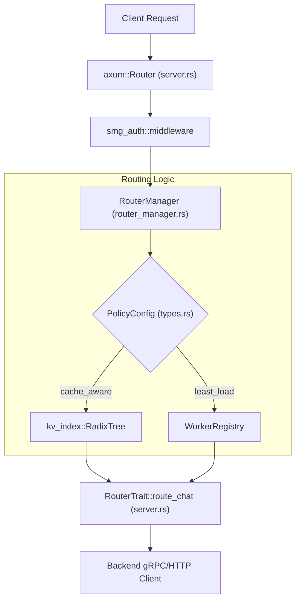
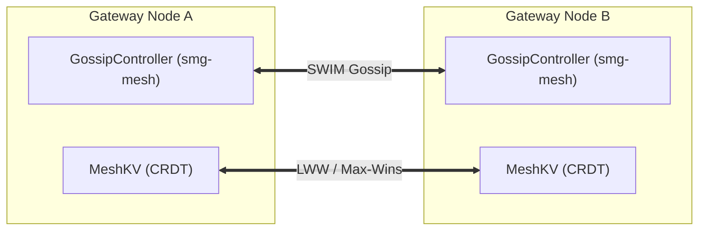

<!-- source: DeepWiki mcp.deepwiki.com · repo smg-project/smg · page 1 Overview · fetched 2026-10-21 -->

# Overview

Relevant source files

The following files were used as context for generating this wiki page:

- [.github/workflows/release-sglang-docker.yml](.github/workflows/release-sglang-docker.yml)
- [.github/workflows/release-trtllm-docker.yml](.github/workflows/release-trtllm-docker.yml)
- [.github/workflows/release-vllm-docker.yml](.github/workflows/release-vllm-docker.yml)
- [Cargo.toml](Cargo.toml)
- [README.md](README.md)
- [bindings/golang/Cargo.toml](bindings/golang/Cargo.toml)
- [bindings/python/Cargo.toml](bindings/python/Cargo.toml)
- [bindings/python/pyproject.toml](bindings/python/pyproject.toml)
- [bindings/python/src/lib.rs](bindings/python/src/lib.rs)
- [bindings/python/src/smg/router_args.py](bindings/python/src/smg/router_args.py)
- [bindings/python/tests/test_arg_parser.py](bindings/python/tests/test_arg_parser.py)
- [crates/grpc_client/Cargo.toml](crates/grpc_client/Cargo.toml)
- [crates/multimodal/Cargo.toml](crates/multimodal/Cargo.toml)
- [crates/protocols/Cargo.toml](crates/protocols/Cargo.toml)
- [crates/reasoning_parser/Cargo.toml](crates/reasoning_parser/Cargo.toml)
- [crates/tokenizer/Cargo.toml](crates/tokenizer/Cargo.toml)
- [crates/tool_parser/Cargo.toml](crates/tool_parser/Cargo.toml)
- [docs/assets/images/architecture-animated.svg](docs/assets/images/architecture-animated.svg)
- [docs/assets/images/concepts-overview.svg](docs/assets/images/concepts-overview.svg)
- [docs/assets/images/mcp-architecture.svg](docs/assets/images/mcp-architecture.svg)
- [docs/assets/images/wasm-plugins.svg](docs/assets/images/wasm-plugins.svg)
- [docs/assets/stylesheets/extra.css](docs/assets/stylesheets/extra.css)
- [docs/concepts/index.md](docs/concepts/index.md)
- [docs/concepts/routing/load-balancing.md](docs/concepts/routing/load-balancing.md)
- [docs/contributing/index.md](docs/contributing/index.md)
- [docs/getting-started/index.md](docs/getting-started/index.md)
- [docs/index.md](docs/index.md)
- [docs/reference/api/admin.md](docs/reference/api/admin.md)
- [docs/reference/api/extensions.md](docs/reference/api/extensions.md)
- [docs/reference/api/responses.md](docs/reference/api/responses.md)
- [docs/reference/configuration.md](docs/reference/configuration.md)
- [mkdocs.yml](mkdocs.yml)
- [model_gateway/Cargo.toml](model_gateway/Cargo.toml)
- [model_gateway/src/app_context.rs](model_gateway/src/app_context.rs)
- [model_gateway/src/config/builder.rs](model_gateway/src/config/builder.rs)
- [model_gateway/src/config/types.rs](model_gateway/src/config/types.rs)
- [model_gateway/src/config/validation.rs](model_gateway/src/config/validation.rs)
- [model_gateway/src/main.rs](model_gateway/src/main.rs)
- [model_gateway/src/policies/factory.rs](model_gateway/src/policies/factory.rs)
- [model_gateway/src/policies/mod.rs](model_gateway/src/policies/mod.rs)
- [model_gateway/src/policies/registry.rs](model_gateway/src/policies/registry.rs)
- [model_gateway/src/server.rs](model_gateway/src/server.rs)

Shepherd Model Gateway (SMG) is a high-performance, engine-agnostic inference gateway written in Rust. It is designed to centralize the management of large-scale LLM (Large Language Model) deployments by providing a unified, OpenAI-compatible API layer over diverse backend engines such as **vLLM**, **SGLang**, **TensorRT-LLM**, and various cloud providers [README.md:19-33]().

SMG specializes in maximizing GPU utilization through **cache-aware routing**, which tracks the KV cache state of inference engines to reuse prefixes and minimize redundant computation [README.md:27-29]().

## Key Capabilities

*   **Multi-Backend Support**: Connects to self-hosted engines (vLLM, SGLang, TRT-LLM) and cloud providers (OpenAI, Anthropic, Gemini, Bedrock) [README.md:76-85]().
*   **Advanced Load Balancing**: Supports 8+ routing policies, including `cache_aware`, `least_load`, and `consistent_hashing` [bindings/python/src/lib.rs:11-22]().
*   **Protocol Disaggregation**: Implements PD (Prefill-Decode) and EPD (Encode-Prefill-Decode) disaggregation to optimize resource usage for different inference stages [model_gateway/src/main.rs:116-123]().
*   **Resilience**: Built-in circuit breakers, retries with exponential backoff, and multi-tenant rate limiting [model_gateway/src/config/types.rs:109-110]().
*   **Extensibility**: Middleware support via **WebAssembly (WASM)** and integration with the **Model Context Protocol (MCP)** for agentic tool use [model_gateway/src/config/types.rs:155-159]().

## System Architecture

SMG operates as a high-throughput data plane between clients and inference workers. The core logic is encapsulated in the `smg` crate (located in `model_gateway/`), which orchestrates several specialized workspace crates.

### Codebase Topology

The workspace is organized into functional crates that handle specific aspects of the LLM request lifecycle:

| Crate | Purpose |
| :--- | :--- |
| `model_gateway` | The main `smg` binary and core routing logic [model_gateway/Cargo.toml:2-5](). |
| `llm-tokenizer` | Zero-copy tokenization and Jinja2 template rendering [Cargo.toml:12-12](). |
| `reasoning-parser` | Extracts "thinking" blocks from models like DeepSeek-R1 [Cargo.toml:9-9](). |
| `tool-parser` | Detects and parses function-call syntax from model streams [Cargo.toml:10-10](). |
| `smg-mesh` | SWIM-based gossip protocol for High Availability [Cargo.toml:19-19](). |
| `smg-wasm` | Runtime for custom middleware plugins [Cargo.toml:18-18](). |

### Request Flow: Natural Language to Code Entities

The following diagram illustrates how a request transitions from a network packet to a routed inference task within the codebase.

**Request Processing Pipeline**

Sources: [model_gateway/src/server.rs:156-170](), [model_gateway/src/config/types.rs:20-21](), [Cargo.toml:15-15]()

## Core Subsystems

### 1. Router and Policy Engine
The `RouterManager` is the central coordinator for routing decisions. It uses the `PolicyConfig` to determine which `Worker` should handle a request. For details on how traffic is distributed, see [Request Routing](#2).

### 2. Worker Management
SMG tracks the health and load of backend workers through a `WorkerRegistry`. It supports dynamic discovery via Kubernetes or manual registration via the Control Plane API. For details on worker lifecycles, see [Worker Management](#4).

### 3. High Availability Mesh
In multi-gateway deployments, SMG instances form a mesh using `smg-mesh`. This allows gateways to share KV cache state and worker load information via a gossip protocol. For details, see [High Availability Mesh](#7).

**Mesh State Synchronization**

Sources: [Cargo.toml:19-19](), [model_gateway/src/server.rs:75-76]()

## Navigation

*   [Getting Started](#1.1) — Installation, configuration, and first-run setup.
*   [Architecture Overview](#1.2) — Deep dive into the internal request lifecycle and crate relationships.
*   [Request Routing](#2) — Detailed exploration of routing policies and disaggregated modes.
*   [API Reference](#3) — Documentation for OpenAI-compatible and administrative endpoints.
*   [Worker Management](#4) — Discovery, health checks, and backend servicers.
*   [MCP (Model Context Protocol) Integration](#6) — Connecting agentic workflows to external tools.

Sources: [README.md:103-108](), [model_gateway/src/server.rs:13-14](), [model_gateway/src/main.rs:142-149]()

---

