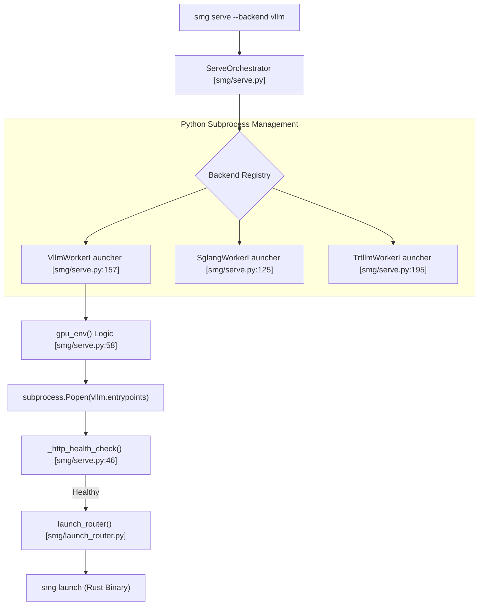
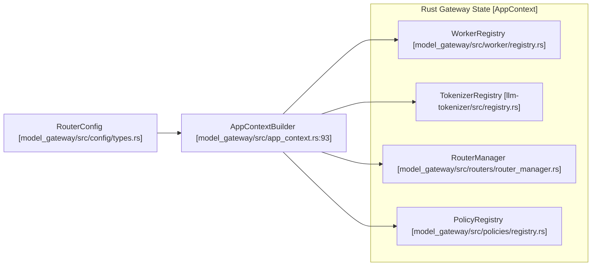

<!-- source: DeepWiki mcp.deepwiki.com · repo smg-project/smg · page 1.1 Getting Started · fetched 2026-10-21 -->

# Getting Started

<details>
<summary>Relevant source files</summary>

The following files were used as context for generating this wiki page:

- [README.md](README.md)
- [bindings/python/README.md](bindings/python/README.md)
- [bindings/python/src/lib.rs](bindings/python/src/lib.rs)
- [bindings/python/src/smg/cli.py](bindings/python/src/smg/cli.py)
- [bindings/python/src/smg/launch_router.py](bindings/python/src/smg/launch_router.py)
- [bindings/python/src/smg/router.py](bindings/python/src/smg/router.py)
- [bindings/python/src/smg/router_args.py](bindings/python/src/smg/router_args.py)
- [bindings/python/src/smg/serve.py](bindings/python/src/smg/serve.py)
- [bindings/python/tests/conftest.py](bindings/python/tests/conftest.py)
- [bindings/python/tests/test_arg_parser.py](bindings/python/tests/test_arg_parser.py)
- [bindings/python/tests/test_cli.py](bindings/python/tests/test_cli.py)
- [bindings/python/tests/test_router_config.py](bindings/python/tests/test_router_config.py)
- [bindings/python/tests/test_serve.py](bindings/python/tests/test_serve.py)
- [bindings/python/tests/test_startup_sequence.py](bindings/python/tests/test_startup_sequence.py)
- [bindings/python/tests/test_validation.py](bindings/python/tests/test_validation.py)
- [docs/assets/images/architecture-animated.svg](docs/assets/images/architecture-animated.svg)
- [docs/assets/images/concepts-overview.svg](docs/assets/images/concepts-overview.svg)
- [docs/assets/images/mcp-architecture.svg](docs/assets/images/mcp-architecture.svg)
- [docs/assets/images/wasm-plugins.svg](docs/assets/images/wasm-plugins.svg)
- [docs/assets/stylesheets/extra.css](docs/assets/stylesheets/extra.css)
- [docs/concepts/index.md](docs/concepts/index.md)
- [docs/concepts/routing/load-balancing.md](docs/concepts/routing/load-balancing.md)
- [docs/contributing/index.md](docs/contributing/index.md)
- [docs/getting-started/index.md](docs/getting-started/index.md)
- [docs/index.md](docs/index.md)
- [docs/reference/api/admin.md](docs/reference/api/admin.md)
- [docs/reference/api/extensions.md](docs/reference/api/extensions.md)
- [docs/reference/api/responses.md](docs/reference/api/responses.md)
- [docs/reference/configuration.md](docs/reference/configuration.md)
- [mkdocs.yml](mkdocs.yml)
- [model_gateway/src/app_context.rs](model_gateway/src/app_context.rs)
- [model_gateway/src/config/builder.rs](model_gateway/src/config/builder.rs)
- [model_gateway/src/config/types.rs](model_gateway/src/config/types.rs)
- [model_gateway/src/config/validation.rs](model_gateway/src/config/validation.rs)
- [model_gateway/src/main.rs](model_gateway/src/main.rs)
- [model_gateway/src/policies/factory.rs](model_gateway/src/policies/factory.rs)
- [model_gateway/src/policies/mod.rs](model_gateway/src/policies/mod.rs)
- [model_gateway/src/policies/registry.rs](model_gateway/src/policies/registry.rs)
- [model_gateway/src/server.rs](model_gateway/src/server.rs)

</details>


The Shepherd Model Gateway (SMG) is a high-performance, engine-agnostic model-routing gateway designed for large-scale LLM deployments. It centralizes worker lifecycle management and provides a unified OpenAI-compatible API across diverse backends like vLLM, SGLang, and TensorRT-LLM [README.md:19-23]().

## Installation

SMG can be installed via Docker, Python (PyPI), or Rust (Cargo).

| Method | Command |
| :--- | :--- |
| **Docker** | `docker pull lightseekorg/smg:latest` |
| **Python** | `pip install smg` |
| **Rust** | `cargo install smg` |

**Sources:** [README.md:39-50]()

---

## Launching SMG

SMG provides two primary CLI entry points for starting the gateway: `smg launch` and `smg serve`.

### 1. `smg launch` (Gateway Only)
The `launch` command starts the Rust gateway process. It assumes inference workers (e.g., vLLM instances) are already running and reachable via network URLs [model_gateway/src/main.rs:108-115]().

**Basic Usage:**
```bash
smg launch --worker-urls http://localhost:8000 --policy cache_aware
```

### 2. `smg serve` (All-in-One)
The `serve` command is a Python-based orchestrator that simplifies local development and single-node scaling. It performs a "two-pass" argument parse:
1.  **Orchestrator Pass**: Configures the number of workers (`--dp-size`), GPU partitioning, and gateway settings [bindings/python/src/smg/serve.py:1-5]().
2.  **Backend Pass**: Lazily imports and validates arguments for the specific inference engine (vLLM, SGLang, or TRT-LLM) [bindings/python/src/smg/serve.py:246-260]().

**Basic Usage:**
```bash
# Launch 2 vLLM workers, automatically partitioned across available GPUs
smg serve --backend vllm --model /path/to/model --dp-size 2
```

**Sources:** [README.md:52-64](), [model_gateway/src/main.rs:108-132](), [bindings/python/src/smg/serve.py:1-22]()

---

## Configuration Overview

SMG uses a hierarchical configuration system where CLI arguments override environment variables, which in turn override defaults [docs/reference/configuration.md:11-18]().

### Key Global Options
Defined in `RouterConfig` [model_gateway/src/config/types.rs:15-17]():

| Parameter | CLI Flag | Default | Description |
| :--- | :--- | :--- | :--- |
| **Host** | `--host` | `0.0.0.0` | Interface to bind the gateway [model_gateway/src/main.rs:161-162](). |
| **Port** | `--port` | `30000` | Port for the OpenAI-compatible API [model_gateway/src/main.rs:165-166](). |
| **Policy** | `--policy` | `cache_aware` | Load balancing strategy [model_gateway/src/main.rs:187-188](). |
| **Health Port** | `--health-check-port`| `None` | Isolated port for K8s probes to prevent starvation [model_gateway/src/main.rs:178-179](). |

### Load Balancing Policies
SMG supports 8+ routing policies. The `cache_aware` policy is recommended for LLM workloads to maximize KV cache reuse [docs/reference/configuration.md:81-92]().

*   `cache_aware`: Routes based on Radix-tree prefix matching of the prompt [model_gateway/src/config/builder.rs:120-137]().
*   `power_of_two`: Selects two random workers and picks the one with the least load [model_gateway/src/config/builder.rs:141-146]().
*   `consistent_hashing`: Ensures session affinity for specific request keys [bindings/python/src/lib.rs:20]().

**Sources:** [model_gateway/src/config/types.rs:15-149](), [model_gateway/src/main.rs:158-200](), [docs/reference/configuration.md:68-92]()

---

## Backend Setup (smg serve)

The `ServeOrchestrator` manages the lifecycle of backend subprocesses and partitions GPUs using `CUDA_VISIBLE_DEVICES` [bindings/python/src/smg/serve.py:58-88]().

### Data Flow: `smg serve` Initialization
This diagram bridges the CLI command to the internal Python launcher classes and the Rust gateway startup.


**Sources:** [bindings/python/src/smg/serve.py:32-200](), [bindings/python/src/smg/launch_router.py:21]()

### Backend-Specific Details

| Backend | Connection | Command Implementation |
| :--- | :--- | :--- |
| **vLLM** | HTTP/gRPC | `vllm.entrypoints.openai.api_server` [bindings/python/src/smg/serve.py:169-170]() |
| **SGLang** | HTTP/gRPC | `sglang.launch_server` [bindings/python/src/smg/serve.py:137]() |
| **TRT-LLM** | gRPC Only | `tensorrt_llm.commands.serve` [bindings/python/src/smg/serve.py:204]() |

---

## First Run Setup

### Prefill-Decode (PD) Disaggregation
SMG supports disaggregating Prefill and Decode phases to different GPU clusters. Use the `--pd-disaggregation` flag along with specific worker lists [model_gateway/src/main.rs:117-122]().

```bash
smg launch --pd-disaggregation \
  --prefill http://prefill-gpu:8000 \
  --decode http://decode-gpu-1:8000 http://decode-gpu-2:8000 \
  --policy cache_aware
```

### AppContext Initialization
Internally, SMG initializes an `AppContext` which holds the shared state, including the `WorkerRegistry`, `TokenizerRegistry`, and `RouterManager` [model_gateway/src/app_context.rs:52-83]().



**Sources:** [model_gateway/src/app_context.rs:52-143](), [model_gateway/src/server.rs:70-81](), [model_gateway/src/main.rs:117-130]()

---

