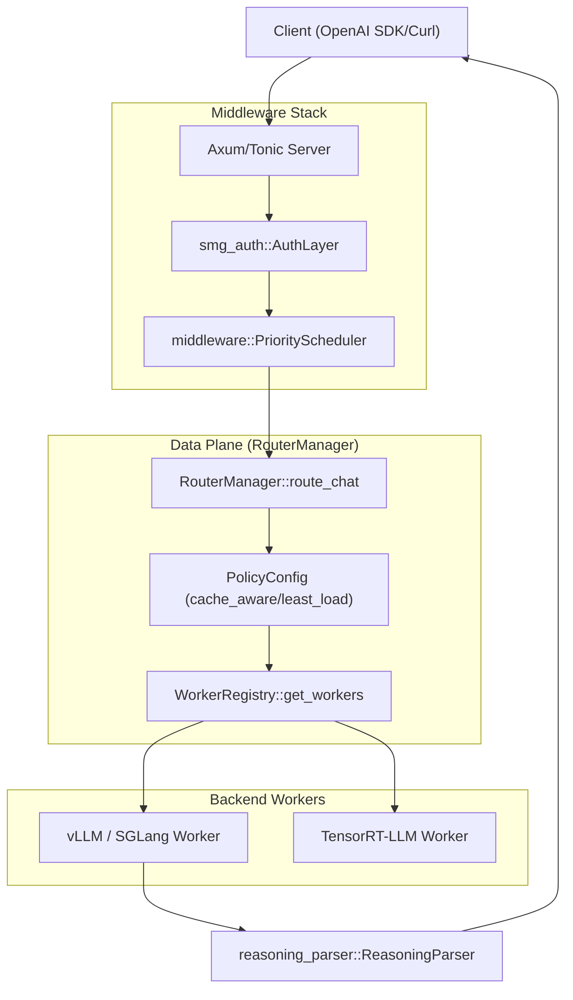
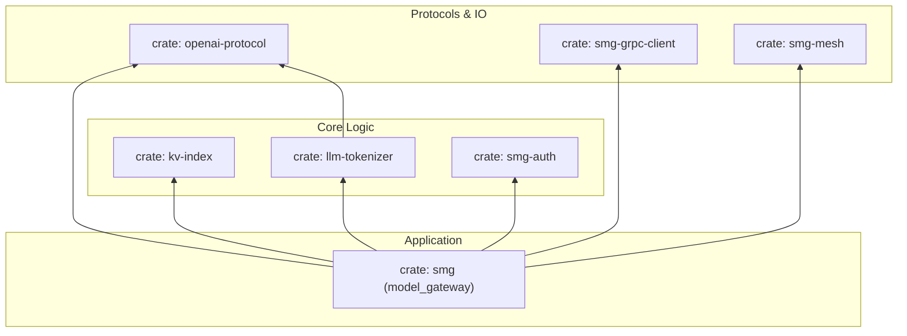

<!-- source: DeepWiki mcp.deepwiki.com · repo smg-project/smg · page 1.2 Architecture Overview · fetched 2026-10-21 -->

# Architecture Overview

Relevant source files

The following files were used as context for generating this wiki page:

- [.github/workflows/release-sglang-docker.yml](.github/workflows/release-sglang-docker.yml)
- [.github/workflows/release-trtllm-docker.yml](.github/workflows/release-trtllm-docker.yml)
- [.github/workflows/release-vllm-docker.yml](.github/workflows/release-vllm-docker.yml)
- [Cargo.toml](Cargo.toml)
- [README.md](README.md)
- [bindings/golang/Cargo.toml](bindings/golang/Cargo.toml)
- [bindings/python/Cargo.toml](bindings/python/Cargo.toml)
- [bindings/python/pyproject.toml](bindings/python/pyproject.toml)
- [bindings/python/src/lib.rs](bindings/python/src/lib.rs)
- [bindings/python/src/smg/router_args.py](bindings/python/src/smg/router_args.py)
- [bindings/python/tests/test_arg_parser.py](bindings/python/tests/test_arg_parser.py)
- [crates/grpc_client/Cargo.toml](crates/grpc_client/Cargo.toml)
- [crates/multimodal/Cargo.toml](crates/multimodal/Cargo.toml)
- [crates/protocols/Cargo.toml](crates/protocols/Cargo.toml)
- [crates/reasoning_parser/Cargo.toml](crates/reasoning_parser/Cargo.toml)
- [crates/tokenizer/Cargo.toml](crates/tokenizer/Cargo.toml)
- [crates/tool_parser/Cargo.toml](crates/tool_parser/Cargo.toml)
- [docs/assets/images/architecture-animated.svg](docs/assets/images/architecture-animated.svg)
- [docs/assets/images/architecture-detailed.svg](docs/assets/images/architecture-detailed.svg)
- [docs/assets/images/concepts-overview.svg](docs/assets/images/concepts-overview.svg)
- [docs/assets/images/mcp-architecture.svg](docs/assets/images/mcp-architecture.svg)
- [docs/assets/images/wasm-plugins.svg](docs/assets/images/wasm-plugins.svg)
- [docs/assets/stylesheets/extra.css](docs/assets/stylesheets/extra.css)
- [docs/concepts/architecture/grpc-pipeline.md](docs/concepts/architecture/grpc-pipeline.md)
- [docs/concepts/architecture/high-availability.md](docs/concepts/architecture/high-availability.md)
- [docs/concepts/architecture/overview.md](docs/concepts/architecture/overview.md)
- [docs/concepts/architecture/service-discovery.md](docs/concepts/architecture/service-discovery.md)
- [docs/concepts/extensibility/mcp.md](docs/concepts/extensibility/mcp.md)
- [docs/concepts/extensibility/wasm-plugins.md](docs/concepts/extensibility/wasm-plugins.md)
- [docs/concepts/index.md](docs/concepts/index.md)
- [docs/concepts/performance/tokenizer-caching.md](docs/concepts/performance/tokenizer-caching.md)
- [docs/concepts/reliability/circuit-breakers.md](docs/concepts/reliability/circuit-breakers.md)
- [docs/concepts/reliability/graceful-shutdown.md](docs/concepts/reliability/graceful-shutdown.md)
- [docs/concepts/reliability/health-checks.md](docs/concepts/reliability/health-checks.md)
- [docs/concepts/reliability/rate-limiting.md](docs/concepts/reliability/rate-limiting.md)
- [docs/concepts/routing/cache-aware.md](docs/concepts/routing/cache-aware.md)
- [docs/concepts/routing/load-balancing.md](docs/concepts/routing/load-balancing.md)
- [docs/concepts/routing/pd-disaggregation.md](docs/concepts/routing/pd-disaggregation.md)
- [docs/contributing/index.md](docs/contributing/index.md)
- [docs/getting-started/index.md](docs/getting-started/index.md)
- [docs/getting-started/pd-disaggregation.md](docs/getting-started/pd-disaggregation.md)
- [docs/index.md](docs/index.md)
- [docs/reference/api/admin.md](docs/reference/api/admin.md)
- [docs/reference/api/extensions.md](docs/reference/api/extensions.md)
- [docs/reference/api/responses.md](docs/reference/api/responses.md)
- [docs/reference/configuration.md](docs/reference/configuration.md)
- [docs/reference/index.md](docs/reference/index.md)
- [mkdocs.yml](mkdocs.yml)
- [model_gateway/Cargo.toml](model_gateway/Cargo.toml)
- [model_gateway/src/app_context.rs](model_gateway/src/app_context.rs)
- [model_gateway/src/config/builder.rs](model_gateway/src/config/builder.rs)
- [model_gateway/src/config/types.rs](model_gateway/src/config/types.rs)
- [model_gateway/src/config/validation.rs](model_gateway/src/config/validation.rs)
- [model_gateway/src/main.rs](model_gateway/src/main.rs)
- [model_gateway/src/policies/factory.rs](model_gateway/src/policies/factory.rs)
- [model_gateway/src/policies/mod.rs](model_gateway/src/policies/mod.rs)
- [model_gateway/src/policies/registry.rs](model_gateway/src/policies/registry.rs)
- [model_gateway/src/server.rs](model_gateway/src/server.rs)

Shepherd Model Gateway (SMG) is a high-performance, engine-agnostic inference gateway written in Rust. It serves as a centralized control and data plane for large-scale LLM deployments, providing unified OpenAI-compatible APIs while managing complex backend topologies like Prefill-Decode (PD) disaggregation and multi-node mesh networking.

## System Topology

SMG is architected as a transparent proxy that sits between clients and inference engines (vLLM, SGLang, TensorRT-LLM). It separates concerns into a **Control Plane** for management and a **Data Plane** for high-throughput request routing.

### Data Plane vs. Control Plane

| Plane | Responsibility | Key Components |
|:---|:---|:---|
| **Data Plane** | Request routing, protocol translation, streaming response processing, and load balancing. | `RouterManager`, `RouterTrait`, `PriorityScheduler`, `TokenizerRegistry` |
| **Control Plane** | Worker registration, health monitoring, service discovery, and configuration management. | `WorkerManager`, `WorkerRegistry`, `ServiceDiscovery`, `GossipController` |

### Request Lifecycle

The lifecycle of a request follows a pipeline designed for minimum latency and zero-copy where possible:

1.  **Ingress**: Requests arrive via `axum` (HTTP) or `tonic` (gRPC).
2.  **Middleware**: Authentication via `smg-auth` [crates/auth/Cargo.toml:13-13](), followed by admission control in the `PriorityScheduler` [model_gateway/src/config/types.rs:84-85]().
3.  **Routing**: The `RouterManager` [model_gateway/src/server.rs:59-59]() selects a `Router` based on the `RoutingMode` (Regular, PD, or EPD).
4.  **Load Balancing**: A `Policy` (e.g., `cache_aware`) selects the optimal `Worker` from the `WorkerRegistry`.
5.  **Dispatch**: The request is forwarded via the `smg-grpc-client` [model_gateway/src/config/types.rs:81-81]() or HTTP.
6.  **Egress Processing**: Streaming outputs are parsed for reasoning blocks (`reasoning-parser`) or tool calls (`tool-parser`) before being returned to the client.

### Request Flow Diagram

**Sources:** [model_gateway/src/server.rs:156-170](), [model_gateway/src/config/types.rs:20-20](), [model_gateway/src/app_context.rs:1-1]()

---

## Connection Modes: gRPC vs. HTTP

SMG supports two primary modes of operation for interacting with backends, configured via `ConnectionMode` [model_gateway/src/config/types.rs:19-19]().

### 1. HTTP Mode
In HTTP mode, SMG acts as a standard Layer 7 proxy. It is best suited for routing to cloud providers (OpenAI, Anthropic) or legacy inference servers.
*   **Implementation**: Uses `reqwest` [model_gateway/Cargo.toml:61-61]() for backend communication.
*   **Protocol**: Standard OpenAI REST API.

### 2. gRPC Mode (Harmony)
The gRPC mode uses a native high-performance pipeline. This mode is required for advanced features like PD disaggregation and cache-aware routing.
*   **Implementation**: Uses `smg-grpc-client` [model_gateway/Cargo.toml:81-81]() and the `openai-harmony` protocol [model_gateway/Cargo.toml:119-119]().
*   **Capabilities**: Supports `GetLoads` RPCs for real-time KV cache pressure monitoring and `SubscribeKvEvents` for prefix-matching synchronization.

**Sources:** [model_gateway/src/config/builder.rs:150-163](), [model_gateway/src/config/types.rs:18-20]()

---

## Workspace Crate Architecture

The SMG codebase is organized into a modular Rust workspace to separate protocol logic from the core gateway.

| Crate | Path | Description |
|:---|:---|:---|
| `smg` | `model_gateway/` | The main binary and orchestration logic. |
| `openai-protocol` | `crates/protocols/` | Shared types for OpenAI-compatible requests/responses. |
| `kv-index` | `crates/kv_index/` | Radix-tree implementation for cache-aware routing. |
| `llm-tokenizer` | `crates/tokenizer/` | Multi-backend tokenizer (HuggingFace, tiktoken). |
| `smg-mesh` | `crates/mesh/` | SWIM-based gossip protocol for High Availability. |
| `smg-wasm` | `crates/wasm/` | Runtime for WebAssembly middleware plugins. |
| `llm-multimodal` | `crates/multimodal/` | Tensor processing for images/video/audio. |

### Crate Dependency Diagram

**Sources:** [Cargo.toml:1-20](), [model_gateway/Cargo.toml:67-81]()

---

## High Availability and Mesh

For multi-gateway deployments, SMG implements a mesh networking layer using `smg-mesh` [model_gateway/Cargo.toml:80-80](). This allows multiple SMG instances to synchronize state without a centralized database.

*   **Gossip Protocol**: Uses a SWIM-like protocol via `MeshServerBuilder` [model_gateway/src/server.rs:42-42]() to discover peers and monitor node health.
*   **State Sync**: Propagates worker registrations and KV cache state across the cluster using CRDT-based synchronization in `MeshAdapters` [model_gateway/src/server.rs:50-50]().
*   **Isolation**: A dedicated `health_check_port` [model_gateway/src/main.rs:178-179]() can be used to isolate Kubernetes liveness/readiness probes from the main request runtime, preventing false negatives during high load.

**Sources:** [model_gateway/src/server.rs:75-76](), [model_gateway/src/config/types.rs:26-30](), [README.md:61-64]()

---

