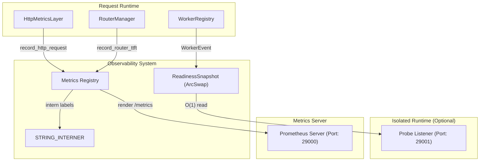
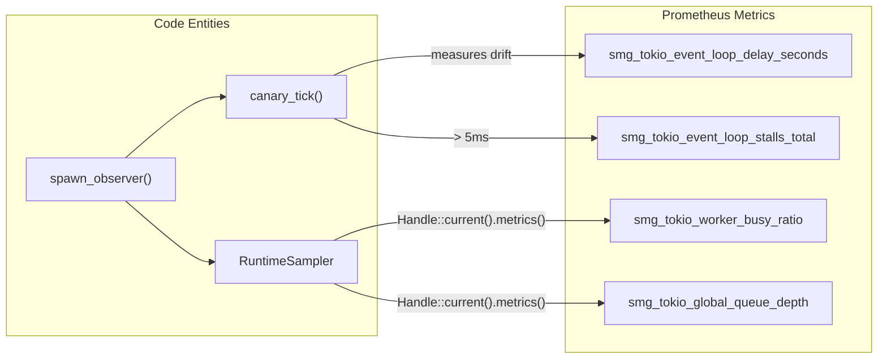

<!-- source: DeepWiki mcp.deepwiki.com · repo smg-project/smg · page 10 Observability · fetched 2026-10-21 -->

# Observability

Relevant source files

The following files were used as context for generating this wiki page:

- [docs/assets/images/service-discovery.svg](docs/assets/images/service-discovery.svg)
- [docs/concepts/data/chat-history.md](docs/concepts/data/chat-history.md)
- [docs/concepts/security/authentication.md](docs/concepts/security/authentication.md)
- [docs/getting-started/control-plane-auth.md](docs/getting-started/control-plane-auth.md)
- [docs/getting-started/control-plane-operations.md](docs/getting-started/control-plane-operations.md)
- [docs/getting-started/data-connections.md](docs/getting-started/data-connections.md)
- [docs/getting-started/mcp.md](docs/getting-started/mcp.md)
- [docs/getting-started/monitoring.md](docs/getting-started/monitoring.md)
- [docs/getting-started/reliability-controls.md](docs/getting-started/reliability-controls.md)
- [docs/reference/metrics.md](docs/reference/metrics.md)
- [model_gateway/src/health.rs](model_gateway/src/health.rs)
- [model_gateway/src/middleware/concurrency.rs](model_gateway/src/middleware/concurrency.rs)
- [model_gateway/src/middleware/logging.rs](model_gateway/src/middleware/logging.rs)
- [model_gateway/src/middleware/metrics.rs](model_gateway/src/middleware/metrics.rs)
- [model_gateway/src/middleware/storage_context.rs](model_gateway/src/middleware/storage_context.rs)
- [model_gateway/src/middleware/token_bucket.rs](model_gateway/src/middleware/token_bucket.rs)
- [model_gateway/src/middleware/wasm.rs](model_gateway/src/middleware/wasm.rs)
- [model_gateway/src/observability/gauge_histogram.rs](model_gateway/src/observability/gauge_histogram.rs)
- [model_gateway/src/observability/metrics.rs](model_gateway/src/observability/metrics.rs)
- [model_gateway/src/observability/metrics_server.rs](model_gateway/src/observability/metrics_server.rs)
- [model_gateway/src/observability/mod.rs](model_gateway/src/observability/mod.rs)
- [model_gateway/src/observability/otel_trace.rs](model_gateway/src/observability/otel_trace.rs)
- [model_gateway/src/observability/runtime_metrics.rs](model_gateway/src/observability/runtime_metrics.rs)

SMG's observability infrastructure is designed for high-throughput LLM gateway operations, providing deep visibility into the request lifecycle, system health, and runtime performance. The system utilizes a multi-layered Prometheus metrics strategy, distributed tracing via OpenTelemetry, and isolated health monitoring to ensure reliability under heavy load.

## Metrics Infrastructure

SMG implements a 6-layer metric hierarchy that tracks a request from the initial HTTP handshake down to individual model pipeline stages and tool invocations [docs/reference/metrics.md:7-8]().

### Performance Optimizations
To handle high-concurrency environments without becoming a bottleneck, the metrics system uses several optimization techniques:
*   **String Interning**: Low-cardinality labels (model IDs, worker URLs) are stored in a global `STRING_INTERNER` using `DashMap` for lock-free concurrent access [model_gateway/src/observability/metrics.rs:13-15]().
*   **Static Constants**: Common HTTP methods and status codes are mapped to static strings to avoid allocations during metric recording [model_gateway/src/observability/metrics.rs:57-105]().
*   **Gauge Histograms**: For Grafana heatmap visualizations, SMG uses a custom non-cumulative gauge histogram that performs zero-allocation updates via pre-registered atomic handles [model_gateway/src/observability/gauge_histogram.rs:6-10]().

### Metric Layers
| Layer | Focus | Key Metrics |
| :--- | :--- | :--- |
| **Layer 1: HTTP** | Edge requests | `smg_http_requests_total`, `smg_http_request_duration_seconds` [model_gateway/src/observability/metrics.rs:139-146]() |
| **Layer 2: Router** | Routing logic | `smg_router_ttft_seconds`, `smg_router_tpot_seconds`, `smg_router_tokens_total` [model_gateway/src/observability/metrics.rs:187-198]() |
| **Layer 3: Worker** | Backend health | `smg_worker_health`, `smg_worker_cb_state` (Circuit Breaker) [docs/getting-started/monitoring.md:146-153]() |
| **Layer 4: Mesh** | HA Coordination | Gossip and CRDT sync metrics [docs/reference/metrics.md:330-345]() |
| **Layer 5: MCP** | Tool Execution | `smg_mcp_tool_calls_total`, `smg_mcp_tool_duration_seconds` [model_gateway/src/observability/metrics.rs:260-267]() |
| **Layer 6: System** | Runtime | `smg_tokio_event_loop_stalls_total`, `smg_tokio_worker_busy_ratio` [model_gateway/src/observability/runtime_metrics.rs:78-83]() |

**Sources:** [model_gateway/src/observability/metrics.rs:13-105](), [model_gateway/src/observability/gauge_histogram.rs:1-10](), [docs/reference/metrics.md:7-10](), [model_gateway/src/observability/runtime_metrics.rs:77-83]()

---

## Distributed Tracing (OpenTelemetry)

SMG integrates with OpenTelemetry (OTEL) to provide distributed tracing. It supports W3C TraceContext propagation, allowing spans to be correlated across the gateway and upstream workers [model_gateway/src/middleware/logging.rs:26-28]().

### Trace Lifecycle
1.  **Context Extraction**: `RequestSpan` extracts `traceparent` and `tracestate` headers from incoming HTTP requests [model_gateway/src/middleware/logging.rs:24-28]().
2.  **Span Creation**: An `http_request` span is created with metadata including method, URI, and a unique `request_id` [model_gateway/src/middleware/logging.rs:32-43]().
3.  **Filtering**: A `CustomOtelFilter` ensures only relevant SMG internal modules export spans to the collector to minimize overhead [model_gateway/src/observability/otel_trace.rs:54-68]().
4.  **Export**: Spans are batched and exported via gRPC to the configured OTLP endpoint (default: `localhost:4317`) [model_gateway/src/observability/otel_trace.rs:105-117]().

**Sources:** [model_gateway/src/middleware/logging.rs:21-49](), [model_gateway/src/observability/otel_trace.rs:89-135]()

---

## Health and Readiness Pattern

SMG implements a high-performance health check system designed to prevent "false negative" probes caused by CPU starvation on the main request runtime [model_gateway/src/health.rs:10-14]().

### Readiness Snapshot Pattern
Instead of scanning the worker fleet for every probe, SMG uses a background task to maintain a `ReadinessSnapshot` [model_gateway/src/health.rs:16-18]().
*   **O(1) Reads**: Probe handlers perform a single atomic pointer load from an `ArcSwap<ReadinessSnapshot>` [model_gateway/src/health.rs:127-130]().
*   **Maintenance**: The snapshot is recomputed whenever a `WorkerEvent` occurs or at a fixed `CHECKPOINT_INTERVAL` (1s) [model_gateway/src/health.rs:78-80]().

### Isolated Probe Listener
For critical deployments, SMG can launch a **Dedicated Probe Listener** on a separate port (configured via `--health-check-port`) [model_gateway/src/health.rs:27-30](). This listener runs on its own OS thread and a minimal `axum` router with no middleware, ensuring that liveness/readiness checks remain responsive even if the main request runtime is saturated [model_gateway/src/health.rs:30-35]().

### System Architecture: Health & Metrics Flow
Title: Health Monitoring and Metrics Data Flow

**Sources:** [model_gateway/src/health.rs:5-43](), [model_gateway/src/middleware/metrics.rs:29-50](), [model_gateway/src/observability/metrics_server.rs:43-52]()

---

## Runtime Self-Monitoring

SMG monitors its own `tokio` runtime to distinguish between gateway starvation and slow backends [model_gateway/src/observability/runtime_metrics.rs:13-14]().

*   **Event-Loop Canary**: A task sleeps for 10ms and measures wake drift. Drift exceeding 5ms increments `smg_tokio_event_loop_stalls_total`, indicating that worker threads are blocked by synchronous I/O or CPU-heavy tasks [model_gateway/src/observability/runtime_metrics.rs:10-14]().
*   **Runtime Sampler**: Every 1 second, the system samples `tokio::runtime::RuntimeMetrics` to export:
    *   `global_queue_depth`: Number of tasks waiting for a thread [model_gateway/src/observability/runtime_metrics.rs:102-104]().
    *   `worker_busy_ratio`: Percentage of time worker threads spend polling tasks [model_gateway/src/observability/runtime_metrics.rs:107-110]().
    *   `alive_tasks`: Total number of spawned tasks [model_gateway/src/observability/runtime_metrics.rs:105]().

### Runtime Monitoring Entities
Title: Tokio Runtime Monitoring Mapping

**Sources:** [model_gateway/src/observability/runtime_metrics.rs:65-115](), [model_gateway/src/observability/runtime_metrics.rs:122-138]()

---

