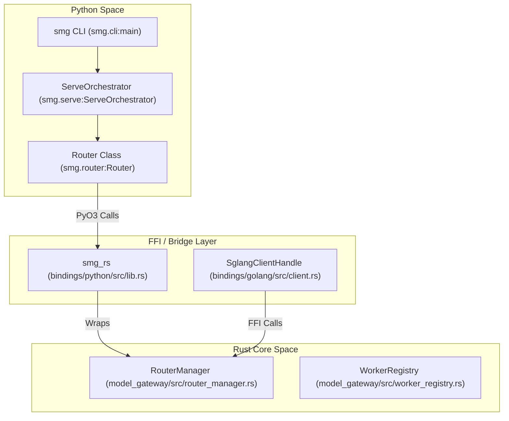
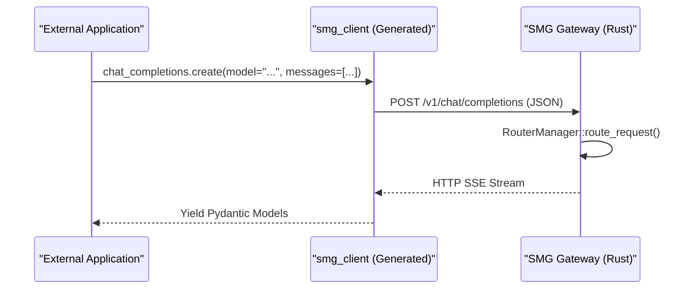

<!-- source: DeepWiki mcp.deepwiki.com · repo smg-project/smg · page 11 Language Bindings and Clients · fetched 2026-10-21 -->

# Language Bindings and Clients

Relevant source files

The following files were used as context for generating this wiki page:

- [.gitignore](.gitignore)
- [LICENSE](LICENSE)
- [bindings/golang/README.md](bindings/golang/README.md)
- [bindings/golang/src/client.rs](bindings/golang/src/client.rs)
- [bindings/golang/src/grpc_converter.rs](bindings/golang/src/grpc_converter.rs)
- [bindings/golang/src/lib.rs](bindings/golang/src/lib.rs)
- [bindings/golang/src/postprocessor.rs](bindings/golang/src/postprocessor.rs)
- [bindings/golang/src/preprocessor.rs](bindings/golang/src/preprocessor.rs)
- [bindings/golang/src/stream.rs](bindings/golang/src/stream.rs)
- [bindings/golang/src/tokenizer.rs](bindings/golang/src/tokenizer.rs)
- [bindings/golang/src/tool_parser.rs](bindings/golang/src/tool_parser.rs)
- [bindings/python/README.md](bindings/python/README.md)
- [bindings/python/src/smg/cli.py](bindings/python/src/smg/cli.py)
- [bindings/python/src/smg/launch_router.py](bindings/python/src/smg/launch_router.py)
- [bindings/python/src/smg/router.py](bindings/python/src/smg/router.py)
- [bindings/python/src/smg/serve.py](bindings/python/src/smg/serve.py)
- [bindings/python/tests/conftest.py](bindings/python/tests/conftest.py)
- [bindings/python/tests/test_cli.py](bindings/python/tests/test_cli.py)
- [bindings/python/tests/test_router_config.py](bindings/python/tests/test_router_config.py)
- [bindings/python/tests/test_serve.py](bindings/python/tests/test_serve.py)
- [bindings/python/tests/test_startup_sequence.py](bindings/python/tests/test_startup_sequence.py)
- [bindings/python/tests/test_validation.py](bindings/python/tests/test_validation.py)
- [clients/java/.openapi-generator-ignore](clients/java/.openapi-generator-ignore)
- [clients/java/pom.xml](clients/java/pom.xml)
- [clients/python/smg_client/api/parser.py](clients/python/smg_client/api/parser.py)
- [clients/python/smg_client/api/responses.py](clients/python/smg_client/api/responses.py)
- [clients/python/smg_client/api/workers.py](clients/python/smg_client/api/workers.py)
- [model_gateway/src/routers/grpc/common/response_formatting.rs](model_gateway/src/routers/grpc/common/response_formatting.rs)
- [scripts/fix_java_codegen.sh](scripts/fix_java_codegen.sh)

SMG (Shepherd Model Gateway) is designed as a language-agnostic core written in Rust, exposed to the broader ecosystem through high-performance language bindings and generated API clients. This architecture allows SMG to integrate deeply with Python-based ML workflows while providing low-latency FFI (Foreign Function Interface) options for Go and other systems languages.

## Multi-Language Architecture

The binding ecosystem follows a tiered approach:
1.  **Core Rust Engine**: The foundational logic for routing, state management, and protocol parsing.
2.  **FFI Layer**: Specialized crates that expose C-compatible symbols or PyO3 interfaces.
3.  **Language-Specific Packages**: Idiomatic wrappers like the `smg` Python package and the Go SDK.
4.  **Generated Clients**: OpenAPI-based clients for remote interaction via HTTP.

### System Mapping

The following diagram illustrates how high-level language concepts map to specific code entities within the binding layer.

**Binding Layer Entity Map**

Sources: [bindings/python/src/smg/cli.py:55-96](), [bindings/python/src/smg/serve.py:214-230](), [bindings/python/src/smg/router.py:133-176](), [bindings/golang/src/client.rs:30-33]().

---

## Python Bindings (`smg-python`)

The Python package is the primary entry point for users. It provides the `smg` CLI and a high-level API for orchestrating both the gateway and the underlying inference workers (e.g., vLLM, SGLang).

*   **Orchestration**: The `ServeOrchestrator` manages the lifecycle of multiple worker processes, handling GPU partitioning via `CUDA_VISIBLE_DEVICES` and performing health checks before the router begins traffic dispatch [bindings/python/src/smg/serve.py:58-88]().
*   **CLI Subcommands**:
    *   `smg launch`: Starts only the Rust router, connecting to existing worker URLs [bindings/python/src/smg/cli.py:77-83]().
    *   `smg serve`: A "one-command" experience that launches both the inference engine workers and the SMG router [bindings/python/src/smg/serve.py:1-5]().
*   **Native Integration**: Uses `PyO3` to expose the Rust `Router` struct directly to Python, allowing for zero-overhead configuration and management [bindings/python/src/smg/router.py:16-17]().

For details, see [Python Bindings (smg-python)](#11.1).

Sources: [bindings/python/src/smg/cli.py:1-11](), [bindings/python/src/smg/serve.py:32-46](), [bindings/python/src/smg/router.py:133-180]().

---

## Go Bindings and gRPC Client

The Go ecosystem interacts with SMG through a specialized FFI layer that enables high-performance gRPC client capabilities and tokenizer integration.

*   **FFI Layer**: The `smg-golang` crate exports C-compatible functions like `sgl_client_create` and `sgl_tokenizer_create_from_file` [bindings/golang/src/client.rs:50-54](), [bindings/golang/src/tokenizer.rs:69-72]().
*   **Request Preprocessing**: Provides high-efficiency functions to apply chat templates and tokenize requests on the client side before dispatching to the gateway [bindings/golang/src/preprocessor.rs:168-177]().
*   **Response Conversion**: Includes logic to convert internal gRPC protocol chunks back into OpenAI-compatible JSON formats idiomatic for Go applications [bindings/golang/src/grpc_converter.rs:201-205]().

For details, see [Go Bindings and gRPC Client](#11.2).

Sources: [bindings/golang/src/client.rs:1-33](), [bindings/golang/src/tokenizer.rs:1-26](), [bindings/golang/src/preprocessor.rs:1-33]().

---

## Generated API Clients

SMG provides automatically generated clients to ensure consistency between the Rust implementation and external consumers.

| Client Language | Tooling | Purpose |
| :--- | :--- | :--- |
| **Python (Pydantic)** | `openapi-generator` | Provides the `smg_client` package used in E2E tests and by external Python services. |
| **Java** | `openapi-generator` | Enables enterprise integration within JVM environments. |
| **Rust** | Internal Crates | The `smg-grpc-client` crate provides native Rust types for inter-gateway and worker communication. |

**Client Interaction Flow**

Sources: [.gitignore:154-162](), [bindings/python/src/smg/router.py:133-176]().

---

## Directory Structure Overview

The bindings are organized within the `bindings/` and `clients/` top-level directories.

| Path | Description |
| :--- | :--- |
| `bindings/python/` | PyO3-based Rust crate and the `smg` Python package source. |
| `bindings/golang/` | Rust crate exporting C-ABI symbols for Go FFI usage. |
| `clients/python/` | Generated Pydantic-based API client (`smg_client`). |
| `clients/openapi/` | The `smg-openapi.yaml` specification that drives client generation. |

Sources: [bindings/python/README.md:51-68](), [.gitignore:154-162]().

---

