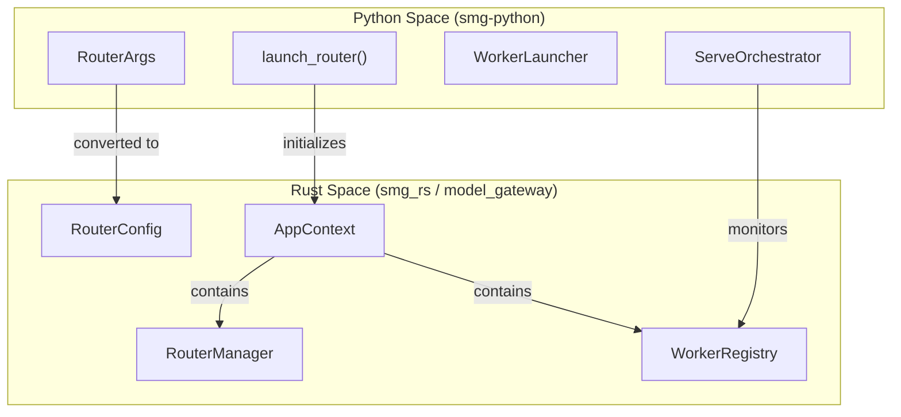
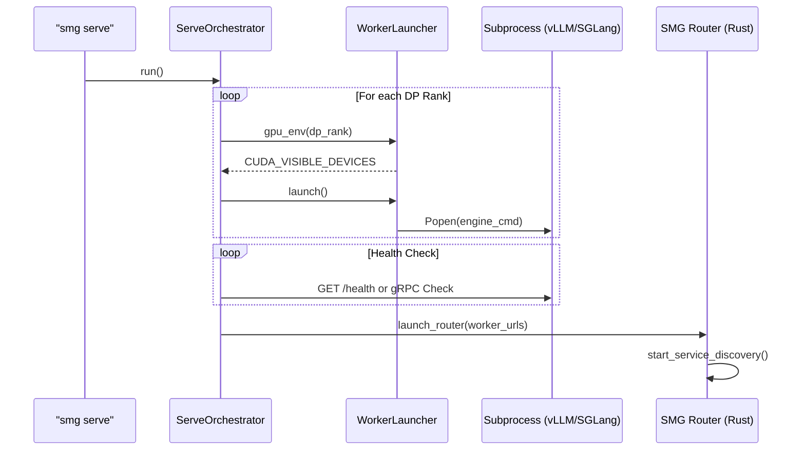

<!-- source: DeepWiki mcp.deepwiki.com · repo smg-project/smg · page 11.1 Python Bindings (smg-python) · fetched 2026-10-21 -->

# Python Bindings (smg-python)

Relevant source files

The following files were used as context for generating this wiki page:

- [.gitignore](.gitignore)
- [LICENSE](LICENSE)
- [bindings/python/README.md](bindings/python/README.md)
- [bindings/python/src/lib.rs](bindings/python/src/lib.rs)
- [bindings/python/src/smg/cli.py](bindings/python/src/smg/cli.py)
- [bindings/python/src/smg/launch_router.py](bindings/python/src/smg/launch_router.py)
- [bindings/python/src/smg/router.py](bindings/python/src/smg/router.py)
- [bindings/python/src/smg/router_args.py](bindings/python/src/smg/router_args.py)
- [bindings/python/src/smg/serve.py](bindings/python/src/smg/serve.py)
- [bindings/python/tests/conftest.py](bindings/python/tests/conftest.py)
- [bindings/python/tests/test_arg_parser.py](bindings/python/tests/test_arg_parser.py)
- [bindings/python/tests/test_cli.py](bindings/python/tests/test_cli.py)
- [bindings/python/tests/test_router_config.py](bindings/python/tests/test_router_config.py)
- [bindings/python/tests/test_serve.py](bindings/python/tests/test_serve.py)
- [bindings/python/tests/test_startup_sequence.py](bindings/python/tests/test_startup_sequence.py)
- [bindings/python/tests/test_validation.py](bindings/python/tests/test_validation.py)
- [clients/java/.openapi-generator-ignore](clients/java/.openapi-generator-ignore)
- [clients/java/pom.xml](clients/java/pom.xml)
- [clients/python/smg_client/api/parser.py](clients/python/smg_client/api/parser.py)
- [clients/python/smg_client/api/responses.py](clients/python/smg_client/api/responses.py)
- [clients/python/smg_client/api/workers.py](clients/python/smg_client/api/workers.py)
- [docs/reference/configuration.md](docs/reference/configuration.md)
- [model_gateway/src/app_context.rs](model_gateway/src/app_context.rs)
- [model_gateway/src/config/builder.rs](model_gateway/src/config/builder.rs)
- [model_gateway/src/config/types.rs](model_gateway/src/config/types.rs)
- [model_gateway/src/config/validation.rs](model_gateway/src/config/validation.rs)
- [model_gateway/src/main.rs](model_gateway/src/main.rs)
- [model_gateway/src/policies/factory.rs](model_gateway/src/policies/factory.rs)
- [model_gateway/src/policies/mod.rs](model_gateway/src/policies/mod.rs)
- [model_gateway/src/policies/registry.rs](model_gateway/src/policies/registry.rs)
- [model_gateway/src/server.rs](model_gateway/src/server.rs)
- [scripts/fix_java_codegen.sh](scripts/fix_java_codegen.sh)

The `smg-python` package provides high-level Python interfaces to the Shepherd Model Gateway (SMG). It consists of a Rust extension module (`smg_rs`) built with PyO3 for performance-critical routing and configuration, and a set of Python orchestration tools for managing inference backends (vLLM, SGLang, TRT-LLM) and launching the gateway.

## Core Architecture

The Python bindings bridge the gap between the Rust-based gateway core and the Python-centric LLM ecosystem.

### smg_rs PyO3 Extension
The `smg_rs` module exposes core Rust data structures and enums to Python, ensuring configuration parity between the CLI and the library. It exports key enums like `PolicyType`, `BackendType`, and `HistoryBackendType` [bindings/python/src/lib.rs:9-41](), as well as complex configuration structs for Authentication and Data Persistence [bindings/python/src/lib.rs:92-191]().

### Router and AppContext
The Python `Router` class (and its underlying `AppState` in Rust) manages the lifecycle of the gateway. The `AppContext` serves as the central dependency injection container, holding the `WorkerRegistry`, `TokenizerRegistry`, and `PolicyRegistry` [model_gateway/src/app_context.rs:52-83]().

### Diagram: Python to Rust Entity Mapping
This diagram shows how Python-side configuration and orchestration entities map to their high-performance Rust counterparts.

Sources: [bindings/python/src/smg/router_args.py:30-176](), [model_gateway/src/config/types.rs:16-150](), [model_gateway/src/app_context.rs:52-83](), [bindings/python/src/smg/launch_router.py:10-25]()

---

## smg serve Orchestration

The `smg serve` command is the primary entry point for launching a unified gateway and backend worker environment. It uses a two-pass argument parsing strategy to lazily import backend-specific CLI arguments (e.g., vLLM or SGLang specific flags) [bindings/python/src/smg/serve.py:1-5]().

### ServeOrchestrator and WorkerLauncher
The `ServeOrchestrator` manages the lifecycle of multiple backend workers and the SMG router. It uses `WorkerLauncher` backends to handle the specific CLI requirements of different engines:

*   **`SglangWorkerLauncher`**: Launches `sglang.launch_server` with support for gRPC mode and cache reporting [bindings/python/src/smg/serve.py:125-154]().
*   **`VllmWorkerLauncher`**: Supports both OpenAI-compatible HTTP and gRPC entry points [bindings/python/src/smg/serve.py:157-192]().
*   **`TrtllmWorkerLauncher`**: Specifically targets the TensorRT-LLM `serve` command [bindings/python/src/smg/serve.py:195-205]().

### GPU Partitioning
The `WorkerLauncher.gpu_env` method implements automatic GPU isolation for Data Parallel (DP) deployments. It calculates `CUDA_VISIBLE_DEVICES` by slicing the available GPU pool based on the worker's `dp_rank` and `tensor_parallel_size` [bindings/python/src/smg/serve.py:58-88]().

### Health Check Logic
The orchestrator performs health checks before registering workers with the router:
1.  **gRPC**: Uses the standard gRPC health check protocol [bindings/python/src/smg/serve.py:45]().
2.  **HTTP**: Polls the `/health` endpoint [bindings/python/src/smg/serve.py:46]().

### Diagram: `smg serve` Execution Flow

Sources: [bindings/python/src/smg/serve.py:109-122](), [bindings/python/src/smg/serve.py:42-46](), [bindings/python/src/smg/launch_router.py:10-25](), [model_gateway/src/server.rs:61-63]()

---

## Configuration and Routing

The Python bindings provide a comprehensive `RouterArgs` dataclass that mirrors the Rust `RouterConfig`.

### Key Configuration Areas
| Area | Python Field | Rust Field | Description |
| :--- | :--- | :--- | :--- |
| **Worker** | `worker_urls` | `mode: RoutingMode::Regular` | List of backend endpoints [bindings/python/src/smg/router_args.py:32]() |
| **Disaggregation** | `pd_disaggregation` | `mode: RoutingMode::PrefillDecode` | Enables Prefill-Decode separation [bindings/python/src/smg/router_args.py:41]() |
| **Policy** | `policy` | `policy: PolicyConfig` | Selection algorithm (e.g., `cache_aware`) [bindings/python/src/smg/router_args.py:52]() |
| **Health** | `health_check_port` | `health_check_port` | Isolated port for k8s probes [bindings/python/src/smg/router_args.py:38]() |
| **Transport** | `multimodal_tensor_transport` | `multimodal_tensor_transport` | `shm` or `rdma` for large tensors [bindings/python/src/smg/router_args.py:75]() |

### GPU and Memory Optimization
The configuration supports fine-tuning of the `cache_aware` policy, which is critical for KV-cache affinity. Parameters like `cache_threshold`, `balance_abs_threshold`, and `max_tree_size` [bindings/python/src/smg/router_args.py:59-65]() allow the gateway to balance between cache hits and worker load distribution.

Sources: [bindings/python/src/smg/router_args.py:30-176](), [model_gateway/src/config/types.rs:16-150](), [model_gateway/src/policies/mod.rs:106-131]()

---

## smg_client (Generated Pydantic Client)

The `smg_client` is a high-level, type-safe Python client generated from the gateway's OpenAPI specification. It provides a native Python interface for interacting with all SMG endpoints.

### Key Modules
*   **`api.responses`**: Interfaces with the `/v1/responses` endpoint for agentic, multi-turn workflows [clients/python/smg_client/api/responses.py]().
*   **`api.parser`**: Provides access to the reasoning and tool-call parsing logic used by the gateway [clients/python/smg_client/api/parser.py]().
*   **`api.workers`**: Administrative interface for dynamic worker registration and load monitoring [clients/python/smg_client/api/workers.py]().

Sources: [clients/python/smg_client/api/responses.py](), [clients/python/smg_client/api/parser.py](), [clients/python/smg_client/api/workers.py]()

---

