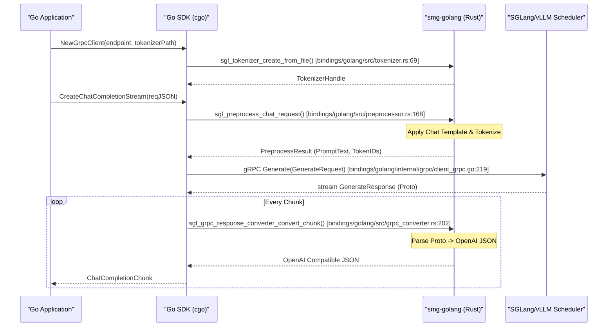
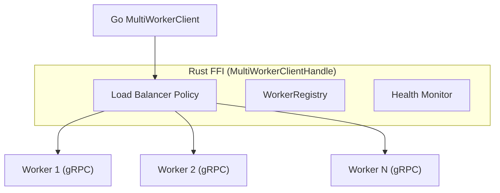

<!-- source: DeepWiki mcp.deepwiki.com · repo smg-project/smg · page 11.2 Go Bindings and gRPC Client · fetched 2026-10-21 -->

# Go Bindings and gRPC Client

Relevant source files

The following files were used as context for generating this wiki page:

- [bindings/golang/README.md](bindings/golang/README.md)
- [bindings/golang/client.go](bindings/golang/client.go)
- [bindings/golang/examples/oai_server/config/config.go](bindings/golang/examples/oai_server/config/config.go)
- [bindings/golang/examples/oai_server/handlers/chat.go](bindings/golang/examples/oai_server/handlers/chat.go)
- [bindings/golang/examples/oai_server/main.go](bindings/golang/examples/oai_server/main.go)
- [bindings/golang/examples/oai_server/models/chat.go](bindings/golang/examples/oai_server/models/chat.go)
- [bindings/golang/examples/oai_server/service/smg.go](bindings/golang/examples/oai_server/service/smg.go)
- [bindings/golang/internal/ffi/multi_client.go](bindings/golang/internal/ffi/multi_client.go)
- [bindings/golang/internal/ffi/preprocessor.go](bindings/golang/internal/ffi/preprocessor.go)
- [bindings/golang/internal/grpc/client_grpc.go](bindings/golang/internal/grpc/client_grpc.go)
- [bindings/golang/internal/proto/sglang_scheduler.pb.go](bindings/golang/internal/proto/sglang_scheduler.pb.go)
- [bindings/golang/internal/proto/sglang_scheduler_grpc.pb.go](bindings/golang/internal/proto/sglang_scheduler_grpc.pb.go)
- [bindings/golang/multi_client.go](bindings/golang/multi_client.go)
- [bindings/golang/src/client.rs](bindings/golang/src/client.rs)
- [bindings/golang/src/grpc_converter.rs](bindings/golang/src/grpc_converter.rs)
- [bindings/golang/src/lib.rs](bindings/golang/src/lib.rs)
- [bindings/golang/src/postprocessor.rs](bindings/golang/src/postprocessor.rs)
- [bindings/golang/src/preprocessor.rs](bindings/golang/src/preprocessor.rs)
- [bindings/golang/src/stream.rs](bindings/golang/src/stream.rs)
- [bindings/golang/src/tokenizer.rs](bindings/golang/src/tokenizer.rs)
- [bindings/golang/src/tool_parser.rs](bindings/golang/src/tool_parser.rs)
- [crates/grpc_client/proto/sglang_scheduler.proto](crates/grpc_client/proto/sglang_scheduler.proto)
- [e2e_test/benchmarks/test_go_bindings_perf.py](e2e_test/benchmarks/test_go_bindings_perf.py)
- [e2e_test/bindings_go/conftest.py](e2e_test/bindings_go/conftest.py)
- [e2e_test/bindings_go/test_go_oai_server.py](e2e_test/bindings_go/test_go_oai_server.py)
- [grpc_servicer/smg_grpc_servicer/sglang/server.py](grpc_servicer/smg_grpc_servicer/sglang/server.py)
- [model_gateway/src/routers/grpc/common/response_formatting.rs](model_gateway/src/routers/grpc/common/response_formatting.rs)

This page documents the Go ecosystem for the Shepherd Model Gateway (SMG), including the C-compatible Rust FFI bindings (`smg-golang`), the high-level Go client library, and the gRPC protocol definitions used for communication between the Rust router and backend inference schedulers.

## Overview

SMG provides a native Go integration path through a multi-layered approach:
1.  **`smg-golang` (Rust cdylib)**: A Rust crate that exports C-compatible symbols for tokenization, chat template application, and gRPC communication [bindings/golang/src/lib.rs:1-55]().
2.  **Go FFI Wrapper**: A set of internal Go packages that use `cgo` to call the Rust shared library [bindings/golang/internal/ffi/preprocessor.go]().
3.  **gRPC Client**: A Go implementation of the SGLang/vLLM scheduler protocols, allowing Go services to bypass the HTTP gateway and talk directly to inference backends [bindings/golang/internal/grpc/client_grpc.go:35-43]().
4.  **OAI Example Server**: A reference implementation of an OpenAI-compatible server written in Go using the SMG SDK [bindings/golang/examples/oai_server/main.go]().

## System Architecture and Data Flow

The Go bindings bridge the gap between Go's garbage-collected environment and SMG's high-performance Rust core.

### Bridging Natural Language to Code Entities

| System Concept | Code Entity (Rust/FFI) | Code Entity (Go) |
| :--- | :--- | :--- |
| **Tokenizer** | `TokenizerHandle` [bindings/golang/src/tokenizer.rs:24-26]() | `ffi.TokenizerHandle` [bindings/golang/internal/ffi/preprocessor.go]() |
| **Client Connection** | `SglangClientHandle` [bindings/golang/src/client.rs:30-33]() | `grpc.GrpcClient` [bindings/golang/internal/grpc/client_grpc.go:35-43]() |
| **Stream Management** | `SglangStreamHandle` [bindings/golang/src/stream.rs:35-44]() | `GrpcChatCompletionStream` [bindings/golang/internal/grpc/client_grpc.go:235-245]() |
| **Response Converter** | `GrpcResponseConverterHandle` [bindings/golang/src/grpc_converter.rs:35-49]() | `ffi.ConvertProtoChunkToOpenAI` [bindings/golang/internal/ffi/preprocessor.go]() |

### Request Lifecycle Diagram

The following diagram illustrates how a Go application interacts with the SMG Rust core to process a chat request.

**Sources:** [bindings/golang/src/client.rs:49-96](), [bindings/golang/src/preprocessor.rs:168-200](), [bindings/golang/internal/grpc/client_grpc.go:109-234]()

## Core Components

### 1. Rust FFI Layer (`smg-golang`)
The Rust side provides thread-safe handles and an asynchronous runtime to manage gRPC streams.

*   **`SglangClientHandle`**: Encapsulates a `SglangSchedulerClient` and a `Tokenizer` [bindings/golang/src/client.rs:30-33]().
*   **`sgl_preprocess_chat_request`**: Performs high-level preprocessing, including chat template rendering via `process_chat_messages` and tokenization [bindings/golang/src/preprocessor.rs:168-187]().
*   **`GrpcResponseConverterHandle`**: Maintains state for streaming responses, including `StopSequenceDecoder` and `ToolParser` to handle incremental tool calls [bindings/golang/src/grpc_converter.rs:35-49]().

### 2. gRPC Protocol Definitions
SMG uses a specialized gRPC protocol to communicate with SGLang and vLLM schedulers. The Go bindings include generated code for these services.

*   **Service**: `SglangScheduler` [crates/grpc_client/proto/sglang_scheduler.proto:11-61]().
*   **Key RPCs**:
    *   `Generate`: Streaming text generation [crates/grpc_client/proto/sglang_scheduler.proto:13]().
    *   `GetLoads`: Retrieves worker load metrics for load balancing [crates/grpc_client/proto/sglang_scheduler.proto:31]().
    *   `SubscribeKvEvents`: Streams KV cache events for cache-aware routing [crates/grpc_client/proto/sglang_scheduler.proto:45-47]().

### 3. Go Client Library
The Go client provides a developer-friendly API that abstracts the FFI and gRPC complexities.

*   **`NewGrpcClient`**: Initializes the gRPC connection and loads the Rust-backed tokenizer [bindings/golang/internal/grpc/client_grpc.go:57-95]().
*   **`CreateChatCompletionStream`**: 
    1.  Calls FFI to preprocess the OpenAI-style JSON request [bindings/golang/internal/grpc/client_grpc.go:114]().
    2.  Converts the preprocessed data into a `proto.GenerateRequest` [bindings/golang/internal/grpc/client_grpc.go:145-153]().
    3.  Initiates the gRPC stream with the backend [bindings/golang/internal/grpc/client_grpc.go:219]().

### 4. Response Processing and Tool Parsing
Streaming responses are processed incrementally to support stop sequences and tool calling.

*   **`StreamStateManager`**: Tracks the state of the current stream in Rust [bindings/golang/src/grpc_converter.rs:46]().
*   **`convert_proto_chunk_to_openai`**: A Rust function that takes a gRPC `GenerateResponse` chunk and uses the `ToolParser` to detect function calls before returning OpenAI-compatible JSON [bindings/golang/src/grpc_converter.rs:202-210]().

## Implementation Details: Multi-Worker Client
For production deployments, the Go SDK supports a `MultiWorkerClient` that performs client-side load balancing.

**Sources:** [bindings/golang/src/policy.rs:30-35](), [bindings/golang/multi_client.go]()

### Data Flow for Streaming
1.  Go calls `sgl_stream_read_next` [bindings/golang/src/stream.rs:82]().
2.  Rust blocks on the `tokio` runtime to pull the next `proto_response` from the gRPC stream [bindings/golang/src/stream.rs:98-101]().
3.  The chunk is passed to the `converter` which handles `skip_special_tokens` and stop sequence logic [bindings/golang/src/grpc_converter.rs:152-163]().
4.  If the chunk completes a message, `is_done_out` is set to `1` [bindings/golang/src/stream.rs:151]().

**Sources:**
- `bindings/golang/src/lib.rs`
- `bindings/golang/src/client.rs`
- `bindings/golang/src/preprocessor.rs`
- `bindings/golang/src/grpc_converter.rs`
- `bindings/golang/src/stream.rs`
- `bindings/golang/internal/grpc/client_grpc.go`
- `crates/grpc_client/proto/sglang_scheduler.proto`

---

