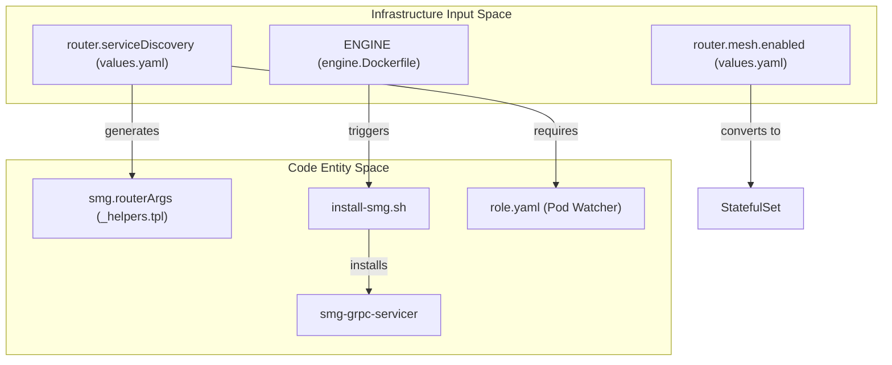
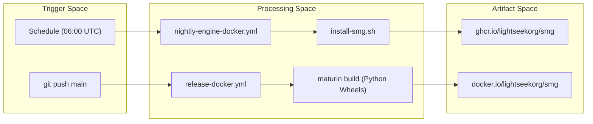

<!-- source: DeepWiki mcp.deepwiki.com · repo smg-project/smg · page 12 Deployment and Infrastructure · fetched 2026-10-21 -->

# Deployment and Infrastructure

Relevant source files

The following files were used as context for generating this wiki page:

- [.github/workflows/_build-engine-image.yml](.github/workflows/_build-engine-image.yml)
- [.github/workflows/nightly-docker.yml](.github/workflows/nightly-docker.yml)
- [.github/workflows/nightly-engine-docker.yml](.github/workflows/nightly-engine-docker.yml)
- [.github/workflows/release-docker.yml](.github/workflows/release-docker.yml)
- [.github/workflows/release-tokenspeed-docker.yml](.github/workflows/release-tokenspeed-docker.yml)
- [deploy/helm/smg/examples/with-mesh-ha.yaml](deploy/helm/smg/examples/with-mesh-ha.yaml)
- [deploy/helm/smg/templates/_helpers.tpl](deploy/helm/smg/templates/_helpers.tpl)
- [deploy/helm/smg/templates/deployment-router.yaml](deploy/helm/smg/templates/deployment-router.yaml)
- [deploy/helm/smg/templates/grafana-dashboard.yaml](deploy/helm/smg/templates/grafana-dashboard.yaml)
- [deploy/helm/smg/templates/role.yaml](deploy/helm/smg/templates/role.yaml)
- [deploy/helm/smg/templates/rolebinding.yaml](deploy/helm/smg/templates/rolebinding.yaml)
- [deploy/helm/smg/templates/service-router-headless.yaml](deploy/helm/smg/templates/service-router-headless.yaml)
- [deploy/helm/smg/templates/servicemonitor.yaml](deploy/helm/smg/templates/servicemonitor.yaml)
- [deploy/helm/smg/templates/tests/test-connection.yaml](deploy/helm/smg/templates/tests/test-connection.yaml)
- [deploy/helm/smg/values.schema.json](deploy/helm/smg/values.schema.json)
- [deploy/helm/smg/values.yaml](deploy/helm/smg/values.yaml)
- [docker/engine.Dockerfile](docker/engine.Dockerfile)
- [scripts/installation/install-smg.sh](scripts/installation/install-smg.sh)
- [scripts/installation/install-tokenspeed.sh](scripts/installation/install-tokenspeed.sh)

This section provides an overview of the deployment methodologies and the automated CI/CD infrastructure used to build, test, and release the SMG (Shepherd Model Gateway) ecosystem. SMG is designed for containerized environments, providing official Docker images and Helm charts for Kubernetes orchestration, supported by a robust GitHub Actions pipeline.

## Deployment Options

SMG supports multiple deployment modes ranging from standalone Docker containers to high-availability Kubernetes meshes. The deployment infrastructure focuses on bundling the SMG gateway with various inference engines (vLLM, SGLang, TRT-LLM) to simplify worker node provisioning.

### Docker Containers
The project maintains two primary types of Docker images:
1.  **SMG Gateway Image**: A standalone image containing the `smg` binary and Python environment, used for the routing layer [`docker/Dockerfile:1-99`]().
2.  **Engine Bundle Images**: Parameterized images that combine SMG with specific inference backends like `vllm`, `sglang`, or `trtllm` [`docker/engine.Dockerfile:1-98`]().

For detailed configuration of containerized environments, see [Docker and Helm Deployment](#12.1).

### Kubernetes and Helm
The official Helm chart facilitates complex deployments, including:
*   **Service Discovery**: Automatic detection of worker pods via Kubernetes labels [`deploy/helm/smg/values.yaml:39-48`]().
*   **Mesh HA**: Configuring SMG as a `StatefulSet` for stable network identities required by the gossip protocol [`deploy/helm/smg/templates/deployment-router.yaml:2-6`]().
*   **Observability**: Integrated `ServiceMonitor` for Prometheus and pre-configured Grafana dashboards [`deploy/helm/smg/values.yaml:112-119`]().

For details, see [Docker and Helm Deployment](#12.1).

### Deployment Component Mapping
The following diagram illustrates how Helm values and Docker build arguments map to the running system entities.

**Diagram: Infrastructure to Code Entity Mapping**

**Sources:** [`deploy/helm/smg/values.yaml:39-48`](), [`deploy/helm/smg/templates/_helpers.tpl:74-152`](), [`deploy/helm/smg/templates/role.yaml:1-16`](), [`scripts/installation/install-smg.sh:35-41`]().

---

## CI/CD Infrastructure

The SMG project utilizes GitHub Actions for continuous integration and delivery. The pipeline is designed to handle the complexity of cross-language builds (Rust, Python, Go) and the requirements of GPU-accelerated inference engines.

### Build and Release Workflows
*   **Engine Image Builder**: A reusable workflow [`_build-engine-image.yml`]() that handles the nuances of different backends, such as the specific `pyyaml` shadowing required for `trtllm` and `tokenspeed` base images [`docker/engine.Dockerfile:59-85`]().
*   **Release Pipeline**: Automated pushing to Docker Hub and GHCR triggered by version bumps in `pyproject.toml` [`.github/workflows/release-docker.yml:59-70`]().
*   **Nightly Builds**: Daily builds of both the main gateway and engine-specific bundles to ensure compatibility with the latest upstream inference engine commits [`.github/workflows/nightly-engine-docker.yml:5-9`]().

### CI/CD Logic Flow
The following diagram shows the progression from code change to published artifact.

**Diagram: Pipeline Execution Flow**

**Sources:** [`.github/workflows/release-docker.yml:1-99`](), [`.github/workflows/nightly-engine-docker.yml:1-66`](), [`scripts/installation/install-smg.sh:28-33`]().

For details on test matrices, benchmarking pipelines, and release gates, see [CI/CD Pipeline](#12.2).

---

## Related Pages
*   **[Docker and Helm Deployment](#12.1)**: Deep dive into `values.yaml` configuration, multi-engine Dockerfiles, and Kubernetes resource templates.
*   **[CI/CD Pipeline](#12.2)**: Detailed documentation of GitHub Action workflows, automated testing strategies, and artifact publishing logic.

**Sources:**
*   [`.github/workflows/_build-engine-image.yml:1-100`]()
*   [`.github/workflows/release-docker.yml:1-139`]()
*   [`.github/workflows/nightly-docker.yml:1-62`]()
*   [`docker/engine.Dockerfile:1-98`]()
*   [`deploy/helm/smg/values.yaml:1-252`]()
*   [`deploy/helm/smg/templates/_helpers.tpl:74-218`]()
*   [`scripts/installation/install-smg.sh:1-42`]()

---

