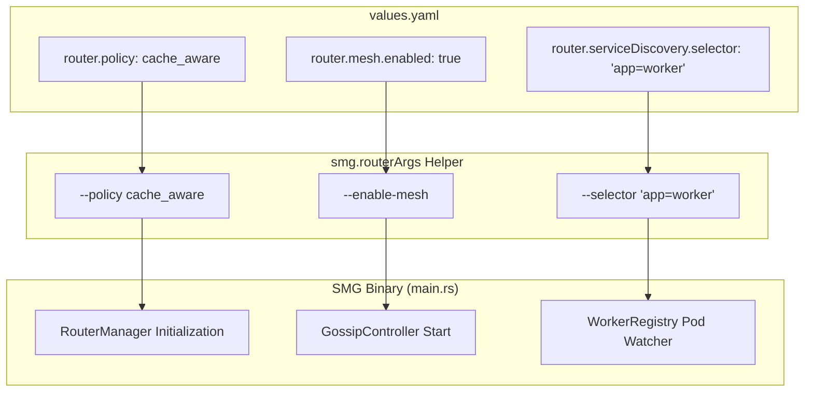
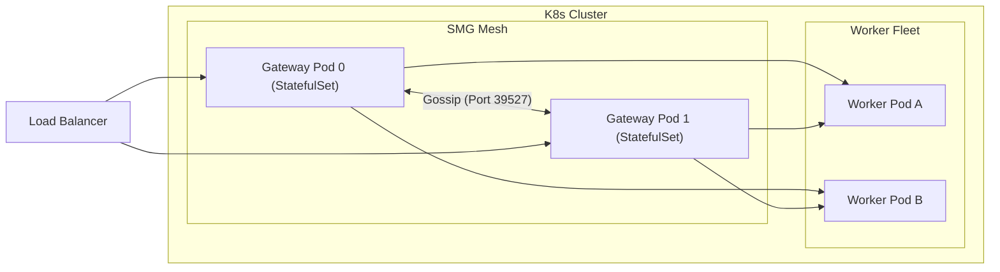

<!-- source: DeepWiki mcp.deepwiki.com · repo smg-project/smg · page 12.1 Docker and Helm Deployment · fetched 2026-10-21 -->

# Docker and Helm Deployment

Relevant source files

The following files were used as context for generating this wiki page:

- [.github/workflows/_build-engine-image.yml](.github/workflows/_build-engine-image.yml)
- [.github/workflows/nightly-docker.yml](.github/workflows/nightly-docker.yml)
- [.github/workflows/nightly-engine-docker.yml](.github/workflows/nightly-engine-docker.yml)
- [.github/workflows/release-docker.yml](.github/workflows/release-docker.yml)
- [.github/workflows/release-tokenspeed-docker.yml](.github/workflows/release-tokenspeed-docker.yml)
- [deploy/helm/smg/Chart.yaml](deploy/helm/smg/Chart.yaml)
- [deploy/helm/smg/examples/with-mesh-ha.yaml](deploy/helm/smg/examples/with-mesh-ha.yaml)
- [deploy/helm/smg/templates/_helpers.tpl](deploy/helm/smg/templates/_helpers.tpl)
- [deploy/helm/smg/templates/deployment-router.yaml](deploy/helm/smg/templates/deployment-router.yaml)
- [deploy/helm/smg/templates/grafana-dashboard.yaml](deploy/helm/smg/templates/grafana-dashboard.yaml)
- [deploy/helm/smg/templates/role.yaml](deploy/helm/smg/templates/role.yaml)
- [deploy/helm/smg/templates/rolebinding.yaml](deploy/helm/smg/templates/rolebinding.yaml)
- [deploy/helm/smg/templates/service-router-headless.yaml](deploy/helm/smg/templates/service-router-headless.yaml)
- [deploy/helm/smg/templates/servicemonitor.yaml](deploy/helm/smg/templates/servicemonitor.yaml)
- [deploy/helm/smg/templates/tests/test-connection.yaml](deploy/helm/smg/templates/tests/test-connection.yaml)
- [deploy/helm/smg/values.schema.json](deploy/helm/smg/values.schema.json)
- [deploy/helm/smg/values.yaml](deploy/helm/smg/values.yaml)
- [docker/engine.Dockerfile](docker/engine.Dockerfile)
- [scripts/installation/install-smg.sh](scripts/installation/install-smg.sh)
- [scripts/installation/install-tokenspeed.sh](scripts/installation/install-tokenspeed.sh)
- [scripts/k8s-runner-resources/README.md](scripts/k8s-runner-resources/README.md)
- [scripts/k8s-runner-resources/arc-runner-autoscaler.yaml](scripts/k8s-runner-resources/arc-runner-autoscaler.yaml)
- [scripts/k8s-runner-resources/arc-runner-cpu.yaml](scripts/k8s-runner-resources/arc-runner-cpu.yaml)
- [scripts/k8s-runner-resources/arc-runner-gpu.yaml](scripts/k8s-runner-resources/arc-runner-gpu.yaml)
- [scripts/k8s-runner-resources/arc-runner-rbac.yaml](scripts/k8s-runner-resources/arc-runner-rbac.yaml)
- [scripts/k8s-runner-resources/arc-secret-template.yaml](scripts/k8s-runner-resources/arc-secret-template.yaml)
- [scripts/k8s-runner-resources/runner-values-1-gpu-h100.yaml](scripts/k8s-runner-resources/runner-values-1-gpu-h100.yaml)
- [scripts/k8s-runner-resources/runner-values-2-gpu-h100.yaml](scripts/k8s-runner-resources/runner-values-2-gpu-h100.yaml)
- [scripts/k8s-runner-resources/runner-values-4-gpu-general.yaml](scripts/k8s-runner-resources/runner-values-4-gpu-general.yaml)
- [scripts/k8s-runner-resources/runner-values-4-gpu-h100.yaml](scripts/k8s-runner-resources/runner-values-4-gpu-h100.yaml)
- [scripts/k8s-runner-resources/volcano-scheduler-configmap.yaml](scripts/k8s-runner-resources/volcano-scheduler-configmap.yaml)

This page documents the containerization and orchestration infrastructure for the Shepherd Model Gateway (SMG). It covers the multi-engine Docker strategy, the Kubernetes Helm chart for high-availability deployments, and the automated CI/CD pipelines that manage image lifecycles.

## Docker Architecture

SMG employs a tiered Docker strategy to support various inference backends (vLLM, SGLang, TRT-LLM, TokenSpeed) while maintaining a consistent gateway interface.

### Engine-Specific Bundles
The primary deployment mechanism uses `docker/engine.Dockerfile` to create specialized images. These images bundle the SMG gateway binary, the Python-based gRPC servicers, and the specific inference engine into a single container [docker/engine.Dockerfile:1-17]().

The build process is parameterized via `ARG` directives:
*   `BASE_IMAGE_REF`: The starting image (e.g., `lmsysorg/sglang:v0.5.10`) [docker/engine.Dockerfile:19-19]().
*   `ENGINE`: The target backend (`vllm`, `sglang`, `trtllm`, `tgl`, `tokenspeed`) [docker/engine.Dockerfile:89-92]().
*   `SMG_REPO`/`SMG_COMMIT`: Controls the version of the gateway code to install [docker/engine.Dockerfile:25-43]().

### Image Building Flow
The `sources` stage in the Dockerfile handles cloning the SMG repository and any required engine source code [docker/engine.Dockerfile:22-43](). Installation is then delegated to shell scripts located in `scripts/installation/`, such as `install-smg.sh` and engine-specific scripts like `install-tokenspeed.sh` [docker/engine.Dockerfile:87-95]().

**Engine Image Relationships**

| Engine | Base Image Example | SMG Servicer |
| :--- | :--- | :--- |
| **vLLM** | `vllm/vllm-openai` | `VllmEngineServicer` |
| **SGLang** | `lmsysorg/sglang` | `SglangSchedulerServicer` |
| **TokenSpeed** | Debian-based Python | `TokenSpeedSchedulerServicer` |
| **TRT-LLM** | NVIDIA NGC | Custom gRPC bridge |

### GitHub Actions Workflows
Automated builds are managed by three primary workflows:
1.  **Release Docker Image**: Triggered by version bumps in `bindings/python/pyproject.toml`, it builds and pushes to `lightseekorg/smg:latest` and versioned tags [/.github/workflows/release-docker.yml:3-9](), [/.github/workflows/release-docker.yml:94-96]().
2.  **Nightly Docker Build**: Runs daily at 06:00 UTC to provide `ghcr.io/lightseekorg/smg:nightly` images for testing [/.github/workflows/nightly-docker.yml:4-6](), [/.github/workflows/nightly-docker.yml:47-48]().
3.  **Engine Image Builder**: A reusable workflow (`_build-engine-image.yml`) that handles the complex logic of building multi-arch images for different backends [/.github/workflows/_build-engine-image.yml:1-13]().

Sources: [docker/engine.Dockerfile:1-98](), [/.github/workflows/release-docker.yml:1-139](), [/.github/workflows/nightly-docker.yml:1-62](), [/.github/workflows/_build-engine-image.yml:1-116]().

---

## Helm Chart Deployment

The SMG Helm chart (located in `deploy/helm/smg`) provides a production-ready template for deploying the gateway and its associated worker fleet.

### Core Components
*   **Router Deployment/StatefulSet**: The gateway layer. If `router.mesh.enabled` is true, it uses a `StatefulSet` to ensure stable network identities for gossip-based synchronization [deploy/helm/smg/values.yaml:26-30]().
*   **Service Discovery**: Automatically detects worker pods using labels (e.g., `app=sglang-worker`) [deploy/helm/smg/values.yaml:39-48]().
*   **ServiceMonitor**: Integrates with Prometheus for scraping metrics from the gateway and workers [deploy/helm/smg/values.yaml:112-119]().
*   **Grafana Dashboard**: A pre-configured dashboard for visualizing throughput, TTFT, and cache efficiency [deploy/helm/smg/templates/grafana-dashboard.yaml]().

### Configuration Parameters
Key configurations in `values.yaml` include:
*   **Routing Policy**: Defined via `router.policy` (e.g., `cache_aware`, `round_robin`) [deploy/helm/smg/values.yaml:20-21]().
*   **Resilience**: Circuit breaker thresholds (`cb-failure-threshold`) and retry logic (`retry-max-retries`) [deploy/helm/smg/templates/_helpers.tpl:190-212]().
*   **Mesh HA**: Configuration for the gossip protocol, including port `39527` and peer discovery [deploy/helm/smg/values.yaml:29-31]().

### Implementation: Router Arguments
The chart uses a helper template `smg.routerArgs` to translate YAML values into CLI flags for the `smg` binary.

**Diagram: Helm Value to CLI Flag Mapping**

Sources: [deploy/helm/smg/values.yaml:1-252](), [deploy/helm/smg/templates/_helpers.tpl:74-212](), [deploy/helm/smg/Chart.yaml:1-30]().

---

## High Availability and Mesh Networking

When scaling beyond a single gateway instance, SMG utilizes a gossip-based mesh to synchronize state.

### Mesh Discovery in Kubernetes
In a Kubernetes environment, SMG avoids static peer lists by using internal service discovery. The Helm chart configures the router to look for other pods with the `app.kubernetes.io/component=router` label [deploy/helm/smg/templates/_helpers.tpl:106-107]().

### Data Flow for HA
1.  **Node Discovery**: Each gateway pod registers its `POD_IP` and `POD_NAME` in the mesh [deploy/helm/smg/templates/_helpers.tpl:86-91]().
2.  **State Sync**: Radix tree prefixes and worker load data are synchronized across peers.
3.  **Headless Service**: A headless service (`service-router-headless.yaml`) provides stable DNS for internal mesh communication.

**Diagram: Multi-Gateway Mesh Topology**

Sources: [deploy/helm/smg/values.yaml:26-33](), [deploy/helm/smg/templates/_helpers.tpl:84-117]().

---

## CI/CD Runner Infrastructure

For high-performance testing and GPU-accelerated builds, SMG utilizes specialized GitHub Actions Runners deployed via the Action Runner Controller (ARC).

### GPU Runner Configurations
The repository contains several runner templates optimized for different hardware:
*   **H100 Nodes**: Configured with 1, 2, or 4 GPUs and RDMA support for KV transfer testing [scripts/k8s-runner-resources/runner-values-1-gpu-h100.yaml:101-102](), [scripts/k8s-runner-resources/runner-values-4-gpu-h100.yaml:101-102]().
*   **RDMA/Infiniband**: Runners are configured with `hostNetwork: true` and `/dev/infiniband` mounts to support NIXL/Mooncake KV transfer protocols [scripts/k8s-runner-resources/runner-values-2-gpu-h100.yaml:29-65]().
*   **Docker-in-Docker (DinD)**: Used for isolated E2E testing where the runner needs to launch worker containers [scripts/k8s-runner-resources/runner-values-2-gpu-h100.yaml:129-142]().

### Auto-scaling Runners
The `HorizontalRunnerAutoscaler` (HRA) manages the runner fleet size based on the number of queued workflow runs, ensuring fast PR feedback while minimizing resource costs [scripts/k8s-runner-resources/arc-runner-autoscaler.yaml:1-108]().

Sources: [scripts/k8s-runner-resources/runner-values-2-gpu-h100.yaml:1-176](), [scripts/k8s-runner-resources/arc-runner-autoscaler.yaml:1-108](), [scripts/k8s-runner-resources/arc-runner-gpu.yaml:1-237]().

---

