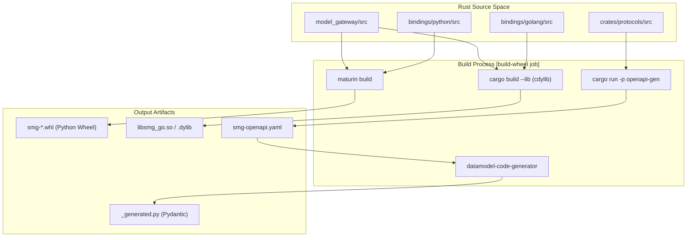
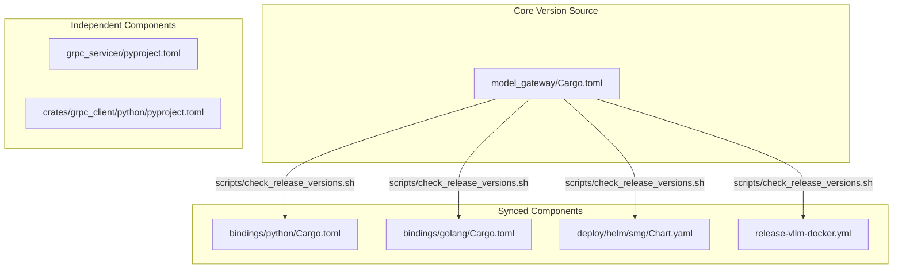

<!-- source: DeepWiki mcp.deepwiki.com · repo smg-project/smg · page 12.2 CI/CD Pipeline · fetched 2026-10-21 -->

# CI/CD Pipeline

Relevant source files

The following files were used as context for generating this wiki page:

- [.github/CODEOWNERS](.github/CODEOWNERS)
- [.github/actions/setup-rust/action.yml](.github/actions/setup-rust/action.yml)
- [.github/mergify.yml](.github/mergify.yml)
- [.github/workflows/benchmark-manual-policy.yml](.github/workflows/benchmark-manual-policy.yml)
- [.github/workflows/benchmark-radix-tree.yml](.github/workflows/benchmark-radix-tree.yml)
- [.github/workflows/benchmark-request-processing.yml](.github/workflows/benchmark-request-processing.yml)
- [.github/workflows/benchmark-tokenizer.yml](.github/workflows/benchmark-tokenizer.yml)
- [.github/workflows/benchmark-tool-parser.yml](.github/workflows/benchmark-tool-parser.yml)
- [.github/workflows/docs.yml](.github/workflows/docs.yml)
- [.github/workflows/nightly-benchmark.yml](.github/workflows/nightly-benchmark.yml)
- [.github/workflows/nightly-mlx-bench.yml](.github/workflows/nightly-mlx-bench.yml)
- [.github/workflows/pr-naming-check.yml](.github/workflows/pr-naming-check.yml)
- [.github/workflows/pr-test-mlx.yml](.github/workflows/pr-test-mlx.yml)
- [.github/workflows/pr-test-rust.yml](.github/workflows/pr-test-rust.yml)
- [.github/workflows/release-crates.yml](.github/workflows/release-crates.yml)
- [.github/workflows/release-grpc.yml](.github/workflows/release-grpc.yml)
- [.github/workflows/release-helm.yml](.github/workflows/release-helm.yml)
- [.github/workflows/release-pypi-dev.yml](.github/workflows/release-pypi-dev.yml)
- [.github/workflows/release-pypi.yml](.github/workflows/release-pypi.yml)
- [.github/workflows/stale.yml](.github/workflows/stale.yml)
- [.pre-commit-config.yaml](.pre-commit-config.yaml)
- [CODE_OF_CONDUCT.md](CODE_OF_CONDUCT.md)
- [CONTRIBUTING.md](CONTRIBUTING.md)
- [GOVERNANCE.md](GOVERNANCE.md)
- [Makefile](Makefile)
- [docs/contributing/code-style.md](docs/contributing/code-style.md)
- [docs/contributing/development.md](docs/contributing/development.md)
- [e2e_test/benchmarks/conftest.py](e2e_test/benchmarks/conftest.py)
- [e2e_test/benchmarks/nightly_summarize.py](e2e_test/benchmarks/nightly_summarize.py)
- [e2e_test/benchmarks/test_nightly_perf.py](e2e_test/benchmarks/test_nightly_perf.py)
- [scripts/check_release_versions.sh](scripts/check_release_versions.sh)
- [scripts/dco-check.sh](scripts/dco-check.sh)
- [scripts/install_opencv.sh](scripts/install_opencv.sh)
- [scripts/k8s-runner-resources/runner-values-cpu.yaml](scripts/k8s-runner-resources/runner-values-cpu.yaml)
- [scripts/mlx_bench.sh](scripts/mlx_bench.sh)
- [scripts/mlx_bench_aggregate.py](scripts/mlx_bench_aggregate.py)
- [scripts/setup-sccache.sh](scripts/setup-sccache.sh)
- [scripts/update_whl_index.py](scripts/update_whl_index.py)

The Shepherd Model Gateway (SMG) CI/CD infrastructure is designed to handle a complex multi-language workspace (Rust, Python, Go) while maintaining high reliability for large-scale LLM inference. The pipeline leverages GitHub Actions, a custom Kubernetes runner infrastructure, and extensive caching via `sccache` to provide fast feedback loops for developers and rigorous validation for releases.

### Pipeline Overview

The automation strategy is divided into three main tiers:
1.  **PR Validation**: Rapid feedback on code quality, compilation, and functional correctness.
2.  **Nightly Benchmarks**: Deep performance regression testing and model-specific evaluations on real GPU hardware.
3.  **Release Orchestration**: Automated publishing of multi-platform artifacts to PyPI, Crates.io, Docker Hub, and Helm registries.

---

## 1. PR Test Pipeline

The PR pipeline triggers on every push and pull request to the `main` branch, excluding documentation-only changes `[.github/workflows/pr-test-rust.yml:3-16]()`. It utilizes a concurrency group strategy to cancel superseded runs on PRs while ensuring every commit on `main` is fully validated `[.github/workflows/pr-test-rust.yml:24-26]()`.

### Workflow Stages

| Stage | Task | Description |
| :--- | :--- | :--- |
| **Linting** | `pre-commit` | Runs `ruff`, `codespell`, and DCO checks `[.github/workflows/pr-test-rust.yml:34-52]()`. |
| **Python Lint** | `ruff`, `mypy` | Validates `e2e_test/`, `bindings/python/`, and `scripts/` `[.github/workflows/pr-test-rust.yml:54-80]()`. |
| **Proto Check** | `grpc-proto` | Verifies that gRPC protobufs compile and are importable in Python `[.github/workflows/pr-test-rust.yml:81-118]()`. |
| **Core Build** | `build-wheel` | Compiles Rust core, generates Python wheels via `maturin`, and builds Go FFI libraries `[.github/workflows/pr-test-rust.yml:119-145]()`. |
| **Codegen** | `openapi-gen` | Generates OpenAPI YAML from Rust types and produces Pydantic models for the Python client `[.github/workflows/pr-test-rust.yml:146-164]()`. |
| **Fixtures** | `wasm-fixtures` | Compiles WASM test plugins used in integration tests `[.github/workflows/pr-test-rust.yml:165-169]()`. |

### Build Artifact Flow
The following diagram illustrates how the `build-wheel` job orchestrates the transformation of Rust source into multi-language artifacts.

**Diagram: Build Artifact Generation Flow**

**Sources**: `[.github/workflows/pr-test-rust.yml:119-198]()`, `[Makefile:102-178]()`

---

## 2. Nightly Benchmarks

Nightly benchmarks run on a schedule (Sundays 00:00 PDT) to evaluate performance across a matrix of models and runtimes (vLLM, SGLang, TRT-LLM) `[.github/workflows/nightly-benchmark.yml:1-15]()`.

### Matrix Strategy
The pipeline uses a `single-worker` job matrix that targets `4-gpu-h100` runners `[.github/workflows/nightly-benchmark.yml:109-130]()`. Key models evaluated include:
*   **Llama Series**: 3.1-8B, 3.3-70B (FP16 and FP8) `[.github/workflows/nightly-benchmark.yml:120-126]()`.
*   **Qwen Series**: Qwen2.5-7B, Qwen3-30B-A3B `[.github/workflows/nightly-benchmark.yml:121-122]()`.
*   **Specialized**: `meta-llama-Llama-4-Scout-17B` `[.github/workflows/nightly-benchmark.yml:124]()`.

### genai-bench Integration
Benchmarks are executed using the `genai-bench` tool wrapped in a Docker container `[.github/workflows/nightly-benchmark.yml:27]()`. The `genai_bench_runner` fixture in `e2e_test/benchmarks/conftest.py` handles:
1.  Mounting local model paths and HF caches to avoid redundant downloads `[e2e_test/benchmarks/conftest.py:51-62]()`.
2.  Executing the `benchmark` command against the SMG `gateway` `[e2e_test/benchmarks/conftest.py:78-100]()`.
3.  Collecting metrics such as TTFT (Time to First Token), TPOT (Time Per Output Token), and GPU utilization `[e2e_test/benchmarks/conftest.py:173]()`.

**Sources**: `[.github/workflows/nightly-benchmark.yml:1-130]()`, `[e2e_test/benchmarks/conftest.py:22-114]()`

---

## 3. Release Workflows

SMG utilizes specialized workflows for publishing to different package registries.

### PyPI Release (`release-pypi.yml`)
This workflow performs cross-platform builds for Linux (x86_64, aarch64), macOS, and Windows `[.github/workflows/release-pypi.yml:23-61]()`.
*   **Tooling**: Uses `maturin-action` to build wheels `[.github/workflows/release-pypi.yml:85-92]()`.
*   **Security**: Includes `vendored-openssl` for hermetic builds `[.github/workflows/release-pypi.yml:90]()`.
*   **Validation**: Uses `twine check --strict` before uploading `[.github/workflows/release-pypi.yml:118]()`.

### Version Management
The `scripts/check_release_versions.sh` script is used to ensure consistency across the workspace. It verifies:
*   Crate versions in `Cargo.toml` vs. the latest git tag `[scripts/check_release_versions.sh:4-8]()`.
*   Python package versions in `pyproject.toml` `[scripts/check_release_versions.sh:85-88]()`.
*   Synchronization of secondary files like Helm `Chart.yaml` and Docker workflows `[scripts/check_release_versions.sh:97-105]()`.

**Diagram: Release Version Synchronization**

**Sources**: `[scripts/check_release_versions.sh:60-105]()`, `[.github/workflows/release-pypi.yml:1-125]()`

---

## 4. Infrastructure and Caching

### Kubernetes Runner Infrastructure
The pipeline runs on a dedicated Kubernetes runner cluster with two main pools:
*   `k8s-runner-cpu`: Used for linting, Rust compilation, and WASM builds. It is configured to tolerate GPU taints to utilize stranded CPU capacity on GPU nodes `[.github/workflows/pr-test-rust.yml:120-124]()`.
*   `k8s-runner-gpu` / `4-gpu-h100`: High-performance nodes for E2E tests and benchmarks `[.github/workflows/nightly-benchmark.yml:113]()`.

### Compilation Caching (`sccache`)
To minimize build times in the Rust workspace, `sccache` is used extensively:
*   **Environment**: `RUSTC_WRAPPER` is set to `sccache` in all core workflows `[.github/workflows/pr-test-rust.yml:29]()`.
*   **GHA Integration**: `SCCACHE_GHA_ENABLED` allows the cache to persist across GitHub Actions runs `[.github/workflows/pr-test-rust.yml:30]()`.
*   **Incrementalism**: The pipeline avoids "all-or-nothing" wheel caching and instead relies on `sccache` to provide granular, crate-level incrementality `[.github/workflows/pr-test-rust.yml:130-136]()`.

**Sources**: `[.github/workflows/pr-test-rust.yml:28-35]()`, `[Makefile:15-22]()`, `[scripts/setup-sccache.sh:1-20]()`

---

