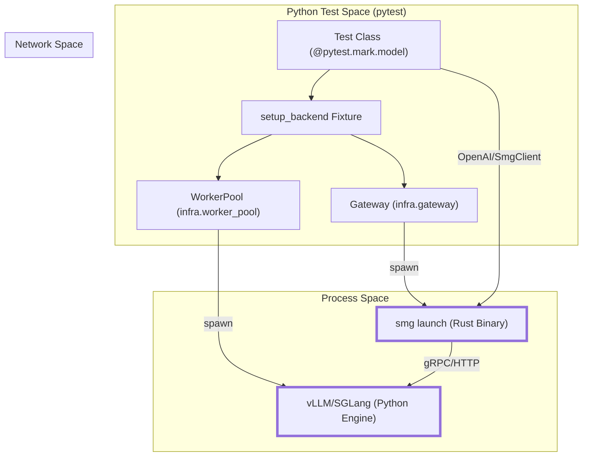
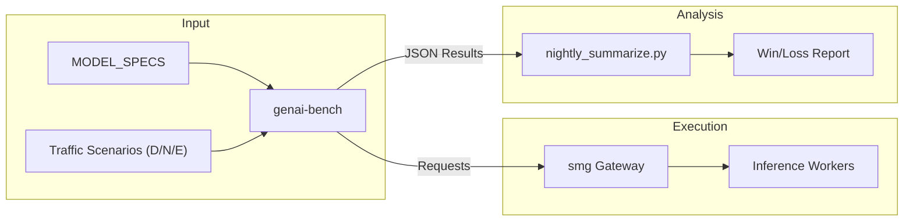

<!-- source: DeepWiki mcp.deepwiki.com · repo smg-project/smg · page 13 Testing · fetched 2026-10-21 -->

# Testing

Relevant source files

The following files were used as context for generating this wiki page:

- [.github/workflows/e2e-gpu-job.yml](.github/workflows/e2e-gpu-job.yml)
- [.github/workflows/nightly-benchmark.yml](.github/workflows/nightly-benchmark.yml)
- [.github/workflows/pr-test-rust.yml](.github/workflows/pr-test-rust.yml)
- [e2e_test/benchmarks/conftest.py](e2e_test/benchmarks/conftest.py)
- [e2e_test/benchmarks/nightly_summarize.py](e2e_test/benchmarks/nightly_summarize.py)
- [e2e_test/benchmarks/test_nightly_perf.py](e2e_test/benchmarks/test_nightly_perf.py)
- [e2e_test/chat_completions/test_epd_multimodal.py](e2e_test/chat_completions/test_epd_multimodal.py)
- [e2e_test/conftest.py](e2e_test/conftest.py)
- [e2e_test/fixtures/__init__.py](e2e_test/fixtures/__init__.py)
- [e2e_test/fixtures/hooks.py](e2e_test/fixtures/hooks.py)
- [e2e_test/fixtures/setup_backend.py](e2e_test/fixtures/setup_backend.py)
- [e2e_test/infra/__init__.py](e2e_test/infra/__init__.py)
- [e2e_test/infra/constants.py](e2e_test/infra/constants.py)
- [e2e_test/infra/gateway.py](e2e_test/infra/gateway.py)
- [e2e_test/infra/model_specs.py](e2e_test/infra/model_specs.py)
- [e2e_test/infra/process_utils.py](e2e_test/infra/process_utils.py)
- [e2e_test/infra/test_epd_cmd_builders.py](e2e_test/infra/test_epd_cmd_builders.py)
- [e2e_test/infra/worker.py](e2e_test/infra/worker.py)
- [e2e_test/pyproject.toml](e2e_test/pyproject.toml)
- [scripts/ci_download_model.sh](scripts/ci_download_model.sh)
- [scripts/ci_install_e2e_deps.sh](scripts/ci_install_e2e_deps.sh)

SMG employs a multi-layered testing strategy to ensure the reliability of its Rust-based gateway and its integration with various inference engines (vLLM, SGLang, TRT-LLM). The strategy spans local unit tests, integration tests for specific crates, and a comprehensive GPU-accelerated End-to-End (E2E) suite.

## Testing Strategy Overview

The codebase is organized into three primary tiers of validation:

| Tier | Scope | Infrastructure |
|:---|:---|:---|
| **Unit & Integration** | Individual Rust crates (e.g., `llm-tokenizer`, `tool-parser`) | `cargo test` |
| **End-to-End (E2E)** | Full request lifecycle from client to backend engines | `pytest` + GPU Runners |
| **Performance** | Throughput, latency (TTFT/TPOT), and accuracy benchmarks | `genai-bench`, BFCL, Tau2 |

### CI/CD Pipeline
Automated testing is driven by GitHub Actions, primarily defined in [.github/workflows/pr-test-rust.yml:1-32](). The pipeline handles:
*   **Linting:** `ruff` and `mypy` for Python components [ .github/workflows/pr-test-rust.yml:54-80]().
*   **WASM Fixtures:** Compiling WASM plugins for middleware testing [ .github/workflows/pr-test-rust.yml:165-169]().
*   **GPU E2E Matrix:** Running the full suite across different engines and GPU tiers [ .github/workflows/e2e-gpu-job.yml:1-56]().

**Sources:** [.github/workflows/pr-test-rust.yml:1-201](), [.github/workflows/e2e-gpu-job.yml:1-56]()

---

## End-to-End (E2E) Test Framework

The E2E framework is designed to validate SMG's routing and protocol translation logic against real inference backends. It uses a session-scoped `WorkerPool` to minimize GPU initialization overhead by reusing worker processes across test classes.

### Core Components
*   **`Gateway`:** A Python wrapper that manages the lifecycle of the `smg launch` process [e2e_test/infra/gateway.py:72-80]().
*   **`Worker`:** Manages the lifecycle of backend engines like vLLM or SGLang [e2e_test/infra/worker.py:34-52]().
*   **`setup_backend` Fixture:** The primary entry point for tests, handling the orchestration of gateways and workers based on markers [e2e_test/fixtures/setup_backend.py:103-122]().

### Request Flow in E2E Tests

The following diagram illustrates how the E2E infrastructure bridges the Python test space with the Rust Gateway and backend engines.

**E2E Test Execution Architecture**

**Sources:** [e2e_test/fixtures/setup_backend.py:1-13](), [e2e_test/infra/gateway.py:72-105](), [e2e_test/infra/worker.py:34-52]()

For a deep dive into E2E setup, including PD/EPD disaggregation and vendor backend testing, see [End-to-End Test Framework](#13.1).

---

## Performance Benchmarking

SMG includes a dedicated benchmarking suite to track performance regressions and compare different inference engines.

### Benchmarking Tools
*   **`genai-bench`:** Used for measuring TTFT (Time to First Token), TPOT (Time Per Output Token), and throughput [e2e_test/benchmarks/conftest.py:163-175]().
*   **BFCL (Berkeley Function Calling Leaderboard):** Validates the accuracy of the `tool-parser` crate.
*   **Nightly Summarization:** A script (`nightly_summarize.py`) that compares current results against baselines to detect "wins" or "losses" in performance [e2e_test/benchmarks/nightly_summarize.py]().

### Benchmarking Lifecycle
The nightly pipeline iterates through a matrix of models and variants (sglang vs vllm) as defined in the workflow configuration [ .github/workflows/nightly-benchmark.yml:118-130]().

**Performance Data Flow**

**Sources:** [.github/workflows/nightly-benchmark.yml:1-130](), [e2e_test/benchmarks/conftest.py:22-114](), [e2e_test/infra/model_specs.py:32-107]()

For details on traffic scenarios, metric definitions, and micro-benchmarks, see [Performance Benchmarking](#13.2).

---

## Model Catalog

All tests and benchmarks rely on a centralized catalog of model specifications. This ensures consistency in Tensor Parallelism (TP) settings and engine-specific arguments.

| Model ID | TP | Features | Engine Args |
|:---|:---:|:---|:---|
| `Llama-3.1-8B-Instruct` | 1 | `chat`, `streaming`, `function_calling` | Default |
| `Qwen3-30B-A3B` | 1 | `thinking`, `reasoning` | `--enforce-eager` [e2e_test/infra/model_specs.py:76-82]() |
| `gpt-oss-20b` | 1 | `harmony`, `reasoning` | `--enable_in_reasoning` [e2e_test/infra/model_specs.py:130-140]() |

**Sources:** [e2e_test/infra/model_specs.py:32-170]()

---

