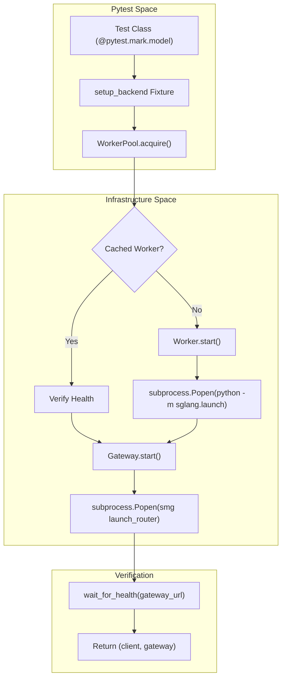

<!-- source: DeepWiki mcp.deepwiki.com · repo smg-project/smg · page 13.1 End-to-End Test Framework · fetched 2026-10-21 -->

# End-to-End Test Framework

Relevant source files

The following files were used as context for generating this wiki page:

- [.github/workflows/e2e-gpu-job.yml](.github/workflows/e2e-gpu-job.yml)
- [crates/mock_worker/README.md](crates/mock_worker/README.md)
- [crates/mock_worker/src/config.rs](crates/mock_worker/src/config.rs)
- [crates/mock_worker/src/engine.rs](crates/mock_worker/src/engine.rs)
- [crates/mock_worker/src/grpc.rs](crates/mock_worker/src/grpc.rs)
- [crates/mock_worker/src/http.rs](crates/mock_worker/src/http.rs)
- [crates/mock_worker/src/main.rs](crates/mock_worker/src/main.rs)
- [e2e_test/chat_completions/test_enable_thinking.py](e2e_test/chat_completions/test_enable_thinking.py)
- [e2e_test/chat_completions/test_epd_multimodal.py](e2e_test/chat_completions/test_epd_multimodal.py)
- [e2e_test/chat_completions/test_function_calling.py](e2e_test/chat_completions/test_function_calling.py)
- [e2e_test/chat_completions/test_multimodal.py](e2e_test/chat_completions/test_multimodal.py)
- [e2e_test/chat_completions/test_openai_server.py](e2e_test/chat_completions/test_openai_server.py)
- [e2e_test/chat_completions/test_reasoning_content.py](e2e_test/chat_completions/test_reasoning_content.py)
- [e2e_test/chat_completions/test_structured_output.py](e2e_test/chat_completions/test_structured_output.py)
- [e2e_test/chat_completions/test_validation.py](e2e_test/chat_completions/test_validation.py)
- [e2e_test/conftest.py](e2e_test/conftest.py)
- [e2e_test/embeddings/test_basic.py](e2e_test/embeddings/test_basic.py)
- [e2e_test/embeddings/test_correctness.py](e2e_test/embeddings/test_correctness.py)
- [e2e_test/fixtures/__init__.py](e2e_test/fixtures/__init__.py)
- [e2e_test/fixtures/hooks.py](e2e_test/fixtures/hooks.py)
- [e2e_test/fixtures/images/dog.jpg](e2e_test/fixtures/images/dog.jpg)
- [e2e_test/fixtures/images/pug.jpg](e2e_test/fixtures/images/pug.jpg)
- [e2e_test/fixtures/setup_backend.py](e2e_test/fixtures/setup_backend.py)
- [e2e_test/infra/__init__.py](e2e_test/infra/__init__.py)
- [e2e_test/infra/constants.py](e2e_test/infra/constants.py)
- [e2e_test/infra/gateway.py](e2e_test/infra/gateway.py)
- [e2e_test/infra/model_specs.py](e2e_test/infra/model_specs.py)
- [e2e_test/infra/process_utils.py](e2e_test/infra/process_utils.py)
- [e2e_test/infra/run_eval.py](e2e_test/infra/run_eval.py)
- [e2e_test/infra/simple_eval_common.py](e2e_test/infra/simple_eval_common.py)
- [e2e_test/infra/simple_eval_mmlu.py](e2e_test/infra/simple_eval_mmlu.py)
- [e2e_test/infra/test_epd_cmd_builders.py](e2e_test/infra/test_epd_cmd_builders.py)
- [e2e_test/infra/worker.py](e2e_test/infra/worker.py)
- [e2e_test/messages/test_basic.py](e2e_test/messages/test_basic.py)
- [e2e_test/messages/test_mcp_tool.py](e2e_test/messages/test_mcp_tool.py)
- [e2e_test/messages/test_tool_search.py](e2e_test/messages/test_tool_search.py)
- [e2e_test/messages/test_tool_use.py](e2e_test/messages/test_tool_use.py)
- [e2e_test/pyproject.toml](e2e_test/pyproject.toml)
- [e2e_test/responses/test_basic_crud.py](e2e_test/responses/test_basic_crud.py)
- [e2e_test/responses/test_builtin_tools.py](e2e_test/responses/test_builtin_tools.py)
- [e2e_test/responses/test_state_management.py](e2e_test/responses/test_state_management.py)
- [e2e_test/responses/test_streaming_events.py](e2e_test/responses/test_streaming_events.py)
- [e2e_test/responses/test_structured_output.py](e2e_test/responses/test_structured_output.py)
- [e2e_test/responses/test_tools_call.py](e2e_test/responses/test_tools_call.py)
- [e2e_test/router/test_mmlu.py](e2e_test/router/test_mmlu.py)
- [e2e_test/router/test_pd_mmlu.py](e2e_test/router/test_pd_mmlu.py)
- [e2e_test/router/test_worker_api.py](e2e_test/router/test_worker_api.py)
- [model_gateway/src/routers/grpc/harmony/stages/preparation.rs](model_gateway/src/routers/grpc/harmony/stages/preparation.rs)
- [scripts/ci_download_model.sh](scripts/ci_download_model.sh)
- [scripts/ci_install_e2e_deps.sh](scripts/ci_install_e2e_deps.sh)
- [scripts/installation/install-sglang.sh](scripts/installation/install-sglang.sh)
- [scripts/installation/install-tgl.sh](scripts/installation/install-tgl.sh)
- [scripts/installation/install-trtllm.sh](scripts/installation/install-trtllm.sh)
- [scripts/installation/install-vllm.sh](scripts/installation/install-vllm.sh)
- [scripts/sim_ab.sh](scripts/sim_ab.sh)
- [scripts/sim_load.py](scripts/sim_load.py)

The End-to-End (E2E) test framework in SMG provides a robust, `pytest`-based infrastructure for validating the full request lifecycle across diverse inference engines, model architectures, and deployment topologies. It automates the lifecycle of backend workers (vLLM, SGLang, TRT-LLM) and the SMG gateway, supporting complex scenarios like Prefill-Decode (PD) disaggregation and multi-vendor cloud backend testing.

## Framework Architecture

The framework is designed to bridge high-level test specifications in Python with the low-level orchestration of Rust binaries and GPU-accelerated inference engines.

### Key Components

| Component | Role | Code Entity |
| :--- | :--- | :--- |
| **Model Catalog** | Central registry of model paths, TP sizes, and features. | `MODEL_SPECS` [[e2e_test/infra/model_specs.py:32-32]]() |
| **Worker Pool** | Session-scoped cache for reusing expensive GPU workers. | `WorkerPool` [[e2e_test/infra/worker_pool.py:71-71]]() |
| **Gateway Manager** | Lifecycle control for the SMG `model-gateway` process. | `Gateway` [[e2e_test/infra/gateway.py:72-72]]() |
| **Setup Fixture** | The primary entry point for launching test environments. | `setup_backend` [[e2e_test/fixtures/setup_backend.py:103-103]]() |

### Data Flow: Test Setup to Execution

The following diagram illustrates how a test class requesting a specific backend (e.g., `grpc` with Llama-3) triggers the infrastructure to provision resources.

**Test Orchestration Flow**

Sources: `[e2e_test/fixtures/setup_backend.py:103-195]()`, `[e2e_test/infra/worker.py:71-122]()`, `[e2e_test/infra/gateway.py:113-150]()`.

## Model Specifications and Catalog

The `model_specs.py` file acts as the source of truth for all models used in E2E testing. It defines tensor parallelism (TP) requirements, supported features (e.g., `streaming`, `function_calling`), and engine-specific CLI arguments.

- **Path Resolution**: The `_resolve_model_path` function prioritizes local paths defined in `ROUTER_LOCAL_MODEL_PATH` (used in CI for speed) before falling back to HuggingFace Hub paths [[e2e_test/infra/model_specs.py:23-29]]().
- **Engine Tuning**: Specs include specific overrides like `sglang_args` or `vllm_args` to optimize startup or fix memory issues for specific architectures [[e2e_test/infra/model_specs.py:58-58]]().

Sources: `[e2e_test/infra/model_specs.py:1-165]()`.

## Worker and Gateway Lifecycle

### Worker Management
The `Worker` class encapsulates an inference engine process [[e2e_test/infra/worker.py:35-35]](). It handles:
- **Command Construction**: Building complex CLI strings for different runtimes (SGLang, vLLM, TRT-LLM, TokenSpeed) [[e2e_test/infra/worker.py:177-207]]().
- **GPU Allocation**: Managing `CUDA_VISIBLE_DEVICES` based on the requested `gpu_ids` [[e2e_test/infra/worker.py:84-84]]().
- **Health Checks**: Blocking until the engine's `/health` or gRPC health endpoint is responsive [[e2e_test/infra/worker.py:107-115]]().

### Gateway Management
The `Gateway` class manages the SMG Rust binary [[e2e_test/infra/gateway.py:72-72]](). It supports four primary modes:
1. **Regular**: Standard routing to a list of worker URLs.
2. **PD/EPD**: Disaggregated Prefill-Decode or Encode-Prefill-Decode routing [[e2e_test/infra/gateway.py:170-200]]().
3. **IGW**: "Instant Gateway" mode where workers are added dynamically via API.
4. **Cloud**: Routing to 3rd-party providers (OpenAI, Anthropic, xAI) [[e2e_test/infra/gateway.py:215-215]]().

Sources: `[e2e_test/infra/worker.py:35-122]()`, `[e2e_test/infra/gateway.py:72-220]()`.

## Session-Scoped Worker Reuse

To minimize the high cost of loading LLM weights into VRAM (often 2-5 minutes), the framework uses a `WorkerPool` [[e2e_test/infra/worker_pool.py:71-71]]().

- **Pool Key**: Workers are cached based on a tuple of `(engine, model_id, mode, worker_type, count, extra_args)` [[e2e_test/fixtures/setup_backend.py:5-7]()].
- **Clustering**: `pytest_collection_modifyitems` sorts tests by their backend and model requirements to maximize cache hits [[e2e_test/fixtures/hooks.py:129-132]()].
- **Cleanup**: The `pytest_sessionfinish` hook ensures all pooled processes are terminated at the end of the test run [[e2e_test/fixtures/hooks.py:192-192]]().

Sources: `[e2e_test/fixtures/hooks.py:120-184]()`, `[e2e_test/fixtures/setup_backend.py:65-80]()`.

## Disaggregation and Specialized Testing

### PD and EPD Setup
The framework provides specialized setup functions for disaggregated architectures:
- **PD (Prefill-Decode)**: Launches distinct workers for prefill and decode phases, passing `--prefill` and `--decode` flags to the gateway [[e2e_test/infra/gateway.py:193-200]]().
- **EPD (Encode-Prefill-Decode)**: Specifically for multimodal models where the vision encoder is separated. It utilizes `build_epd_mode_args` to configure the gateway with bootstrap ports and transport settings [[e2e_test/infra/gateway.py:30-57]]().

### Vendor Backend Tests
Tests for cloud providers like OpenAI or Anthropic use the `_setup_cloud` path in `setup_backend.py`. These bypass local worker launching and instead configure the gateway to proxy requests to the respective vendor endpoints [[e2e_test/fixtures/setup_backend.py:139-141]]().

**Entity Mapping: Infrastructure to Code**
| System Concept | Code Entity | Implementation Detail |
| :--- | :--- | :--- |
| **Inference Engine** | `Runtime` Enum | `sglang`, `vllm`, `trtllm`, `tokenspeed` [[e2e_test/infra/constants.py:23-30]]() |
| **Protocol** | `ConnectionMode` | `http` or `grpc` [[e2e_test/infra/constants.py:7-11]]() |
| **Disaggregation Role**| `WorkerType` | `REGULAR`, `ENCODE`, `PREFILL`, `DECODE` [[e2e_test/infra/constants.py:14-20]]() |
| **Mock Worker** | `mock_worker` crate | Rust-based mock for testing gateway logic without GPUs [[crates/mock_worker/src/main.rs:1-10]]() |

Sources: `[e2e_test/infra/constants.py:1-40]()`, `[e2e_test/infra/gateway.py:30-57]()`, `[e2e_test/fixtures/setup_backend.py:162-195]()`.

## CI Integration

The framework is tightly integrated with GitHub Actions via `e2e-gpu-job.yml`.
- **GPU Tiers**: Jobs are dispatched to runners with 1, 2, or 4 H100 GPUs based on the `E2E_GPU_TIER` [[.github/workflows/e2e-gpu-job.yml:10-13]]().
- **Fail-Fast**: The `_worker_start_failures` tracker in `setup_backend.py` aborts the session if workers repeatedly fail to initialize, preventing wasted CI time [[e2e_test/fixtures/setup_backend.py:61-62]]().
- **Diagnostics**: On failure, `ci_dump_worker_logs.sh` captures and uploads logs from both the SMG gateway and the underlying inference engines [[.github/workflows/e2e-gpu-job.yml:160-172]]().

Sources: `[.github/workflows/e2e-gpu-job.yml:1-188]()`, `[e2e_test/fixtures/setup_backend.py:153-158]()`.

---

