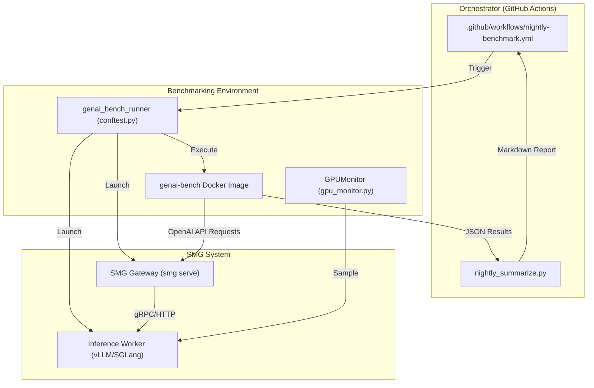
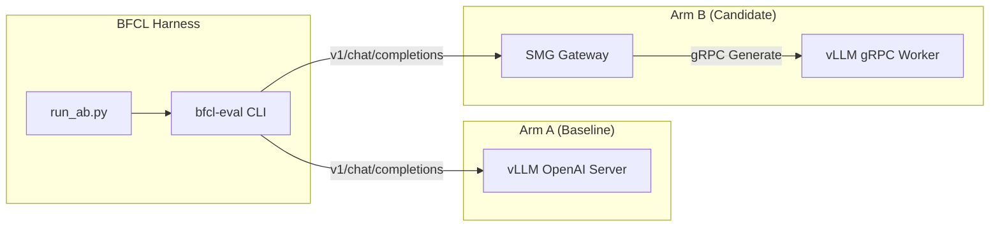

<!-- source: DeepWiki mcp.deepwiki.com · repo smg-project/smg · page 13.2 Performance Benchmarking · fetched 2026-10-21 -->

# Performance Benchmarking

Relevant source files

The following files were used as context for generating this wiki page:

- [.github/workflows/nightly-benchmark.yml](.github/workflows/nightly-benchmark.yml)
- [.github/workflows/nightly-bfcl.yml](.github/workflows/nightly-bfcl.yml)
- [.github/workflows/nightly-tau2.yml](.github/workflows/nightly-tau2.yml)
- [.github/workflows/pr-test-rust.yml](.github/workflows/pr-test-rust.yml)
- [e2e_test/benchmarks/conftest.py](e2e_test/benchmarks/conftest.py)
- [e2e_test/benchmarks/nightly_summarize.py](e2e_test/benchmarks/nightly_summarize.py)
- [e2e_test/benchmarks/results.py](e2e_test/benchmarks/results.py)
- [e2e_test/benchmarks/summarize.py](e2e_test/benchmarks/summarize.py)
- [e2e_test/benchmarks/test_nightly_perf.py](e2e_test/benchmarks/test_nightly_perf.py)
- [e2e_test/benchmarks/test_pd_perf.py](e2e_test/benchmarks/test_pd_perf.py)
- [e2e_test/benchmarks/test_regular_perf.py](e2e_test/benchmarks/test_regular_perf.py)
- [e2e_test/infra/gpu_monitor.py](e2e_test/infra/gpu_monitor.py)
- [scripts/bfcl/README.md](scripts/bfcl/README.md)
- [scripts/bfcl/launch_arm.sh](scripts/bfcl/launch_arm.sh)
- [scripts/bfcl/register_bfcl_model.py](scripts/bfcl/register_bfcl_model.py)
- [scripts/bfcl/run_ab.py](scripts/bfcl/run_ab.py)
- [scripts/tau2/README.md](scripts/tau2/README.md)
- [scripts/tau2/costmap_shim/sitecustomize.py](scripts/tau2/costmap_shim/sitecustomize.py)
- [scripts/tau2/launch_arms.sh](scripts/tau2/launch_arms.sh)
- [scripts/tau2/run_ab.py](scripts/tau2/run_ab.py)
- [scripts/tests/fixtures/tau2_results_sample.json](scripts/tests/fixtures/tau2_results_sample.json)
- [scripts/tests/test_tau2_costmap_shim.py](scripts/tests/test_tau2_costmap_shim.py)
- [scripts/tests/test_tau2_run_ab.py](scripts/tests/test_tau2_run_ab.py)

Performance benchmarking in SMG is divided into automated nightly pipelines for large-scale model evaluation and targeted micro-benchmarks for specific system components. The infrastructure is designed to validate throughput/latency metrics and ensure functional correctness in complex scenarios like function calling and agentic tool-use.

## Nightly genai-bench Pipeline

The primary performance tracking mechanism is the nightly `genai-bench` pipeline. This pipeline executes a comprehensive suite of traffic scenarios across various model families and worker configurations.

### Infrastructure and Metrics
The pipeline utilizes `genai-bench` (packaged as a Docker image `ghcr.io/moirai-internal/genai-bench:0.0.4`) to simulate client traffic and collect metrics [e2e_test/benchmarks/conftest.py:19-31](). It runs on dedicated Kubernetes GPU runners (H100 and Blackwell/B200) [.github/workflows/nightly-benchmark.yml:113-124]().

**Key Metrics Collected:**
*   **TTFT (Time To First Token):** Latency from request sent to first token received.
*   **TPOT (Time Per Output Token):** Average time between consecutive output tokens.
*   **E2E Latency:** Total request duration.
*   **Throughput:** Tokens per second (Input, Output, and Total).
*   **RPS:** Requests per second.

### Traffic Scenarios
The benchmarks use three primary traffic patterns [e2e_test/benchmarks/nightly_summarize.py:101-108]():
1.  **D(in, out):** Deterministic — fixed input/output token lengths (e.g., `D(2000, 200)`).
2.  **N(μ,σ)/(μ,σ):** Normal — input/output lengths drawn from Gaussian distributions.
3.  **E(size):** Embedding — fixed input length for embedding model benchmarks.

### Comparison Logic (Win/Loss Analysis)
The `nightly_summarize.py` script aggregates results and performs a "Win/Loss" analysis comparing different protocols (gRPC vs. HTTP) or runtimes (vLLM vs. SGLang) [e2e_test/benchmarks/nightly_summarize.py:4-9](). It defines a tolerance of 2%; differences within this range are considered a tie (`~`) [e2e_test/benchmarks/nightly_summarize.py:116-117]().

**Benchmarking Data Flow**
The following diagram illustrates how the nightly benchmark orchestrates the system under test.

Title: Nightly Benchmark Data Flow

Sources: [.github/workflows/nightly-benchmark.yml:1-31](), [e2e_test/benchmarks/conftest.py:163-194](), [e2e_test/benchmarks/nightly_summarize.py:4-15](), [e2e_test/benchmarks/test_nightly_perf.py:39-60]().

## Function Calling: BFCL A/B

The Berkeley Function Calling Leaderboard (BFCL) is used to verify SMG's `tool-parser` accuracy compared to a baseline (pure vLLM).

### Experiment Design
The BFCL A/B experiment isolates the "frontend" variable (tokenization and parsing). Both "arms" use identical models, engines, and sampling parameters [scripts/bfcl/README.md:5-15]():
*   **Arm A (Baseline):** Pure vLLM OpenAI server. vLLM handles chat templates and tool parsing.
*   **Arm B (Candidate):** SMG Gateway in front of a vLLM gRPC worker. SMG handles chat templates and tool parsing.

### Execution Flow
1.  **Launch:** `launch_arm.sh` brings up both arms on separate GPU sets [scripts/bfcl/launch_arm.sh:1-20]().
2.  **Registration:** `register_bfcl_model.py` injects new model IDs into the BFCL environment if they are not yet officially supported [scripts/bfcl/register_bfcl_model.py:1-23]().
3.  **Evaluation:** `run_ab.py` executes the `bfcl generate` and `bfcl evaluate` commands against both endpoints and diffs the scores [scripts/bfcl/README.md:23]().

Title: BFCL A/B Testing Architecture

Sources: [scripts/bfcl/README.md:1-24](), [scripts/bfcl/launch_arm.sh:1-11](), [.github/workflows/nightly-bfcl.yml:129-160]().

## Agentic Workflows: τ²-bench

The `tau2-bench` nightly benchmark evaluates SMG's performance in multi-turn agentic simulations.

### Configuration
*   **User Simulator:** A fixed external model (e.g., `gpt-5.2`) acts as the user [scripts/tau2/README.md:7-14]().
*   **Agent LLM:** The model under test, served via SMG (Arm B) or pure vLLM (Arm A) [scripts/tau2/README.md:7-14]().
*   **Domains:** Retail, Airline, and Telecom [scripts/tau2/README.md:41-44]().

The benchmark measures `pass^1` and `pass^k` metrics. Any delta in success rate is attributed to SMG's ability to correctly parse tool calls across multi-turn conversations [scripts/tau2/README.md:17-18]().

Sources: [.github/workflows/nightly-tau2.yml:1-18](), [scripts/tau2/README.md:1-18]().

## Micro-benchmarks

SMG includes targeted micro-benchmarks for performance-critical Rust components. These are typically implemented using `criterion` or custom measurement loops.

| Component | Focus Area | Relevant Files |
| :--- | :--- | :--- |
| **Radix Tree** | Prefix matching speed and KV index lookups. | `crates/kv_index/` |
| **Tokenizer** | Chat template rendering and encoding/decoding overhead. | `crates/tokenizer/` |
| **Tool Parser** | Regex/Logic overhead for detecting function calls in streams. | `crates/tool_parser/` |
| **WASM** | Plugin execution latency and host-call overhead. | `crates/wasm/` |
| **Request Processing** | Middleware chain latency and router selection overhead. | `model_gateway/src/routers/` |

Sources: [.github/workflows/pr-test-rust.yml:165-169](), [e2e_test/benchmarks/test_regular_perf.py:10-30]().

---

