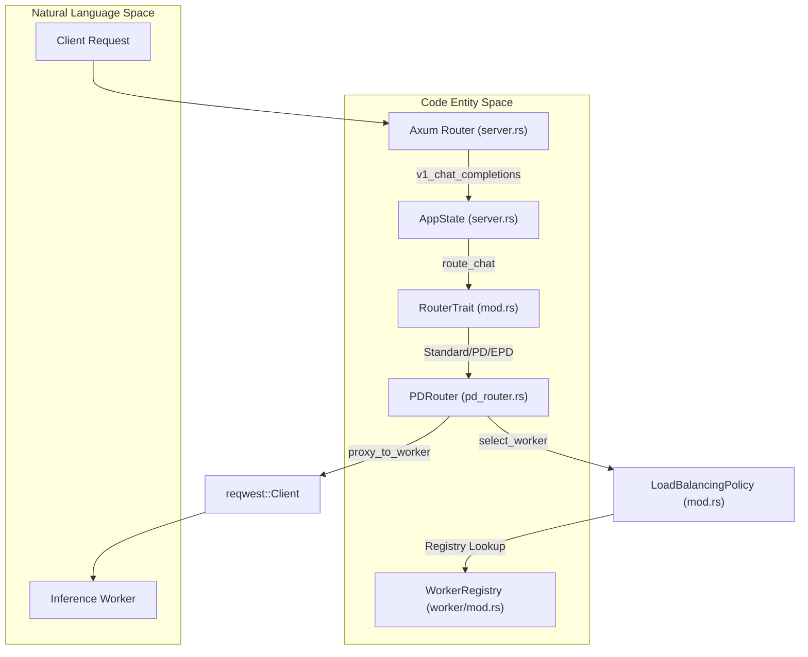
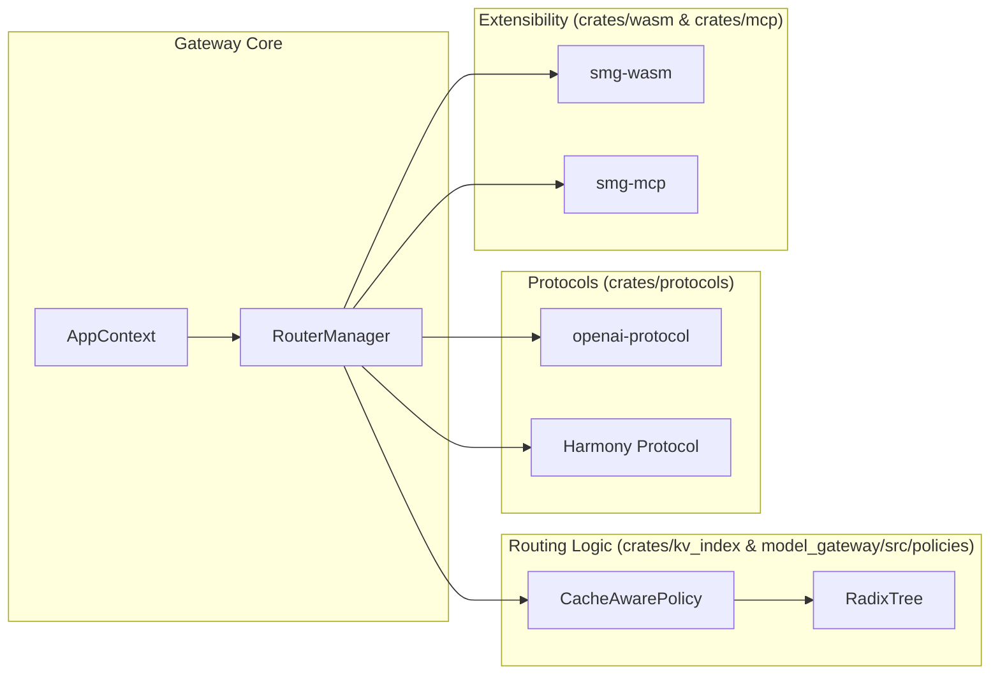

<!-- source: DeepWiki mcp.deepwiki.com · repo smg-project/smg · page 14 Glossary · fetched 2026-10-21 -->

# Glossary

Relevant source files

The following files were used as context for generating this wiki page:

- [.github/workflows/release-sglang-docker.yml](.github/workflows/release-sglang-docker.yml)
- [.github/workflows/release-trtllm-docker.yml](.github/workflows/release-trtllm-docker.yml)
- [.github/workflows/release-vllm-docker.yml](.github/workflows/release-vllm-docker.yml)
- [Cargo.toml](Cargo.toml)
- [README.md](README.md)
- [bindings/golang/Cargo.toml](bindings/golang/Cargo.toml)
- [bindings/python/Cargo.toml](bindings/python/Cargo.toml)
- [bindings/python/pyproject.toml](bindings/python/pyproject.toml)
- [bindings/python/src/lib.rs](bindings/python/src/lib.rs)
- [bindings/python/src/smg/router_args.py](bindings/python/src/smg/router_args.py)
- [bindings/python/tests/test_arg_parser.py](bindings/python/tests/test_arg_parser.py)
- [clients/rust/Cargo.toml](clients/rust/Cargo.toml)
- [crates/auth/Cargo.toml](crates/auth/Cargo.toml)
- [crates/auth/src/config.rs](crates/auth/src/config.rs)
- [crates/auth/src/jwt.rs](crates/auth/src/jwt.rs)
- [crates/auth/src/lib.rs](crates/auth/src/lib.rs)
- [crates/auth/src/middleware.rs](crates/auth/src/middleware.rs)
- [crates/data_connector/README.md](crates/data_connector/README.md)
- [crates/data_connector/src/common.rs](crates/data_connector/src/common.rs)
- [crates/data_connector/src/core.rs](crates/data_connector/src/core.rs)
- [crates/data_connector/src/hooked.rs](crates/data_connector/src/hooked.rs)
- [crates/data_connector/src/lib.rs](crates/data_connector/src/lib.rs)
- [crates/data_connector/src/memory.rs](crates/data_connector/src/memory.rs)
- [crates/data_connector/src/noop.rs](crates/data_connector/src/noop.rs)
- [crates/data_connector/src/oracle.rs](crates/data_connector/src/oracle.rs)
- [crates/data_connector/src/oracle_migrations.rs](crates/data_connector/src/oracle_migrations.rs)
- [crates/data_connector/src/postgres_migrations.rs](crates/data_connector/src/postgres_migrations.rs)
- [crates/data_connector/src/redis.rs](crates/data_connector/src/redis.rs)
- [crates/data_connector/src/schema.rs](crates/data_connector/src/schema.rs)
- [crates/grpc_client/Cargo.toml](crates/grpc_client/Cargo.toml)
- [crates/grpc_client/proto/vllm_engine.proto](crates/grpc_client/proto/vllm_engine.proto)
- [crates/grpc_client/python/README.md](crates/grpc_client/python/README.md)
- [crates/grpc_client/python/pyproject.toml](crates/grpc_client/python/pyproject.toml)
- [crates/grpc_client/src/tokenizer_bundle.rs](crates/grpc_client/src/tokenizer_bundle.rs)
- [crates/kv_index/benches/throughput_bench.rs](crates/kv_index/benches/throughput_bench.rs)
- [crates/kv_index/src/lib.rs](crates/kv_index/src/lib.rs)
- [crates/kv_index/src/snapshot.rs](crates/kv_index/src/snapshot.rs)
- [crates/kv_index/src/string_tree.rs](crates/kv_index/src/string_tree.rs)
- [crates/kv_index/src/token_tree.rs](crates/kv_index/src/token_tree.rs)
- [crates/mcp/src/core/session.rs](crates/mcp/src/core/session.rs)
- [crates/mesh/src/kv.rs](crates/mesh/src/kv.rs)
- [crates/mesh/src/lib.rs](crates/mesh/src/lib.rs)
- [crates/mesh/src/metrics.rs](crates/mesh/src/metrics.rs)
- [crates/mesh/src/service.rs](crates/mesh/src/service.rs)
- [crates/multimodal/Cargo.toml](crates/multimodal/Cargo.toml)
- [crates/multimodal/src/vision/processor.rs](crates/multimodal/src/vision/processor.rs)
- [crates/protocols/Cargo.toml](crates/protocols/Cargo.toml)
- [crates/protocols/src/responses.rs](crates/protocols/src/responses.rs)
- [crates/protocols/tests/responses.rs](crates/protocols/tests/responses.rs)
- [crates/reasoning_parser/Cargo.toml](crates/reasoning_parser/Cargo.toml)
- [crates/reasoning_parser/src/factory.rs](crates/reasoning_parser/src/factory.rs)
- [crates/reasoning_parser/src/lib.rs](crates/reasoning_parser/src/lib.rs)
- [crates/reasoning_parser/src/parsers/mod.rs](crates/reasoning_parser/src/parsers/mod.rs)
- [crates/tokenizer/Cargo.toml](crates/tokenizer/Cargo.toml)
- [crates/tokenizer/src/cache/l0.rs](crates/tokenizer/src/cache/l0.rs)
- [crates/tokenizer/src/cache/l1.rs](crates/tokenizer/src/cache/l1.rs)
- [crates/tokenizer/src/cache/mod.rs](crates/tokenizer/src/cache/mod.rs)
- [crates/tokenizer/src/stop.rs](crates/tokenizer/src/stop.rs)
- [crates/tool_parser/Cargo.toml](crates/tool_parser/Cargo.toml)
- [crates/tool_parser/src/factory.rs](crates/tool_parser/src/factory.rs)
- [crates/tool_parser/src/lib.rs](crates/tool_parser/src/lib.rs)
- [crates/tool_parser/src/parsers/mod.rs](crates/tool_parser/src/parsers/mod.rs)
- [crates/wasm/Cargo.toml](crates/wasm/Cargo.toml)
- [crates/wasm/src/module.rs](crates/wasm/src/module.rs)
- [crates/wasm/src/module_manager.rs](crates/wasm/src/module_manager.rs)
- [crates/wasm/src/runtime.rs](crates/wasm/src/runtime.rs)
- [crates/wasm/src/storage_hook.rs](crates/wasm/src/storage_hook.rs)
- [crates/wasm/src/types.rs](crates/wasm/src/types.rs)
- [docs/assets/images/architecture-animated.svg](docs/assets/images/architecture-animated.svg)
- [docs/assets/images/architecture-detailed.svg](docs/assets/images/architecture-detailed.svg)
- [docs/assets/images/concepts-overview.svg](docs/assets/images/concepts-overview.svg)
- [docs/assets/images/mcp-architecture.svg](docs/assets/images/mcp-architecture.svg)
- [docs/assets/images/service-discovery.svg](docs/assets/images/service-discovery.svg)
- [docs/assets/images/wasm-plugins.svg](docs/assets/images/wasm-plugins.svg)
- [docs/assets/stylesheets/extra.css](docs/assets/stylesheets/extra.css)
- [docs/concepts/architecture/grpc-pipeline.md](docs/concepts/architecture/grpc-pipeline.md)
- [docs/concepts/architecture/high-availability.md](docs/concepts/architecture/high-availability.md)
- [docs/concepts/architecture/overview.md](docs/concepts/architecture/overview.md)
- [docs/concepts/architecture/service-discovery.md](docs/concepts/architecture/service-discovery.md)
- [docs/concepts/data/chat-history.md](docs/concepts/data/chat-history.md)
- [docs/concepts/extensibility/mcp.md](docs/concepts/extensibility/mcp.md)
- [docs/concepts/extensibility/wasm-plugins.md](docs/concepts/extensibility/wasm-plugins.md)
- [docs/concepts/index.md](docs/concepts/index.md)
- [docs/concepts/performance/tokenizer-caching.md](docs/concepts/performance/tokenizer-caching.md)
- [docs/concepts/reliability/circuit-breakers.md](docs/concepts/reliability/circuit-breakers.md)
- [docs/concepts/reliability/graceful-shutdown.md](docs/concepts/reliability/graceful-shutdown.md)
- [docs/concepts/reliability/health-checks.md](docs/concepts/reliability/health-checks.md)
- [docs/concepts/reliability/rate-limiting.md](docs/concepts/reliability/rate-limiting.md)
- [docs/concepts/routing/cache-aware.md](docs/concepts/routing/cache-aware.md)
- [docs/concepts/routing/load-balancing.md](docs/concepts/routing/load-balancing.md)
- [docs/concepts/routing/pd-disaggregation.md](docs/concepts/routing/pd-disaggregation.md)
- [docs/concepts/security/authentication.md](docs/concepts/security/authentication.md)
- [docs/contributing/index.md](docs/contributing/index.md)
- [docs/getting-started/control-plane-auth.md](docs/getting-started/control-plane-auth.md)
- [docs/getting-started/control-plane-operations.md](docs/getting-started/control-plane-operations.md)
- [docs/getting-started/data-connections.md](docs/getting-started/data-connections.md)
- [docs/getting-started/index.md](docs/getting-started/index.md)
- [docs/getting-started/mcp.md](docs/getting-started/mcp.md)
- [docs/getting-started/monitoring.md](docs/getting-started/monitoring.md)
- [docs/getting-started/pd-disaggregation.md](docs/getting-started/pd-disaggregation.md)
- [docs/getting-started/reliability-controls.md](docs/getting-started/reliability-controls.md)
- [docs/index.md](docs/index.md)
- [docs/reference/api/admin.md](docs/reference/api/admin.md)
- [docs/reference/api/extensions.md](docs/reference/api/extensions.md)
- [docs/reference/api/responses.md](docs/reference/api/responses.md)
- [docs/reference/configuration.md](docs/reference/configuration.md)
- [docs/reference/index.md](docs/reference/index.md)
- [docs/reference/metrics.md](docs/reference/metrics.md)
- [e2e_test/completions/test_basic.py](e2e_test/completions/test_basic.py)
- [grpc_servicer/pyproject.toml](grpc_servicer/pyproject.toml)
- [grpc_servicer/smg_grpc_servicer/vllm/servicer.py](grpc_servicer/smg_grpc_servicer/vllm/servicer.py)
- [mkdocs.yml](mkdocs.yml)
- [model_gateway/Cargo.toml](model_gateway/Cargo.toml)
- [model_gateway/benches/radix_tree_benchmark.rs](model_gateway/benches/radix_tree_benchmark.rs)
- [model_gateway/benches/routing_allocation_bench.rs](model_gateway/benches/routing_allocation_bench.rs)
- [model_gateway/benches/wasm_instantiation.rs](model_gateway/benches/wasm_instantiation.rs)
- [model_gateway/src/app_context.rs](model_gateway/src/app_context.rs)
- [model_gateway/src/config/builder.rs](model_gateway/src/config/builder.rs)
- [model_gateway/src/config/types.rs](model_gateway/src/config/types.rs)
- [model_gateway/src/config/validation.rs](model_gateway/src/config/validation.rs)
- [model_gateway/src/health.rs](model_gateway/src/health.rs)
- [model_gateway/src/main.rs](model_gateway/src/main.rs)
- [model_gateway/src/middleware/scheduler/admission.rs](model_gateway/src/middleware/scheduler/admission.rs)
- [model_gateway/src/middleware/scheduler/body.rs](model_gateway/src/middleware/scheduler/body.rs)
- [model_gateway/src/middleware/scheduler/engine.rs](model_gateway/src/middleware/scheduler/engine.rs)
- [model_gateway/src/middleware/scheduler/error.rs](model_gateway/src/middleware/scheduler/error.rs)
- [model_gateway/src/middleware/scheduler/extract.rs](model_gateway/src/middleware/scheduler/extract.rs)
- [model_gateway/src/middleware/scheduler/inflight.rs](model_gateway/src/middleware/scheduler/inflight.rs)
- [model_gateway/src/middleware/scheduler/metrics.rs](model_gateway/src/middleware/scheduler/metrics.rs)
- [model_gateway/src/middleware/scheduler/mod.rs](model_gateway/src/middleware/scheduler/mod.rs)
- [model_gateway/src/middleware/scheduler/queue.rs](model_gateway/src/middleware/scheduler/queue.rs)
- [model_gateway/src/middleware/scheduler/slots.rs](model_gateway/src/middleware/scheduler/slots.rs)
- [model_gateway/src/middleware/scheduler/state.rs](model_gateway/src/middleware/scheduler/state.rs)
- [model_gateway/src/observability/metrics.rs](model_gateway/src/observability/metrics.rs)
- [model_gateway/src/observability/metrics_server.rs](model_gateway/src/observability/metrics_server.rs)
- [model_gateway/src/observability/mod.rs](model_gateway/src/observability/mod.rs)
- [model_gateway/src/observability/runtime_metrics.rs](model_gateway/src/observability/runtime_metrics.rs)
- [model_gateway/src/policies/cache_aware.rs](model_gateway/src/policies/cache_aware.rs)
- [model_gateway/src/policies/factory.rs](model_gateway/src/policies/factory.rs)
- [model_gateway/src/policies/mod.rs](model_gateway/src/policies/mod.rs)
- [model_gateway/src/policies/registry.rs](model_gateway/src/policies/registry.rs)
- [model_gateway/src/routers/grpc/common/response_collection.rs](model_gateway/src/routers/grpc/common/response_collection.rs)
- [model_gateway/src/routers/grpc/common/stages/request_execution.rs](model_gateway/src/routers/grpc/common/stages/request_execution.rs)
- [model_gateway/src/routers/grpc/harmony/builder.rs](model_gateway/src/routers/grpc/harmony/builder.rs)
- [model_gateway/src/routers/grpc/harmony/streaming.rs](model_gateway/src/routers/grpc/harmony/streaming.rs)
- [model_gateway/src/routers/grpc/regular/processor.rs](model_gateway/src/routers/grpc/regular/processor.rs)
- [model_gateway/src/routers/grpc/regular/responses/conversions.rs](model_gateway/src/routers/grpc/regular/responses/conversions.rs)
- [model_gateway/src/routers/grpc/regular/stages/completion/preparation.rs](model_gateway/src/routers/grpc/regular/stages/completion/preparation.rs)
- [model_gateway/src/routers/grpc/regular/stages/completion/request_building.rs](model_gateway/src/routers/grpc/regular/stages/completion/request_building.rs)
- [model_gateway/src/routers/grpc/regular/stages/completion/response_processing.rs](model_gateway/src/routers/grpc/regular/stages/completion/response_processing.rs)
- [model_gateway/src/routers/grpc/regular/streaming.rs](model_gateway/src/routers/grpc/regular/streaming.rs)
- [model_gateway/src/routers/http/pd_router.rs](model_gateway/src/routers/http/pd_router.rs)
- [model_gateway/src/routers/http/router.rs](model_gateway/src/routers/http/router.rs)
- [model_gateway/src/routers/mod.rs](model_gateway/src/routers/mod.rs)
- [model_gateway/src/routers/openai/responses/utils.rs](model_gateway/src/routers/openai/responses/utils.rs)
- [model_gateway/src/routers/router_manager.rs](model_gateway/src/routers/router_manager.rs)
- [model_gateway/src/server.rs](model_gateway/src/server.rs)
- [model_gateway/src/workflow/wasm_module_registration.rs](model_gateway/src/workflow/wasm_module_registration.rs)
- [model_gateway/tests/common/mock_worker.rs](model_gateway/tests/common/mock_worker.rs)
- [model_gateway/tests/routing/grpc_completion_batch_test.rs](model_gateway/tests/routing/grpc_completion_batch_test.rs)
- [model_gateway/tests/routing/model_alias_test.rs](model_gateway/tests/routing/model_alias_test.rs)
- [model_gateway/tests/routing/pd_routing_test.rs](model_gateway/tests/routing/pd_routing_test.rs)
- [scripts/oracle_flyway/schema-config.yaml](scripts/oracle_flyway/schema-config.yaml)

This page provides definitions for codebase-specific terms, abbreviations, and domain concepts used within the SMG (Shepherd Model Gateway) project.

## Core System Concepts

### AppContext
The central, shared state container for the gateway. It holds thread-safe references to the `WorkerRegistry`, `PolicyRegistry`, HTTP clients, and global configuration. It is typically wrapped in an `Arc` and injected into request handlers.
*   **Implementation**: `AppContext` struct in [model_gateway/src/app_context.rs:43-65]().
*   **Data Flow**: Initialized during server startup and passed to `AppState` [model_gateway/src/server.rs:70-81]().

### RouterManager
The top-level orchestrator that selects the appropriate routing implementation based on the configured `RoutingMode` (e.g., `Standard`, `PdDisaggregation`, `EpdDisaggregation`).
*   **Implementation**: `RouterManager` in [model_gateway/src/routers/router_manager.rs:45-60]().
*   **Pointers**: Managed within `AppState` [model_gateway/src/server.rs:74-74]().

### WorkerRegistry
A lock-free (using `arc-swap`) registry of all known inference workers. It categorizes workers by their type (Prefill, Decode, Encode, or All-in-one) and provides methods for the routing policies to select candidates.
*   **Implementation**: `WorkerRegistry` in [model_gateway/src/worker/mod.rs:342-360]().
*   **Usage**: Used by `PDRouter` to fetch specific worker sets [model_gateway/src/routers/http/pd_router.rs:75-76]().

## Routing & Disaggregation

### PD Disaggregation (Prefill-Decode)
An optimization where the LLM inference pipeline is split into two distinct stages: **Prefill** (processing the input prompt) and **Decode** (generating tokens one by one). SMG routes these stages to different worker fleets to maximize GPU utilization.
*   **Logic**: Handled by `PDRouter` [model_gateway/src/routers/http/pd_router.rs:50-56]().
*   **CLI Flag**: `--pd-disaggregation` [model_gateway/src/main.rs:117-123]().

### EPD Disaggregation (Encode-Prefill-Decode)
An extension of PD disaggregation that includes an explicit **Encode** stage, typically used for multimodal inputs or specialized embedding models before the prefill stage begins.
*   **CLI Flag**: `--epd-disaggregation` [bindings/python/src/smg/router_args.py:42-42]().

### Cache-Aware Routing
A routing policy that uses a Radix Tree to track the KV (Key-Value) cache state of backend workers. It routes requests to workers that already contain a prefix of the request's tokens, significantly reducing TTFT (Time To First Token).
*   **Implementation**: `CacheAwarePolicy` in [model_gateway/src/policies/cache_aware.rs:45-60]().
*   **Configuration**: `cache_threshold` [model_gateway/src/config/types.rs:191-192]().

## Protocol & API

### Harmony Protocol
A specialized internal gRPC protocol used by SMG to communicate with high-performance inference engines like SGLang and vLLM. It supports advanced features like streaming reasoning blocks and tool calls.
*   **Processor**: `HarmonyStreamingProcessor` in [model_gateway/src/routers/grpc/harmony/streaming.rs:81-87]().
*   **Data Structure**: `HarmonyChannelDelta` [model_gateway/src/routers/grpc/harmony/streaming.rs:30-30]().

### Responses API
An agentic workflow API compatible with OpenAI's `/v1/responses` endpoint. It supports multi-turn conversations, stateful tool execution, and complex tool choice logic.
*   **Schema**: Defined in [crates/protocols/src/responses.rs:162-180]().
*   **Tool Types**: Includes `web_search`, `image_generation`, and `computer_use` [crates/protocols/src/responses.rs:94-103]().

### MCP (Model Context Protocol)
A protocol that allows SMG to connect to external tool servers. SMG acts as an orchestrator, managing `McpToolSession` lifecycles and injecting tool results back into the model context.
*   **Implementation**: `McpToolSession` in [crates/mcp/src/core/session.rs:25-45]().
*   **Integration**: Integrated into Harmony streaming [model_gateway/src/routers/grpc/harmony/streaming.rs:23-23]().

## Technical Infrastructure

### WASM Middleware
Extensibility layer allowing users to run custom logic (Auth, Logging, Transformation) inside the gateway using WebAssembly.
*   **Registration**: `add_wasm_module` [model_gateway/src/server.rs:62-62]().
*   **Crate**: `smg-wasm` [Cargo.toml:18-18]().

### Mesh HA
High-availability layer using a gossip protocol (SWIM-like) to synchronize state across multiple SMG instances.
*   **Server**: `MeshServerBuilder` [model_gateway/src/server.rs:42-42]().
*   **Key-Value Store**: `MeshKV` for distributed state [crates/mesh/src/kv.rs:10-30]().

### Multimodal Tensor Transport
Mechanisms for moving large binary data (images/video tensors) between the gateway and workers. Supports `inline`, `shm` (Shared Memory), and `rdma`.
*   **Configuration**: `TransportMode` [model_gateway/src/config/types.rs:4-4]().
*   **Logic**: `multimodal_shm_min_bytes` determines when to switch to SHM [model_gateway/src/config/types.rs:55-56]().

## Mapping: Natural Language to Code Entities

### Request Lifecycle Diagram
This diagram maps the conceptual flow of a request to the specific Rust structs and functions that handle it.

**Sources**: [model_gateway/src/server.rs:156-170](), [model_gateway/src/routers/http/pd_router.rs:50-56](), [model_gateway/src/worker/mod.rs:342-360]().

### Component Relationship Diagram
This diagram shows how the domain concepts (like "Routing Policy") translate into specific implementation crates and structs.

**Sources**: [Cargo.toml:7-20](), [model_gateway/src/app_context.rs:43-65](), [model_gateway/src/routers/router_manager.rs:45-60]().

## Table of Abbreviations

| Abbreviation | Full Term | Description | Code Pointer |
| :--- | :--- | :--- | :--- |
| **TTFT** | Time To First Token | Latency until the first generated token is received. | [model_gateway/src/observability/metrics.rs:100-120]() |
| **SHM** | Shared Memory | Used for zero-copy multimodal tensor transport. | [model_gateway/src/config/types.rs:52-56]() |
| **RDMA** | Remote Direct Memory Access | High-speed network transport for large tensors. | [model_gateway/Cargo.toml:22-22]() |
| **KV Cache** | Key-Value Cache | Cached attention keys/values in the inference engine. | [model_gateway/src/policies/cache_aware.rs:10-25]() |
| **SSE** | Server-Sent Events | Protocol used for streaming LLM responses. | [model_gateway/src/routers/common/sse.rs:5-15]() |
| **DP** | Data Parallel | Scaling strategy where multiple workers serve the same model. | [model_gateway/src/config/types.rs:57-57]() |

**Sources**: [model_gateway/src/config/types.rs:1-150](), [model_gateway/src/routers/grpc/harmony/streaming.rs:1-100](), [model_gateway/src/routers/http/pd_router.rs:1-100]().