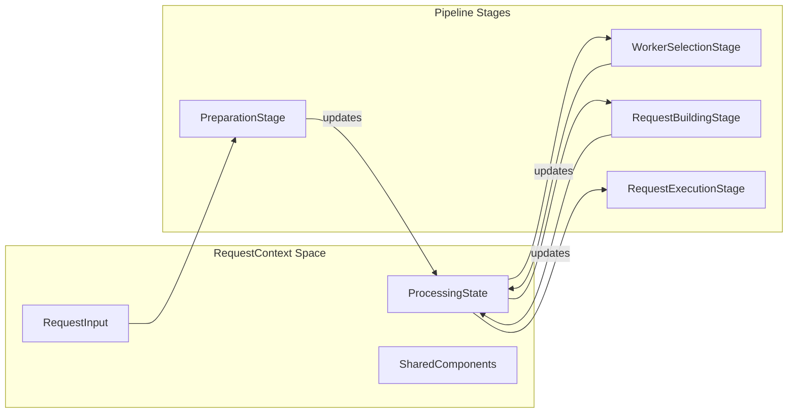

<!-- source: DeepWiki mcp.deepwiki.com · repo smg-project/smg · page 2 Request Routing · fetched 2026-10-21 -->

# Request Routing

<details>
<summary>Relevant source files</summary>

The following files were used as context for generating this wiki page:

- [model_gateway/src/routers/factory.rs](model_gateway/src/routers/factory.rs)
- [model_gateway/src/routers/grpc/common/stages/dispatch_metadata.rs](model_gateway/src/routers/grpc/common/stages/dispatch_metadata.rs)
- [model_gateway/src/routers/grpc/context.rs](model_gateway/src/routers/grpc/context.rs)
- [model_gateway/src/routers/grpc/pipeline.rs](model_gateway/src/routers/grpc/pipeline.rs)
- [model_gateway/src/routers/grpc/router.rs](model_gateway/src/routers/grpc/router.rs)
- [model_gateway/src/routers/http/mod.rs](model_gateway/src/routers/http/mod.rs)
- [model_gateway/src/routers/http/pd_router.rs](model_gateway/src/routers/http/pd_router.rs)
- [model_gateway/src/routers/http/router.rs](model_gateway/src/routers/http/router.rs)
- [model_gateway/src/routers/mod.rs](model_gateway/src/routers/mod.rs)
- [model_gateway/src/routers/router_manager.rs](model_gateway/src/routers/router_manager.rs)
- [model_gateway/tests/common/mock_worker.rs](model_gateway/tests/common/mock_worker.rs)
- [model_gateway/tests/routing/mod.rs](model_gateway/tests/routing/mod.rs)
- [model_gateway/tests/routing/model_alias_test.rs](model_gateway/tests/routing/model_alias_test.rs)
- [model_gateway/tests/routing/pd_routing_test.rs](model_gateway/tests/routing/pd_routing_test.rs)

</details>


SMG (Shepherd Model Gateway) employs a multi-layered routing architecture designed to handle high-throughput inference requests across heterogeneous worker fleets. The routing system abstracts backend complexities—such as engine-specific protocols (vLLM, SGLang) and hardware topologies—providing a unified OpenAI-compatible interface to clients.

## Router Architecture

The central coordinator for all traffic is the `RouterManager` [model_gateway/src/routers/router_manager.rs:55-67](). It operates in two primary modes based on the `enable_igw` (Intelligent Gateway) configuration:

1.  **Single Router Mode**: The gateway acts as a direct proxy to a specific fleet using a single `RouterId` [model_gateway/src/routers/router_manager.rs:128-140]().
2.  **Multi-Router Mode (IGW)**: The manager coordinates multiple specialized routers (e.g., separate routers for OpenAI, Anthropic, and native gRPC traffic) [model_gateway/src/routers/router_manager.rs:114-127]().

### Router Selection Logic
The `RouterManager` determines which internal router implementation to invoke based on the `ConnectionMode` (HTTP vs. gRPC) and the `RoutingMode` (Regular, Prefill-Decode, etc.) [model_gateway/src/routers/router_manager.rs:149-168]().

| Connection | Routing Mode | Router ID |
| :--- | :--- | :--- |
| HTTP | Regular | `http-regular` |
| HTTP | Prefill-Decode | `http-pd` |
| Grpc | Regular | `grpc-regular` |
| Grpc | Encode-Prefill-Decode | `grpc-epd` |

**Sources:** [model_gateway/src/routers/router_manager.rs:1-168](), [model_gateway/src/routers/factory.rs:37-48]()

---

## Routing Modes

SMG supports various routing strategies to optimize for different hardware and performance requirements.

### HTTP Routing Layer
The HTTP layer handles standard RESTful requests. It includes logic for model alias resolution, where a request addressed to an alias (e.g., `gpt-4-coding`) is mapped to a canonical ID (e.g., `gpt-4-0613`) before being dispatched to a worker [model_gateway/tests/routing/model_alias_test.rs:72-96]().

*   **Standard Router**: Proxies requests to healthy workers using standard load-balancing policies [model_gateway/src/routers/http/router.rs:67-75]().
*   **PDRouter**: Implements Prefill-Decode disaggregation for HTTP, splitting the prefill phase from the decoding phase across different worker sets [model_gateway/src/routers/http/pd_router.rs:50-56]().

For details, see [HTTP Routing Layer](#2.1).

### gRPC Routing Layer
The gRPC layer uses a structured `RequestPipeline` to process requests through distinct stages: Preparation, Worker Selection, Client Acquisition, Request Building, and Execution [model_gateway/src/routers/grpc/pipeline.rs:192-196]().

*   **Pipeline Orchestration**: Uses a `RequestContext` as a single source of truth that flows through all stages [model_gateway/src/routers/grpc/context.rs:43-47]().
*   **EPD Disaggregation**: Supports Encode-Prefill-Decode disaggregation, specifically designed for multimodal and high-throughput scenarios [model_gateway/src/routers/factory.rs:72-83]().

For details, see [gRPC Routing Layer](#2.2).

**Sources:** [model_gateway/src/routers/http/router.rs:1-121](), [model_gateway/src/routers/grpc/pipeline.rs:1-70](), [model_gateway/src/routers/grpc/context.rs:1-177]()

---

## Load Balancing and Policies

Routing decisions are governed by a `PolicyRegistry` which holds the active load-balancing strategies [model_gateway/src/routers/factory.rs:140-146]().

*   **Standard Policies**: Includes `round_robin`, `least_load`, `consistent_hashing`, and `power_of_two` [model_gateway/src/routers/factory.rs:18-21]().
*   **Cache-Aware Routing**: Leverages a Radix tree and KV-cache event monitoring to route requests to workers that already have the prompt prefix in their cache, significantly reducing TTFT (Time to First Token).

For details, see [Load Balancing Policies](#2.3).

**Sources:** [model_gateway/src/routers/factory.rs:140-161](), [model_gateway/src/routers/http/pd_router.rs:35-47]()

---

## Multimodal Handling

Requests containing images, video, or audio are routed through the `MultimodalComponents` [model_gateway/src/routers/grpc/context.rs:137-148](). This layer handles:
*   **Tensor Assembly**: Converting base64 or URL inputs into tensors for the inference engine.
*   **Model-Specific Processing**: Specialized logic for models like Qwen3-ASR [model_gateway/src/routers/grpc/router.rs:145-168]().

For details, see [Multimodal Request Handling](#2.4).

**Sources:** [model_gateway/src/routers/grpc/context.rs:137-159](), [model_gateway/src/routers/grpc/router.rs:191-216]()

---

## Code Entity Space Mapping

The following diagrams map the high-level routing concepts to the specific structs and traits defined in the codebase.

### Router Implementation Hierarchy
```mermaid
graph TD
    subgraph "Router Traits & Factories"
        RouterTrait["RouterTrait (Trait)"]
        RouterFactory["RouterFactory (Struct)"]
        RouterManager["RouterManager (Struct)"]
    end

    subgraph "HTTP Implementations"
        Router["Router (HTTP Regular)"]
        PDRouter["PDRouter (HTTP PD)"]
        OpenAIRouter["OpenAIRouter"]
    end

    subgraph "gRPC Implementations"
        GrpcRouter["GrpcRouter (gRPC Regular/PD/EPD)"]
    end

    RouterManager -->|owns| RouterTrait
    RouterFactory -->|creates| RouterTrait
    RouterTrait <|-- Router
    RouterTrait <|-- PDRouter
    RouterTrait <|-- GrpcRouter
    RouterTrait <|-- OpenAIRouter
```
**Sources:** [model_gateway/src/routers/mod.rs:54-56](), [model_gateway/src/routers/router_manager.rs:55-67](), [model_gateway/src/routers/factory.rs:5-15]()

### gRPC Pipeline Execution Flow

**Sources:** [model_gateway/src/routers/grpc/context.rs:43-47](), [model_gateway/src/routers/grpc/pipeline.rs:192-198](), [model_gateway/src/routers/grpc/common/stages/dispatch_metadata.rs:19-21]()

---

