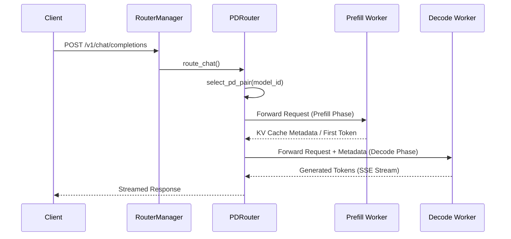
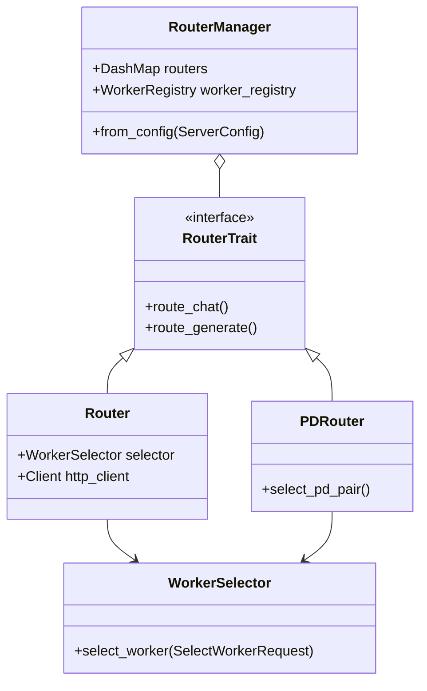

<!-- source: DeepWiki mcp.deepwiki.com · repo smg-project/smg · page 2.1 HTTP Routing Layer · fetched 2026-10-21 -->

# HTTP Routing Layer

Relevant source files

The following files were used as context for generating this wiki page:

- [model_gateway/src/routers/anthropic/context.rs](model_gateway/src/routers/anthropic/context.rs)
- [model_gateway/src/routers/anthropic/mcp.rs](model_gateway/src/routers/anthropic/mcp.rs)
- [model_gateway/src/routers/anthropic/mod.rs](model_gateway/src/routers/anthropic/mod.rs)
- [model_gateway/src/routers/anthropic/non_streaming.rs](model_gateway/src/routers/anthropic/non_streaming.rs)
- [model_gateway/src/routers/anthropic/router.rs](model_gateway/src/routers/anthropic/router.rs)
- [model_gateway/src/routers/anthropic/sse.rs](model_gateway/src/routers/anthropic/sse.rs)
- [model_gateway/src/routers/anthropic/streaming.rs](model_gateway/src/routers/anthropic/streaming.rs)
- [model_gateway/src/routers/anthropic/utils.rs](model_gateway/src/routers/anthropic/utils.rs)
- [model_gateway/src/routers/anthropic/worker.rs](model_gateway/src/routers/anthropic/worker.rs)
- [model_gateway/src/routers/common/header_utils.rs](model_gateway/src/routers/common/header_utils.rs)
- [model_gateway/src/routers/gemini/context.rs](model_gateway/src/routers/gemini/context.rs)
- [model_gateway/src/routers/gemini/driver.rs](model_gateway/src/routers/gemini/driver.rs)
- [model_gateway/src/routers/gemini/mod.rs](model_gateway/src/routers/gemini/mod.rs)
- [model_gateway/src/routers/gemini/router.rs](model_gateway/src/routers/gemini/router.rs)
- [model_gateway/src/routers/gemini/state.rs](model_gateway/src/routers/gemini/state.rs)
- [model_gateway/src/routers/gemini/steps/mod.rs](model_gateway/src/routers/gemini/steps/mod.rs)
- [model_gateway/src/routers/gemini/steps/non_stream_execution.rs](model_gateway/src/routers/gemini/steps/non_stream_execution.rs)
- [model_gateway/src/routers/gemini/steps/previous_interaction_loading.rs](model_gateway/src/routers/gemini/steps/previous_interaction_loading.rs)
- [model_gateway/src/routers/gemini/steps/request_building.rs](model_gateway/src/routers/gemini/steps/request_building.rs)
- [model_gateway/src/routers/gemini/steps/response_processing.rs](model_gateway/src/routers/gemini/steps/response_processing.rs)
- [model_gateway/src/routers/gemini/steps/stream_execution.rs](model_gateway/src/routers/gemini/steps/stream_execution.rs)
- [model_gateway/src/routers/gemini/steps/worker_selection.rs](model_gateway/src/routers/gemini/steps/worker_selection.rs)
- [model_gateway/src/routers/grpc/common/responses/handlers.rs](model_gateway/src/routers/grpc/common/responses/handlers.rs)
- [model_gateway/src/routers/http/pd_router.rs](model_gateway/src/routers/http/pd_router.rs)
- [model_gateway/src/routers/http/router.rs](model_gateway/src/routers/http/router.rs)
- [model_gateway/src/routers/mod.rs](model_gateway/src/routers/mod.rs)
- [model_gateway/src/routers/openai/chat.rs](model_gateway/src/routers/openai/chat.rs)
- [model_gateway/src/routers/openai/context.rs](model_gateway/src/routers/openai/context.rs)
- [model_gateway/src/routers/openai/health.rs](model_gateway/src/routers/openai/health.rs)
- [model_gateway/src/routers/openai/responses/history.rs](model_gateway/src/routers/openai/responses/history.rs)
- [model_gateway/src/routers/openai/responses/mod.rs](model_gateway/src/routers/openai/responses/mod.rs)
- [model_gateway/src/routers/openai/responses/route.rs](model_gateway/src/routers/openai/responses/route.rs)
- [model_gateway/src/routers/openai/router.rs](model_gateway/src/routers/openai/router.rs)
- [model_gateway/src/routers/responses/handlers.rs](model_gateway/src/routers/responses/handlers.rs)
- [model_gateway/src/routers/responses/mod.rs](model_gateway/src/routers/responses/mod.rs)
- [model_gateway/src/routers/router_manager.rs](model_gateway/src/routers/router_manager.rs)
- [model_gateway/tests/common/mock_worker.rs](model_gateway/tests/common/mock_worker.rs)
- [model_gateway/tests/routing/model_alias_test.rs](model_gateway/tests/routing/model_alias_test.rs)
- [model_gateway/tests/routing/pd_routing_test.rs](model_gateway/tests/routing/pd_routing_test.rs)

The HTTP Routing Layer is responsible for orchestrating the lifecycle of inference requests arriving via HTTP. It manages worker selection, protocol-specific transformations (OpenAI, Anthropic, Gemini), and specialized routing modes like Prefill-Decode (PD) disaggregation.

## Router Management and Selection

The `RouterManager` acts as the central coordinator for all router instances. Depending on the configuration, it operates in two modes:
1.  **Single-Router Mode**: A single router instance (e.g., `Router`, `PDRouter`, or `OpenAIRouter`) is created based on the `RoutingMode` and `ConnectionMode` [model_gateway/src/routers/router_manager.rs:128-140]().
2.  **Multi-Router Mode (IGW)**: Multiple routers are initialized to support various upstream protocols and routing strategies simultaneously [model_gateway/src/routers/router_manager.rs:114-127]().

### Router Selection Logic
The `RouterManager` determines the appropriate `RouterId` by mapping the `RoutingMode` and `ConnectionMode` [model_gateway/src/routers/router_manager.rs:149-168]().

| Connection Mode | Routing Mode | Resulting Router ID |
| :--- | :--- | :--- |
| HTTP | Regular | `HTTP_REGULAR` |
| HTTP | PrefillDecode | `HTTP_PD` |
| HTTP | OpenAI | `HTTP_OPENAI` |
| HTTP | Anthropic | `HTTP_ANTHROPIC` |
| HTTP | Gemini | `HTTP_GEMINI` |

**Sources:** [model_gateway/src/routers/router_manager.rs:55-67](), [model_gateway/src/routers/router_manager.rs:149-168]()

---

## Standard Router (`Router`)

The standard `Router` is the default implementation for general HTTP-based inference. It supports standard OpenAI-compatible endpoints like `/v1/chat/completions`, `/v1/embeddings`, and `/v1/audio/transcriptions` [model_gateway/src/routers/http/router.rs:67-75]().

### Request Lifecycle
1.  **Model Resolution**: Resolves the target `model_id` from the request body.
2.  **Worker Selection**: Uses the `WorkerSelector` to find a healthy worker serving the requested model [model_gateway/src/routers/http/router.rs:195-200]().
3.  **Proxying**: Forwards the request to the worker's URL. It handles both standard JSON payloads and `multipart/form-data` for audio tasks [model_gateway/src/routers/http/router.rs:151-190]().
4.  **Realtime Support**: Manages WebSocket and WebRTC connections for `/v1/realtime` endpoints [model_gateway/src/routers/http/router.rs:48-51]().

**Sources:** [model_gateway/src/routers/http/router.rs:67-75](), [model_gateway/src/routers/http/router.rs:151-190]()

---

## Prefill-Decode Disaggregated Routing (`PDRouter`)

The `PDRouter` implements disaggregated routing, splitting the LLM inference process into two distinct phases: **Prefill** (processing input tokens) and **Decode** (generating output tokens).

### Routing Logic
The `PDRouter` selects a pair consisting of one Prefill worker and one Decode worker [model_gateway/src/routers/http/pd_router.rs:50-56]().
*   **Prefill Selection**: Targeted at workers with `WorkerType::Prefill`.
*   **Decode Selection**: Targeted at workers with `WorkerType::Decode`.
*   **Session Management**: It ensures that the KV cache generated during the prefill phase is available to the decode worker, often utilizing `prefill_metadata` passed in headers [model_gateway/src/routers/http/pd_router.rs:70-83]().

### Diagram: PD Routing Data Flow

**Sources:** [model_gateway/src/routers/http/pd_router.rs:50-56](), [model_gateway/src/routers/http/pd_router.rs:70-83]()

---

## Protocol-Specific Routers

### OpenAIRouter
The `OpenAIRouter` provides deep integration for OpenAI-compatible backends and internal "Responses" workflows.
*   **Model Alias Resolution**: Resolves aliases to canonical model IDs before worker selection [model_gateway/src/routers/openai/router.rs:51-63]().
*   **Responses API**: Handles stateful agentic workflows via `/v1/responses`, including history loading from `ConversationStorage` [model_gateway/src/routers/openai/responses/history.rs:34-39]().
*   **BYOK (Bring Your Own Key)**: Supports forwarding client-provided API keys to upstream providers if the gateway's internal authentication is bypassed or configured for passthrough [model_gateway/src/routers/router_manager.rs:58-63]().

### AnthropicRouter
Handles the Anthropic Messages API (`/v1/messages`).
*   **Tool Loop Interception**: If MCP (Model Context Protocol) is enabled, the router intercepts `tool_use` blocks from the model, executes the tool via the `McpOrchestrator`, and feeds the result back to the model in a loop [model_gateway/src/routers/anthropic/streaming.rs:188-195]().
*   **SSE Transformation**: Converts Anthropic's specific SSE event format into a standardized stream [model_gateway/src/routers/anthropic/sse.rs:109-115]().

**Sources:** [model_gateway/src/routers/openai/router.rs:65-74](), [model_gateway/src/routers/anthropic/router.rs:41-44](), [model_gateway/src/routers/anthropic/streaming.rs:188-195]()

---

## Resilience: Retries and Circuit Breakers

The HTTP layer integrates with the gateway's reliability mechanisms:
*   **RetryExecutor**: Routers wrap worker calls in a `RetryExecutor`. If a worker returns a retryable status code (e.g., 429 or 503), the router selects a *different* worker and retries the request [model_gateway/src/routers/http/router.rs:52](), [model_gateway/src/routers/http/pd_router.rs:39]().
*   **Circuit Breaker**: Worker health is tracked. If a worker consistently fails, the `WorkerSelector` filters it out of the available pool until it passes health checks again [model_gateway/src/routers/http/router.rs:195-200]().
*   **WorkerLoadGuard**: An RAII guard that increments the active request count on a worker upon selection and decrements it when the response stream closes [model_gateway/src/routers/http/router.rs:60]().

### Entity Mapping: Routing Components

**Sources:** [model_gateway/src/routers/router_manager.rs:55-67](), [model_gateway/src/routers/mod.rs:54-56](), [model_gateway/src/routers/http/router.rs:67-75](), [model_gateway/src/routers/http/pd_router.rs:50-56]()

---

