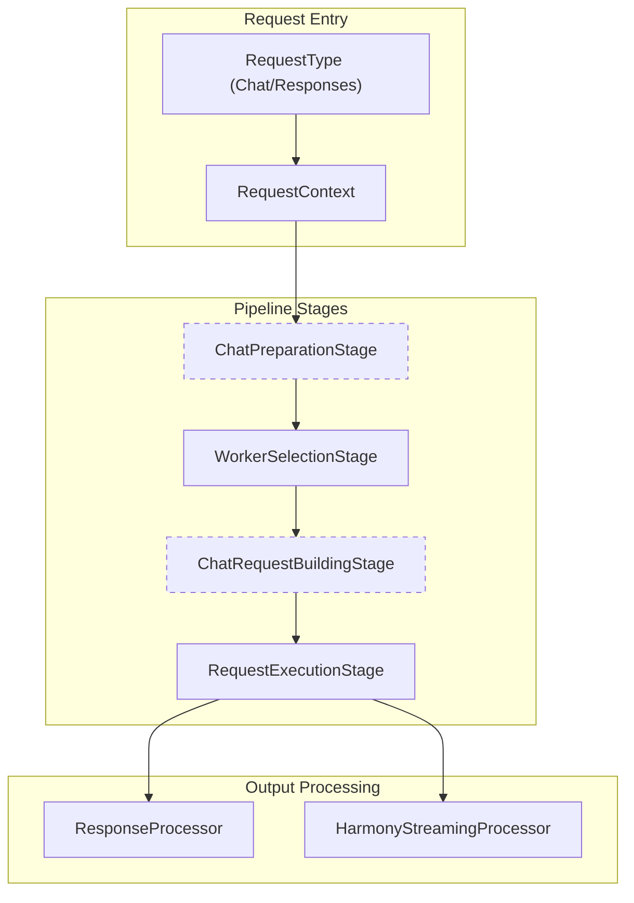
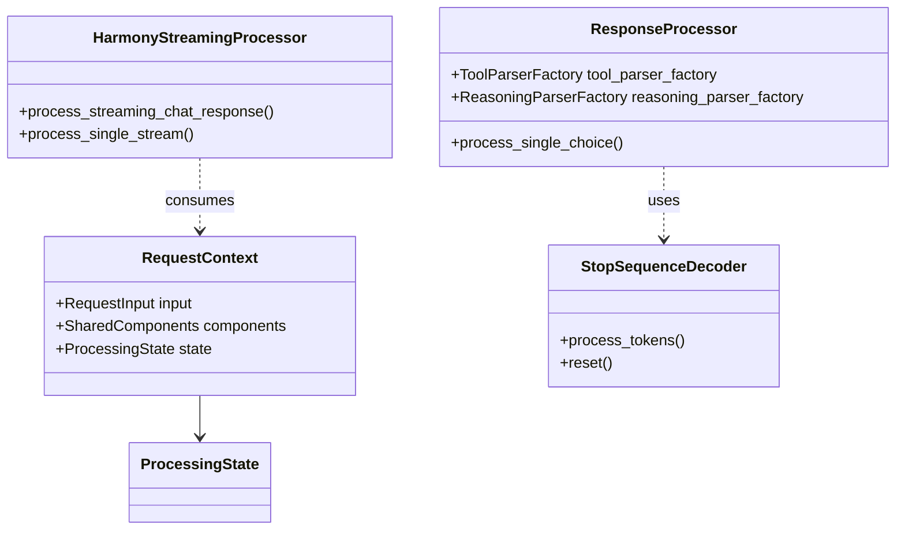

<!-- source: DeepWiki mcp.deepwiki.com · repo smg-project/smg · page 2.2 gRPC Routing Layer · fetched 2026-10-21 -->

# gRPC Routing Layer

Relevant source files

The following files were used as context for generating this wiki page:

- [bindings/golang/src/proto_parse.rs](bindings/golang/src/proto_parse.rs)
- [bindings/golang/src/utils.rs](bindings/golang/src/utils.rs)
- [crates/protocols/src/messages.rs](crates/protocols/src/messages.rs)
- [crates/tokenizer/src/huggingface.rs](crates/tokenizer/src/huggingface.rs)
- [docs/getting-started/logging.md](docs/getting-started/logging.md)
- [e2e_test/completions/test_basic.py](e2e_test/completions/test_basic.py)
- [model_gateway/src/middleware/request_id.rs](model_gateway/src/middleware/request_id.rs)
- [model_gateway/src/middleware/tenant_resolution.rs](model_gateway/src/middleware/tenant_resolution.rs)
- [model_gateway/src/routers/factory.rs](model_gateway/src/routers/factory.rs)
- [model_gateway/src/routers/grpc/common/response_collection.rs](model_gateway/src/routers/grpc/common/response_collection.rs)
- [model_gateway/src/routers/grpc/common/responses/streaming.rs](model_gateway/src/routers/grpc/common/responses/streaming.rs)
- [model_gateway/src/routers/grpc/common/responses/utils.rs](model_gateway/src/routers/grpc/common/responses/utils.rs)
- [model_gateway/src/routers/grpc/common/stages/dispatch_metadata.rs](model_gateway/src/routers/grpc/common/stages/dispatch_metadata.rs)
- [model_gateway/src/routers/grpc/common/stages/helpers.rs](model_gateway/src/routers/grpc/common/stages/helpers.rs)
- [model_gateway/src/routers/grpc/common/stages/request_execution.rs](model_gateway/src/routers/grpc/common/stages/request_execution.rs)
- [model_gateway/src/routers/grpc/context.rs](model_gateway/src/routers/grpc/context.rs)
- [model_gateway/src/routers/grpc/harmony/responses/common.rs](model_gateway/src/routers/grpc/harmony/responses/common.rs)
- [model_gateway/src/routers/grpc/harmony/responses/execution.rs](model_gateway/src/routers/grpc/harmony/responses/execution.rs)
- [model_gateway/src/routers/grpc/harmony/responses/non_streaming.rs](model_gateway/src/routers/grpc/harmony/responses/non_streaming.rs)
- [model_gateway/src/routers/grpc/harmony/responses/streaming.rs](model_gateway/src/routers/grpc/harmony/responses/streaming.rs)
- [model_gateway/src/routers/grpc/harmony/stages/request_building.rs](model_gateway/src/routers/grpc/harmony/stages/request_building.rs)
- [model_gateway/src/routers/grpc/harmony/stages/response_processing.rs](model_gateway/src/routers/grpc/harmony/stages/response_processing.rs)
- [model_gateway/src/routers/grpc/harmony/streaming.rs](model_gateway/src/routers/grpc/harmony/streaming.rs)
- [model_gateway/src/routers/grpc/pipeline.rs](model_gateway/src/routers/grpc/pipeline.rs)
- [model_gateway/src/routers/grpc/regular/processor.rs](model_gateway/src/routers/grpc/regular/processor.rs)
- [model_gateway/src/routers/grpc/regular/responses/common.rs](model_gateway/src/routers/grpc/regular/responses/common.rs)
- [model_gateway/src/routers/grpc/regular/responses/non_streaming.rs](model_gateway/src/routers/grpc/regular/responses/non_streaming.rs)
- [model_gateway/src/routers/grpc/regular/responses/streaming.rs](model_gateway/src/routers/grpc/regular/responses/streaming.rs)
- [model_gateway/src/routers/grpc/regular/stages/chat/preparation.rs](model_gateway/src/routers/grpc/regular/stages/chat/preparation.rs)
- [model_gateway/src/routers/grpc/regular/stages/chat/request_building.rs](model_gateway/src/routers/grpc/regular/stages/chat/request_building.rs)
- [model_gateway/src/routers/grpc/regular/stages/completion/preparation.rs](model_gateway/src/routers/grpc/regular/stages/completion/preparation.rs)
- [model_gateway/src/routers/grpc/regular/stages/completion/request_building.rs](model_gateway/src/routers/grpc/regular/stages/completion/request_building.rs)
- [model_gateway/src/routers/grpc/regular/stages/completion/response_processing.rs](model_gateway/src/routers/grpc/regular/stages/completion/response_processing.rs)
- [model_gateway/src/routers/grpc/regular/stages/embedding/preparation.rs](model_gateway/src/routers/grpc/regular/stages/embedding/preparation.rs)
- [model_gateway/src/routers/grpc/regular/stages/embedding/request_building.rs](model_gateway/src/routers/grpc/regular/stages/embedding/request_building.rs)
- [model_gateway/src/routers/grpc/regular/stages/generate/preparation.rs](model_gateway/src/routers/grpc/regular/stages/generate/preparation.rs)
- [model_gateway/src/routers/grpc/regular/stages/generate/request_building.rs](model_gateway/src/routers/grpc/regular/stages/generate/request_building.rs)
- [model_gateway/src/routers/grpc/regular/stages/messages/mod.rs](model_gateway/src/routers/grpc/regular/stages/messages/mod.rs)
- [model_gateway/src/routers/grpc/regular/stages/messages/preparation.rs](model_gateway/src/routers/grpc/regular/stages/messages/preparation.rs)
- [model_gateway/src/routers/grpc/regular/stages/messages/request_building.rs](model_gateway/src/routers/grpc/regular/stages/messages/request_building.rs)
- [model_gateway/src/routers/grpc/regular/stages/messages/response_processing.rs](model_gateway/src/routers/grpc/regular/stages/messages/response_processing.rs)
- [model_gateway/src/routers/grpc/regular/stages/mod.rs](model_gateway/src/routers/grpc/regular/stages/mod.rs)
- [model_gateway/src/routers/grpc/regular/stages/preparation.rs](model_gateway/src/routers/grpc/regular/stages/preparation.rs)
- [model_gateway/src/routers/grpc/regular/stages/request_building.rs](model_gateway/src/routers/grpc/regular/stages/request_building.rs)
- [model_gateway/src/routers/grpc/regular/stages/response_processing.rs](model_gateway/src/routers/grpc/regular/stages/response_processing.rs)
- [model_gateway/src/routers/grpc/regular/streaming.rs](model_gateway/src/routers/grpc/regular/streaming.rs)
- [model_gateway/src/routers/grpc/router.rs](model_gateway/src/routers/grpc/router.rs)
- [model_gateway/src/routers/grpc/utils/chat_utils.rs](model_gateway/src/routers/grpc/utils/chat_utils.rs)
- [model_gateway/src/routers/grpc/utils/message_utils.rs](model_gateway/src/routers/grpc/utils/message_utils.rs)
- [model_gateway/src/routers/grpc/utils/mod.rs](model_gateway/src/routers/grpc/utils/mod.rs)
- [model_gateway/src/routers/grpc/utils/parsers.rs](model_gateway/src/routers/grpc/utils/parsers.rs)
- [model_gateway/src/routers/http/mod.rs](model_gateway/src/routers/http/mod.rs)
- [model_gateway/src/routers/tokenize/handlers.rs](model_gateway/src/routers/tokenize/handlers.rs)
- [model_gateway/tests/api/mod.rs](model_gateway/tests/api/mod.rs)
- [model_gateway/tests/routing/grpc_completion_batch_test.rs](model_gateway/tests/routing/grpc_completion_batch_test.rs)
- [model_gateway/tests/routing/mod.rs](model_gateway/tests/routing/mod.rs)

The gRPC routing layer provides a high-performance, stage-based pipeline for processing inference requests. Unlike the HTTP router which often handles JSON-to-JSON transformations, the gRPC layer manages complex internal state across multiple execution stages, including multimodal tensor assembly, tokenizer-driven prompt preparation, and advanced disaggregation strategies like **EPD (Encode-Prefill-Decode)**.

## Pipeline Architecture

The gRPC router is built around a `RequestPipeline` [model_gateway/src/routers/grpc/pipeline.rs:31-31]() that executes a sequence of `PipelineStage` [model_gateway/src/routers/grpc/common/stages/helpers.rs:11-11]() implementations. This design ensures a clean separation of concerns and allows the router to support various protocols (Regular, Harmony) and execution modes (Single, PD, EPD).

### Request Lifecycle
1.  **Preparation**: Resolves tokenizers, renders chat templates, and processes multimodal inputs [model_gateway/src/routers/grpc/regular/stages/chat/preparation.rs:23-23]().
2.  **Worker Selection**: Picks optimal backend workers based on load and cache affinity [model_gateway/src/routers/grpc/context.rs:171-171]().
3.  **Client Acquisition**: Establishes gRPC connections to the selected workers [model_gateway/src/routers/grpc/context.rs:174-174]().
4.  **Request Building**: Constructs backend-specific protobuf messages (e.g., `ProtoGenerateRequest`) [model_gateway/src/routers/grpc/regular/stages/chat/request_building.rs:23-23]().
5.  **Dispatch**: Executes the gRPC calls, managing parallel streams for disaggregated modes [model_gateway/src/routers/grpc/common/stages/request_execution.rs:122-122]().
6.  **Response Processing**: Parses streaming tokens, extracts reasoning blocks, and handles tool-call syntax [model_gateway/src/routers/grpc/regular/processor.rs:38-38]().

### Code-to-Entity Mapping: Pipeline Flow
This diagram maps the logical stages to the specific Rust structs that implement them.

Sources: [model_gateway/src/routers/grpc/context.rs:43-47](), [model_gateway/src/routers/grpc/common/stages/request_execution.rs:122-122](), [model_gateway/src/routers/grpc/regular/stages/chat/preparation.rs:23-23](), [model_gateway/src/routers/grpc/regular/stages/chat/request_building.rs:23-23]().

## Context and State Management

The `RequestContext` [model_gateway/src/routers/grpc/context.rs:43-47]() is the primary data structure flowing through the pipeline. It holds:
*   **Input**: The original request and tenant metadata [model_gateway/src/routers/grpc/context.rs:50-56]().
*   **Shared Components**: Access to registries (Tokenizer, Worker) and parsers [model_gateway/src/routers/grpc/context.rs:137-148]().
*   **Processing State**: Mutable state that evolves, such as `multimodal_intermediate` [model_gateway/src/routers/grpc/context.rs:159-159]() and `execution_plan` [model_gateway/src/routers/grpc/context.rs:177-177]().

Sources: [model_gateway/src/routers/grpc/context.rs:43-180]()

## Disaggregated Execution (PD & EPD)

SMG supports splitting requests across different worker types to optimize for throughput and latency.

### Prefill-Decode (PD) Disaggregation
The router can split a request into a **Prefill** leg and a **Decode** leg. The `RequestExecutionStage` manages the KV-cache transfer between these workers using specific connectors:
*   **Mooncake**: A push-based connector where the prefill worker pins blocks and the gateway relays rendezvous info to the decode worker [model_gateway/src/routers/grpc/common/stages/request_execution.rs:43-47]().
*   **Nixl**: Tags the prefill leg with `do_remote_decode` and relays returned parameters to the decode leg [model_gateway/src/routers/grpc/common/stages/request_execution.rs:48-49]().

### Encode-Prefill-Decode (EPD)
For multimodal requests, SMG introduces an **Encode** stage. This stage handles the heavy lifting of vision/audio encoding on specialized workers before passing the resulting tensors to the Prefill worker [model_gateway/src/routers/grpc/regular/stages/chat/request_building.rs:91-107]().

| Feature | Single Mode | PD Mode | EPD Mode |
| :--- | :--- | :--- | :--- |
| **Worker Count** | 1 | 2 (Prefill + Decode) | 3 (Encode + Prefill + Decode) |
| **KV Transfer** | Local | Remote (Nixl/Mooncake) | Remote |
| **Multimodal** | Inline | Inline | Disaggregated (Encode) |

Sources: [model_gateway/src/routers/grpc/common/stages/request_execution.rs:33-80](), [model_gateway/src/routers/grpc/regular/stages/chat/request_building.rs:91-114]()

## Harmony Protocol Support

The **Harmony Protocol** is a specialized gRPC interface used for high-efficiency, multi-channel communication between the gateway and backend engines.

### Streaming Harmony Responses
The `HarmonyStreamingProcessor` [model_gateway/src/routers/grpc/harmony/streaming.rs:81-81]() handles the complex task of parsing incremental Harmony tokens. It supports multi-channel streaming where different parts of the response (e.g., thought blocks, tool calls, and final text) can arrive asynchronously [model_gateway/src/routers/grpc/harmony/streaming.rs:103-108]().

### Multi-turn Tool Loops
For the `Responses` API, the router implements an automated tool execution loop. If the model emits a tool call (detected in the Harmony commentary channel), the gateway:
1.  Intercepts the call [model_gateway/src/routers/grpc/harmony/responses/non_streaming.rs:48-52]().
2.  Executes the tool via the `McpToolSession` [model_gateway/src/routers/grpc/harmony/responses/non_streaming.rs:124-124]().
3.  Injects the results back into a new request and re-runs the pipeline [model_gateway/src/routers/grpc/harmony/responses/non_streaming.rs:207-215]().

Sources: [model_gateway/src/routers/grpc/harmony/streaming.rs:81-174](), [model_gateway/src/routers/grpc/harmony/responses/non_streaming.rs:54-100]()

## Response Processing & Parsing

The `ResponseProcessor` [model_gateway/src/routers/grpc/regular/processor.rs:38-43]() is responsible for transforming raw backend outputs into OpenAI-compatible formats.

### Reasoning and Tool Parsing
*   **Reasoning Extraction**: Uses a `ReasoningParser` to identify `<think>` blocks or similar markers, separating them from the final user-facing text [model_gateway/src/routers/grpc/regular/processor.rs:102-135]().
*   **Tool Call Parsing**: Detects structured tool-use syntax. It supports both JSON-schema-based constraints and model-specific XML/Markdown parsing via the `ToolParserFactory` [model_gateway/src/routers/grpc/regular/processor.rs:144-178]().

### Stop Sequence Decoding
The router implements a `StopSequenceDecoder` [model_gateway/src/routers/grpc/regular/processor.rs:68-68]() to handle client-defined stop sequences. This ensures that even if a backend engine doesn't natively support a specific stop string, the gateway can terminate the stream and trim the output correctly [model_gateway/src/routers/grpc/regular/processor.rs:73-96]().

Sources: [model_gateway/src/routers/grpc/regular/processor.rs:38-72](), [model_gateway/src/routers/grpc/harmony/streaming.rs:81-108](), [model_gateway/src/routers/grpc/context.rs:43-47]().

## Reliability Features

### Load Guards
The router uses RAII-based `LoadGuards` [model_gateway/src/routers/grpc/common/stages/request_execution.rs:174-178]() to track inflight requests per worker. The load is incremented when the guard is created and automatically decremented when the `RequestContext` (or the streaming response) is dropped [model_gateway/src/routers/grpc/common/stages/request_execution.rs:157-158]().

### Retries
The gRPC router integrates with a `RetryExecutor` [model_gateway/src/routers/grpc/router.rs:40-40]() that can re-run the entire pipeline if a backend returns a retryable status (e.g., `UNAVAILABLE` or `RESOURCE_EXHAUSTED`). Because the pipeline is stage-based, it can intelligently skip or re-execute preparation steps during a retry.

Sources: [model_gateway/src/routers/grpc/common/stages/request_execution.rs:157-179](), [model_gateway/src/routers/grpc/router.rs:34-44]()

---

