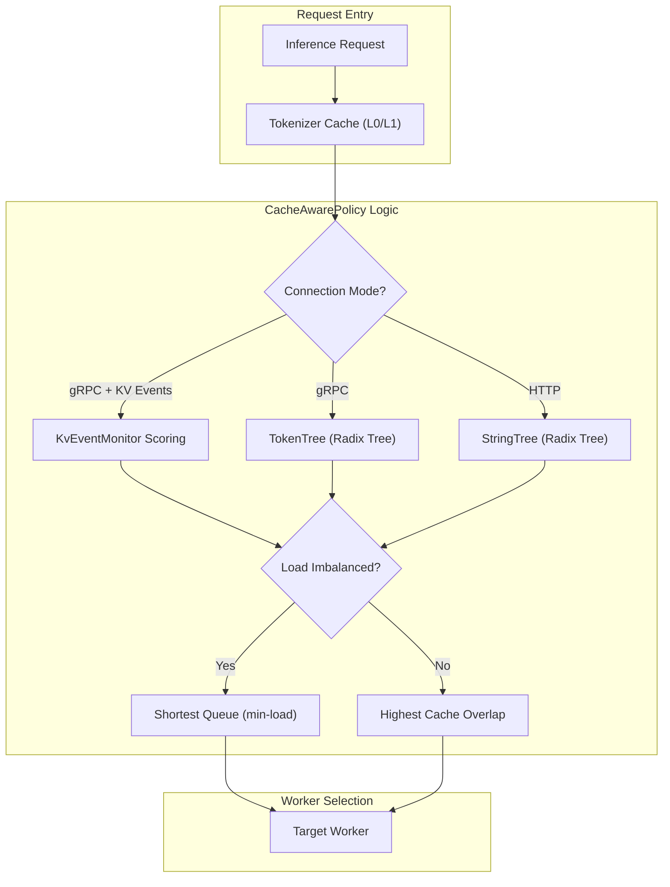
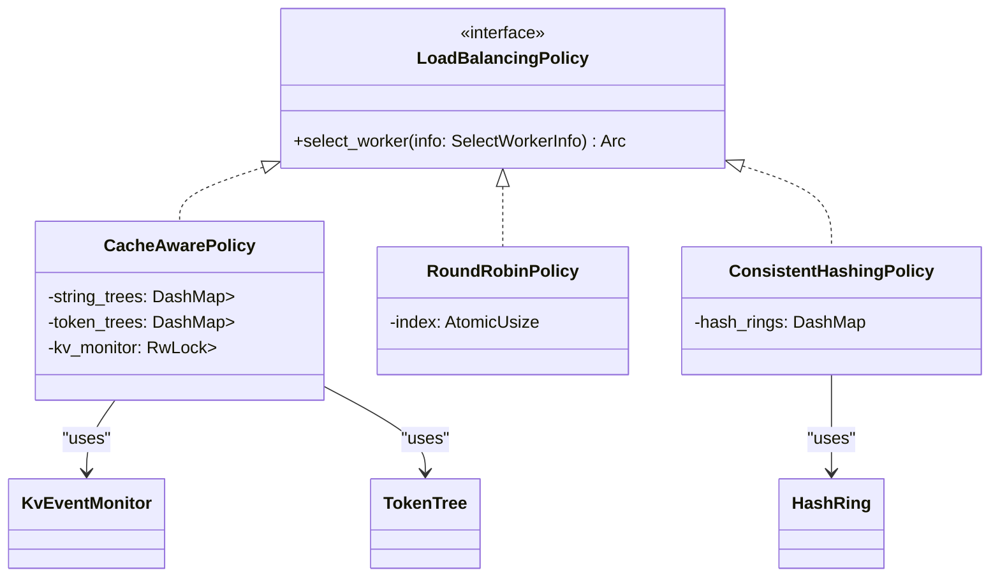

<!-- source: DeepWiki mcp.deepwiki.com · repo smg-project/smg · page 2.3 Load Balancing Policies · fetched 2026-10-21 -->

# Load Balancing Policies

Relevant source files

The following files were used as context for generating this wiki page:

- [bindings/golang/src/policy.rs](bindings/golang/src/policy.rs)
- [clients/rust/Cargo.toml](clients/rust/Cargo.toml)
- [crates/auth/Cargo.toml](crates/auth/Cargo.toml)
- [crates/grpc_client/src/tokenizer_bundle.rs](crates/grpc_client/src/tokenizer_bundle.rs)
- [crates/kv_index/benches/throughput_bench.rs](crates/kv_index/benches/throughput_bench.rs)
- [crates/kv_index/src/lib.rs](crates/kv_index/src/lib.rs)
- [crates/kv_index/src/snapshot.rs](crates/kv_index/src/snapshot.rs)
- [crates/kv_index/src/string_tree.rs](crates/kv_index/src/string_tree.rs)
- [crates/kv_index/src/token_tree.rs](crates/kv_index/src/token_tree.rs)
- [crates/protocols/src/worker.rs](crates/protocols/src/worker.rs)
- [crates/tokenizer/src/cache/l0.rs](crates/tokenizer/src/cache/l0.rs)
- [crates/tokenizer/src/cache/l1.rs](crates/tokenizer/src/cache/l1.rs)
- [crates/tokenizer/src/cache/mod.rs](crates/tokenizer/src/cache/mod.rs)
- [crates/tokenizer/src/stop.rs](crates/tokenizer/src/stop.rs)
- [crates/wasm/Cargo.toml](crates/wasm/Cargo.toml)
- [model_gateway/benches/manual_policy_benchmark.rs](model_gateway/benches/manual_policy_benchmark.rs)
- [model_gateway/benches/radix_tree_benchmark.rs](model_gateway/benches/radix_tree_benchmark.rs)
- [model_gateway/src/config/mod.rs](model_gateway/src/config/mod.rs)
- [model_gateway/src/policies/bucket.rs](model_gateway/src/policies/bucket.rs)
- [model_gateway/src/policies/cache_aware.rs](model_gateway/src/policies/cache_aware.rs)
- [model_gateway/src/policies/consistent_hashing.rs](model_gateway/src/policies/consistent_hashing.rs)
- [model_gateway/src/policies/least_load.rs](model_gateway/src/policies/least_load.rs)
- [model_gateway/src/policies/manual.rs](model_gateway/src/policies/manual.rs)
- [model_gateway/src/policies/power_of_two.rs](model_gateway/src/policies/power_of_two.rs)
- [model_gateway/src/policies/prefix_hash.rs](model_gateway/src/policies/prefix_hash.rs)
- [model_gateway/src/policies/random.rs](model_gateway/src/policies/random.rs)
- [model_gateway/src/policies/round_robin.rs](model_gateway/src/policies/round_robin.rs)
- [model_gateway/src/routers/common/retry.rs](model_gateway/src/routers/common/retry.rs)
- [model_gateway/src/service_discovery.rs](model_gateway/src/service_discovery.rs)
- [model_gateway/src/worker/builder.rs](model_gateway/src/worker/builder.rs)
- [model_gateway/src/worker/capacity.rs](model_gateway/src/worker/capacity.rs)
- [model_gateway/src/worker/manager.rs](model_gateway/src/worker/manager.rs)
- [model_gateway/src/worker/mod.rs](model_gateway/src/worker/mod.rs)
- [model_gateway/src/worker/monitor.rs](model_gateway/src/worker/monitor.rs)
- [model_gateway/src/worker/registry.rs](model_gateway/src/worker/registry.rs)
- [model_gateway/src/worker/service.rs](model_gateway/src/worker/service.rs)
- [model_gateway/src/worker/worker.rs](model_gateway/src/worker/worker.rs)
- [model_gateway/src/workflow/data.rs](model_gateway/src/workflow/data.rs)
- [model_gateway/src/workflow/job_queue.rs](model_gateway/src/workflow/job_queue.rs)
- [model_gateway/src/workflow/mod.rs](model_gateway/src/workflow/mod.rs)
- [model_gateway/src/workflow/steps/local/create_worker.rs](model_gateway/src/workflow/steps/local/create_worker.rs)
- [model_gateway/src/workflow/steps/mod.rs](model_gateway/src/workflow/steps/mod.rs)
- [model_gateway/src/workflow/steps/shared/activate.rs](model_gateway/src/workflow/steps/shared/activate.rs)
- [model_gateway/src/workflow/steps/shared/register.rs](model_gateway/src/workflow/steps/shared/register.rs)
- [model_gateway/tests/harmony_encoding_test.rs](model_gateway/tests/harmony_encoding_test.rs)
- [model_gateway/tests/routing/worker_management_test.rs](model_gateway/tests/routing/worker_management_test.rs)

SMG (Shepherd Model Gateway) provides a suite of load-balancing policies designed to optimize inference performance, specifically focusing on KV cache affinity and system stability. The system supports standard algorithms (Round Robin, Least Load) alongside advanced cache-aware routing that utilizes prefix matching via radix trees and event-driven KV monitoring.

## Policy Overview

All policies implement the `LoadBalancingPolicy` trait, which requires a `select_worker` method to return an `Arc<dyn Worker>` based on the request context and current fleet state.

| Policy | Logic | Best Use Case |
| :--- | :--- | :--- |
| `cache_aware` | Radix tree prefix matching + KV event scoring | Maximizing KV cache hits in SGLang/vLLM. |
| `least_load` | Selects worker with lowest active request count | General purpose load balancing. |
| `power_of_two` | Samples 2 workers, picks the one with least load | High-throughput low-contention balancing. |
| `prefix_hash` | Hashes a specific prefix length to a worker | Simple sticky routing for shared prefixes. |
| `consistent_hashing` | Uses a hash ring for stable worker mapping | Minimizing cache churn during fleet changes. |
| `manual` | Uses `X-Worker-Id` or `X-Routing-Key` | Sticky sessions / Debugging. |
| `round_robin` | Cyclic selection | Simple testing / Uniform distribution. |

**Sources:**
- `model_gateway/src/policies/cache_aware.rs:85-124`
- `model_gateway/src/worker/registry.rs:109-112`
- `bindings/golang/src/policy.rs:25-37`

---

## Cache-Aware Routing

The `CacheAwarePolicy` is the most sophisticated router in SMG. It attempts to route requests to workers that already contain the request's prefix in their KV cache. It operates in three distinct modes based on the connection type and available telemetry.

### 1. Event-Driven (gRPC + KV Events)
For backends that stream KV cache events (like SGLang or vLLM with Mooncake), the policy uses a `KvEventMonitor` [model_gateway/src/worker/kv_event_monitor.rs]().
- **Logic**: It uses a `PositionalIndexer` to score workers based on actual block-level overlap [model_gateway/src/policies/cache_aware.rs:11-17]().
- **Tie-breaking**: Highest overlap count $\rightarrow$ Lower load $\rightarrow$ Smaller tree size [model_gateway/src/policies/cache_aware.rs:15-16]().

### 2. Approximate Token Tree (gRPC)
When KV events are unavailable but the input is tokenized, SMG maintains a `TokenTree` per model [model_gateway/src/policies/cache_aware.rs:18-23]().
- **Mechanism**: Tracks which token prefixes were previously routed to which worker.
- **Threshold**: If the `match_rate` exceeds `cache_threshold`, the best-matching worker is selected. Otherwise, it routes to the worker with the smallest tree to encourage cache growth [model_gateway/src/policies/cache_aware.rs:21-23]().

### 3. Approximate String Tree (HTTP)
Used for raw text requests to avoid the overhead of tokenization before routing decisions [model_gateway/src/policies/cache_aware.rs:24-28]().
- **Mechanism**: Uses a `StringTree` [crates/kv_index/src/string_tree.rs:143-150]() for character-level prefix matching.

### Imbalance Trigger
To prevent "hot-spotting" where one worker handles all requests due to cache affinity, the policy switches to **Shortest Queue** routing if the system is imbalanced [model_gateway/src/policies/cache_aware.rs:29-33]():
- $(max\_load - min\_load) > balance\_abs\_threshold$ **AND**
- $max\_load > balance\_rel\_threshold \times min\_load$

### Cache-Aware Routing Data Flow

**Sources:**
- `model_gateway/src/policies/cache_aware.rs:1-42`
- `crates/kv_index/src/string_tree.rs:1-31`
- `model_gateway/src/worker/kv_event_monitor.rs:1-20`

---

## Tokenizer Caching (L0 & L1)

Cache-aware routing relies on efficient tokenization. The `CachedTokenizer` provides two layers of caching to reduce CPU latency.

### L0 Cache: Whole-String Match
A simple `DashMap` that stores exact matches for full input strings. This captures ~90% of hits for static system prompts [crates/tokenizer/src/cache/mod.rs:7-8]().

### L1 Cache: Prefix Matching
Matches prefixes at fixed boundaries (e.g., special tokens like `<|user|>`).
- **Hit**: Splices the cached prefix tokens with a fresh encoding of the remaining suffix [crates/tokenizer/src/cache/mod.rs:185-200]().
- **Miss**: Tokenizes the input and seeds new boundary entries into the cache [crates/tokenizer/src/cache/mod.rs:177-178]().

**Sources:**
- `crates/tokenizer/src/cache/mod.rs:1-60`
- `crates/tokenizer/src/cache/mod.rs:166-200`

---

## Load Balancing Implementations

### Consistent Hashing
Maintains a `HashRing` per model [model_gateway/src/worker/registry.rs:10-13](). The ring is rebuilt only when workers are added or removed (copy-on-write). This ensures that a request with the same `routing_key` consistently hits the same worker, preserving local caches.

### Least Load & Power of Two
- **Least Load**: Iterates through all `Ready` workers in the `WorkerRegistry` and selects the one where `worker.load()` is minimal [model_gateway/src/policies/least_load.rs]().
- **Power of Two**: Samples two random workers and picks the one with the lower load, reducing the "herd effect" in high-concurrency environments [model_gateway/src/policies/power_of_two.rs]().

### Manual (Sticky Sessions)
Allows clients to bypass balancing logic by providing specific headers:
- `X-Worker-Id`: Targets a specific UUID in the `WorkerRegistry` [model_gateway/src/policies/manual.rs]().
- `X-Routing-Key`: Used by the `ConsistentHashing` policy to determine ring position.

### Implementation Mapping

**Sources:**
- `model_gateway/src/worker/registry.rs:9-13`
- `model_gateway/src/worker/worker.rs:164-174`
- `model_gateway/src/policies/cache_aware.rs:85-124`
- `bindings/golang/src/policy.rs:25-37`

---

## Performance Considerations

Prefix matching is optimized for high-concurrency via:
1. **Lock-Free Reads**: The `WorkerRegistry` uses `Arc` snapshots for `ModelIndex` to allow reads without contention [model_gateway/src/worker/registry.rs:6-8]().
2. **Radix Tree Sharding**: `StringTree` uses `DashMap` with custom shard counts (32 for root, 8 for nodes) to balance memory vs. contention [crates/kv_index/src/string_tree.rs:23-31]().
3. **Identity Hashing**: Character-based trees use a fast identity hasher for single-character keys to avoid cryptographic overhead [crates/kv_index/src/string_tree.rs:70-74]().

**Sources:**
- `model_gateway/src/worker/registry.rs:5-13`
- `crates/kv_index/src/string_tree.rs:23-37`
- `model_gateway/benches/radix_tree_benchmark.rs:1-8`

---

