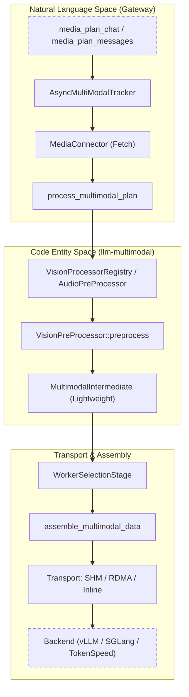
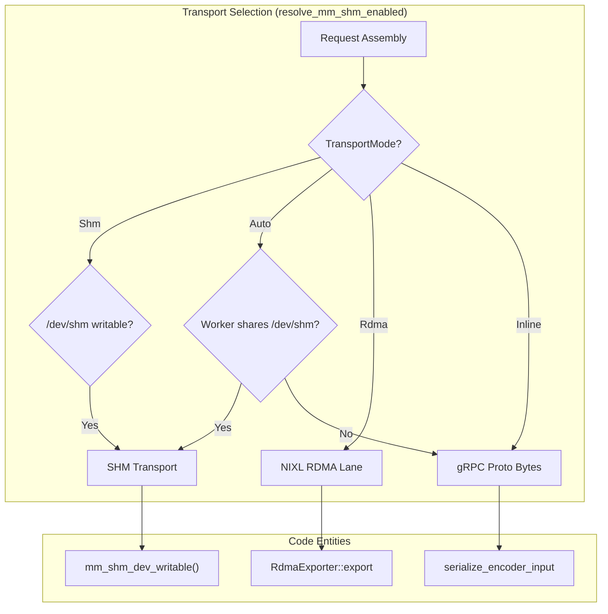

<!-- source: DeepWiki mcp.deepwiki.com · repo smg-project/smg · page 2.4 Multimodal Request Handling · fetched 2026-10-21 -->

# Multimodal Request Handling

Relevant source files

The following files were used as context for generating this wiki page:

- [crates/mm_rdma/Cargo.toml](crates/mm_rdma/Cargo.toml)
- [crates/mm_rdma/src/lib.rs](crates/mm_rdma/src/lib.rs)
- [crates/mm_rdma/src/nixl.rs](crates/mm_rdma/src/nixl.rs)
- [crates/mm_rdma/src/slot_pool.rs](crates/mm_rdma/src/slot_pool.rs)
- [crates/mm_rdma/src/stub.rs](crates/mm_rdma/src/stub.rs)
- [crates/multimodal/src/audio/mod.rs](crates/multimodal/src/audio/mod.rs)
- [crates/multimodal/src/audio/processor.rs](crates/multimodal/src/audio/processor.rs)
- [crates/multimodal/src/audio/processors/mod.rs](crates/multimodal/src/audio/processors/mod.rs)
- [crates/multimodal/src/audio/processors/qwen3_audio.rs](crates/multimodal/src/audio/processors/qwen3_audio.rs)
- [crates/multimodal/src/audio/transforms.rs](crates/multimodal/src/audio/transforms.rs)
- [crates/multimodal/src/error.rs](crates/multimodal/src/error.rs)
- [crates/multimodal/src/lib.rs](crates/multimodal/src/lib.rs)
- [crates/multimodal/src/media.rs](crates/multimodal/src/media.rs)
- [crates/multimodal/src/registry/llama4.rs](crates/multimodal/src/registry/llama4.rs)
- [crates/multimodal/src/registry/phi3_v.rs](crates/multimodal/src/registry/phi3_v.rs)
- [crates/multimodal/src/registry/qwen3_asr.rs](crates/multimodal/src/registry/qwen3_asr.rs)
- [crates/multimodal/src/registry/qwen3_omni.rs](crates/multimodal/src/registry/qwen3_omni.rs)
- [crates/multimodal/src/registry/qwen3_vl.rs](crates/multimodal/src/registry/qwen3_vl.rs)
- [crates/multimodal/src/registry/qwen_vl.rs](crates/multimodal/src/registry/qwen_vl.rs)
- [crates/multimodal/src/types.rs](crates/multimodal/src/types.rs)
- [crates/multimodal/src/vision/execution.rs](crates/multimodal/src/vision/execution.rs)
- [crates/multimodal/src/vision/mod.rs](crates/multimodal/src/vision/mod.rs)
- [crates/multimodal/src/vision/preprocessor_config.rs](crates/multimodal/src/vision/preprocessor_config.rs)
- [crates/multimodal/src/vision/processors/kimi_k25.rs](crates/multimodal/src/vision/processors/kimi_k25.rs)
- [crates/multimodal/src/vision/processors/kimi_k3.rs](crates/multimodal/src/vision/processors/kimi_k3.rs)
- [crates/multimodal/src/vision/processors/mod.rs](crates/multimodal/src/vision/processors/mod.rs)
- [crates/multimodal/src/vision/processors/moonvit.rs](crates/multimodal/src/vision/processors/moonvit.rs)
- [crates/multimodal/src/vision/processors/qwen2_vl.rs](crates/multimodal/src/vision/processors/qwen2_vl.rs)
- [crates/multimodal/src/vision/processors/qwen3_omni_vision.rs](crates/multimodal/src/vision/processors/qwen3_omni_vision.rs)
- [crates/multimodal/src/vision/processors/qwen3_vl.rs](crates/multimodal/src/vision/processors/qwen3_vl.rs)
- [crates/multimodal/src/vision/processors/qwen_vl_base.rs](crates/multimodal/src/vision/processors/qwen_vl_base.rs)
- [crates/multimodal/src/vision/transforms.rs](crates/multimodal/src/vision/transforms.rs)
- [crates/multimodal/tests/qwen_preprocess_golden.rs](crates/multimodal/tests/qwen_preprocess_golden.rs)
- [e2e_test/router/test_mmmu.py](e2e_test/router/test_mmmu.py)
- [model_gateway/src/routers/grpc/common/stages/worker_selection.rs](model_gateway/src/routers/grpc/common/stages/worker_selection.rs)
- [model_gateway/src/routers/grpc/mod.rs](model_gateway/src/routers/grpc/mod.rs)
- [model_gateway/src/routers/grpc/multimodal/assemble.rs](model_gateway/src/routers/grpc/multimodal/assemble.rs)
- [model_gateway/src/routers/grpc/multimodal/config.rs](model_gateway/src/routers/grpc/multimodal/config.rs)
- [model_gateway/src/routers/grpc/multimodal/mod.rs](model_gateway/src/routers/grpc/multimodal/mod.rs)
- [model_gateway/src/routers/grpc/multimodal/process.rs](model_gateway/src/routers/grpc/multimodal/process.rs)
- [model_gateway/src/routers/grpc/multimodal/serialize.rs](model_gateway/src/routers/grpc/multimodal/serialize.rs)
- [model_gateway/src/routers/grpc/multimodal/transport.rs](model_gateway/src/routers/grpc/multimodal/transport.rs)
- [scripts/ci_install_vllm.sh](scripts/ci_install_vllm.sh)

SMG (Shepherd Model Gateway) provides a high-performance, protocol-agnostic pipeline for processing multimodal inputs (images, video, and audio). The system is designed to handle complex operations such as media fetching, aspect-ratio-aware preprocessing, placeholder token expansion, and efficient tensor transport to backend workers via Shared Memory (SHM) or RDMA.

## System Architecture

The multimodal subsystem is divided into the `llm-multimodal` crate, which handles pure media processing and model-specific logic, and the `model_gateway` gRPC router integration, which manages the request lifecycle and data transport.

### Data Flow: From Request to Tensor

The following diagram illustrates how a multimodal request is transformed from an OpenAI-compatible JSON payload into backend-specific tensors.

**Multimodal Processing Pipeline**

Sources: [model_gateway/src/routers/grpc/multimodal/mod.rs:1-15](), [model_gateway/src/routers/grpc/multimodal/process.rs:39-62](), [model_gateway/src/routers/grpc/multimodal/assemble.rs:45-51]()

## Media Fetching and Tracking

Media processing begins with the `AsyncMultiModalTracker` [crates/multimodal/src/tracker.rs](), which uses a `MediaConnector` [crates/multimodal/src/media.rs:121-126]() to fetch content concurrently.

- **MediaConnector**: Supports fetching from HTTP(S) URLs, Base64 Data URLs, and local file paths (if permitted by `allowed_local_media_path`) [crates/multimodal/src/media.rs:151-181]().
- **Concurrency**: Fetching is performed asynchronously using `tokio` and `reqwest`.
- **Validation**: The system enforces limits on input bytes and decoded sizes (e.g., `DEFAULT_VIDEO_MAX_DECODED_BYTES` at 1 GiB) [crates/multimodal/src/media.rs:27-32]().

Sources: [crates/multimodal/src/media.rs:121-181](), [model_gateway/src/routers/grpc/multimodal/process.rs:51-62]()

## Preprocessing and Model Registries

Once media is fetched, SMG identifies the correct preprocessor using the `ModelRegistry` [crates/multimodal/src/registry/mod.rs](). Preprocessors are implemented in Rust to avoid Python dependency overhead.

### Vision Processors
Vision processors handle tasks like "Smart Resize" (preserving aspect ratio while fitting pixel bounds) and normalization.

- **Qwen-VL Family**: Implements a `QwenVLProcessorBase` [crates/multimodal/src/vision/processors/qwen_vl_base.rs:61-85]() used by Qwen2-VL, Qwen2.5-VL, and Qwen3-VL. It calculates grid dimensions `(T, H, W)` for position encoding [crates/multimodal/src/vision/processors/qwen2_vl.rs:195-202]().
- **LLaVA / LLaVA-Next**: Implements multi-patch processing for high-resolution images.
- **Kimi / Phi3-V**: Model-specific implementations registered in the `VisionProcessorRegistry` [crates/multimodal/src/vision/mod.rs]().

### Audio Processors
Audio inputs are decoded into mono `f32` PCM data at a target sample rate (e.g., 16kHz or 24kHz) [crates/multimodal/src/audio/mod.rs:25]().

Sources: [crates/multimodal/src/vision/processors/qwen_vl_base.rs:1-22](), [crates/multimodal/src/vision/processors/qwen2_vl.rs:60-95](), [model_gateway/src/routers/grpc/multimodal/process.rs:164-183]()

## Placeholder Token Expansion

Models represent media as special placeholder tokens in the text prompt. SMG dynamically expands these tokens based on the preprocessed output (e.g., number of patches or video frames).

- **Token Expansion**: The `prepare_placeholder_tokens` function [model_gateway/src/routers/grpc/multimodal/plan.rs]() calculates the required number of tokens for each media item.
- **Prompt Binding**: Each media item is associated with a `PromptBinding` [model_gateway/src/routers/grpc/multimodal/mod.rs:147-157]() which tracks its position in the expanded prompt.

Sources: [model_gateway/src/routers/grpc/multimodal/mod.rs:66-72](), [model_gateway/src/routers/grpc/multimodal/plan.rs]()

## Tensor Assembly and Transport

After a worker is selected in the `WorkerSelectionStage` [model_gateway/src/routers/grpc/common/stages/worker_selection.rs](), the `MultimodalIntermediate` is converted into backend-specific `MultimodalData` [model_gateway/src/routers/grpc/multimodal/assemble.rs:45-51]().

### Backend Registries
| Backend | Assembly Implementation | Key Proto Wrappers |
| :--- | :--- | :--- |
| **vLLM** | `assemble_vllm` | `VllmMultimodalData` |
| **SGLang** | `assemble_sglang` | `SglangMultimodalData` |
| **TokenSpeed** | `assemble_tokenspeed_batches` | `TokenSpeedMultimodalData` |

Sources: [model_gateway/src/routers/grpc/multimodal/assemble.rs:74-106]()

### High-Performance Transport
For large tensors (high-res images or video), SMG avoids gRPC serialization overhead using advanced transport modes resolved in `transport.rs` [model_gateway/src/routers/grpc/multimodal/transport.rs]().

1.  **Shared Memory (SHM)**: Used when the gateway and worker share a `/dev/shm` volume. SMG writes the raw tensors to a memory-mapped file and passes the file descriptor/name to the worker [model_gateway/src/routers/grpc/multimodal/transport.rs:135-149]().
2.  **RDMA (NIXL)**: For disaggregated prefill-decode (PD) clusters, SMG uses the `smg-mm-rdma` crate to export tensors directly to remote worker memory using RDMA [model_gateway/src/routers/grpc/multimodal/transport.rs:157-167]().
3.  **Inline**: The default mode, where tensors are serialized into the gRPC message as `TensorBytes`.

**Transport Selection Logic**

Sources: [model_gateway/src/routers/grpc/multimodal/transport.rs:135-149](), [model_gateway/src/routers/grpc/multimodal/serialize.rs]()

---

