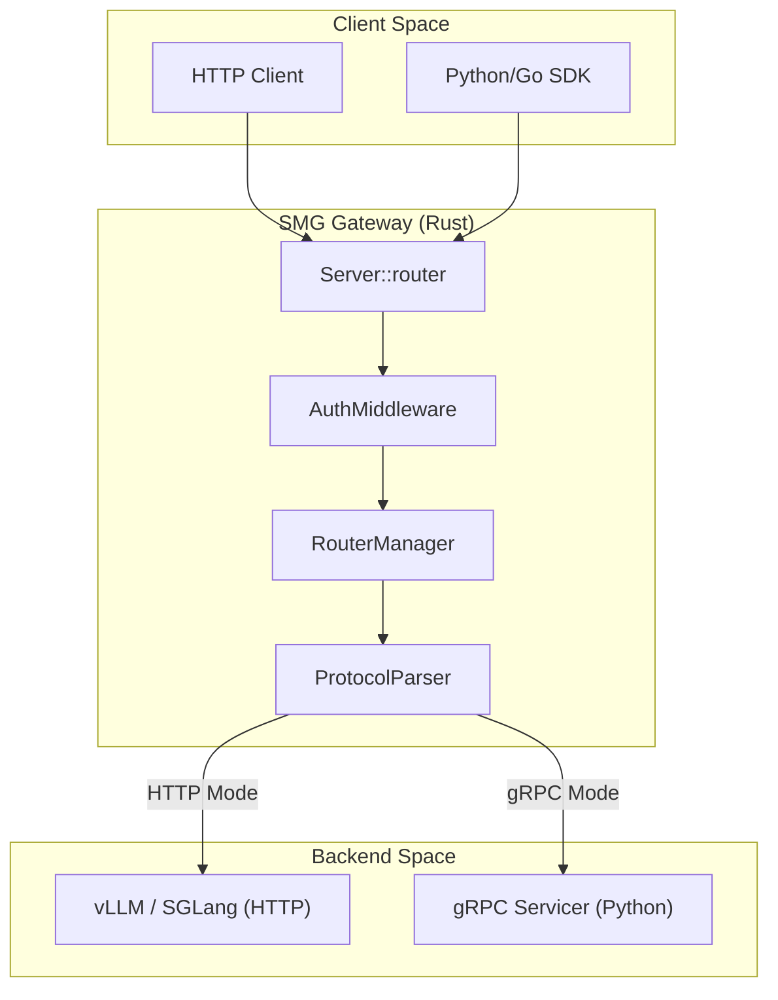

<!-- source: DeepWiki mcp.deepwiki.com · repo smg-project/smg · page 3 API Reference · fetched 2026-10-21 -->

# API Reference

<details>
<summary>Relevant source files</summary>

The following files were used as context for generating this wiki page:

- [README.md](README.md)
- [crates/protocols/src/chat.rs](crates/protocols/src/chat.rs)
- [crates/protocols/src/common.rs](crates/protocols/src/common.rs)
- [crates/protocols/src/completion.rs](crates/protocols/src/completion.rs)
- [crates/protocols/src/realtime_conversation.rs](crates/protocols/src/realtime_conversation.rs)
- [crates/protocols/src/rerank.rs](crates/protocols/src/rerank.rs)
- [crates/protocols/src/tokenize.rs](crates/protocols/src/tokenize.rs)
- [docs/assets/images/architecture-animated.svg](docs/assets/images/architecture-animated.svg)
- [docs/assets/images/concepts-overview.svg](docs/assets/images/concepts-overview.svg)
- [docs/assets/images/mcp-architecture.svg](docs/assets/images/mcp-architecture.svg)
- [docs/assets/images/wasm-plugins.svg](docs/assets/images/wasm-plugins.svg)
- [docs/assets/stylesheets/extra.css](docs/assets/stylesheets/extra.css)
- [docs/concepts/index.md](docs/concepts/index.md)
- [docs/concepts/routing/load-balancing.md](docs/concepts/routing/load-balancing.md)
- [docs/contributing/index.md](docs/contributing/index.md)
- [docs/getting-started/index.md](docs/getting-started/index.md)
- [docs/index.md](docs/index.md)
- [docs/reference/api/admin.md](docs/reference/api/admin.md)
- [docs/reference/api/extensions.md](docs/reference/api/extensions.md)
- [docs/reference/api/responses.md](docs/reference/api/responses.md)
- [mkdocs.yml](mkdocs.yml)
- [model_gateway/tests/spec/chat_completion.rs](model_gateway/tests/spec/chat_completion.rs)

</details>


Shepherd Model Gateway (SMG) exposes a multi-layered API designed to provide a unified interface for LLM inference, agentic orchestration, and infrastructure management. The gateway acts as a high-performance intermediary, abstracting the complexities of diverse backends like vLLM, SGLang, and TensorRT-LLM into a single, standardized set of endpoints [README.md:19-35]().

The API surface is categorized into three primary domains:
1.  **Inference APIs**: Industry-standard interfaces for text generation, embeddings, and multimodal processing.
2.  **Responses (Agentic) API**: A stateful, tool-enabled interface for complex multi-turn workflows.
3.  **Control Plane API**: Administrative endpoints for managing the gateway's internal state, workers, and plugins.

### API Architecture Overview

SMG routes requests based on the requested endpoint and the configured `connection_mode` (HTTP or gRPC) of the backend workers [docs/getting-started/index.md:118-126](). In **gRPC Mode**, the gateway serves as a full server handling tokenization and template rendering, whereas in **HTTP Mode**, it acts as a smart load-balancing proxy [docs/index.md:107-124]().

**Logical Request Flow**

Sources: [model_gateway/src/server.rs:7-20](), [docs/index.md:107-124](), [README.md:25-35]()

---

### 1. OpenAI-Compatible Inference API
The primary interface for standard LLM tasks. SMG provides 100% compatibility with the OpenAI specification, allowing users to drop SMG into existing application stacks by simply changing the `base_url` [docs/index.md:35-38]().

*   **Chat Completions**: `/v1/chat/completions` supports streaming (SSE), tool calling, and multimodal inputs [crates/protocols/src/chat.rs:140-150]().
*   **Legacy Completions**: `/v1/completions` for base model text generation [crates/protocols/src/completion.rs:17-22]().
*   **Embeddings**: `/v1/embeddings` for vector generation.
*   **Utility**: `/v1/tokenize` and `/v1/detokenize` for gateway-side text processing [docs/reference/api/extensions.md:48-49]().

For detailed request/response schemas and streaming behavior, see [OpenAI-Compatible Inference API](#3.1).

### 2. Responses API (Agentic Workflows)
The `/v1/responses` endpoint is designed for stateful agentic interactions. Unlike standard inference, this API manages the execution loop for tools and Model Context Protocol (MCP) servers [docs/getting-started/index.md:172-181]().

*   **Tool Execution**: Automatically detects and executes tool calls (e.g., web search, computer use) before returning the final response to the client [README.md:93-95]().
*   **Multi-turn Logic**: Handles conversation history and state persistence across multiple steps of a task.

For details on tool types and the execution loop, see [Responses API (Agentic Workflows)](#3.2).

### 3. Control Plane (Admin) API
The Control Plane provides endpoints for operational maintenance and dynamic configuration. These routes are typically protected by administrative credentials [docs/reference/api/admin.md:14-16]().

*   **Worker Management**: Dynamic registration and removal of inference backends via `POST /workers` [docs/reference/api/admin.md:157-171]().
*   **Tokenizer Management**: Loading HuggingFace or local tokenizers via `/v1/tokenizers` [docs/reference/api/admin.md:17-21]().
*   **Cache Control**: System-wide KV cache flushing via `/flush_cache` [docs/reference/api/admin.md:267-270]().
*   **Health & Metrics**: Liveness, readiness, and detailed Prometheus metrics [docs/reference/api/extensions.md:29-35]().

For administrative command references, see [Control Plane (Admin) API](#3.3).

---

### Code Entity Mapping

The following diagram maps high-level API concepts to the specific Rust structs and traits used in the `crates/protocols` and `model_gateway` crates.

**API to Code Entity Mapping**
```mermaid
classDiagram
    class "GenerationRequest" {
        <<trait>>
        +is_stream() bool
        +get_model() Option
        +extract_text_for_routing() String
    }
    class "ChatCompletionRequest" {
        +messages Vec~ChatMessage~
        +model String
        +tools Option~Vec~Tool~~
    }
    class "CompletionRequest" {
        +prompt StringOrArray
        +max_tokens Option~u32~
    }
    class "WorkerSpec" {
        +url String
        +worker_type String
        +runtime_type String
    }

    "GenerationRequest" <|-- "ChatCompletionRequest"
    "GenerationRequest" <|-- "CompletionRequest"
    "ChatCompletionRequest" ..> "ChatMessage" : uses
    "WorkerSpec" --o "WorkerRegistry" : registered in
```
Sources: [crates/protocols/src/common.rs:40-49](), [crates/protocols/src/chat.rs:140-150](), [crates/protocols/src/completion.rs:17-22](), [docs/reference/api/admin.md:174-183]()

### API Route Summary

| Group | Method | Path | Description |
| :--- | :--- | :--- | :--- |
| **Inference** | `POST` | `/v1/chat/completions` | Standard chat interface |
| **Inference** | `POST` | `/v1/embeddings` | Vector embeddings |
| **Agentic** | `POST` | `/v1/responses` | Stateful tool-use loop |
| **Admin** | `POST` | `/workers` | Register new backend |
| **Admin** | `POST` | `/v1/tokenizers` | Load new tokenizer |
| **System** | `GET` | `/health` | Gateway health check |

Sources: [docs/reference/api/extensions.md:29-54](), [docs/reference/api/admin.md:17-21]()

---

