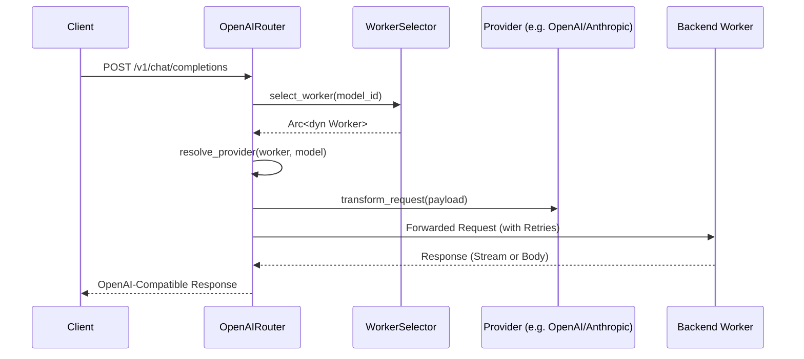
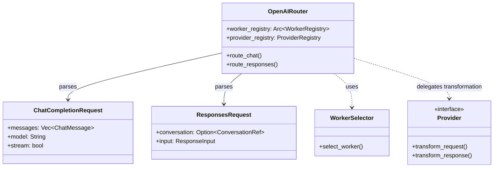

<!-- source: DeepWiki mcp.deepwiki.com · repo smg-project/smg · page 3.1 OpenAI-Compatible Inference API · fetched 2026-10-21 -->

# OpenAI-Compatible Inference API

Relevant source files

The following files were used as context for generating this wiki page:

- [crates/protocols/src/chat.rs](crates/protocols/src/chat.rs)
- [crates/protocols/src/common.rs](crates/protocols/src/common.rs)
- [crates/protocols/src/completion.rs](crates/protocols/src/completion.rs)
- [crates/protocols/src/generate.rs](crates/protocols/src/generate.rs)
- [crates/protocols/src/interactions.rs](crates/protocols/src/interactions.rs)
- [crates/protocols/src/lib.rs](crates/protocols/src/lib.rs)
- [crates/protocols/src/multipart.rs](crates/protocols/src/multipart.rs)
- [crates/protocols/src/realtime_conversation.rs](crates/protocols/src/realtime_conversation.rs)
- [crates/protocols/src/rerank.rs](crates/protocols/src/rerank.rs)
- [crates/protocols/src/tokenize.rs](crates/protocols/src/tokenize.rs)
- [crates/protocols/src/transcription.rs](crates/protocols/src/transcription.rs)
- [model_gateway/benches/request_processing.rs](model_gateway/benches/request_processing.rs)
- [model_gateway/benches/router_registry_bench.rs](model_gateway/benches/router_registry_bench.rs)
- [model_gateway/benches/tokenizer_benchmark.rs](model_gateway/benches/tokenizer_benchmark.rs)
- [model_gateway/benches/tool_parser_benchmark.rs](model_gateway/benches/tool_parser_benchmark.rs)
- [model_gateway/src/routers/common/header_utils.rs](model_gateway/src/routers/common/header_utils.rs)
- [model_gateway/src/routers/grpc/common/responses/handlers.rs](model_gateway/src/routers/grpc/common/responses/handlers.rs)
- [model_gateway/src/routers/grpc/utils/metrics.rs](model_gateway/src/routers/grpc/utils/metrics.rs)
- [model_gateway/src/routers/openai/chat.rs](model_gateway/src/routers/openai/chat.rs)
- [model_gateway/src/routers/openai/context.rs](model_gateway/src/routers/openai/context.rs)
- [model_gateway/src/routers/openai/health.rs](model_gateway/src/routers/openai/health.rs)
- [model_gateway/src/routers/openai/responses/history.rs](model_gateway/src/routers/openai/responses/history.rs)
- [model_gateway/src/routers/openai/responses/mod.rs](model_gateway/src/routers/openai/responses/mod.rs)
- [model_gateway/src/routers/openai/responses/route.rs](model_gateway/src/routers/openai/responses/route.rs)
- [model_gateway/src/routers/openai/router.rs](model_gateway/src/routers/openai/router.rs)
- [model_gateway/src/routers/responses/handlers.rs](model_gateway/src/routers/responses/handlers.rs)
- [model_gateway/src/routers/responses/mod.rs](model_gateway/src/routers/responses/mod.rs)
- [model_gateway/tests/api/api_endpoints_test.rs](model_gateway/tests/api/api_endpoints_test.rs)
- [model_gateway/tests/routing/test_openai_routing.rs](model_gateway/tests/routing/test_openai_routing.rs)
- [model_gateway/tests/spec/chat_completion.rs](model_gateway/tests/spec/chat_completion.rs)

The OpenAI-Compatible Inference API serves as the primary HTTP interface for the Shepherd Model Gateway (SMG). It provides a high-fidelity implementation of the OpenAI REST API specification, allowing clients to swap standard OpenAI endpoints for SMG with minimal configuration changes. The API supports chat completions, legacy completions, embeddings, tokenization, and stateful agentic "Responses" workflows.

## Architecture and Request Lifecycle

The `OpenAIRouter` is the central coordinator for all OpenAI-compatible HTTP traffic. It manages a `ProviderRegistry` to handle cross-provider transformations (e.g., converting OpenAI requests to Anthropic or Gemini formats) and interacts with the `WorkerRegistry` to select backend execution targets [model_gateway/src/routers/openai/router.rs:65-74]().

### Request Flow Diagram

The following diagram illustrates the data flow from an incoming HTTP request to an upstream worker.

**Title: OpenAI Request Processing Pipeline**

Sources: [model_gateway/src/routers/openai/router.rs:157-177](), [model_gateway/src/routers/openai/chat.rs:45-87](), [model_gateway/src/routers/openai/router.rs:51-63]()

## Supported Endpoints

### Chat Completions (`/v1/chat/completions`)
The primary endpoint for conversational AI. It supports the full `ChatCompletionRequest` schema, including system, user, assistant, and tool messages [crates/protocols/src/chat.rs:28-60]().

*   **Streaming**: Supported via Server-Sent Events (SSE) [model_gateway/src/routers/openai/chat.rs:170-171]().
*   **Reasoning Content**: Extension for O1-style models, allowing extraction of chain-of-thought blocks [crates/protocols/src/chat.rs:45-45]().
*   **Normalization**: Automatically migrates deprecated fields (e.g., `max_tokens` to `max_completion_tokens`, `functions` to `tools`) to ensure backend compatibility [model_gateway/tests/spec/chat_completion.rs:15-45]().

### Completions (`/v1/completions`)
Supports legacy text completion workflows. While deprecated in the OpenAI spec, SMG maintains support for compatibility with older tools and specific base model prompting [crates/protocols/src/completion.rs:20-149]().

### Responses API (`/v1/responses`)
A stateful, agentic extension of the chat API. It handles conversation history management and Model Context Protocol (MCP) tool execution [model_gateway/src/routers/openai/responses/mod.rs:1-10]().

*   **History Loading**: Automatically fetches previous messages from `ConversationStorage` or `ResponseStorage` based on `conversation_id` or `previous_response_id` [model_gateway/src/routers/openai/responses/history.rs:34-43]().
*   **MCP Integration**: Intercepts tool calls to execute local or remote MCP tools before returning the final response to the user [model_gateway/src/routers/openai/responses/mod.rs:5-8]().

### Utility Endpoints
*   **/v1/embeddings**: Generates vector representations of input text.
*   **/v1/tokenize**: Returns token IDs for a given string using the model's specific tokenizer.
*   **/v1/detokenize**: Converts token IDs back into human-readable text.
*   **/v1/audio/transcriptions**: Speech-to-text processing.
*   **/v1/realtime**: WebSocket and WebRTC based low-latency interaction [model_gateway/src/routers/openai/router.rs:194-208]().

Sources: [crates/protocols/src/chat.rs:143-180](), [model_gateway/src/routers/openai/responses/route.rs:42-48](), [model_gateway/src/routers/openai/router.rs:13-20]()

## Implementation Details

### Provider Transformation
The `resolve_provider` function determines which transformation logic to apply to a request [model_gateway/src/routers/openai/router.rs:51-63](). If a worker targets a non-OpenAI backend (like Anthropic), the `Provider` trait implementation handles:
1.  **Request Mapping**: Translating JSON fields (e.g., mapping `max_completion_tokens` to `max_tokens` for specific backends) [model_gateway/src/routers/openai/chat.rs:111-121]().
2.  **Header Injection**: Applying provider-specific authentication headers (e.g., `x-api-key` for Anthropic or `x-goog-api-key` for Gemini) [model_gateway/src/routers/common/header_utils.rs:158-180]().

### Resilience and Retries
Chat requests are wrapped in a `RetryExecutor`. If an upstream worker returns a retryable status code (e.g., 429 or 503), SMG will attempt to re-route the request to a different healthy worker [model_gateway/src/routers/openai/chat.rs:154-164]().

### Entity Mapping
The following diagram maps the API concepts to their internal Rust implementations.

**Title: API to Code Entity Mapping**

Sources: [model_gateway/src/routers/openai/router.rs:65-74](), [crates/protocols/src/chat.rs:143-180](), [model_gateway/src/routers/openai/chat.rs:65-66](), [model_gateway/src/routers/openai/context.rs:14-18]()

## Data Schemas and Validation

SMG enforces strict validation on incoming requests using the `validator` crate.

| Feature | Logic | Source |
| :--- | :--- | :--- |
| **Stop Sequences** | Max 4 sequences, non-empty strings required. | [crates/protocols/src/common.rs:156-181]() |
| **Sampling Params** | Temperature [0, 2], Top-p [0, 1], Presence Penalty [-2, 2]. | [crates/protocols/src/chat.rs:152-198]() |
| **Multimodal** | Supports `image_url`, `audio_url`, `video_url`, and `input_audio` parts. | [crates/protocols/src/common.rs:189-200]() |
| **Normalization** | Merges `functions` into `tools` and `function_call` into `tool_choice`. | [model_gateway/tests/spec/chat_completion.rs:74-143]() |

Sources: [crates/protocols/src/chat.rs:141-143](), [crates/protocols/src/completion.rs:18-20](), [crates/protocols/src/common.rs:187-200]()

---

