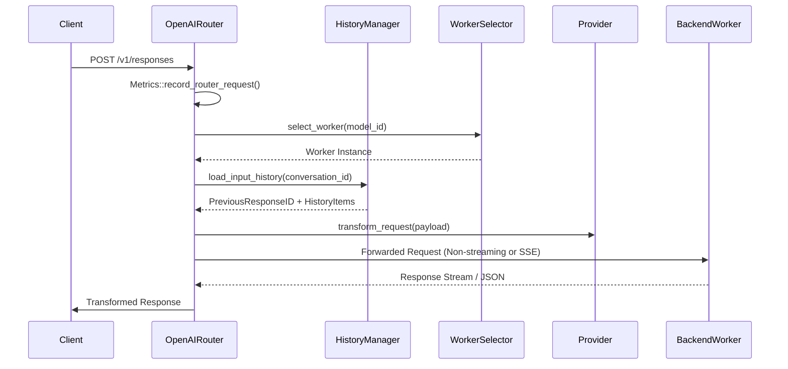
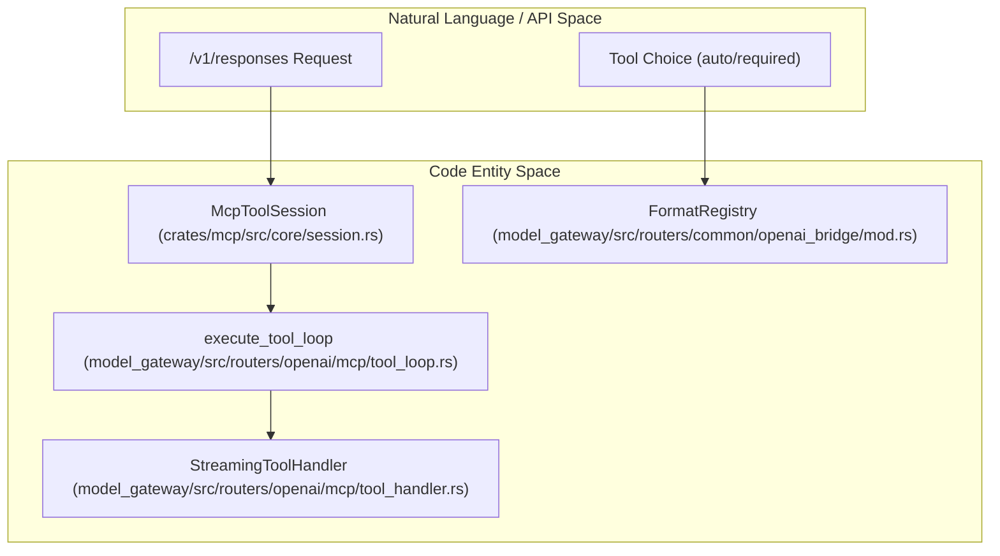
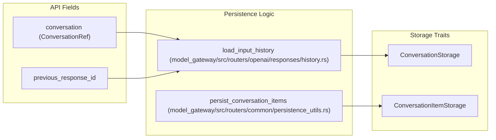

<!-- source: DeepWiki mcp.deepwiki.com · repo smg-project/smg · page 3.2 Responses API (Agentic Workflows) · fetched 2026-10-21 -->

# Responses API (Agentic Workflows)

Relevant source files

The following files were used as context for generating this wiki page:

- [crates/mcp/src/core/session.rs](crates/mcp/src/core/session.rs)
- [crates/protocols/src/builders/responses/response.rs](crates/protocols/src/builders/responses/response.rs)
- [crates/protocols/src/responses.rs](crates/protocols/src/responses.rs)
- [crates/protocols/tests/responses.rs](crates/protocols/tests/responses.rs)
- [model_gateway/benches/routing_allocation_bench.rs](model_gateway/benches/routing_allocation_bench.rs)
- [model_gateway/src/routers/common/header_utils.rs](model_gateway/src/routers/common/header_utils.rs)
- [model_gateway/src/routers/common/mcp_utils.rs](model_gateway/src/routers/common/mcp_utils.rs)
- [model_gateway/src/routers/common/openai_bridge/connect.rs](model_gateway/src/routers/common/openai_bridge/connect.rs)
- [model_gateway/src/routers/common/openai_bridge/format_descriptor.rs](model_gateway/src/routers/common/openai_bridge/format_descriptor.rs)
- [model_gateway/src/routers/common/openai_bridge/mod.rs](model_gateway/src/routers/common/openai_bridge/mod.rs)
- [model_gateway/src/routers/common/persistence_utils.rs](model_gateway/src/routers/common/persistence_utils.rs)
- [model_gateway/src/routers/grpc/common/responses/handlers.rs](model_gateway/src/routers/grpc/common/responses/handlers.rs)
- [model_gateway/src/routers/grpc/harmony/builder.rs](model_gateway/src/routers/grpc/harmony/builder.rs)
- [model_gateway/src/routers/grpc/regular/responses/conversions.rs](model_gateway/src/routers/grpc/regular/responses/conversions.rs)
- [model_gateway/src/routers/openai/chat.rs](model_gateway/src/routers/openai/chat.rs)
- [model_gateway/src/routers/openai/context.rs](model_gateway/src/routers/openai/context.rs)
- [model_gateway/src/routers/openai/health.rs](model_gateway/src/routers/openai/health.rs)
- [model_gateway/src/routers/openai/mcp/tool_handler.rs](model_gateway/src/routers/openai/mcp/tool_handler.rs)
- [model_gateway/src/routers/openai/mcp/tool_loop.rs](model_gateway/src/routers/openai/mcp/tool_loop.rs)
- [model_gateway/src/routers/openai/responses/accumulator.rs](model_gateway/src/routers/openai/responses/accumulator.rs)
- [model_gateway/src/routers/openai/responses/common.rs](model_gateway/src/routers/openai/responses/common.rs)
- [model_gateway/src/routers/openai/responses/history.rs](model_gateway/src/routers/openai/responses/history.rs)
- [model_gateway/src/routers/openai/responses/mod.rs](model_gateway/src/routers/openai/responses/mod.rs)
- [model_gateway/src/routers/openai/responses/non_streaming.rs](model_gateway/src/routers/openai/responses/non_streaming.rs)
- [model_gateway/src/routers/openai/responses/route.rs](model_gateway/src/routers/openai/responses/route.rs)
- [model_gateway/src/routers/openai/responses/streaming.rs](model_gateway/src/routers/openai/responses/streaming.rs)
- [model_gateway/src/routers/openai/responses/utils.rs](model_gateway/src/routers/openai/responses/utils.rs)
- [model_gateway/src/routers/openai/router.rs](model_gateway/src/routers/openai/router.rs)
- [model_gateway/src/routers/responses/handlers.rs](model_gateway/src/routers/responses/handlers.rs)
- [model_gateway/src/routers/responses/mod.rs](model_gateway/src/routers/responses/mod.rs)
- [model_gateway/src/workflow/mcp_registration.rs](model_gateway/src/workflow/mcp_registration.rs)
- [model_gateway/tests/api/responses_api_test.rs](model_gateway/tests/api/responses_api_test.rs)
- [model_gateway/tests/spec/responses.rs](model_gateway/tests/spec/responses.rs)

The `/v1/responses` endpoint facilitates stateful, multi-turn agentic workflows. Unlike the stateless chat completions API, the Responses API manages conversation history internally, supports complex tool execution loops (including Model Context Protocol integration), and handles specialized output items like reasoning and file searches.

## 1. Request and Response Schemas

The Responses API utilizes a distinct set of types designed for structured agentic interactions, primarily defined in `crates/protocols/src/responses.rs`.

### Tool Choice and Built-in Tools
The API supports standard options (`none`, `auto`, `required`) and specific tool types. A key difference from the Chat API is the flat structure for function tool choice: `{"type": "function", "name": "..."}` [crates/protocols/src/responses.rs:105-124]().

Supported built-in tools include:
*   `web_search` / `web_search_preview`
*   `image_generation`
*   `computer_use_preview`
*   `file_search`
*   `code_interpreter`

### Input and Output Items
Requests can provide input as raw text or a sequence of `ResponseInputOutputItem` objects [crates/protocols/src/responses.rs:46-54](). Output items include:
*   `message`: Standard assistant responses.
*   `reasoning`: Chain-of-thought blocks [crates/protocols/tests/responses.rs:14-23]().
*   `function_call` / `function_call_output`: Tool interaction records.
*   `mcp_call`: Specialized Model Context Protocol tool calls [model_gateway/src/routers/openai/mcp/tool_loop.rs:160-170]().

### Data Flow: Request Orchestration
The following diagram illustrates the lifecycle of a request to the `/v1/responses` endpoint.

**Responses Request Flow**

**Sources:** [model_gateway/src/routers/openai/router.rs:179-192](), [model_gateway/src/routers/openai/responses/route.rs:42-186]().

---

## 2. Tool Execution Loop and MCP Integration

SMG implements a stateful tool execution loop that allows the model to perform multiple tool calls in a single request turn. This is particularly relevant for **Model Context Protocol (MCP)** tools.

### The Tool Loop Logic
When a request includes MCP tools, SMG intercepts the model's function calls and executes them locally or via remote MCP servers before potentially "resuming" the conversation with the model using the tool results.

1.  **Interception**: Function calls from the backend are checked against the `McpToolSession` [model_gateway/src/routers/openai/mcp/tool_loop.rs:170-180]().
2.  **Execution**: The `McpOrchestrator` executes the tool [crates/mcp/src/core/session.rs:112-135]().
3.  **Transformation**: Results are transformed into the appropriate `ResponseFormat` (e.g., `web_search_call`, `mcp_call`) [model_gateway/src/routers/openai/mcp/tool_loop.rs:201-210]().
4.  **Iteration**: If `max_iterations` is not reached, SMG may send the results back to the LLM to continue the response [model_gateway/src/routers/openai/responses/non_streaming.rs:104-117]().

**Entity Mapping: Tool Loop Components**

**Sources:** [crates/mcp/src/core/session.rs:68-86](), [model_gateway/src/routers/openai/mcp/tool_loop.rs:42-55](), [model_gateway/src/routers/openai/responses/non_streaming.rs:87-102]().

---

## 3. Streaming and SSE Events

Streaming in the Responses API uses Server-Sent Events (SSE). SMG manages the complexity of multi-turn tool calls by injecting intermediate events into the stream.

### Key Streaming Functions
*   `handle_streaming_response`: The entry point for SSE requests [model_gateway/src/routers/openai/responses/streaming.rs:1-9]().
*   `apply_event_transformations_inplace`: Efficiently modifies JSON payloads in the stream to mask internal tool formats or inject metadata like `previous_response_id` [model_gateway/src/routers/openai/responses/streaming.rs:69-83]().
*   `StreamingResponseAccumulator`: Collects chunks to allow persistence of the full conversation even when streamed [model_gateway/src/routers/openai/responses/accumulator.rs:1-10]().

### Event Transformation
SMG rewrites `function_call` events into `mcp_call` or `web_search_call` based on the `McpToolSession` configuration [model_gateway/src/routers/openai/responses/streaming.rs:133-150]().

**Sources:** [model_gateway/src/routers/openai/responses/streaming.rs:69-130](), [model_gateway/src/routers/openai/responses/utils.rs:135-150]().

---

## 4. Conversation History Management

The Responses API is stateful. SMG handles the resolution of `conversation_id` and `previous_response_id` to provide the backend with the necessary context.

### History Resolution Logic
1.  **Conflict Validation**: The API ensures that `conversation` and `previous_response_id` are mutually exclusive in a single request [model_gateway/src/routers/openai/responses/route.rs:92-110]().
2.  **Loading**: `load_input_history` queries the `ConversationStorage` and `ConversationItemStorage` to reconstruct the thread [model_gateway/src/routers/openai/responses/route.rs:116-126]().
3.  **Persistence**: After a successful turn, `persist_conversation_items` saves new messages, tool calls, and reasoning blocks to the database [model_gateway/src/routers/openai/responses/non_streaming.rs:186-194]().

**History Entity Mapping**

**Sources:** [model_gateway/src/routers/openai/responses/route.rs:88-110](), [model_gateway/src/routers/openai/responses/non_streaming.rs:181-194]().

---

## 5. Protocol Conversions (gRPC Harmony)

For backends using the Harmony protocol (e.g., `gpt-oss`), SMG performs deep translation between OpenAI Responses types and Harmony's internal representation.

*   **Request Conversion**: `responses_to_chat` maps Response items (messages, tool calls, reasoning) into a flat chat message list suitable for backend processing [model_gateway/src/routers/grpc/regular/responses/conversions.rs:34-54]().
*   **Harmony Encoding**: Uses `openai-harmony` to encode content into specific channel tags for tools like `web_search` or `code_interpreter` [model_gateway/src/routers/grpc/harmony/builder.rs:108-136]().
*   **Reasoning Extraction**: Extracts reasoning content from the Harmony stream and packages it into `ResponseOutputItem::Reasoning` [model_gateway/src/routers/grpc/regular/responses/conversions.rs:119-135]().

**Sources:** [model_gateway/src/routers/grpc/regular/responses/conversions.rs:10-34](), [model_gateway/src/routers/grpc/harmony/builder.rs:178-195]().

---

