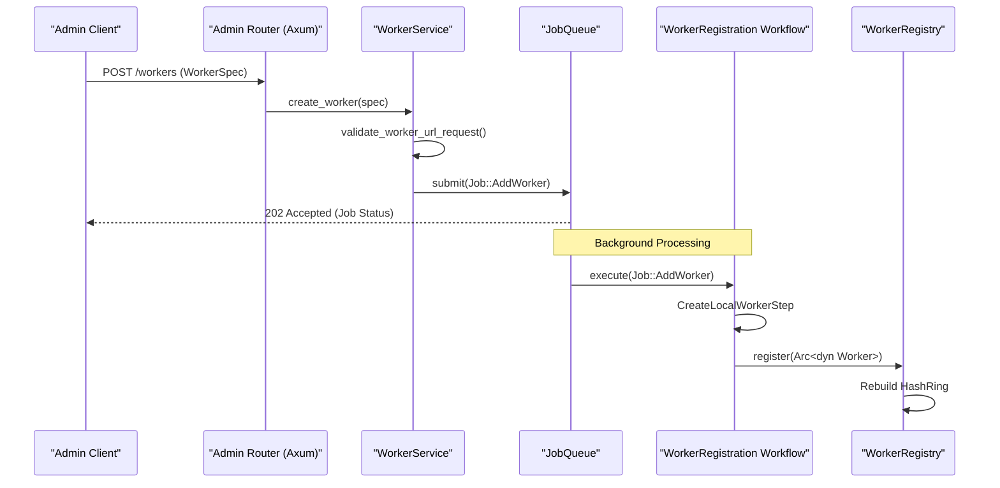

<!-- source: DeepWiki mcp.deepwiki.com · repo smg-project/smg · page 3.3 Control Plane (Admin) API · fetched 2026-10-21 -->

# Control Plane (Admin) API

<details>
<summary>Relevant source files</summary>

The following files were used as context for generating this wiki page:

- [README.md](README.md)
- [docs/assets/images/architecture-animated.svg](docs/assets/images/architecture-animated.svg)
- [docs/assets/images/concepts-overview.svg](docs/assets/images/concepts-overview.svg)
- [docs/assets/images/mcp-architecture.svg](docs/assets/images/mcp-architecture.svg)
- [docs/assets/images/service-discovery.svg](docs/assets/images/service-discovery.svg)
- [docs/assets/images/wasm-plugins.svg](docs/assets/images/wasm-plugins.svg)
- [docs/assets/stylesheets/extra.css](docs/assets/stylesheets/extra.css)
- [docs/concepts/data/chat-history.md](docs/concepts/data/chat-history.md)
- [docs/concepts/index.md](docs/concepts/index.md)
- [docs/concepts/routing/load-balancing.md](docs/concepts/routing/load-balancing.md)
- [docs/concepts/security/authentication.md](docs/concepts/security/authentication.md)
- [docs/contributing/index.md](docs/contributing/index.md)
- [docs/getting-started/control-plane-auth.md](docs/getting-started/control-plane-auth.md)
- [docs/getting-started/control-plane-operations.md](docs/getting-started/control-plane-operations.md)
- [docs/getting-started/data-connections.md](docs/getting-started/data-connections.md)
- [docs/getting-started/index.md](docs/getting-started/index.md)
- [docs/getting-started/mcp.md](docs/getting-started/mcp.md)
- [docs/getting-started/monitoring.md](docs/getting-started/monitoring.md)
- [docs/getting-started/reliability-controls.md](docs/getting-started/reliability-controls.md)
- [docs/index.md](docs/index.md)
- [docs/reference/api/admin.md](docs/reference/api/admin.md)
- [docs/reference/api/extensions.md](docs/reference/api/extensions.md)
- [docs/reference/api/responses.md](docs/reference/api/responses.md)
- [docs/reference/metrics.md](docs/reference/metrics.md)
- [mkdocs.yml](mkdocs.yml)
- [model_gateway/src/config/mod.rs](model_gateway/src/config/mod.rs)
- [model_gateway/src/health.rs](model_gateway/src/health.rs)
- [model_gateway/src/observability/metrics.rs](model_gateway/src/observability/metrics.rs)
- [model_gateway/src/observability/metrics_server.rs](model_gateway/src/observability/metrics_server.rs)
- [model_gateway/src/observability/mod.rs](model_gateway/src/observability/mod.rs)
- [model_gateway/src/observability/runtime_metrics.rs](model_gateway/src/observability/runtime_metrics.rs)
- [model_gateway/src/service_discovery.rs](model_gateway/src/service_discovery.rs)
- [model_gateway/src/worker/registry.rs](model_gateway/src/worker/registry.rs)
- [model_gateway/src/worker/service.rs](model_gateway/src/worker/service.rs)
- [model_gateway/src/workflow/data.rs](model_gateway/src/workflow/data.rs)
- [model_gateway/src/workflow/job_queue.rs](model_gateway/src/workflow/job_queue.rs)
- [model_gateway/src/workflow/mod.rs](model_gateway/src/workflow/mod.rs)
- [model_gateway/src/workflow/steps/local/create_worker.rs](model_gateway/src/workflow/steps/local/create_worker.rs)
- [model_gateway/src/workflow/steps/mod.rs](model_gateway/src/workflow/steps/mod.rs)
- [model_gateway/src/workflow/steps/shared/register.rs](model_gateway/src/workflow/steps/shared/register.rs)
- [model_gateway/tests/harmony_encoding_test.rs](model_gateway/tests/harmony_encoding_test.rs)
- [model_gateway/tests/routing/worker_management_test.rs](model_gateway/tests/routing/worker_management_test.rs)

</details>


The Control Plane (Admin) API provides administrative endpoints for managing the lifecycle of the Shepherd Model Gateway (SMG). It enables dynamic worker registration, tokenizer management, WASM plugin deployment, and real-time observability of the system's load and health status.

## Overview and Data Flow

The Control Plane operates as an asynchronous management layer. When a request is made to an administrative endpoint, the gateway typically validates the input and then submits a `Job` to the `JobQueue`. This ensures that long-running operations—such as worker health probing or tokenizer downloading—do not block the API response.

### Administrative Data Flow

The following diagram illustrates how a worker registration request flows from the Admin API through the system's internal components.

**Admin API Workflow Execution**

Sources: [model_gateway/src/worker/service.rs:112-136](), [model_gateway/src/workflow/job_queue.rs:175-194](), [model_gateway/src/worker/registry.rs:9-13]()

---

## Worker Management

Worker management endpoints allow for the dynamic scaling and reconfiguration of the inference fleet without restarting the gateway.

### Endpoints
*   **POST /workers**: Registers a new backend worker. Triggers the `AddWorker` job [model_gateway/src/workflow/job_queue.rs:36-39]().
*   **PATCH /workers/{id}**: Partially updates worker configuration (e.g., priority, cost, or API keys) [docs/reference/api/admin.md:197-228]().
*   **PUT /workers/{id}**: Re-runs the full registration workflow for an existing worker ID [docs/reference/api/admin.md:232-242]().
*   **DELETE /workers/{id}**: Removes a worker from the pool and stops its health checks [model_gateway/src/worker/service.rs:138-154]().

### Implementation Details
The `WorkerService` acts as the business logic layer, translating HTTP requests into `Job` objects [model_gateway/src/worker/service.rs:1-5](). Validations are performed against the `RouterConfig` to ensure URL safety and prevent orphaned reservations [model_gateway/src/worker/service.rs:24-32]().

**Worker Entity Mapping**
```mermaid
classDiagram
    class WorkerSpec {
        +String url
        +WorkerType worker_type
        +ConnectionMode connection_mode
        +RuntimeType runtime_type
    }
    class WorkerService {
        +create_worker(WorkerSpec)
        +delete_worker(WorkerId)
    }
    class JobQueue {
        +submit(Job)
        -process_job(Job)
    }
    class WorkerRegistry {
        +DashMap workers
        +DashMap model_index
        +register(Worker)
    }

    WorkerService --> JobQueue : "Submits Job::AddWorker"
    JobQueue --> WorkerRegistry : "Finalizes registration"
    WorkerSpec --* WorkerService : "Input Validation"
```
Sources: [model_gateway/src/worker/service.rs:18-22](), [model_gateway/src/worker/registry.rs:91-139](), [model_gateway/src/workflow/job_queue.rs:124-133]()

---

## Tokenizer and WASM Management

SMG supports dynamic management of tokenizers and WebAssembly (WASM) plugins to extend gateway functionality.

### Tokenizer Management (`POST /v1/tokenizers`)
Tokenizers are used for gateway-side tokenization (essential for gRPC mode).
*   **Job Type**: `Job::AddTokenizer` [model_gateway/src/workflow/job_queue.rs:63-65]().
*   **Capabilities**: Supports loading from HuggingFace IDs or local paths [docs/reference/api/admin.md:23-32]().
*   **Lifecycle**: Jobs transition through `pending`, `processing`, and `completed` states [docs/reference/api/admin.md:123-129]().

### WASM Plugin Management (`POST /wasm`)
WASM modules can be dynamically injected into the request/response pipeline.
*   **Job Type**: `Job::AddWasmModule` [model_gateway/src/workflow/job_queue.rs:57-59]().
*   **Workflow**: Handled via `create_wasm_registration_workflow_data` which prepares the runtime environment for the module [model_gateway/src/workflow/job_queue.rs:25-26]().

Sources: [docs/reference/api/admin.md:10-148](), [model_gateway/src/workflow/job_queue.rs:57-68]()

---

## Observability and Cache Control

The Control Plane provides deep insights into the current state of the inference fleet.

### Load Monitoring (`GET /get_loads`)
This endpoint fans out requests to all registered workers to aggregate current KV-cache utilization [docs/reference/api/admin.md:290-296]().
*   **Logic**: Queries every backend (HTTP or gRPC) for their specific load metrics [docs/reference/api/admin.md:296-300]().
*   **Usage**: Critical for verifying the effectiveness of the `cache_aware` routing policy.

### Cache Management (`POST /flush_cache`)
Forces a KV-cache eviction across the fleet.
*   **HTTP Workers**: Sends a flush command to all HTTP-based backends [docs/reference/api/admin.md:269-273]().
*   **Partial Success**: If only a subset of workers succeed, it returns `206 Partial Content` with a list of failed worker URLs [docs/reference/api/admin.md:273-287]().

### Metrics Server
SMG runs a dedicated Prometheus metrics server, typically on port `29000`.
*   **Endpoint**: `GET /metrics` [model_gateway/src/observability/metrics_server.rs:2]().
*   **Implementation**: Uses `PrometheusHandle` to render interner-optimized metrics [model_gateway/src/observability/metrics_server.rs:18-29]().
*   **Upkeep**: A background task runs every 5 minutes to maintain histogram buckets [model_gateway/src/observability/metrics_server.rs:66-71]().

Sources: [docs/reference/api/admin.md:263-300](), [model_gateway/src/observability/metrics_server.rs:1-47]()

---

## Health and Mesh Status

SMG implements standard Kubernetes-compatible health endpoints and mesh synchronization checks.

### Liveness and Readiness
*   **GET /health**: Basic gateway health check.
*   **GET /liveness**: Indicates if the process is running.
*   **GET /readiness**: Indicates if the gateway has initialized its worker pool and is ready to route traffic [docs/reference/api/admin.md:6-7]().

### High Availability (HA) Mesh Status
In a multi-gateway deployment, SMG uses a gossip protocol to synchronize state.
*   **Service Discovery**: The gateway can watch Kubernetes `Pod` resources to automatically register workers based on labels or annotations [model_gateway/src/service_discovery.rs:11-19]().
*   **Mesh Sync**: Node status (Alive/Leaving/Down) is tracked via `NodeState` and published across the cluster [model_gateway/src/service_discovery.rs:22-25]().

Sources: [model_gateway/src/service_discovery.rs:89-107](), [docs/reference/api/admin.md:1-7]()

---

