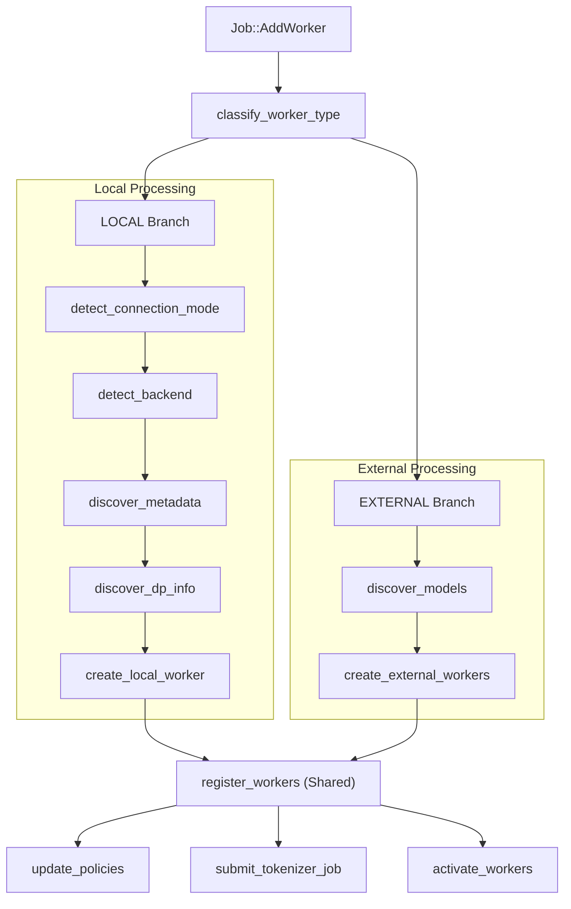
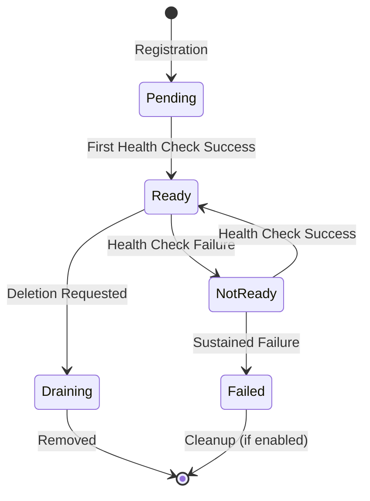

<!-- source: DeepWiki mcp.deepwiki.com · repo smg-project/smg · page 4 Worker Management · fetched 2026-10-21 -->

# Worker Management

Relevant source files

The following files were used as context for generating this wiki page:

- [bindings/golang/src/policy.rs](bindings/golang/src/policy.rs)
- [crates/protocols/src/worker.rs](crates/protocols/src/worker.rs)
- [model_gateway/src/config/mod.rs](model_gateway/src/config/mod.rs)
- [model_gateway/src/policies/least_load.rs](model_gateway/src/policies/least_load.rs)
- [model_gateway/src/policies/power_of_two.rs](model_gateway/src/policies/power_of_two.rs)
- [model_gateway/src/service_discovery.rs](model_gateway/src/service_discovery.rs)
- [model_gateway/src/worker/builder.rs](model_gateway/src/worker/builder.rs)
- [model_gateway/src/worker/capacity.rs](model_gateway/src/worker/capacity.rs)
- [model_gateway/src/worker/manager.rs](model_gateway/src/worker/manager.rs)
- [model_gateway/src/worker/mod.rs](model_gateway/src/worker/mod.rs)
- [model_gateway/src/worker/monitor.rs](model_gateway/src/worker/monitor.rs)
- [model_gateway/src/worker/registry.rs](model_gateway/src/worker/registry.rs)
- [model_gateway/src/worker/service.rs](model_gateway/src/worker/service.rs)
- [model_gateway/src/worker/worker.rs](model_gateway/src/worker/worker.rs)
- [model_gateway/src/workflow/data.rs](model_gateway/src/workflow/data.rs)
- [model_gateway/src/workflow/job_queue.rs](model_gateway/src/workflow/job_queue.rs)
- [model_gateway/src/workflow/mod.rs](model_gateway/src/workflow/mod.rs)
- [model_gateway/src/workflow/steps/local/create_worker.rs](model_gateway/src/workflow/steps/local/create_worker.rs)
- [model_gateway/src/workflow/steps/mod.rs](model_gateway/src/workflow/steps/mod.rs)
- [model_gateway/src/workflow/steps/shared/register.rs](model_gateway/src/workflow/steps/shared/register.rs)
- [model_gateway/tests/harmony_encoding_test.rs](model_gateway/tests/harmony_encoding_test.rs)
- [model_gateway/tests/routing/worker_management_test.rs](model_gateway/tests/routing/worker_management_test.rs)

The Worker Management subsystem is responsible for the full lifecycle of backend inference engines (workers) within SMG. This includes discovery via Kubernetes or manual API registration, health monitoring through a state-machine-driven probe system, and dynamic load tracking for advanced routing policies.

SMG treats workers as abstract entities that implement the `Worker` trait [model_gateway/src/worker/worker.rs:193-193](), allowing the gateway to manage diverse backends like vLLM, SGLang, and TensorRT-LLM through a unified interface.

### Worker Discovery and Lifecycle

Workers enter the system either via the **Control Plane API** (manual registration) or through **Service Discovery** (Kubernetes pod watching). Every registration triggers a background **Workflow DAG** that validates the worker's connection, detects its runtime type, and populates its metadata before adding it to the registry.

#### Registration Workflow DAG
When a worker is added, SMG executes a multi-step workflow [model_gateway/src/workflow/steps/mod.rs:36-65]() to ensure the worker is ready for traffic:

*Sources: [model_gateway/src/workflow/steps/mod.rs:36-65](), [model_gateway/src/workflow/job_queue.rs:35-69]()*

For details on the registration process and Kubernetes integration, see **[Service Discovery and Worker Registry](#4.1)**.

### Centralized Management Entities

The subsystem is built around three core components that coordinate to maintain fleet health:

| Component | Role | File Reference |
| :--- | :--- | :--- |
| `WorkerRegistry` | Lock-free storage for all active workers, indexed by ID and Model. | [model_gateway/src/worker/registry.rs:92-92]() |
| `WorkerManager` | Background coordinator for health check probes and lifecycle transitions. | [model_gateway/src/worker/manager.rs:118-118]() |
| `WorkerMonitor` | High-frequency load monitoring for data-parallel (DP) ranks and policies. | [model_gateway/src/worker/monitor.rs:3-6]() |

#### Worker State Machine
The `WorkerManager` moves workers through a lifecycle inspired by Kubernetes pod conditions [crates/protocols/src/worker.rs:98-130]():

*Sources: [crates/protocols/src/worker.rs:110-130](), [model_gateway/src/worker/manager.rs:138-153]()*

### Backend Abstraction and Communication

SMG supports both HTTP and gRPC communication with workers. The `Worker` trait abstracts these details, allowing the router to interact with backends without knowing the underlying protocol.

*   **HTTP Workers**: Standard OpenAI-compatible backends.
*   **gRPC Workers**: Optimized for high-throughput inference engines like SGLang and vLLM. These utilize specialized **Servicers** to handle advanced features like KV-cache event streaming and multimodal tensor transport.

For details on backend-specific implementations, see **[Backend gRPC Servicers](#4.2)**.

### Reliability and Resilience

To ensure high availability, SMG implements several per-worker resilience mechanisms:
*   **Circuit Breakers**: Prevents cascading failures by "tripping" when a worker's error rate exceeds a threshold [model_gateway/src/worker/circuit_breaker.rs:5-13]().
*   **Health Polling**: Periodic async probes verify backend readiness [model_gateway/src/worker/manager.rs:186-195]().
*   **Load Balancing Integration**: The `WorkerMonitor` tracks real-time metrics (e.g., KV cache usage, request queues) to inform load-aware routing [model_gateway/src/worker/monitor.rs:139-145]().

For details on these mechanisms, see **[Reliability: Circuit Breakers, Health Checks, and Retries](#4.3)**.

### Related Pages
*   **[Service Discovery and Worker Registry](#4.1)**: Deep dive into how workers are found and indexed.
*   **[Backend gRPC Servicers](#4.2)**: Technical details on the Python-side gRPC bridge.
*   **[Reliability: Circuit Breakers, Health Checks, and Retries](#4.3)**: Detailed breakdown of the resilience stack.

**Sources:**
*   `Worker` trait and status: [model_gateway/src/worker/worker.rs:193-210](), [crates/protocols/src/worker.rs:110-130]()
*   `WorkerRegistry` architecture: [model_gateway/src/worker/registry.rs:92-139]()
*   `WorkerManager` lifecycle: [model_gateway/src/worker/manager.rs:107-153]()
*   `WorkerMonitor` load tracking: [model_gateway/src/worker/monitor.rs:1-46]()
*   Workflow DAG: [model_gateway/src/workflow/steps/mod.rs:36-65]()

---

