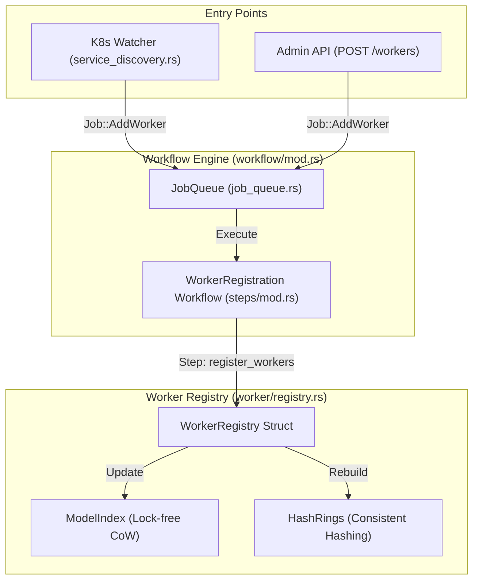
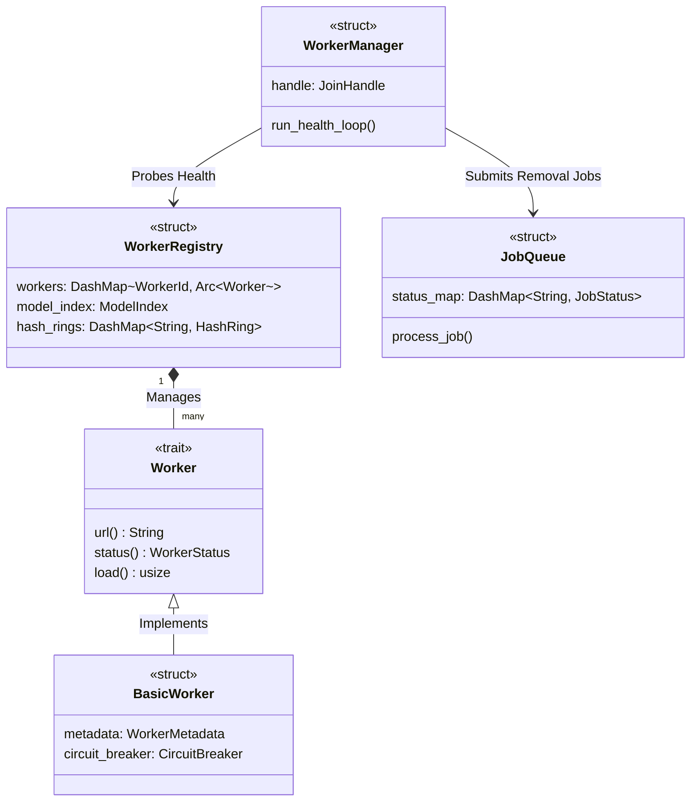

<!-- source: DeepWiki mcp.deepwiki.com · repo smg-project/smg · page 4.1 Service Discovery and Worker Registry · fetched 2026-10-21 -->

# Service Discovery and Worker Registry

Relevant source files

The following files were used as context for generating this wiki page:

- [bindings/golang/src/policy.rs](bindings/golang/src/policy.rs)
- [crates/grpc_client/build.rs](crates/grpc_client/build.rs)
- [crates/protocols/src/worker.rs](crates/protocols/src/worker.rs)
- [model_gateway/src/config/mod.rs](model_gateway/src/config/mod.rs)
- [model_gateway/src/policies/least_load.rs](model_gateway/src/policies/least_load.rs)
- [model_gateway/src/policies/power_of_two.rs](model_gateway/src/policies/power_of_two.rs)
- [model_gateway/src/routers/openai/mod.rs](model_gateway/src/routers/openai/mod.rs)
- [model_gateway/src/routers/openai/provider/mod.rs](model_gateway/src/routers/openai/provider/mod.rs)
- [model_gateway/src/routers/openai/provider/tests.rs](model_gateway/src/routers/openai/provider/tests.rs)
- [model_gateway/src/routers/openai/provider/types.rs](model_gateway/src/routers/openai/provider/types.rs)
- [model_gateway/src/service_discovery.rs](model_gateway/src/service_discovery.rs)
- [model_gateway/src/worker/builder.rs](model_gateway/src/worker/builder.rs)
- [model_gateway/src/worker/capacity.rs](model_gateway/src/worker/capacity.rs)
- [model_gateway/src/worker/manager.rs](model_gateway/src/worker/manager.rs)
- [model_gateway/src/worker/mod.rs](model_gateway/src/worker/mod.rs)
- [model_gateway/src/worker/monitor.rs](model_gateway/src/worker/monitor.rs)
- [model_gateway/src/worker/registry.rs](model_gateway/src/worker/registry.rs)
- [model_gateway/src/worker/service.rs](model_gateway/src/worker/service.rs)
- [model_gateway/src/worker/worker.rs](model_gateway/src/worker/worker.rs)
- [model_gateway/src/workflow/data.rs](model_gateway/src/workflow/data.rs)
- [model_gateway/src/workflow/job_queue.rs](model_gateway/src/workflow/job_queue.rs)
- [model_gateway/src/workflow/mod.rs](model_gateway/src/workflow/mod.rs)
- [model_gateway/src/workflow/steps/classify.rs](model_gateway/src/workflow/steps/classify.rs)
- [model_gateway/src/workflow/steps/local/create_worker.rs](model_gateway/src/workflow/steps/local/create_worker.rs)
- [model_gateway/src/workflow/steps/local/detect_backend.rs](model_gateway/src/workflow/steps/local/detect_backend.rs)
- [model_gateway/src/workflow/steps/local/discover_dp.rs](model_gateway/src/workflow/steps/local/discover_dp.rs)
- [model_gateway/src/workflow/steps/local/discover_metadata.rs](model_gateway/src/workflow/steps/local/discover_metadata.rs)
- [model_gateway/src/workflow/steps/mod.rs](model_gateway/src/workflow/steps/mod.rs)
- [model_gateway/src/workflow/steps/shared/register.rs](model_gateway/src/workflow/steps/shared/register.rs)
- [model_gateway/src/workflow/steps/util.rs](model_gateway/src/workflow/steps/util.rs)
- [model_gateway/tests/harmony_encoding_test.rs](model_gateway/tests/harmony_encoding_test.rs)
- [model_gateway/tests/routing/worker_management_test.rs](model_gateway/tests/routing/worker_management_test.rs)

The **Service Discovery and Worker Registry** subsystem is responsible for the lifecycle management of backend inference workers. It provides mechanisms for automatic discovery via Kubernetes, manual registration via the Control Plane API, and a high-performance, lock-free registry for routing lookups.

## Kubernetes Service Discovery

SMG supports native Kubernetes pod watching to automatically discover and register workers. The `ServiceDiscoveryConfig` [model_gateway/src/service_discovery.rs:89-107]() defines how SMG interacts with the Kubernetes API.

### Pod Watching and Filtering
The `build_watcher_config` function [model_gateway/src/service_discovery.rs:170-180]() creates a `kube::runtime::watcher` that filters pods based on label selectors. SMG supports both regular and disaggregated (PD/EPD) modes:
- **Regular Mode**: Uses a single `selector` to find all workers [model_gateway/src/service_discovery.rs:133-139]().
- **Disaggregated Mode**: Aggregates `encode_selector`, `prefill_selector`, and `decode_selector` to monitor specialized roles [model_gateway/src/service_discovery.rs:117-132]().

### Model ID Resolution
Workers discovered via K8s can derive their `model_id` from pod metadata using the `ModelIdSource` enum [model_gateway/src/service_discovery.rs:36-44]():
- `Namespace`: Uses the pod's K8s namespace.
- `Label(key)`: Extracts the value of a specific pod label.
- `Annotation(key)`: Extracts the value of a specific pod annotation.

**Sources:** [model_gateway/src/service_discovery.rs:35-86](), [model_gateway/src/service_discovery.rs:89-164]()

---

## Worker Registry Implementation

The `WorkerRegistry` [model_gateway/src/worker/registry.rs:92-139]() is the central source of truth for all known workers. It is optimized for high-concurrency read access during request routing.

### Lock-Free Read Design
To minimize contention, the registry uses **Copy-on-Write (CoW) snapshots** for its primary indices:
- **`model_index`**: Maps a `model_id` to an `Arc<[Arc<dyn Worker>]>`. Routers can acquire a snapshot of all workers for a model without holding a long-lived lock [model_gateway/src/worker/registry.rs:82-85]().
- **`model_alias_index`**: Maps aliases to canonical model IDs, allowing for transparent model redirection [model_gateway/src/worker/registry.rs:88-88]().
- **`hash_rings`**: Maintains pre-computed `HashRing` structures per model for O(log n) consistent hashing [model_gateway/src/worker/registry.rs:109-111]().

### Worker Status State Machine
Workers transition through several states defined in `WorkerStatus` [crates/protocols/src/worker.rs:110-130]():
- `Pending`: Newly registered; awaiting first health check.
- `Ready`: Health check passed; routable.
- `NotReady`: Failed a readiness probe; temporarily non-routable.
- `Draining`: Marked for removal; handles in-flight requests but accepts no new ones.

**Sources:** [model_gateway/src/worker/registry.rs:92-168](), [crates/protocols/src/worker.rs:98-161]()

---

## Worker Registration Workflow (DAG)

Worker registration is handled asynchronously via a Directed Acyclic Graph (DAG) managed by the `wfaas` (Workflow as a Service) engine. This ensures that complex detection and configuration steps are performed reliably.

### Workflow Steps
The `create_worker_registration_workflow` [model_gateway/src/workflow/steps/mod.rs:66-178]() defines the execution order:

| Step ID | Responsibility |
| :--- | :--- |
| `classify_worker_type` | Determines if the worker is `Local` (managed by SMG) or `External` (e.g., OpenAI API) [model_gateway/src/workflow/steps/classify.rs:1-20](). |
| `detect_connection_mode` | Probes the worker to determine if it uses `HTTP` or `gRPC` [model_gateway/src/workflow/steps/local/detect_connection_mode.rs:1-30](). |
| `detect_backend` | Identifies the inference engine (vLLM, SGLang, TRT-LLM) [model_gateway/src/workflow/steps/local/detect_backend.rs:1-40](). |
| `discover_metadata` | Fetches model names, chat templates, and engine-specific features [model_gateway/src/workflow/steps/local/discover_metadata.rs:1-50](). |
| `discover_dp_info` | Detects Data-Parallel (DP) ranks for engine-internal load balancing [model_gateway/src/workflow/steps/local/discover_dp.rs:1-35](). |
| `create_local_worker` | Instantiates the `Worker` trait object with the gathered configuration [model_gateway/src/workflow/steps/local/create_worker.rs:20-20](). |
| `register_workers` | Commits the worker(s) to the `WorkerRegistry` [model_gateway/src/workflow/steps/shared/register.rs:1-25](). |

### Data-Parallel (DP) Expansion
If `dp_aware` is enabled in the configuration, the `CreateLocalWorkerStep` [model_gateway/src/workflow/steps/local/create_worker.rs:124-136]() expands a single registration request into multiple worker instances, one for each DP rank detected by the `DiscoverDPInfoStep`.

**Sources:** [model_gateway/src/workflow/steps/mod.rs:36-178](), [model_gateway/src/workflow/steps/local/create_worker.rs:19-178]()

---

## Technical Architecture Diagrams

### Worker Registration Data Flow
This diagram traces a registration request from the API/K8s into the `WorkerRegistry`.

**Sources:** [model_gateway/src/workflow/job_queue.rs:34-69](), [model_gateway/src/worker/registry.rs:92-139](), [model_gateway/src/workflow/steps/mod.rs:38-65]()

### Code Entity Relationship
Associating system concepts with specific Rust structs and traits.

**Sources:** [model_gateway/src/worker/worker.rs:193-215](), [model_gateway/src/worker/registry.rs:92-139](), [model_gateway/src/worker/manager.rs:118-136](), [model_gateway/src/workflow/job_queue.rs:124-133]()

---

