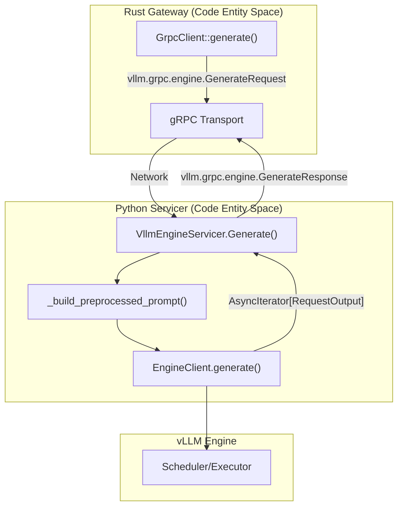
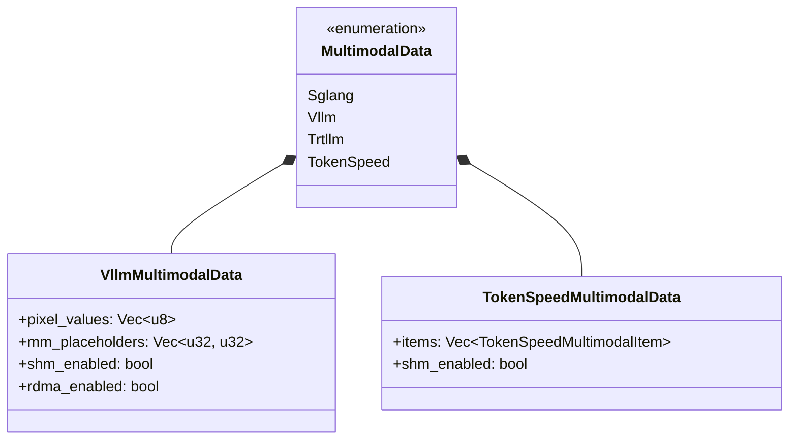

<!-- source: DeepWiki mcp.deepwiki.com · repo smg-project/smg · page 4.2 Backend gRPC Servicers · fetched 2026-10-21 -->

# Backend gRPC Servicers

Relevant source files

The following files were used as context for generating this wiki page:

- [crates/grpc_client/proto/common.proto](crates/grpc_client/proto/common.proto)
- [crates/grpc_client/proto/tokenspeed_scheduler.proto](crates/grpc_client/proto/tokenspeed_scheduler.proto)
- [crates/grpc_client/proto/trtllm_service.proto](crates/grpc_client/proto/trtllm_service.proto)
- [crates/grpc_client/proto/vllm_engine.proto](crates/grpc_client/proto/vllm_engine.proto)
- [crates/grpc_client/python/README.md](crates/grpc_client/python/README.md)
- [crates/grpc_client/python/pyproject.toml](crates/grpc_client/python/pyproject.toml)
- [crates/grpc_client/src/abort_on_drop.rs](crates/grpc_client/src/abort_on_drop.rs)
- [crates/grpc_client/src/channel.rs](crates/grpc_client/src/channel.rs)
- [crates/grpc_client/src/lib.rs](crates/grpc_client/src/lib.rs)
- [crates/grpc_client/src/mlx_engine.rs](crates/grpc_client/src/mlx_engine.rs)
- [crates/grpc_client/src/sglang_scheduler.rs](crates/grpc_client/src/sglang_scheduler.rs)
- [crates/grpc_client/src/tokenspeed_scheduler.rs](crates/grpc_client/src/tokenspeed_scheduler.rs)
- [crates/grpc_client/src/trtllm_service.rs](crates/grpc_client/src/trtllm_service.rs)
- [crates/grpc_client/src/vllm_engine.rs](crates/grpc_client/src/vllm_engine.rs)
- [docs/getting-started/kv-events-cache-aware.md](docs/getting-started/kv-events-cache-aware.md)
- [e2e_test/responses/test_sampling_params.py](e2e_test/responses/test_sampling_params.py)
- [grpc_servicer/DEVELOPMENT.md](grpc_servicer/DEVELOPMENT.md)
- [grpc_servicer/README.md](grpc_servicer/README.md)
- [grpc_servicer/pyproject.toml](grpc_servicer/pyproject.toml)
- [grpc_servicer/smg_grpc_servicer/__init__.py](grpc_servicer/smg_grpc_servicer/__init__.py)
- [grpc_servicer/smg_grpc_servicer/kv_events.py](grpc_servicer/smg_grpc_servicer/kv_events.py)
- [grpc_servicer/smg_grpc_servicer/mlx/__init__.py](grpc_servicer/smg_grpc_servicer/mlx/__init__.py)
- [grpc_servicer/smg_grpc_servicer/mlx/health_servicer.py](grpc_servicer/smg_grpc_servicer/mlx/health_servicer.py)
- [grpc_servicer/smg_grpc_servicer/mlx/server.py](grpc_servicer/smg_grpc_servicer/mlx/server.py)
- [grpc_servicer/smg_grpc_servicer/mlx/servicer.py](grpc_servicer/smg_grpc_servicer/mlx/servicer.py)
- [grpc_servicer/smg_grpc_servicer/sglang/__init__.py](grpc_servicer/smg_grpc_servicer/sglang/__init__.py)
- [grpc_servicer/smg_grpc_servicer/sglang/health_servicer.py](grpc_servicer/smg_grpc_servicer/sglang/health_servicer.py)
- [grpc_servicer/smg_grpc_servicer/sglang/request_manager.py](grpc_servicer/smg_grpc_servicer/sglang/request_manager.py)
- [grpc_servicer/smg_grpc_servicer/sglang/scheduler_launcher.py](grpc_servicer/smg_grpc_servicer/sglang/scheduler_launcher.py)
- [grpc_servicer/smg_grpc_servicer/sglang/servicer.py](grpc_servicer/smg_grpc_servicer/sglang/servicer.py)
- [grpc_servicer/smg_grpc_servicer/sglang/utils.py](grpc_servicer/smg_grpc_servicer/sglang/utils.py)
- [grpc_servicer/smg_grpc_servicer/tokenspeed/encoder_servicer.py](grpc_servicer/smg_grpc_servicer/tokenspeed/encoder_servicer.py)
- [grpc_servicer/smg_grpc_servicer/tokenspeed/kv_events.py](grpc_servicer/smg_grpc_servicer/tokenspeed/kv_events.py)
- [grpc_servicer/smg_grpc_servicer/tokenspeed/servicer.py](grpc_servicer/smg_grpc_servicer/tokenspeed/servicer.py)
- [grpc_servicer/smg_grpc_servicer/vllm/__init__.py](grpc_servicer/smg_grpc_servicer/vllm/__init__.py)
- [grpc_servicer/smg_grpc_servicer/vllm/health_servicer.py](grpc_servicer/smg_grpc_servicer/vllm/health_servicer.py)
- [grpc_servicer/smg_grpc_servicer/vllm/kv_events.py](grpc_servicer/smg_grpc_servicer/vllm/kv_events.py)
- [grpc_servicer/smg_grpc_servicer/vllm/servicer.py](grpc_servicer/smg_grpc_servicer/vllm/servicer.py)
- [grpc_servicer/tests/conftest.py](grpc_servicer/tests/conftest.py)
- [grpc_servicer/tests/test_token_id_array.py](grpc_servicer/tests/test_token_id_array.py)
- [grpc_servicer/tests/test_tokenspeed_encoder_import.py](grpc_servicer/tests/test_tokenspeed_encoder_import.py)
- [grpc_servicer/tests/test_tokenspeed_kv_events.py](grpc_servicer/tests/test_tokenspeed_kv_events.py)
- [grpc_servicer/tests/test_tokenspeed_kv_events_stream.py](grpc_servicer/tests/test_tokenspeed_kv_events_stream.py)
- [grpc_servicer/tests/test_vllm_kv_events.py](grpc_servicer/tests/test_vllm_kv_events.py)
- [grpc_servicer/tests/test_vllm_kv_events_stream.py](grpc_servicer/tests/test_vllm_kv_events_stream.py)
- [model_gateway/src/routers/grpc/client.rs](model_gateway/src/routers/grpc/client.rs)
- [model_gateway/src/routers/grpc/proto_wrapper.rs](model_gateway/src/routers/grpc/proto_wrapper.rs)
- [model_gateway/src/workflow/steps/local/detect_connection.rs](model_gateway/src/workflow/steps/local/detect_connection.rs)
- [scripts/ci_install_sglang.sh](scripts/ci_install_sglang.sh)
- [scripts/ci_install_tokenspeed.sh](scripts/ci_install_tokenspeed.sh)

Backend gRPC Servicers are Python-side components that bridge the SMG Rust gateway to various inference engines. They implement engine-specific gRPC services defined in the `smg-grpc-proto` package, allowing the gateway to interact with vLLM, SGLang, TokenSpeed, and MLX through a unified interface while supporting advanced features like multimodal tensor handling and KV-cache event bridging.

## Architecture and Data Flow

The servicers act as a translation layer. They receive gRPC requests from the Rust gateway, convert them into the internal request structures required by the specific inference engine, and stream responses back.

### Request Lifecycle Diagram

The following diagram illustrates how a `Generate` request flows from the Rust `GrpcClient` to the Python `VllmEngineServicer` and finally into the vLLM `EngineClient`.

Sources: [model_gateway/src/routers/grpc/client.rs:56-76](), [grpc_servicer/smg_grpc_servicer/vllm/servicer.py:156-200]()

## Supported Servicers

### VllmEngineServicer
Implements the `VllmEngine` service on top of vLLM's `EngineClient` [grpc_servicer/smg_grpc_servicer/vllm/servicer.py:126-141]().
*   **Generate/Embed**: Supports pre-tokenized inputs and preprocessed multimodal tensors.
*   **GetLoads**: Aggregates `SchedulerStats` from vLLM's internal loggers [grpc_servicer/smg_grpc_servicer/vllm/servicer.py:92-123]().
*   **KV Events**: Bridges vLLM `KVEventBatch` to ZMQ for cache-aware routing [grpc_servicer/smg_grpc_servicer/vllm/kv_events.py:42-46]().

### SglangSchedulerServicer
Exposes SGLang's `GrpcRequestManager` via gRPC [grpc_servicer/smg_grpc_servicer/sglang/servicer.py:196-200]().
*   **Orchestration**: Manages requests without local tokenization (tokenization happens in the gateway).
*   **Disaggregation**: Supports `EncodeItemBootstrapInfo` for EPD (Encode-Prefill-Decode) flows [model_gateway/src/routers/grpc/proto_wrapper.rs:48-53]().

### TokenSpeedSchedulerServicer
A minimal servicer implementation for the TokenSpeed engine [grpc_servicer/smg_grpc_servicer/tokenspeed/servicer.py:120-134]().
*   **SHM Transport**: Utilizes `ShmTensorHandle` for high-performance tensor transfer on the same host [grpc_servicer/smg_grpc_servicer/tokenspeed/servicer.py:41-41]().
*   **RDMA Support**: Integrates `RdmaPixelPuller` for remote multimodal data fetching [grpc_servicer/smg_grpc_servicer/tokenspeed/servicer.py:139-145]().

## Multimodal Tensor Handling

SMG uses a specialized transport mechanism to move large multimodal tensors (images/videos) from the gateway to the servicers without the overhead of standard gRPC protobuf serialization when possible.

### Transport Modes
1.  **Inline**: Tensors are sent as `bytes` within the gRPC message [crates/grpc_client/proto/vllm_engine.proto:107-107]().
2.  **SHM (Shared Memory)**: Tensors are written to `/dev/shm` by the gateway, and a `ShmHandle` (file descriptor/path) is sent via gRPC. The servicer then maps this memory [model_gateway/src/routers/grpc/proto_wrapper.rs:107-108]().
3.  **RDMA**: For cross-node transfers, the gateway exports tensors via `RdmaExporter`, and the servicer pulls them using a `RemoteTensorHandle` [model_gateway/src/routers/grpc/proto_wrapper.rs:40-42]().

### Multimodal Data Mapping

Sources: [model_gateway/src/routers/grpc/proto_wrapper.rs:67-132]()

## KV Event Bridging

To support cache-aware routing, the gateway needs to know which KV cache prefixes are present on which worker. The servicers implement `SubscribeKvEvents` to stream these updates.

*   **Mechanism**: The servicer subscribes to the engine's internal event bus (e.g., vLLM's ZMQ publisher or SGLang's `ZmqEventPublisher`) [grpc_servicer/smg_grpc_servicer/sglang/servicer.py:36-37]().
*   **Translation**: Internal events like `BlockStored` or `BlockRemoved` are batched into `common.KvEventBatch` messages [grpc_servicer/smg_grpc_servicer/vllm/kv_events.py:26-26]().
*   **Gateway Consumption**: The Rust gateway receives these streams to update its local Radix tree index for load balancing.

Sources: [crates/grpc_client/proto/common.proto:123-145](), [grpc_servicer/smg_grpc_servicer/kv_events.py:44-46]()

## Key Classes and Functions

| Entity | File Path | Description |
| :--- | :--- | :--- |
| `VllmEngineServicer` | [grpc_servicer/smg_grpc_servicer/vllm/servicer.py:126]() | Main gRPC servicer for vLLM backend. |
| `SglangSchedulerServicer` | [grpc_servicer/smg_grpc_servicer/sglang/servicer.py:196]() | Main gRPC servicer for SGLang backend. |
| `TokenSpeedSchedulerServicer` | [grpc_servicer/smg_grpc_servicer/tokenspeed/servicer.py:120]() | Main gRPC servicer for TokenSpeed backend. |
| `_tensor_from_proto` | [grpc_servicer/smg_grpc_servicer/vllm/servicer.py:77]() | Deserializes `TensorData` (Inline/SHM) into `torch.Tensor`. |
| `resolve_kv_events_config` | [grpc_servicer/smg_grpc_servicer/vllm/kv_events.py:42]() | Detects if the engine is configured to emit KV events. |
| `build_tokenizer_zip` | [grpc_servicer/smg_grpc_servicer/tokenizer_bundle.py:41]() | Bundles tokenizer files for the `GetTokenizer` RPC. |

Sources: [grpc_servicer/smg_grpc_servicer/vllm/servicer.py](), [grpc_servicer/smg_grpc_servicer/sglang/servicer.py](), [grpc_servicer/smg_grpc_servicer/tokenspeed/servicer.py]()

---

