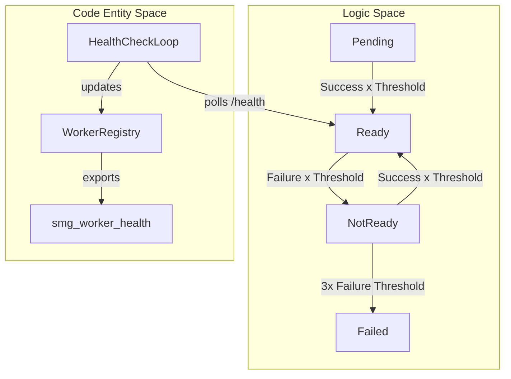
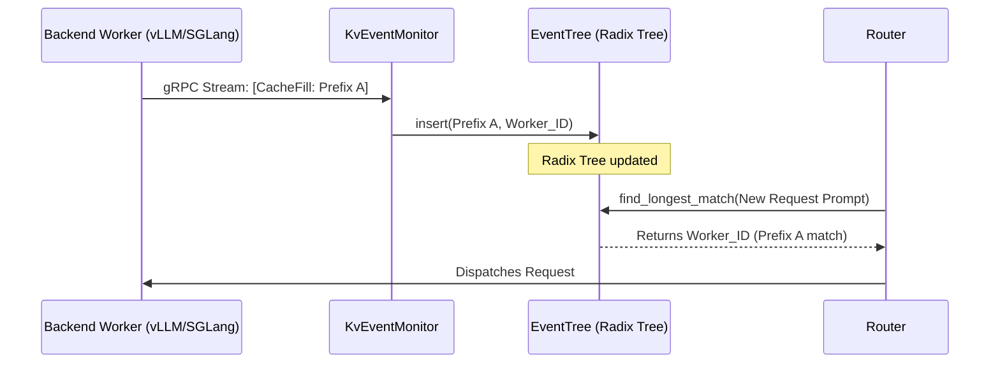

<!-- source: DeepWiki mcp.deepwiki.com · repo smg-project/smg · page 4.3 Reliability: Circuit Breakers, Health Checks, and Retries · fetched 2026-10-21 -->

# Reliability: Circuit Breakers, Health Checks, and Retries

Relevant source files

The following files were used as context for generating this wiki page:

- [crates/kv_index/src/event_tree.rs](crates/kv_index/src/event_tree.rs)
- [docs/assets/images/architecture-detailed.svg](docs/assets/images/architecture-detailed.svg)
- [docs/concepts/architecture/grpc-pipeline.md](docs/concepts/architecture/grpc-pipeline.md)
- [docs/concepts/architecture/high-availability.md](docs/concepts/architecture/high-availability.md)
- [docs/concepts/architecture/overview.md](docs/concepts/architecture/overview.md)
- [docs/concepts/architecture/service-discovery.md](docs/concepts/architecture/service-discovery.md)
- [docs/concepts/extensibility/mcp.md](docs/concepts/extensibility/mcp.md)
- [docs/concepts/extensibility/wasm-plugins.md](docs/concepts/extensibility/wasm-plugins.md)
- [docs/concepts/performance/tokenizer-caching.md](docs/concepts/performance/tokenizer-caching.md)
- [docs/concepts/reliability/circuit-breakers.md](docs/concepts/reliability/circuit-breakers.md)
- [docs/concepts/reliability/graceful-shutdown.md](docs/concepts/reliability/graceful-shutdown.md)
- [docs/concepts/reliability/health-checks.md](docs/concepts/reliability/health-checks.md)
- [docs/concepts/reliability/rate-limiting.md](docs/concepts/reliability/rate-limiting.md)
- [docs/concepts/routing/cache-aware.md](docs/concepts/routing/cache-aware.md)
- [docs/concepts/routing/pd-disaggregation.md](docs/concepts/routing/pd-disaggregation.md)
- [docs/getting-started/pd-disaggregation.md](docs/getting-started/pd-disaggregation.md)
- [docs/reference/index.md](docs/reference/index.md)
- [model_gateway/src/worker/circuit_breaker.rs](model_gateway/src/worker/circuit_breaker.rs)
- [model_gateway/src/worker/error.rs](model_gateway/src/worker/error.rs)
- [model_gateway/src/worker/hash_ring.rs](model_gateway/src/worker/hash_ring.rs)
- [model_gateway/src/worker/kv_event_monitor.rs](model_gateway/src/worker/kv_event_monitor.rs)

This page details the per-worker resilience mechanisms implemented in SMG to ensure high availability and fault tolerance within the inference fleet. These mechanisms proactively monitor worker health, reactively isolate failing nodes, and manage request lifecycle safety through RAII-based load tracking.

## Circuit Breaker State Machine

SMG implements a per-worker circuit breaker to prevent "cascade failures" where a single failing worker slows down the entire system or triggers a retry storm [docs/concepts/reliability/circuit-breakers.md:7-10](). The circuit breaker follows a standard three-state machine logic.

### State Transitions
The state machine transitions based on consecutive success/failure counters rather than a sliding time window [docs/concepts/reliability/circuit-breakers.md:126-127]().

| State | Description | Traffic Flow |
| :--- | :--- | :--- |
| **Closed** | Normal operation. Every request is forwarded to the worker. | Full |
| **Open** | Triggered after `consecutive_failures >= failure_threshold`. Requests are rejected immediately. | None |
| **Half-Open** | Triggered after `cb-timeout-duration-secs`. Allows a limited number of probe requests. | Limited (Probes) |

### Transition Logic
*   **Closed → Open**: Occurs when the `failure_threshold` (default: 10) is reached [docs/concepts/reliability/circuit-breakers.md:122-124, 157]().
*   **Open → Half-Open**: Occurs after a cooling-off period defined by `cb-timeout-duration-secs` (default: 60s) [docs/concepts/reliability/circuit-breakers.md:130, 159]().
*   **Half-Open → Closed**: Occurs if `cb-success-threshold` (default: 3) consecutive requests succeed [docs/concepts/reliability/circuit-breakers.md:132-134, 158]().
*   **Half-Open → Open**: If *any* request fails during the Half-Open state, the circuit immediately trips back to Open [docs/concepts/reliability/circuit-breakers.md:137-138]().

### Configuration Reference
The circuit breaker is configured via the following CLI parameters:
*   `--cb-failure-threshold`: Number of failures to trip the circuit [docs/concepts/reliability/circuit-breakers.md:157]().
*   `--cb-success-threshold`: Number of successes to close the circuit [docs/concepts/reliability/circuit-breakers.md:158]().
*   `--cb-timeout-duration-secs`: Time spent in `Open` state before testing recovery [docs/concepts/reliability/circuit-breakers.md:159]().

Sources: [docs/concepts/reliability/circuit-breakers.md:116-162](), [model_gateway/src/worker/circuit_breaker.rs:1-100]()

## Proactive Health Checks

While circuit breakers are reactive (triggered by real request failures), health checks are proactive background tasks that monitor worker availability [docs/concepts/reliability/health-checks.md:7-10]().

### Worker Lifecycle States
Health checks manage a more granular set of states for workers within the `WorkerRegistry` [docs/concepts/reliability/health-checks.md:77-85]().

*   **Pending**: Newly registered; waiting for first successful probe.
*   **Ready**: Passing health checks; eligible for traffic.
*   **NotReady**: Failed consecutive probes; removed from the active routing pool.
*   **Failed**: Terminal state. Reached after `3 × health-failure-threshold`. Requires manual re-registration or the `--remove-unhealthy-workers` flag [docs/concepts/reliability/health-checks.md:98-100]().

### Logic Flow: Natural Language to Code
The following diagram maps the health check conceptual flow to the internal state management.

Title: Health Check State Management

Sources: [docs/concepts/reliability/health-checks.md:67-101](), [docs/concepts/architecture/service-discovery.md:59-66]()

## Retry Logic and Load Guarding

SMG employs two primary mechanisms to handle transient failures and ensure load accuracy: `WorkerLoadGuard` and retry policies.

### WorkerLoadGuard (RAII Tracking)
To prevent "herding" and ensure load-balancing policies (like `least_load`) have accurate data, SMG uses an RAII-based `WorkerLoadGuard`.
1.  **Acquisition**: When a worker is selected, the guard increments the worker's active request count.
2.  **Release**: When the guard is dropped (at the end of the request scope, even on error), it automatically decrements the count.

### Exponential Backoff Retries
Retries are implemented at the router level. If a request fails with a transient error (e.g., 503 Service Unavailable or a connection timeout), the router selects a *different* worker and retries the request [docs/concepts/architecture/overview.md:230-232]().
*   **Strategy**: Exponential backoff is used to avoid overwhelming the remaining healthy workers [docs/concepts/reliability/rate-limiting.md:276-278]().
*   **Idempotency**: Retries are generally safe for inference requests but are tracked to prevent infinite loops.

Sources: [docs/concepts/architecture/overview.md:226-235](), [docs/concepts/reliability/rate-limiting.md:274-278](), [model_gateway/src/worker/error.rs:1-50]()

## KV Event Monitor

For `cache_aware` routing, SMG must maintain a "mirrored" state of the KV cache present on each worker [docs/concepts/routing/cache-aware.md:7-8]().

### The Event Monitor Loop
The `KvEventMonitor` subscribes to a gRPC stream (or polls an HTTP endpoint) on the backend worker to receive cache events [model_gateway/src/worker/kv_event_monitor.rs:1-20]().
1.  **Event Types**: `CacheHit`, `CacheEvict`, or `CacheFill`.
2.  **Synchronization**: These events are applied to the local `EventTree` (a multi-tenant radix tree) [crates/kv_index/src/event_tree.rs:1-30]().
3.  **Routing Impact**: The `Router` queries this tree to find the worker with the longest prefix match for a new request [docs/concepts/routing/cache-aware.md:156-160]().

Title: KV State Synchronization Flow

Sources: [docs/concepts/routing/cache-aware.md:97-140](), [model_gateway/src/worker/kv_event_monitor.rs:1-50](), [crates/kv_index/src/event_tree.rs:1-50]()

## Graceful Shutdown and Draining

SMG supports graceful shutdown to ensure in-flight requests are not truncated during deployments [docs/concepts/reliability/graceful-shutdown.md:7-8]().

### Shutdown Sequence
1.  **Signal**: Receives `SIGTERM` [docs/concepts/reliability/graceful-shutdown.md:79]().
2.  **Health State**: `/readiness` immediately flips to `503` (reason: "draining"), signaling load balancers to stop sending new traffic [docs/concepts/reliability/graceful-shutdown.md:80, 266]().
3.  **Drain**: The server waits for the `InFlightTracker` (managed by `WorkerLoadGuard`s) to reach zero [docs/concepts/reliability/graceful-shutdown.md:81]().
4.  **Timeout**: If requests exceed `--shutdown-grace-period-secs` (default 180s), the server forces exit [docs/concepts/reliability/graceful-shutdown.md:82, 99]().

Sources: [docs/concepts/reliability/graceful-shutdown.md:71-84, 96-100]()

---

