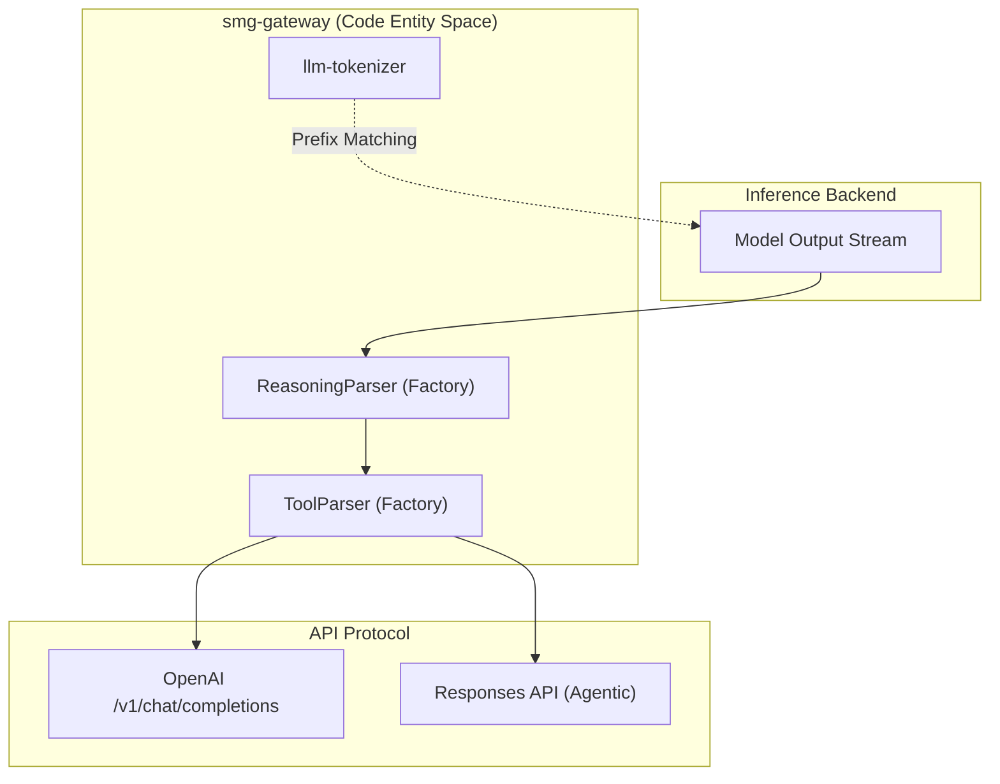
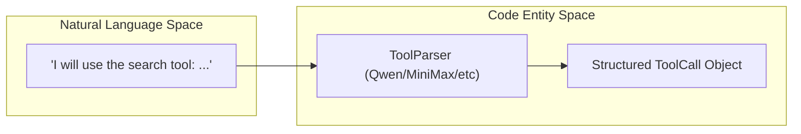

<!-- source: DeepWiki mcp.deepwiki.com · repo smg-project/smg · page 5 Protocol Parsing and Output Processing · fetched 2026-10-21 -->

# Protocol Parsing and Output Processing

Relevant source files

The following files were used as context for generating this wiki page:

- [.github/workflows/release-sglang-docker.yml](.github/workflows/release-sglang-docker.yml)
- [.github/workflows/release-trtllm-docker.yml](.github/workflows/release-trtllm-docker.yml)
- [.github/workflows/release-vllm-docker.yml](.github/workflows/release-vllm-docker.yml)
- [Cargo.toml](Cargo.toml)
- [bindings/golang/Cargo.toml](bindings/golang/Cargo.toml)
- [bindings/python/Cargo.toml](bindings/python/Cargo.toml)
- [bindings/python/pyproject.toml](bindings/python/pyproject.toml)
- [crates/grpc_client/Cargo.toml](crates/grpc_client/Cargo.toml)
- [crates/multimodal/Cargo.toml](crates/multimodal/Cargo.toml)
- [crates/multimodal/src/vision/processor.rs](crates/multimodal/src/vision/processor.rs)
- [crates/protocols/Cargo.toml](crates/protocols/Cargo.toml)
- [crates/reasoning_parser/Cargo.toml](crates/reasoning_parser/Cargo.toml)
- [crates/reasoning_parser/src/factory.rs](crates/reasoning_parser/src/factory.rs)
- [crates/reasoning_parser/src/lib.rs](crates/reasoning_parser/src/lib.rs)
- [crates/reasoning_parser/src/parsers/mod.rs](crates/reasoning_parser/src/parsers/mod.rs)
- [crates/tokenizer/Cargo.toml](crates/tokenizer/Cargo.toml)
- [crates/tool_parser/Cargo.toml](crates/tool_parser/Cargo.toml)
- [crates/tool_parser/src/factory.rs](crates/tool_parser/src/factory.rs)
- [crates/tool_parser/src/lib.rs](crates/tool_parser/src/lib.rs)
- [crates/tool_parser/src/parsers/mod.rs](crates/tool_parser/src/parsers/mod.rs)
- [model_gateway/Cargo.toml](model_gateway/Cargo.toml)

This page provides a high-level overview of the SMG (Shepherd Model Gateway) subsystems responsible for transforming raw model outputs into structured, protocol-compliant data. These components bridge the gap between the "Natural Language Space" (unstructured text streams from LLMs) and the "Code Entity Space" (structured API responses, tool calls, and reasoning blocks).

The processing pipeline typically involves three main stages:
1.  **Tokenization**: Converting text to tokens for routing and cache matching, or rendering chat templates into model-specific prompt formats.
2.  **Reasoning Extraction**: Identifying and isolating "Chain of Thought" or "thinking" blocks (e.g., ``) from the output stream.
3.  **Tool/Function Parsing**: Detecting and extracting structured tool calls (JSON, XML, or custom formats) from the stream to trigger external actions.

## Subsystem Architecture

The following diagram illustrates how raw output from a model (e.g., via `tonic` gRPC) is processed through various parsers before being returned to the client.

### Data Transformation Pipeline

**Sources:** [model_gateway/Cargo.toml:67-82](), [crates/reasoning_parser/src/factory.rs:115-185](), [crates/tool_parser/src/factory.rs:1-50]()

---

## Tokenizer

The `llm-tokenizer` crate is the foundational utility for text-to-token conversion. It supports multiple encoding standards and provides the necessary logic for Jinja2-based chat template rendering.

*   **Capabilities**: Support for HuggingFace `tokenizers`, OpenAI `tiktoken`, and custom encoders for models like Kimi (K2/K3) and DeepSeek.
*   **Caching**: Implements L0/L1 tokenizer caches to support high-performance prefix matching in the `kv-index` for cache-aware routing.
*   **Prompting**: Uses `minijinja` to render complex chat histories into the exact string format expected by the underlying model.

For details, see [Tokenizer](#5.1).

**Sources:** [crates/tokenizer/Cargo.toml:30-39](), [model_gateway/Cargo.toml:72]()

---

## Reasoning Parser

The `reasoning-parser` crate identifies and extracts internal "thinking" content from streaming model outputs. This allows SMG to separate a model's reasoning process from its final answer, which is often required for modern "Reasoning" models (e.g., DeepSeek R1).

*   **Factory Pattern**: The `ParserFactory` [crates/reasoning_parser/src/factory.rs:111-114]() creates specific implementations like `DeepSeekR1Parser`, `Qwen3Parser`, or `KimiK3Parser` based on the model ID.
*   **Stream Handling**: Parsers maintain state to detect start/end tokens (like `<|START_THINKING|>`) and can either buffer or stream reasoning content to the client.

### Reasoning Parser Mapping
| Model Pattern | Parser Implementation | Behavior |
| :--- | :--- | :--- |
| `deepseek_r1` | `DeepSeekR1Parser` | Starts in reasoning mode by default |
| `qwen3` | `Qwen3Parser` | Detects `<thought>` tags |
| `cohere_cmd` | `CohereCmdParser` | Uses `<|START_THINKING|>` tokens |

For details, see [Reasoning Parser](#5.2).

**Sources:** [crates/reasoning_parser/src/factory.rs:120-150](), [crates/reasoning_parser/src/traits.rs:1-15]()

---

## Tool Parser

The `tool-parser` crate is responsible for detecting function-calling syntax. Since different model families use different formats (XML, JSON, or Markdown blocks), this crate provides a unified interface for the gateway to extract tool intents.

*   **Multi-Format Support**: Includes specific parsers for Qwen (XML), MiniMax (M2), GLM4, and standard OpenAI-style JSON.
*   **Integration**: The output of the `ToolParser` is fed into the `smg-mcp` orchestrator or returned via the `/v1/chat/completions` endpoint as `tool_calls`.
*   **API Endpoint**: SMG exposes a standalone `/parse` endpoint to allow external systems to use its parsing logic on arbitrary text.

### Tool Parsing Logic

For details, see [Tool Parser](#5.3).

**Sources:** [model_gateway/Cargo.toml:70](), [crates/tool_parser/src/factory.rs:1-50](), [Cargo.toml:9-10]()

---

