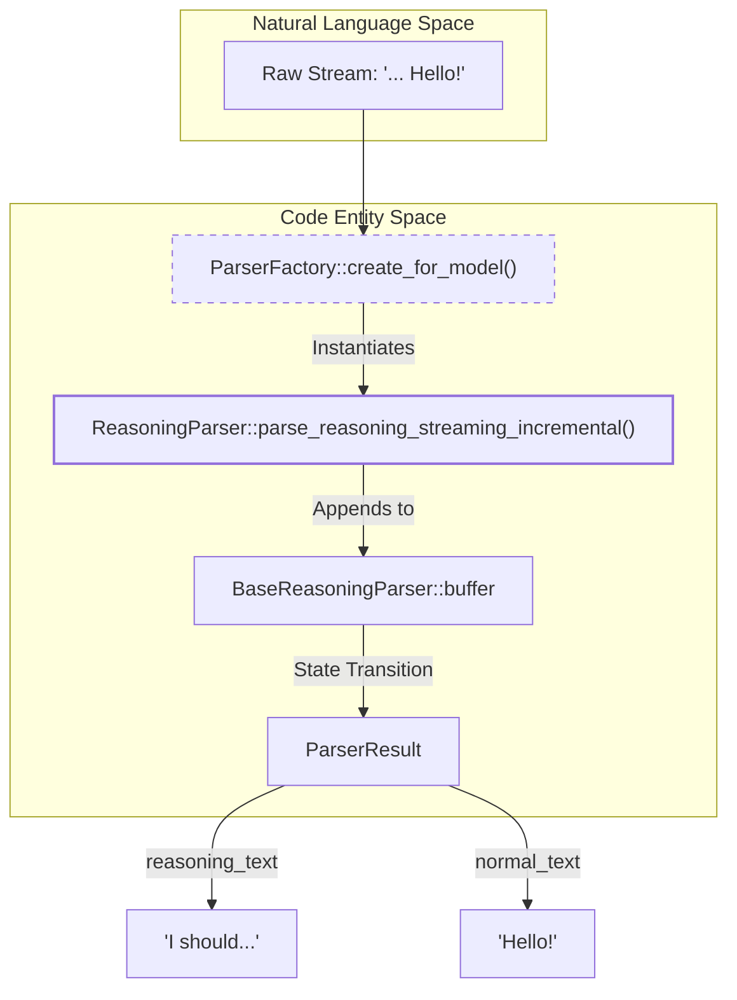
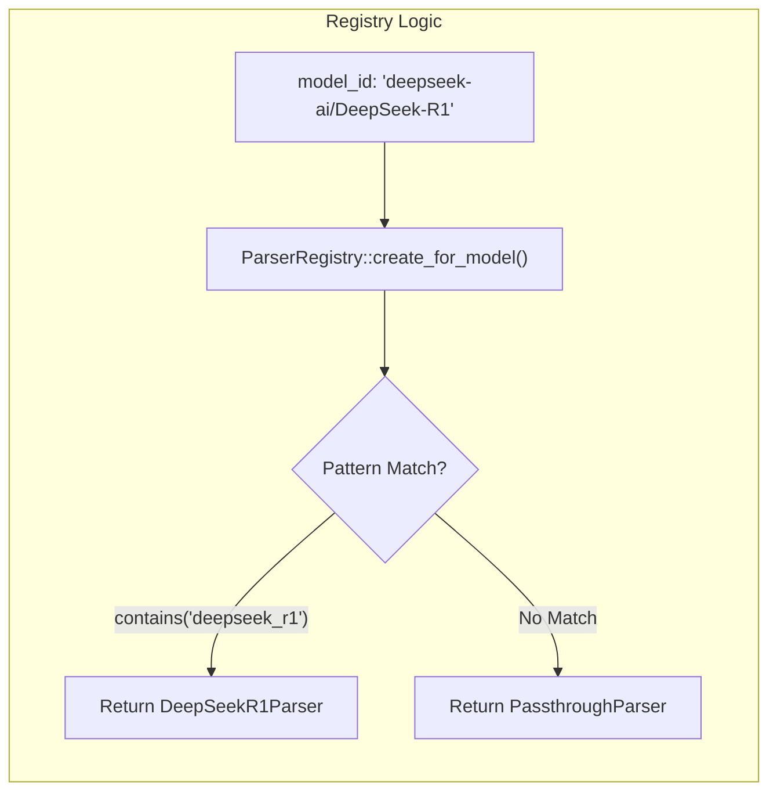

<!-- source: DeepWiki mcp.deepwiki.com · repo smg-project/smg · page 5.2 Reasoning Parser · fetched 2026-10-21 -->

# Reasoning Parser

Relevant source files

The following files were used as context for generating this wiki page:

- [crates/multimodal/src/vision/processor.rs](crates/multimodal/src/vision/processor.rs)
- [crates/reasoning_parser/src/factory.rs](crates/reasoning_parser/src/factory.rs)
- [crates/reasoning_parser/src/lib.rs](crates/reasoning_parser/src/lib.rs)
- [crates/reasoning_parser/src/parsers/base.rs](crates/reasoning_parser/src/parsers/base.rs)
- [crates/reasoning_parser/src/parsers/cohere_cmd.rs](crates/reasoning_parser/src/parsers/cohere_cmd.rs)
- [crates/reasoning_parser/src/parsers/deepseek_r1.rs](crates/reasoning_parser/src/parsers/deepseek_r1.rs)
- [crates/reasoning_parser/src/parsers/glm45.rs](crates/reasoning_parser/src/parsers/glm45.rs)
- [crates/reasoning_parser/src/parsers/kimi.rs](crates/reasoning_parser/src/parsers/kimi.rs)
- [crates/reasoning_parser/src/parsers/kimi_k3.rs](crates/reasoning_parser/src/parsers/kimi_k3.rs)
- [crates/reasoning_parser/src/parsers/minimax.rs](crates/reasoning_parser/src/parsers/minimax.rs)
- [crates/reasoning_parser/src/parsers/mod.rs](crates/reasoning_parser/src/parsers/mod.rs)
- [crates/reasoning_parser/src/parsers/nano_v3.rs](crates/reasoning_parser/src/parsers/nano_v3.rs)
- [crates/reasoning_parser/src/parsers/qwen3.rs](crates/reasoning_parser/src/parsers/qwen3.rs)
- [crates/reasoning_parser/src/parsers/step3.rs](crates/reasoning_parser/src/parsers/step3.rs)
- [crates/tool_parser/src/factory.rs](crates/tool_parser/src/factory.rs)
- [crates/tool_parser/src/lib.rs](crates/tool_parser/src/lib.rs)
- [crates/tool_parser/src/parsers/kimi_k3.rs](crates/tool_parser/src/parsers/kimi_k3.rs)
- [crates/tool_parser/src/parsers/mod.rs](crates/tool_parser/src/parsers/mod.rs)

The `reasoning-parser` crate is responsible for identifying, isolating, and extracting Chain-of-Thought (CoT) "thinking" blocks from LLM output streams. As modern models (such as DeepSeek R1 and Kimi K3) increasingly use explicit reasoning phases, this subsystem ensures that reasoning content is correctly separated from the final response content, allowing SMG to populate the `reasoning_content` field in OpenAI-compatible API responses [crates/reasoning_parser/src/traits.rs:11-13]().

## Architecture and Design

The crate follows a factory pattern, utilizing a central `ParserRegistry` to manage model-specific implementations. The system is designed for high-performance streaming, using buffering techniques to handle partial tokens and markers that might be split across multiple network packets.

### Core Traits and Types

The behavior of all reasoning parsers is defined by the `ReasoningParser` trait [crates/reasoning_parser/src/traits.rs:46-75]().

| Entity | Description |
|:---|:---|
| `ReasoningParser` | Trait defining methods for full-text detection, incremental streaming, and state management [crates/reasoning_parser/src/traits.rs:46-75](). |
| `ParserResult` | Struct containing `normal_text` and `reasoning_text` extracted from a chunk [crates/reasoning_parser/src/traits.rs:11-13](). |
| `ParserConfig` | Configuration for delimiters (`think_start_token`, `think_end_token`) and streaming behavior [crates/reasoning_parser/src/traits.rs:13-14](). |
| `BaseReasoningParser` | A reusable implementation for standard delimiter-based parsing (e.g., ``) [crates/reasoning_parser/src/parsers/base.rs:11-17](). |

**Sources:** [crates/reasoning_parser/src/traits.rs:1-75](), [crates/reasoning_parser/src/parsers/base.rs:1-17]()

### Data Flow: Streaming Extraction

When a stream of tokens arrives from an inference backend, the `ReasoningParser` processes the text through `parse_reasoning_streaming_incremental` [crates/reasoning_parser/src/parsers/base.rs:77-80]().

1.  **Buffering**: Incoming text is appended to an internal buffer to handle cases where a delimiter (e.g., `</think>`) is split across chunks [crates/reasoning_parser/src/parsers/base.rs:87-93]().
2.  **State Tracking**: The parser tracks if it is currently `in_reasoning` [crates/reasoning_parser/src/parsers/base.rs:13-14]().
3.  **Marker Detection**:
    *   If `in_reasoning` is false and a start token is detected, it switches state and strips the marker [crates/reasoning_parser/src/parsers/base.rs:96-101]().
    *   If `in_reasoning` is true and an end token is detected, it splits the buffer into reasoning and normal text, then resets the state [crates/reasoning_parser/src/parsers/base.rs:112-126]().
4.  **Emission**: Validated text is returned as a `ParserResult`, and the buffer is cleared of emitted content [crates/reasoning_parser/src/parsers/base.rs:132-139]().

### Code Entity Space: Reasoning Pipeline

**Sources:** [crates/reasoning_parser/src/factory.rs:83-93](), [crates/reasoning_parser/src/parsers/base.rs:77-144](), [crates/reasoning_parser/src/traits.rs:11-13]()

## Model-Specific Parsers

The `ParserFactory` registers specialized parsers for various model families to handle their unique framing and special tokens [crates/reasoning_parser/src/factory.rs:115-185]().

| Parser Name | Model Family | Logic Description |
|:---|:---|:---|
| `DeepSeekR1Parser` | DeepSeek R1 | Starts with `always_in_reasoning=true`; uses `` [crates/reasoning_parser/src/parsers/deepseek_r1.rs:14-32](). |
| `KimiK3Parser` | Kimi K3 | Uses XTML tags: `<\|open\|>think<\|sep\|>` and `<\|close\|>think<\|sep\|>` [crates/reasoning_parser/src/parsers/kimi_k3.rs:15-22](). |
| `MiniMaxParser` | MiniMax M2 | Prefilled with `<think>`; assumes reasoning from start [crates/reasoning_parser/src/parsers/minimax.rs:14-32](). |
| `CohereCmdParser` | Cohere Command | Uses `<\|START_THINKING\|>` and `<\|END_THINKING\|>` markers [crates/reasoning_parser/src/factory.rs:147-147](). |
| `Qwen3Parser` | Qwen 2.5/3 | Starts with `in_reasoning=false` and detects start tokens [crates/reasoning_parser/src/factory.rs:131-131](). |
| `PassthroughParser` | Generic | Default fallback that treats all text as normal content [crates/reasoning_parser/src/factory.rs:125-125](). |

### Kimi K3 (XTML) Implementation Details

The `KimiK3Parser` is significantly more complex than the base parser because it handles the Kimi-specific XTML format, which involves multiple channels (`think`, `response`, `message`, `tools`) [crates/reasoning_parser/src/parsers/kimi_k3.rs:1-9]().

*   **Marker Detection**: Uses compiled regexes to tolerate whitespace within markers (e.g., `<|open|> think <|sep|>`) [crates/reasoning_parser/src/parsers/kimi_k3.rs:58-77]().
*   **Channel Management**: It identifies the end of the `think` channel not just by a closing marker, but also by the appearance of sibling openers like `response` or `tools` [crates/reasoning_parser/src/parsers/kimi_k3.rs:123-155]().
*   **Content Stripping**: It provides `strip_content_wrapper` to remove `<|open|>response<|sep|>` and similar markers from the final text while preserving the inner content [crates/reasoning_parser/src/parsers/kimi_k3.rs:96-101]().

**Sources:** [crates/reasoning_parser/src/parsers/kimi_k3.rs:1-155](), [crates/reasoning_parser/src/factory.rs:120-185]()

## Factory and Registry

The `ParserRegistry` provides the mapping between model identifiers (strings) and parser implementations [crates/reasoning_parser/src/factory.rs:19-26]().

### Parser Selection Logic

The selection process uses pattern matching against the `model_id` provided in the request:

**Sources:** [crates/reasoning_parser/src/factory.rs:68-93](), [crates/reasoning_parser/src/factory.rs:125-128]()

### Key Functions

*   `register_parser`: Adds a new parser creator function to the registry [crates/reasoning_parser/src/factory.rs:38-44]().
*   `register_pattern`: Maps a substring pattern (e.g., "qwen") to a registered parser name [crates/reasoning_parser/src/factory.rs:48-51]().
*   `create_for_model`: The primary entry point that takes a model ID, iterates through patterns, and returns a fresh parser instance [crates/reasoning_parser/src/factory.rs:83-93]().

**Sources:** [crates/reasoning_parser/src/factory.rs:1-101]()

---

