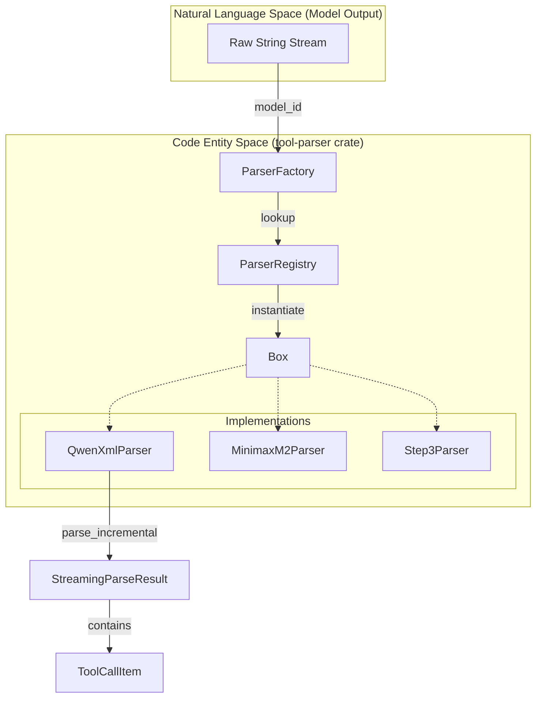
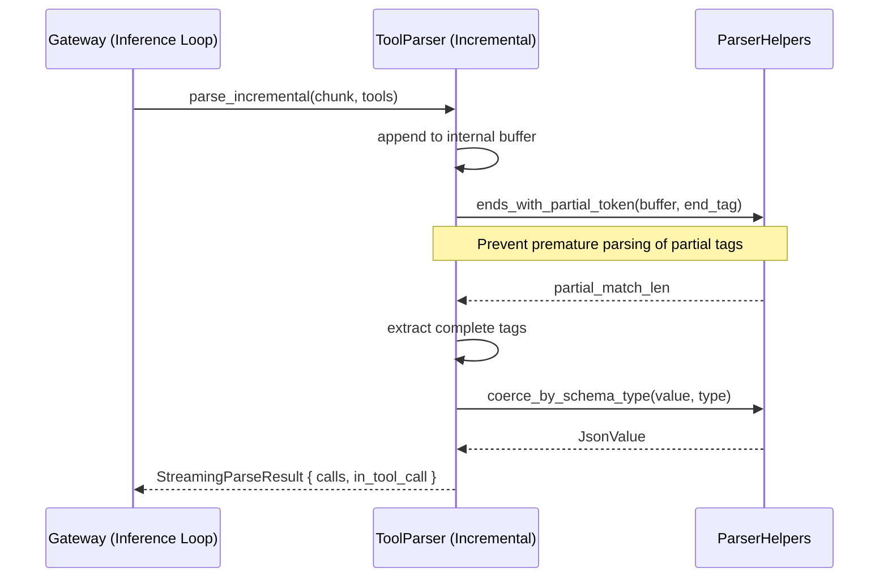

<!-- source: DeepWiki mcp.deepwiki.com · repo smg-project/smg · page 5.3 Tool Parser · fetched 2026-10-21 -->

# Tool Parser

Relevant source files

The following files were used as context for generating this wiki page:

- [crates/multimodal/src/vision/processor.rs](crates/multimodal/src/vision/processor.rs)
- [crates/reasoning_parser/src/factory.rs](crates/reasoning_parser/src/factory.rs)
- [crates/reasoning_parser/src/lib.rs](crates/reasoning_parser/src/lib.rs)
- [crates/reasoning_parser/src/parsers/mod.rs](crates/reasoning_parser/src/parsers/mod.rs)
- [crates/tool_parser/README.md](crates/tool_parser/README.md)
- [crates/tool_parser/src/factory.rs](crates/tool_parser/src/factory.rs)
- [crates/tool_parser/src/lib.rs](crates/tool_parser/src/lib.rs)
- [crates/tool_parser/src/parsers/glm4_moe.rs](crates/tool_parser/src/parsers/glm4_moe.rs)
- [crates/tool_parser/src/parsers/helpers.rs](crates/tool_parser/src/parsers/helpers.rs)
- [crates/tool_parser/src/parsers/minimax_m2.rs](crates/tool_parser/src/parsers/minimax_m2.rs)
- [crates/tool_parser/src/parsers/mod.rs](crates/tool_parser/src/parsers/mod.rs)
- [crates/tool_parser/src/parsers/qwen_xml.rs](crates/tool_parser/src/parsers/qwen_xml.rs)
- [crates/tool_parser/src/traits.rs](crates/tool_parser/src/traits.rs)
- [crates/tool_parser/tests/tool_parser_minimax_m2.rs](crates/tool_parser/tests/tool_parser_minimax_m2.rs)
- [crates/tool_parser/tests/tool_parser_qwen_xml.rs](crates/tool_parser/tests/tool_parser_qwen_xml.rs)
- [crates/tool_parser/tests/tool_parser_step3.rs](crates/tool_parser/tests/tool_parser_step3.rs)
- [model_gateway/src/routers/parse/handlers.rs](model_gateway/src/routers/parse/handlers.rs)

The `tool-parser` crate is responsible for detecting, extracting, and normalizing function-call or tool-use syntax from model output streams. Since different model families (e.g., Qwen, MiniMax, GLM) utilize disparate formats—ranging from structured XML to specialized Markdown blocks—this crate provides a unified interface to transform these model-specific representations into standard OpenAI-compatible tool call objects.

## Architecture and Design

The Tool Parser subsystem is built around the `ToolParser` trait and a central `ParserFactory` that manages model-to-parser mapping.

### Core Traits and Types

The system relies on the `ToolParser` trait to define the behavior for both complete (non-streaming) and incremental (streaming) parsing.

*   **`ToolParser` Trait**: Defines methods for checking if a string contains tool markers, parsing complete responses, and handling incremental chunks during inference [crates/tool_parser/src/traits.rs:1-24]().
*   **`StreamingParseResult`**: A struct containing a list of `ToolCallItem`s and a flag indicating if the model is currently in a tool-calling state [crates/tool_parser/src/types.rs:1-25]().
*   **`ToolCallItem`**: Represents a delta in a tool call, including the tool index, optional function name, and parameter fragments [crates/tool_parser/src/types.rs:27-40]().

### Parser Factory and Registry

The `ParserRegistry` serves as a central repository for all parser implementations. It supports:
1.  **Creator Functions**: Logic to instantiate specific parsers [crates/tool_parser/src/factory.rs:24-28]().
2.  **Structural Tag Builders**: Optional functions that generate JSON constraints for engines supporting XGrammar or similar structural steering [crates/tool_parser/src/factory.rs:26-39]().
3.  **Pooling**: The registry can maintain a pool of parser instances to reduce allocation overhead during high-concurrency inference [crates/tool_parser/src/factory.rs:65-76]().

### Data Flow: Natural Language to Code Entities

The following diagram illustrates how raw model output is transformed into structured tool calls through the registry and specific parser implementations.

**Tool Parsing Pipeline**

Sources: [crates/tool_parser/src/factory.rs:67-101](), [crates/tool_parser/src/traits.rs:1-24](), [crates/tool_parser/src/types.rs:1-40]()

---

## Model-Specific Parsers

The crate implements several specialized parsers to handle the unique "dialects" of various LLM providers.

### Qwen XML Parser
Handles the format used by Qwen3 and Qwen-Coder models. It looks for `<tool_call>` wrappers containing `<function=name>` and `<parameter=key>value</parameter>` tags [crates/tool_parser/src/parsers/qwen_xml.rs:13-23]().
*   **Literal Parsing**: Unlike standard XML, Qwen parameters are often treated literally without HTML-entity decoding to match DashScope API behavior [crates/tool_parser/src/parsers/qwen_xml.rs:57-70]().

### MiniMax M2 Parser
Supports the MiniMax M2 namespaced XML format: `<minimax:tool_call><invoke name="func">...</invoke></minimax:tool_call>` [crates/tool_parser/src/parsers/minimax_m2.rs:15-26]().
*   **Parallel Invocation**: It can extract multiple `<invoke>` blocks from a single tool-call wrapper [crates/tool_parser/src/parsers/minimax_m2.rs:150-174]().

### Type Coercion Logic
A critical feature across parsers is the ability to coerce string-based XML/Markdown values into proper JSON types (integers, booleans) based on the tool's JSON schema [crates/tool_parser/src/parsers/helpers.rs:41-64](). This prevents issues where a model outputs `<param>42</param>` but the function expects a numeric `42` rather than a string `"42"` [crates/tool_parser/tests/tool_parser_minimax_m2.rs:38-56]().

| Parser Name | Format Example | Key Implementation File |
| :--- | :--- | :--- |
| `qwen_xml` | `<tool_call><function=...>` | `qwen_xml.rs` |
| `minimax_m2` | `<minimax:tool_call><invoke ...>` | `minimax_m2.rs` |
| `glm4_moe` | Specific MoE Tool Tags | `glm4_moe.rs` |
| `json` | Pure JSON Markdown Blocks | `json.rs` |

Sources: [crates/tool_parser/src/parsers/qwen_xml.rs:100-132](), [crates/tool_parser/src/parsers/minimax_m2.rs:81-108](), [crates/tool_parser/src/parsers/helpers.rs:17-35]()

---

## API and Integration

### The /parse Endpoint
The gateway exposes a `/parse` API (typically handled in `model_gateway/src/routers/parse/handlers.rs`) that allows external callers to utilize the `tool-parser` logic independently of the full inference pipeline.

### Integration with Reasoning
The `tool-parser` often works in tandem with the `reasoning-parser`. While the reasoning parser extracts "Chain of Thought" blocks (e.g., ``), the tool parser focuses on the executable actions that follow or are interleaved with reasoning [crates/reasoning_parser/src/factory.rs:109-152]().

**Streaming State Management**

Sources: [crates/tool_parser/src/traits.rs:15-22](), [crates/tool_parser/src/parsers/helpers.rs:129-140](), [crates/tool_parser/src/parsers/helpers.rs:41-64]()

## Implementation Details

### Incremental JSON Handling
For models that stream tool arguments as JSON fragments, the `tool-parser` uses a `partial_json` module to attempt parsing of incomplete strings [crates/tool_parser/src/lib.rs:7-9](). This allows the gateway to stream tool arguments to the client as they are generated, rather than waiting for the entire block to finish.

### Helper Functions
The `helpers.rs` file contains shared utilities used by multiple parsers:
*   `param_types_for_function`: Extracts expected types from the `Tool` definition [crates/tool_parser/src/parsers/helpers.rs:17-35]().
*   `get_unstreamed_args`: Identifies remaining argument fragments that need to be flushed at the end of a stream [crates/tool_parser/src/parsers/helpers.rs:88-125]().
*   `ensure_capacity`: Manages the internal vectors used to track parallel tool calls [crates/tool_parser/src/parsers/helpers.rs:177-193]().

Sources: [crates/tool_parser/src/parsers/helpers.rs:1-193](), [crates/tool_parser/src/types.rs:1-40]()

---

