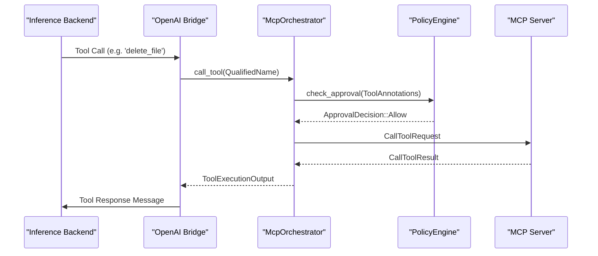

<!-- source: DeepWiki mcp.deepwiki.com · repo smg-project/smg · page 6 MCP (Model Context Protocol) Integration · fetched 2026-10-21 -->

# MCP (Model Context Protocol) Integration

<details>
<summary>Relevant source files</summary>

The following files were used as context for generating this wiki page:

- [crates/mcp/src/annotations.rs](crates/mcp/src/annotations.rs)
- [crates/mcp/src/core/config.rs](crates/mcp/src/core/config.rs)
- [crates/mcp/src/core/handler.rs](crates/mcp/src/core/handler.rs)
- [crates/mcp/src/core/mod.rs](crates/mcp/src/core/mod.rs)
- [crates/mcp/src/core/orchestrator.rs](crates/mcp/src/core/orchestrator.rs)
- [crates/mcp/src/core/pool.rs](crates/mcp/src/core/pool.rs)
- [crates/mcp/src/core/proxy.rs](crates/mcp/src/core/proxy.rs)
- [crates/mcp/src/inventory/index.rs](crates/mcp/src/inventory/index.rs)
- [crates/mcp/src/inventory/types.rs](crates/mcp/src/inventory/types.rs)
- [crates/mcp/src/lib.rs](crates/mcp/src/lib.rs)
- [docs/reference/mcp-internal-servers.md](docs/reference/mcp-internal-servers.md)
- [model_gateway/src/routers/common/openai_bridge/format_registry.rs](model_gateway/src/routers/common/openai_bridge/format_registry.rs)
- [model_gateway/src/routers/common/openai_bridge/tool_descriptors.rs](model_gateway/src/routers/common/openai_bridge/tool_descriptors.rs)

</details>


The Model Context Protocol (MCP) integration in SMG enables agentic workflows by connecting LLMs to external tool servers. This subsystem manages server connections, tool discovery (inventory), and the execution loop required for multi-turn tool interactions. SMG acts as an MCP client, orchestrating communication between the gateway, the inference backends, and various MCP tool servers.

## High-Level Architecture

The integration is centered around the `McpOrchestrator`, which manages a fleet of `McpToolSession` instances. Each session provides a filtered, namespaced view of available tools for a specific request context.

### Bridging Natural Language to Code Entities

The following diagram illustrates how high-level MCP concepts map to internal code structures during a tool execution request.

**MCP Entity Mapping**
```mermaid
graph TD
    subgraph "Natural Language Space (LLM/User)"
        A["'web_search' (Exposed Name)"]
        B["'brave' (Server Label)"]
    end

    subgraph "Code Entity Space (smg-mcp crate)"
        A --> C["QualifiedToolName ('brave:brave_web_search')"]
        B --> D["McpServerConfig (name: 'brave')"]
        C --> E["ToolEntry"]
        D --> F["McpConnectionPool / PoolKey"]
        E --> G["rmcp::model::Tool"]
    end

    [crates/mcp/src/inventory/types.rs:32-35]()
    [crates/mcp/src/core/config.rs:172-175]()
    [crates/mcp/src/inventory/types.rs:135-145]()
    [crates/mcp/src/core/pool.rs:26-30]()
```
*Sources: [crates/mcp/src/inventory/types.rs:32-35](), [crates/mcp/src/core/config.rs:172-175](), [crates/mcp/src/inventory/types.rs:135-145](), [crates/mcp/src/core/pool.rs:26-30]()*

## Core Components

### McpOrchestrator
The `McpOrchestrator` is the primary entry point for all MCP operations. It coordinates server connections (both static and dynamic), maintains the `ToolInventory`, and interfaces with the `ApprovalManager` for policy-based execution.
*   **Inventory Management**: Uses `ToolInventory` to handle tool registration, aliasing (e.g., mapping `web_search` to a specific provider), and collision resolution [crates/mcp/src/inventory/index.rs:32-40]().
*   **Connection Pooling**: Manages an LRU cache of connections via `McpConnectionPool` to optimize performance for dynamic tool servers [crates/mcp/src/core/pool.rs:107-114]().
*   **For details, see [MCP Orchestrator and Tool Sessions](#6.1)**.

### Tool Execution Loop
SMG supports an agentic tool loop for both OpenAI and Anthropic protocol families. When a model generates a tool call, the gateway intercepts it, executes the tool via the MCP transport, and feeds the results back to the model.
*   **Response Transformation**: The `openai_bridge` transforms raw MCP outputs into protocol-specific formats using the `FormatRegistry` [model_gateway/src/routers/common/openai_bridge/format_registry.rs:48-50]().
*   **Streaming Support**: Handles tool events in real-time for streaming API responses.
*   **For details, see [MCP Tool Loop (OpenAI and Anthropic)](#6.2)**.

## Tool Discovery and Inventory

Tools are indexed by a `QualifiedToolName`, which consists of a `server_key` and a `tool_name` [crates/mcp/src/inventory/types.rs:32-35](). This allows SMG to handle multiple servers providing tools with the same name without ambiguity.

| Concept | Description | Code Reference |
| :--- | :--- | :--- |
| **ToolEntry** | Contains tool schema, metadata, and lifecycle info (TTL). | [crates/mcp/src/inventory/types.rs:135-145]() |
| **Alias** | Maps a simple name (e.g., `web_search`) to a qualified target. | [crates/mcp/src/inventory/index.rs:152-154]() |
| **Builtin Tools** | Tools like `code_interpreter` that are routed to internal MCP servers. | [crates/mcp/src/core/config.rs:207-213]() |

## Security and Approvals

SMG implements a multi-layer approval system for tool execution. Decisions are based on `ToolAnnotations` (e.g., `destructive`, `read_only`) and configured policies [crates/mcp/src/annotations.rs:12-17]().

**Tool Execution Flow**

*Sources: [crates/mcp/src/core/orchestrator.rs:20-26](), [crates/mcp/src/annotations.rs:57-60](), [crates/mcp/src/core/orchestrator.rs:175-196]()*

## Configuration

MCP is configured via the `McpConfig` struct, which defines static servers, proxy settings, and global policies [crates/mcp/src/core/config.rs:11-36]().

```yaml
# Example MCP Configuration
servers:
  - name: "brave"
    protocol: "streamable"
    url: "https://mcp.brave.com/search"
    builtin_type: "web_search_preview"
    builtin_tool_name: "brave_web_search"
    tools:
      brave_web_search:
        alias: "web_search"
        response_format: "web_search_call"
```
*Sources: [crates/mcp/src/core/config.rs:172-213](), [model_gateway/src/routers/common/openai_bridge/format_registry.rs:90-131]()*

## Child Pages
*   [MCP Orchestrator and Tool Sessions](#6.1) — Details on `McpOrchestrator` logic, tool inventory lookup, and session lifecycle.
*   [MCP Tool Loop (OpenAI and Anthropic)](#6.2) — Documentation on the agentic tool execution loop and protocol-specific dispatch.

---

